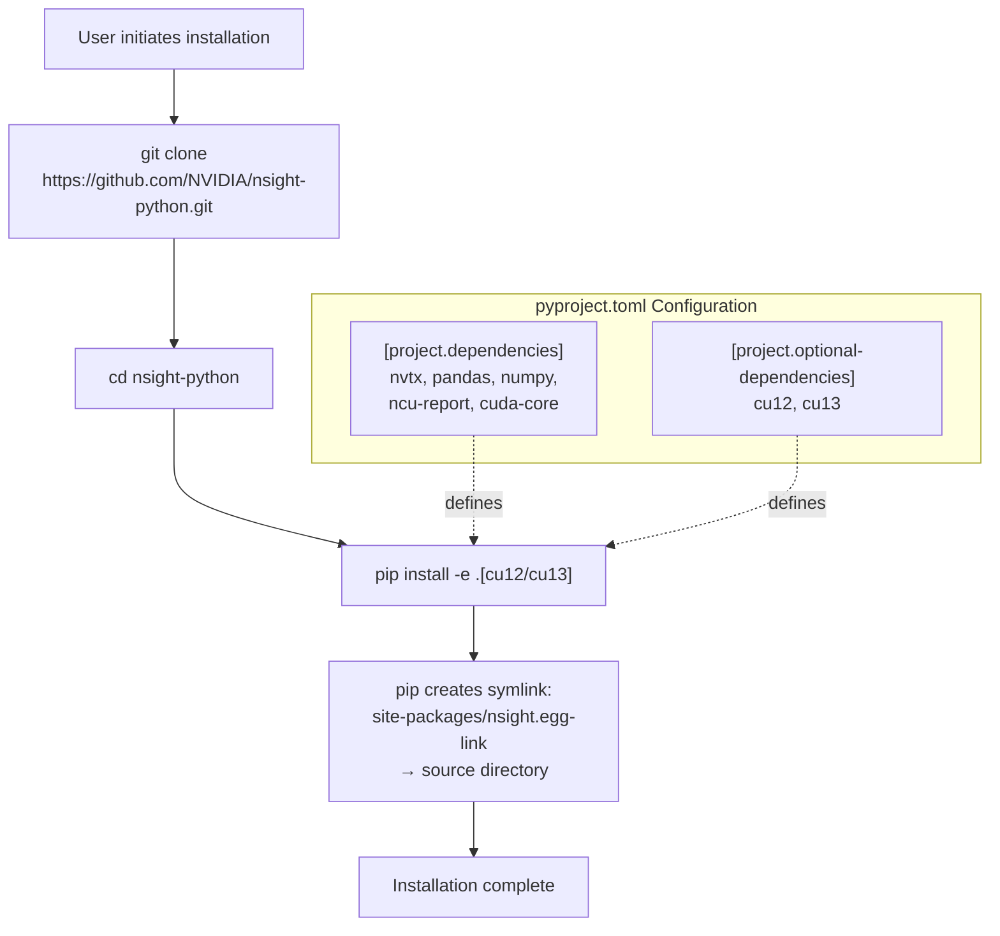
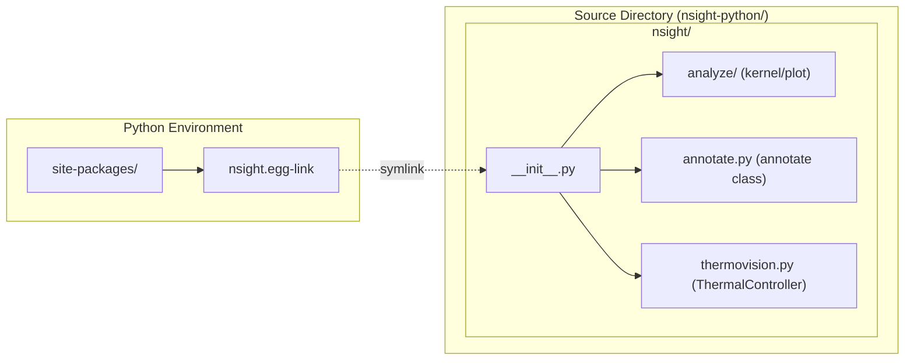

<!-- source: DeepWiki mcp.deepwiki.com · repo NVIDIA/nsight-python · page 2.2 Installing from Source · fetched 2026-10-26 -->

# Installing from Source

<details>
<summary>Relevant source files</summary>

The following files were used as context for generating this wiki page:

- [docs/source/installation/installation_from_source.rst](docs/source/installation/installation_from_source.rst)
- [nsight/thermovision.py](nsight/thermovision.py)
- [pyproject.toml](pyproject.toml)

</details>


This document describes how to install `nsight-python` from source code by cloning the GitHub repository. This installation method is primarily intended for developers who want to modify the package, contribute changes, or test unreleased features. For standard usage, see [Installing from PyPI](2.1).

## Purpose and Scope

Installing from source enables:
- **Development workflow**: Make code changes and test them immediately without reinstalling.
- **Contribution preparation**: Set up the codebase for submitting pull requests.
- **Pre-release access**: Use features not yet available on PyPI.
- **Dependency control**: Manage required components like `cuda-core` and `cuda-bindings` manually if needed.

For information about runtime dependencies and system requirements, see [Dependencies and Requirements](2.3).

---

## Prerequisites

Before installing from source, ensure you have:

| Requirement | Description |
|-------------|-------------|
| **Git** | Version control system for cloning the repository. |
| **Python** | Python 3.10 or higher [pyproject.toml:13-13](). |
| **pip** | Python package installer (usually bundled with Python). |
| **Hatch** | (Optional) Recommended build tool for managing environments [pyproject.toml:4-6](). |

**Sources**: [pyproject.toml:13-13](), [docs/source/installation/installation_from_source.rst:1-12]()

---

## Installation Steps

### Step 1: Clone the Repository

Clone the `nsight-python` repository from GitHub:

```bash
git clone https://github.com/NVIDIA/nsight-python.git
cd nsight-python
```

This creates a local copy of the entire source tree, including:
- Package source code (`nsight/` directory).
- Tests (`tests/` directory).
- Examples (`examples/` directory).
- Documentation source (`docs/` directory).
- Build configuration (`pyproject.toml`).

### Step 2: Install in Editable Mode

Install the package using pip's editable mode. As of v1.0.0, `cuda-core` is a mandatory dependency [pyproject.toml:25-25](). You should specify your CUDA version using extras to ensure the correct `cuda-core` variant is pulled:

```bash
# For CUDA 12.x
pip install -e ".[cu12]"

# For CUDA 13.x
pip install -e ".[cu13]"
```

The `-e` flag (editable mode) creates a symbolic link between your Python environment and the source directory, allowing code changes to take effect immediately without reinstallation.

**Sources**: [pyproject.toml:25-27](), [pyproject.toml:40-42](), [docs/source/installation/installation_from_source.rst:7-11]()

---

## Installation Workflow Diagram

The following diagram illustrates how the `pip install -e .` command interacts with the project configuration to set up the development environment.

**Source to Code Entity Mapping: Installation Process**



**Sources**: [pyproject.toml:18-27](), [pyproject.toml:40-42](), [docs/source/installation/installation_from_source.rst:7-11]()

---

## Understanding Editable Installation

Editable installation (also called "development mode") differs from standard installation:

| Installation Type | Behavior | Use Case |
|-------------------|----------|----------|
| **Standard** (`pip install .`) | Copies package files to `site-packages` | Production use |
| **Editable** (`pip install -e .`) | Creates symlink to source directory | Development |

### Code Structure Mapping

When you modify files in the source directory, changes are immediately reflected when you `import nsight` because Python follows the symlink to the source code.

**Source to Code Entity Mapping: Package Entry Points**



**Sources**: [pyproject.toml:48-49](), [nsight/thermovision.py:44-51]()

---

## Managing Dependencies

### Automatic Dependency Installation

By default, `pip install -e .` installs all runtime dependencies specified in `pyproject.toml` [pyproject.toml:18-27]():
- `nvtx`: For code instrumentation.
- `pandas`: For result processing and DataFrames.
- `numpy`: For numerical operations.
- `matplotlib`: For visualization.
- `ncu-report`: For parsing Nsight Compute results.
- `cuda-core` & `cuda-bindings`: For low-level CUDA and NVML interaction.

### Using Hatch for Development

The project uses `hatch` as its build backend [pyproject.toml:4-6](). For development tasks, you can use the predefined environments:

```bash
# Run linting
hatch run lint:check

# Run tests in a specific CUDA environment
hatch run test_cu12:run
```

**Sources**: [pyproject.toml:91-120]()

---

## Verification

After installation, verify the package is correctly installed:

```bash
python -c "import nsight; print(nsight.__version__)"
```

### Testing the Installation

To further verify functionality, run the test suite using `pytest`. The tests cover core components like the profiler, data transformation, and thermal control:

```bash
# Run tests (requires NVIDIA Nsight Compute in PATH)
pytest tests -v
```

Tests include [tests/test_profiler.py](), [tests/test_thermovision.py](), and [tests/test_api_params.py]().

**Sources**: [pyproject.toml:103-112](), [nsight/thermovision.py:1-17]()

---

## Post-Installation File Structure

After cloning and installing, your directory structure will be:

```
nsight-python/
├── nsight/                    # Package source (linked to site-packages)
│   ├── __init__.py           # Package entry point
│   ├── analyze/              # kernel and plot decorators
│   ├── annotate.py           # annotate context manager
│   ├── collection/           # NCUCollector and NsightProfiler
│   ├── visualization/        # Plotting subsystem
│   └── thermovision.py       # ThermalController (NVML/GPU monitoring)
├── tests/                     # Test suite (test_profiler.py, etc.)
├── examples/                  # Usage examples (00_minimal.py, etc.)
├── docs/                      # Documentation source (Sphinx/Furo)
├── pyproject.toml            # Build configuration and dependencies
└── LICENSE                   # Apache 2.0 License
```

**Sources**: [pyproject.toml:48-49](), [nsight/thermovision.py:11-17]()

---

## Next Steps

After installing from source:

1. **Verify dependencies**: Ensure `cuda-core` and `cuda-bindings` are correctly installed for your environment [pyproject.toml:25-27]().
2. **Explore examples**: Review usage patterns in the `examples/` directory.
3. **Run tests**: Validate your installation by running `pytest tests`.
4. **Read contributing guidelines**: See [Contributing Guidelines](10.3) for coding standards (Black/Isort) and DCO requirements.

**Sources**: [pyproject.toml:51-56](), [pyproject.toml:84-101]()

---

