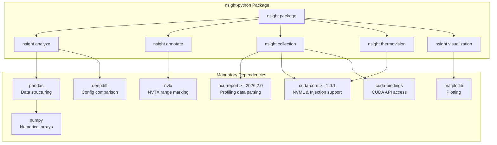
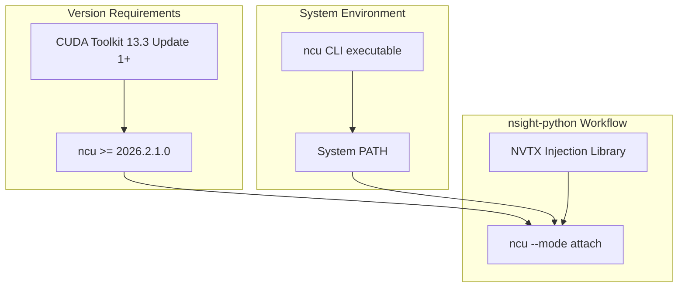

<!-- source: DeepWiki mcp.deepwiki.com · repo NVIDIA/nsight-python · page 2.3 Dependencies and Requirements · fetched 2026-10-26 -->

# Dependencies and Requirements

<details>
<summary>Relevant source files</summary>

The following files were used as context for generating this wiki page:

- [README.md](README.md)
- [docs/source/index.rst](docs/source/index.rst)
- [docs/source/installation/runtime_requirements.rst](docs/source/installation/runtime_requirements.rst)
- [nsight/thermovision.py](nsight/thermovision.py)
- [pyproject.toml](pyproject.toml)

</details>


This page documents all dependencies and system requirements needed to use nsight-python. It covers Python version requirements, core runtime dependencies, mandatory CUDA integration packages, external tool requirements, and development dependencies for testing and contributing.

As of version 1.0.0, nsight-python has transitioned to an **injection-based attach mode**, which introduces new mandatory dependencies like `cuda-core` and requires specific versions of NVIDIA Nsight Compute to support the `--mode attach` workflow.

---

## Python Version Requirements

nsight-python requires **Python 3.10 or later**. The package is tested and supported on the following Python versions:

| Python Version | Support Status |
|----------------|----------------|
| 3.10           | ✓ Supported    |
| 3.11           | ✓ Supported    |
| 3.12           | ✓ Supported    |
| 3.13           | ✓ Supported    |

The Python version requirement is specified in [pyproject.toml:13]() with `requires-python = ">=3.10"`.

**Sources:** [pyproject.toml:13](), [pyproject.toml:33-37]()

---

## Core Runtime Dependencies

nsight-python has several core runtime dependencies that are automatically installed. Note that in v1.0.0, `cuda-core` and `cuda-bindings` are now **required** dependencies, not optional extras.

### Dependency Overview



### Individual Dependencies

#### cuda-core (Required)
- **Purpose**: Provides NVIDIA Management Library (NVML) access and the NVTX injection library required for the "attach" profiling mode.
- **Used by**: `nsight.thermovision` ([nsight/thermovision.py:21-25]()) and `nsight.collection.ncu`.
- **Functionality**: Replaces the previous `nvidia-ml-py` dependency. It is used for GPU temperature monitoring and to load the injection library that allows `ncu` to attach to a running Python process without a script relaunch.

#### cuda-bindings (Required)
- **Purpose**: Provides Pythonic bindings to the CUDA Driver and Runtime APIs.
- **Used by**: `nsight.collection` and `nsight.annotate`.
- **Functionality**: Essential for managing CUDA contexts and handling error suppression when using the `ignore_failures` parameter.

#### ncu-report
- **Purpose**: Parses NVIDIA Nsight Compute profiling reports (`.ncu-rep` files).
- **Used by**: `nsight.collection` and data extraction logic.
- **Requirement**: Must be version **2026.2.0** or later to support the latest report formats.

#### nvtx
- **Purpose**: Creates NVTX (NVIDIA Tools Extension) profiling ranges.
- **Used by**: `nsight.annotate` class.
- **Functionality**: Marks code regions that `ncu` should profile. nsight-python updates `NVTX_INJECTION64_PATH` at import time to enable its custom injection logic.

#### pandas, numpy, & matplotlib
- **Purpose**: Data processing and visualization.
- **Functionality**: `pandas` structures results into DataFrames (including the new `Unit` column); `matplotlib` generates the plots for the `@plot` decorator.

**Sources:** [pyproject.toml:18-27](), [nsight/thermovision.py:21-26](), [docs/source/installation/runtime_requirements.rst:18-19]()

---

## Optional Dependency Extras

While `cuda-core` is required, you can specify the CUDA major version via extras to ensure the correct variant is installed for your environment.

| Extra | Package Variant | Use Case |
|-------|-----------------|----------|
| `cu12` | `cuda-core[cu12]` | Systems running CUDA 12.x |
| `cu13` | `cuda-core[cu13]` | Systems running CUDA 13.x |

Install with an extra:
```bash
pip install nsight-python[cu12]
```

**Sources:** [pyproject.toml:40-42]()

---

## External System Requirements

The most critical requirement for nsight-python v1.0.0+ is a modern version of the Nsight Compute CLI.

### NVIDIA Nsight Compute



#### Requirements
- **Nsight Compute Version**: **2026.2.1.0** or later. This is typically bundled with **CUDA Toolkit 13.3 Update 1**.
- **Path**: The `ncu` executable must be in your system `PATH`.
- **Capability**: Must support `--mode attach`. This allows nsight-python to profile a running process (including Jupyter/Colab notebooks) without needing to relaunch the entire script.

#### Import Ordering Requirement
Due to the way Nsight Compute attaches via injection, `import nsight` **must** occur before:
1. **CUDA Initialization**: Any call like `torch.cuda.init()` or creating CUDA tensors.
2. **NVTX API calls**: Any other library using NVTX.

Failure to import `nsight` first will result in `NV_INJ_ERROR_NOT_INITIALIZED` or missing profiling ranges.

**Sources:** [docs/source/installation/runtime_requirements.rst:7-19]()

---

## Development and Testing Dependencies

### Testing Environment
Tests require `pytest` and a functional GPU environment with PyTorch.

```bash
pip install pytest pytest-cov
# Install PyTorch matching your CUDA version
pip install torch --index-url https://download.pytorch.org/whl/cu130 
```

### Hatch Environments
The project uses `hatch` to manage development tasks:

- **lint**: Includes `black`, `isort`, and `mypy` for code quality.
- **test_cu12 / test_cu13**: Specific environments to test against different CUDA core versions.
- **docs**: Uses `sphinx`, `furo`, and `nvidia-sphinx-theme` to build the documentation.

**Sources:** [pyproject.toml:69-120](), [README.md:28-54]()

---

## Dependency Installation Summary

| Component | Requirement |
|-----------|-------------|
| **Python** | 3.10, 3.11, 3.12, or 3.13 |
| **Nsight Compute** | >= 2026.2.1.0 (CUDA 13.3U1+) |
| **cuda-core** | >= 1.0.1 (Required) |
| **ncu-report** | >= 2026.2.0 |
| **GPU Framework** | PyTorch (recommended for most use cases) |

**Sources:** [pyproject.toml:13-27](), [docs/source/installation/runtime_requirements.rst:7-8]()

---

