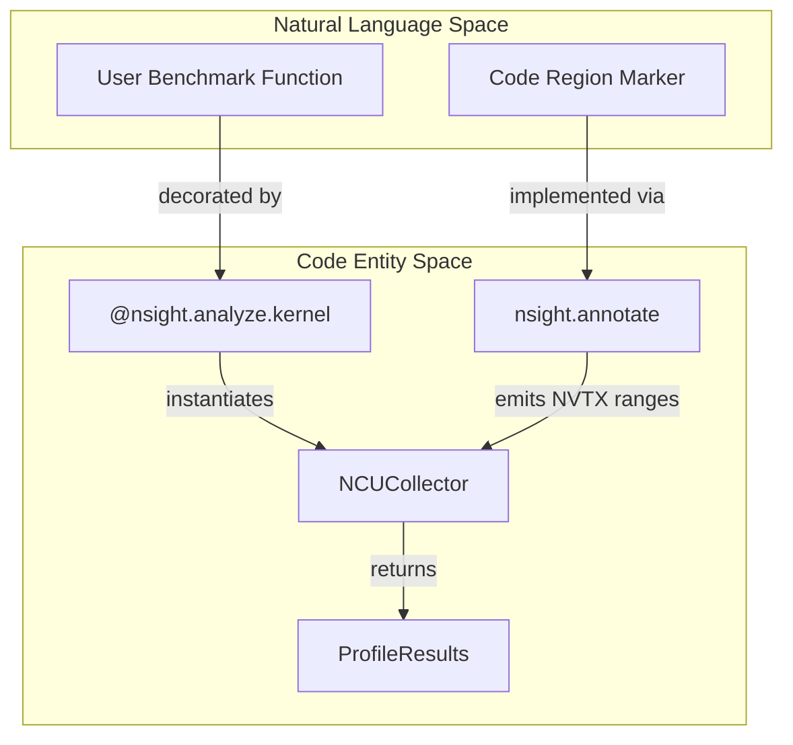
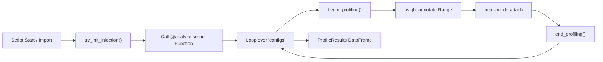

<!-- source: DeepWiki mcp.deepwiki.com · repo NVIDIA/nsight-python · page 3 Getting Started · fetched 2026-10-26 -->

# Getting Started

<details>
<summary>Relevant source files</summary>

The following files were used as context for generating this wiki page:

- [docs/source/analyze.rst](docs/source/analyze.rst)
- [docs/source/annotation.rst](docs/source/annotation.rst)
- [docs/source/overview/core_concepts.rst](docs/source/overview/core_concepts.rst)
- [docs/source/overview/quickstart.rst](docs/source/overview/quickstart.rst)

</details>


This page provides an introduction to using Nsight Python for GPU kernel profiling. It covers the minimal setup required to profile your first kernel and introduces the core concepts you'll need to understand. **Note: As of v1.0.0, Nsight Python uses an injection-based approach that attaches to the running process, eliminating the need for script relaunches and supporting Jupyter/Colab environments.**

## Purpose and Scope

This Getting Started guide is designed to help new users quickly begin profiling GPU kernels with Nsight Python. You will learn:

- How to apply the `@nsight.analyze.kernel` decorator to profile functions.
- How to mark specific code regions using `nsight.annotate` context managers.
- The fundamental primitives: Annotations, Configurations, and Plots.
- The basic execution flow from decoration to results collection using the new injection mode.

By the end of this guide, you should be able to profile a simple GPU kernel and understand the fundamental workflow.

**Sources**: [docs/source/overview/quickstart.rst:1-37](), [docs/source/overview/core_concepts.rst:1-12]()

---

## Minimal Example

The simplest way to profile a GPU kernel is to add two elements to your code: the `@nsight.analyze.kernel` decorator on your benchmark function and a `nsight.annotate()` context manager around the kernel you want to profile. Both are required for successful collection [docs/source/overview/core_concepts.rst:7-12]().

```python
import torch
import nsight

@nsight.analyze.kernel
def benchmark_matmul(n):
    """
    The simplest possible benchmark.
    We create two matrices and multiply them.
    """
    # Create two NxN matrices on GPU
    a = torch.randn(n, n, device="cuda")
    b = torch.randn(n, n, device="cuda")

    # Mark the kernel we want to profile
    with nsight.annotate("matmul"):
        c = a @ b

if __name__ == "__main__":
    # Run the benchmark
    result = benchmark_matmul(1024)
    print(result.to_dataframe())
```

When you run this script, Nsight Python will:
1. Initialize the injection library to allow `ncu --mode attach` to hook into the process.
2. Execute the function; when it reaches the `nsight.annotate` block, it signals the profiler.
3. Collect GPU performance metrics for the annotated region.
4. Return a `ProfileResults` object which can be converted to a pandas DataFrame.

**Sources**: [docs/source/overview/quickstart.rst:1-37](), [docs/source/overview/core_concepts.rst:7-12]()

---

## Key Components and Their Roles

The following diagram shows the primary code entities and how they bridge natural language concepts to the codebase:

**Component Interaction Diagram**



| Component | Code Entity | Purpose |
|-----------|--------|---------|
| **Kernel Analysis** | `@nsight.analyze.kernel` | Decorator that controls the profiling session and manages iterations [docs/source/overview/core_concepts.rst:47-52](). |
| **Annotation** | `nsight.annotate` | Context manager/decorator that tags GPU kernels for the profiler [docs/source/overview/core_concepts.rst:26-28](). |
| **Collector** | `NCUCollector` | Internal class that manages the `ncu` attach process and data collection. |
| **Results** | `ProfileResults` | Object containing metrics, convertible to a pandas DataFrame [docs/source/analyze.rst:11-12](). |

**Sources**: [docs/source/overview/core_concepts.rst:1-92](), [docs/source/analyze.rst:1-19](), [docs/source/annotation.rst:1-13]()

---

## Profiling Workflow

Nsight Python v1.0.0 uses an injection-based approach. The workflow is streamlined to support interactive environments like Jupyter.

**Profiling Execution Flow**



### Execution Steps

1. **Injection Initialization**: At import or session start, the system attempts to load the NVTX injection library.
2. **Configuration Iteration**: The decorator loops through provided `configs`. Config values map to function parameters in declaration order [docs/source/overview/core_concepts.rst:61-62]().
3. **Attach Signal**: `begin_profiling()` is called to allow the Nsight Compute profiler to attach to the current process.
4. **NVTX Annotation**: The `nsight.annotate()` block executes, emitting a named NVTX range that `ncu` filters for.
5. **Metric Collection**: Metrics are collected only for kernels within that specific range.
6. **Results Transformation**: Data is parsed and returned as a `ProfileResults` object, which includes a `Unit` column for metric clarity.

**Sources**: [docs/source/overview/core_concepts.rst:47-82](), [docs/source/analyze.rst:7-12]()

---

## Core Concepts at a Glance

For a deeper dive into these topics, see [Core Concepts](#3.2).

| Concept | Description | Code Implementation |
|---------|-------------|-------------|
| **Annotation** | A named marker for a code region. Can wrap single or multiple kernels [docs/source/overview/core_concepts.rst:26-45](). | `nsight.annotate("name")` |
| **Configuration** | A tuple of parameters. Supports positional, keyword-only, and default values [docs/source/overview/core_concepts.rst:61-71](). | `configs=[(1024, "fast")]` |
| **Metric** | Hardware counters or derived values (e.g., TFLOPs). | `metric` arg in `@analyze.kernel` |
| **Plotting** | Automated visualization of collected results [docs/source/overview/core_concepts.rst:83-92](). | `@nsight.analyze.plot` |
| **Attach Mode** | The v1.0.0 mechanism where `ncu` attaches to a running process via injection. | Internal `ncu --mode attach` |

---

## What's Next

- **Quick Start Tutorial**: [Quick Start Tutorial](#3.1) of a profiling session.
- **Core Concepts**: Detailed explanation of [Core Concepts](#3.2).
- **Basic Profiling Workflow**: Deep dive into the [Basic Profiling Workflow](#3.3).
- **User Guide**: Comprehensive documentation on [User Guide](#4).

**Sources**: [docs/source/overview/core_concepts.rst:1-92](), [docs/source/overview/quickstart.rst:1-37]()

---

