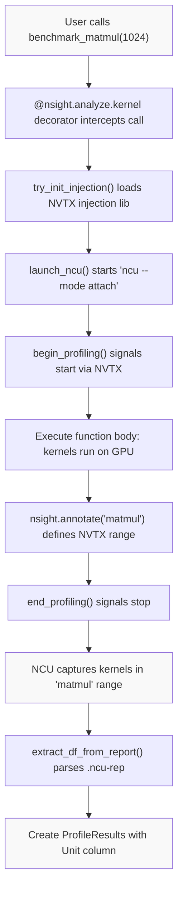
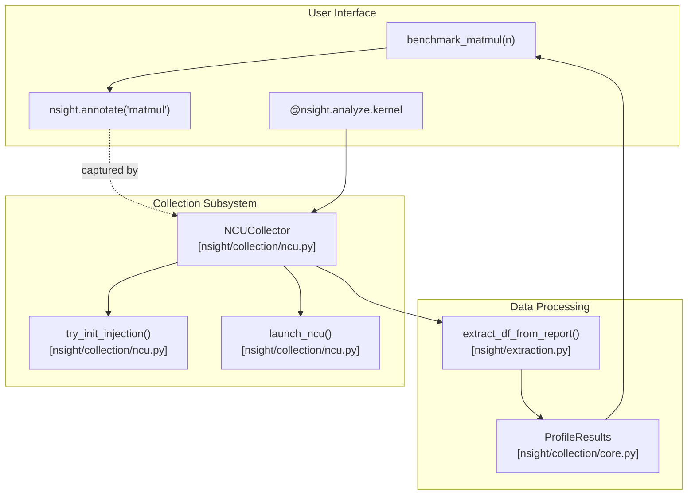

<!-- source: DeepWiki mcp.deepwiki.com · repo NVIDIA/nsight-python · page 3.1 Quick Start Tutorial · fetched 2026-10-26 -->

# Quick Start Tutorial

<details>
<summary>Relevant source files</summary>

The following files were used as context for generating this wiki page:

- [docs/source/analyze.rst](docs/source/analyze.rst)
- [docs/source/annotation.rst](docs/source/annotation.rst)
- [docs/source/overview/quickstart.rst](docs/source/overview/quickstart.rst)
- [examples/00_minimal.py](examples/00_minimal.py)
- [examples/07_triton_minimal.py](examples/07_triton_minimal.py)

</details>


This tutorial walks through a minimal working example to help you start profiling GPU kernels with `nsight-python`. As of **v1.0.0**, the profiling mechanism has shifted to an **injection-based attach mode**. This means the profiler attaches to the currently running process without requiring a script relaunch, enabling seamless profiling in environments like Jupyter Notebooks and Google Colab.

You will learn how to apply the `@nsight.analyze.kernel` decorator, mark code regions with `nsight.annotate()`, and interpret the profiling results.

**Sources:** [docs/source/overview/quickstart.rst:1-37](), [examples/00_minimal.py:1-47]()

---

## Prerequisites

Before starting this tutorial, ensure you have:

- **NVIDIA GPU** with CUDA support.
- **NVIDIA Nsight Compute** installed (>= 2026.2.1.0 / CUDA Toolkit 13.3 Update 1) and `ncu` available in your `PATH`.
- **nsight-python** installed via pip: `pip install nsight-python`. Note that `cuda-core` is now a required dependency.
- **PyTorch**, **Triton**, or another GPU framework installed.

**Sources:** [docs/source/overview/quickstart.rst:1-10]()

---

## Minimal Working Example

Here is the complete minimal example that demonstrates the core profiling workflow. This script can be run directly or within an interactive cell.

```python
import torch
import nsight

@nsight.analyze.kernel
def benchmark_matmul(n: int) -> torch.Tensor:
    """Profile a simple matrix multiplication."""
    # Create two NxN matrices on GPU
    a = torch.randn(n, n, device="cuda")
    b = torch.randn(n, n, device="cuda")
    
    # Mark the kernel we want to profile
    with nsight.annotate("matmul"):
        c = a @ b
    
    return c

if __name__ == "__main__":
    # Run the benchmark
    result = benchmark_matmul(1024)
    # Display key columns including the new Unit column (v1.0.0)
    print(result.to_dataframe()[["Annotation", "n", "Metric", "Unit", "AvgValue", "NumRuns"]])
```

**Sources:** [examples/00_minimal.py:1-47](), [docs/source/overview/quickstart.rst:9-34]()

---

## Step-by-Step Breakdown

### Step 1: Import and Initialization
When you `import nsight`, the library attempts to initialize the injection environment via `try_init_injection()`. This prepares the process so that Nsight Compute can attach to it later.

**Sources:** [nsight/collection/ncu.py:22-45]()

### Step 2: Apply the Decorator
The `@nsight.analyze.kernel` decorator transforms your function into a profiling harness. In v1.0.0, the `output` parameter was replaced by `verbosity` (using `VerbosityLevel`).

```python
@nsight.analyze.kernel
def benchmark_matmul(n: int) -> torch.Tensor:
```

**Sources:** [nsight/analyze.py:48-241]()

### Step 3: Mark Code Regions
The `nsight.annotate("matmul")` context manager marks a specific code region. It creates an NVTX range named `"matmul"`. Only GPU kernels launched within this context are captured.

**Sources:** [examples/00_minimal.py:30-31](), [docs/source/overview/quickstart.rst:24-26]()

### Step 4: Execute and Attach
When you call the decorated function:
1. The profiler initiates `ncu --mode attach` in a background process.
2. The `begin_profiling()` call triggers the injection library to start capturing.
3. Your code executes; kernels inside the `annotate` block are profiled.
4. `end_profiling()` signals the end of collection.

**Sources:** [nsight/collection/ncu.py:200-260](), [nsight/analyze.py:79-85]()

---

## Execution Flow (v1.0.0 Injection Mode)



**Diagram:** Injection-based profiling flow (no script relaunch)

**Sources:** [nsight/collection/ncu.py:110-260](), [nsight/analyze.py:48-241]()

---

## Code Entity Mapping



**Diagram:** Association between code entities and the collection/extraction pipeline.

**Sources:** [nsight/collection/ncu.py:110-260](), [nsight/analyze.py:1-242](), [nsight/collection/core.py:1-100]()

---

## Understanding the v1.0.0 Output

The `ProfileResults.to_dataframe()` output now includes a dedicated **Unit** column to ensure clarity in measurement (e.g., distinguishing between `nsecond` and `cycle`).

| Column | Description | Example |
|--------|-------------|---------|
| `Annotation` | Label from `nsight.annotate()` | `"matmul"` |
| `Metric` | Hardware counter name | `"gpu__time_duration.sum"` |
| `Unit` | Measurement unit (v1.0.0+) | `"nsecond"` |
| `AvgValue` | Mean across `runs` | `12345.6` |
| `GPU` | Targeted GPU device | `"NVIDIA H100"` |

**Sources:** [examples/00_minimal.py:38-41](), [nsight/collection/core.py:80-120]()

---

## Default Configuration Values

| Parameter | Default Value | Purpose |
|-----------|---------------|---------|
| `runs` | `1` | Number of profiling iterations |
| `metric` | `"gpu__time_duration.sum"` | Default performance counter |
| `thermal_control` | `True` | Prevents thermal throttling |
| `thermal_device` | `0` | GPU index to monitor for thermals (v1.0.0) |
| `verbosity` | `VerbosityLevel.INFO` | Replaces `output` parameter (v1.0.0) |
| `replay_mode` | `"kernel"` | Replay strategy |

**Sources:** [nsight/analyze.py:34-64](), [nsight/utils.py:15-30]()

---

## Next Steps

1.  **Parameter Sweeps:** Pass a list of tuples to `configs` to profile multiple sizes. See [Profiling Configurations](#4.3).
2.  **Visualization:** Use `@nsight.analyze.plot` to generate comparison charts. See [Visualization and Plotting](#4.5).
3.  **Triton/cuTile:** Explore [Example 7: Triton Minimal](examples/07_triton_minimal.py) to see how to profile non-PyTorch kernels.

**Sources:** [examples/07_triton_minimal.py:1-146]()

---

