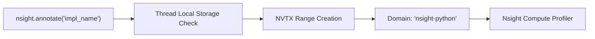
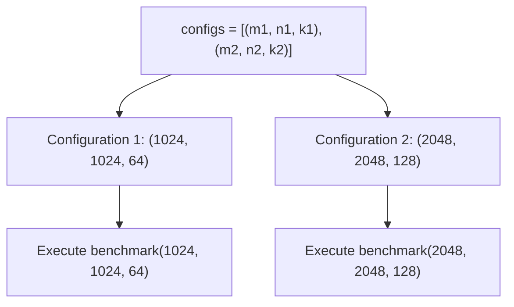
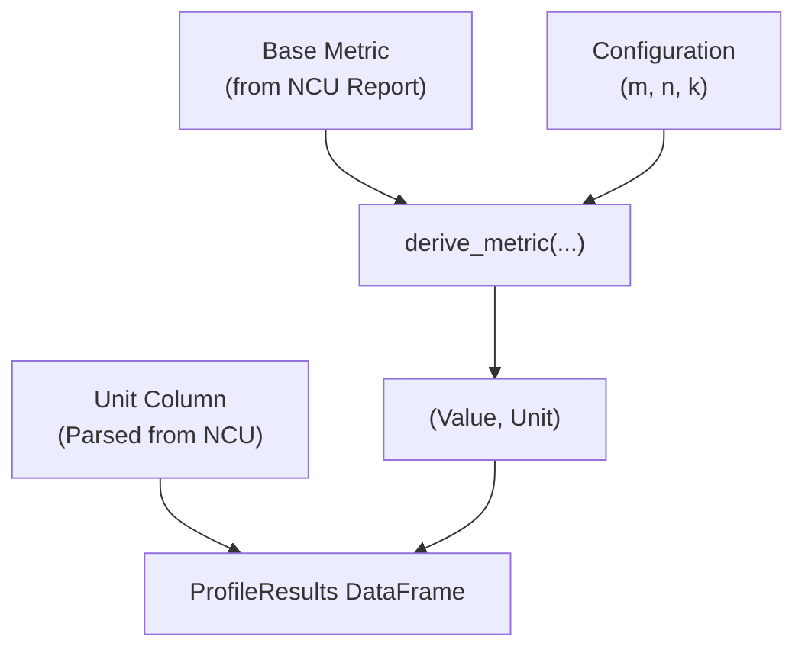
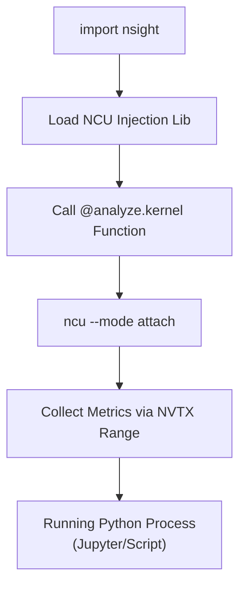

<!-- source: DeepWiki mcp.deepwiki.com · repo NVIDIA/nsight-python · page 3.2 Core Concepts · fetched 2026-10-26 -->

# Core Concepts

<details>
<summary>Relevant source files</summary>

The following files were used as context for generating this wiki page:

- [docs/source/overview/core_concepts.rst](docs/source/overview/core_concepts.rst)
- [docs/source/release_notes/topics/updates-in-nsight-python-1.0.0.rst](docs/source/release_notes/topics/updates-in-nsight-python-1.0.0.rst)
- [nsight/annotation.py](nsight/annotation.py)

</details>


This page introduces the fundamental concepts and primitives of nsight-python. Understanding these concepts is essential for effective GPU kernel profiling. For end-to-end workflow details, see [Basic Profiling Workflow](#3.3). For detailed API documentation, see [API Reference](#7).

---

## Annotations

**Annotations** are code markers that identify specific regions of code containing GPU kernel launches. They enable nsight-python to attribute profiling metrics to named implementations or configurations. The `nsight.annotate` class provides annotation functionality.

### Usage Modes

Annotations can be used in two ways:

**Context Manager:**
```python
with nsight.annotate("torch"):
    torch_implementation()
```

**Decorator:**
```python
@nsight.annotate("triton")
def triton_implementation():
    ...
```

[nsight/annotation.py:91-137]()

### NVTX Domain and Thread Locality

Internally, all annotations create NVTX (NVIDIA Tools Extension) ranges under the `"nsight-python"` domain [nsight/annotation.py:124-127](). This domain name ensures that nsight-python's annotations are grouped separately from other NVTX instrumentation in the application.

Annotations use thread-local storage to track state, preventing conflicts in multi-threaded scenarios [nsight/annotation.py:14-17]().



**Sources:** [nsight/annotation.py:14-17](), [nsight/annotation.py:124-127](), [docs/source/overview/core_concepts.rst:26-45]()

### Constraints and Failure Handling

- **Single Kernel Expectation**: By default, each annotation is expected to contain a single kernel launch [docs/source/overview/core_concepts.rst:27-28]().
- **No Nesting**: Nested annotations are not supported and will raise a `ValueError` [nsight/annotation.py:152-157]().
- **Unique Names**: Annotation names must be unique within a single profiling run [nsight/annotation.py:159-164]().
- **Ignore Failures**: If `ignore_failures=True`, exceptions within the annotation are caught, a dummy kernel is launched to maintain profiler state, and metrics are set to `NaN` [nsight/annotation.py:169-181]().

**Sources:** [nsight/annotation.py:108-137](), [docs/source/overview/core_concepts.rst:40-45]()

---

## Configurations

**Configurations** define parameter sets for benchmarking. The `configs` parameter accepts a list of tuples, where each tuple represents one configuration to profile.

### Configuration Structure



**Sources:** [docs/source/overview/core_concepts.rst:47-60]()

### Parameter Mapping (v1.0.0+)

Nsight Python automatically maps config tuples to function signatures:
- **Keyword-only parameters**: Supported (defined after `*` or `*args`) [docs/source/release_notes/topics/updates-in-nsight-python-1.0.0.rst:31-33]().
- **Default values**: Configs can omit trailing parameters that have defaults; these are padded automatically [docs/source/release_notes/topics/updates-in-nsight-python-1.0.0.rst:34-35]().
- **Variadic arguments**: `*args` and `**kwargs` are tolerated but ignored [docs/source/release_notes/topics/updates-in-nsight-python-1.0.0.rst:36-37]().

**Sources:** [docs/source/overview/core_concepts.rst:61-82](), [docs/source/release_notes/topics/updates-in-nsight-python-1.0.0.rst:28-38]()

---

## Metrics and the Unit Column

**Metrics** are the quantitative measurements collected during profiling.

### Default and Custom Metrics

The default metric is `gpu__time_duration.sum`. Users can specify any Nsight Compute metric via the `metric` parameter.

### Derived Metrics and Units (v1.0.0+)

Derived metrics are computed from base metrics and config parameters. As of v1.0.0, `derive_metric` functions should return a `(value, unit)` tuple to populate the new **Unit column** in the results DataFrame [docs/source/release_notes/topics/updates-in-nsight-python-1.0.0.rst:20-27]().

```python
def tflops(t, m, n, k):
    # Returns (value, unit)
    val = 2 * m * n * k / (t / 1e9) / 1e12
    return val, "TFLOP/s"
```

**Metric Flow Diagram:**



**Sources:** [docs/source/release_notes/topics/updates-in-nsight-python-1.0.0.rst:20-27]()

---

## Injection-Based Profiling Workflow (v1.0.0+)

Starting with version 1.0.0, nsight-python no longer relaunches the Python script for each configuration. Instead, it uses an **injection-based attach mode**.

### The Attach Mechanism

1. **Import Time**: The profiler dynamically loads Nsight Compute's CUDA injection library [docs/source/release_notes/topics/updates-in-nsight-python-1.0.0.rst:10-14]().
2. **Execution**: When the decorated function is called, the system launches `ncu --mode attach` [docs/source/release_notes/topics/updates-in-nsight-python-1.0.0.rst:14]().
3. **Profiling**: The profiler attaches to the currently running process, enabling support for interactive environments like Jupyter and Google Colab [docs/source/release_notes/topics/updates-in-nsight-python-1.0.0.rst:17-18]().



**Sources:** [docs/source/release_notes/topics/updates-in-nsight-python-1.0.0.rst:10-18]()

---

## Thermal Management and Device Selection

### Thermal Control

Nsight Python monitors GPU temperature via NVML to prevent thermal throttling. If the temperature exceeds a threshold, the profiler waits for a cooldown period before proceeding with the next run.

### Thermal Device Selection (v1.0.0+)

The `thermal_device` parameter allows pinning monitoring to a specific CUDA device ordinal [docs/source/release_notes/topics/updates-in-nsight-python-1.0.0.rst:49-51](). If unset, the system automatically maps the current CUDA context to its underlying NVML device UUID, respecting `CUDA_VISIBLE_DEVICES` [docs/source/release_notes/topics/updates-in-nsight-python-1.0.0.rst:51-55]().

**Sources:** [docs/source/release_notes/topics/updates-in-nsight-python-1.0.0.rst:46-55]()

---

## Verbosity Levels

The `output` parameter has been replaced by `verbosity` using the `VerbosityLevel` enum [docs/source/release_notes/topics/updates-in-nsight-python-1.0.0.rst:57-60]():

| Level | Description |
|-------|-------------|
| `VerbosityLevel.SILENT` | No console output. |
| `VerbosityLevel.INFO` | Default. Shows progress bars and report paths. |
| `VerbosityLevel.DEBUG` | Prints full NCU CLI commands and verbose NCU output. |

**Sources:** [docs/source/release_notes/topics/updates-in-nsight-python-1.0.0.rst:57-67]()

---

## Summary of Core Concepts

| Concept | Implementation Entity | Role |
|---------|-----------------------|------|
| **Annotation** | `nsight.annotate` | Marks code regions via NVTX ranges. |
| **Configuration** | `configs` parameter | Defines the parameter sweep space. |
| **Attach Mode** | `ncu --mode attach` | Profiles without script relaunch (v1.0.0+). |
| **Metrics** | `metric` / `derive_metric` | Quantifies performance; now includes Units. |
| **Thermovision** | `thermal_control` | Prevents throttling; supports device pinning. |
| **Verbosity** | `VerbosityLevel` | Controls CLI output feedback levels. |

**Sources:** [docs/source/overview/core_concepts.rst](), [nsight/annotation.py](), [docs/source/release_notes/topics/updates-in-nsight-python-1.0.0.rst]()

---

