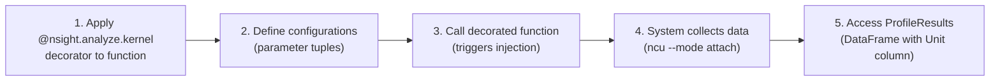
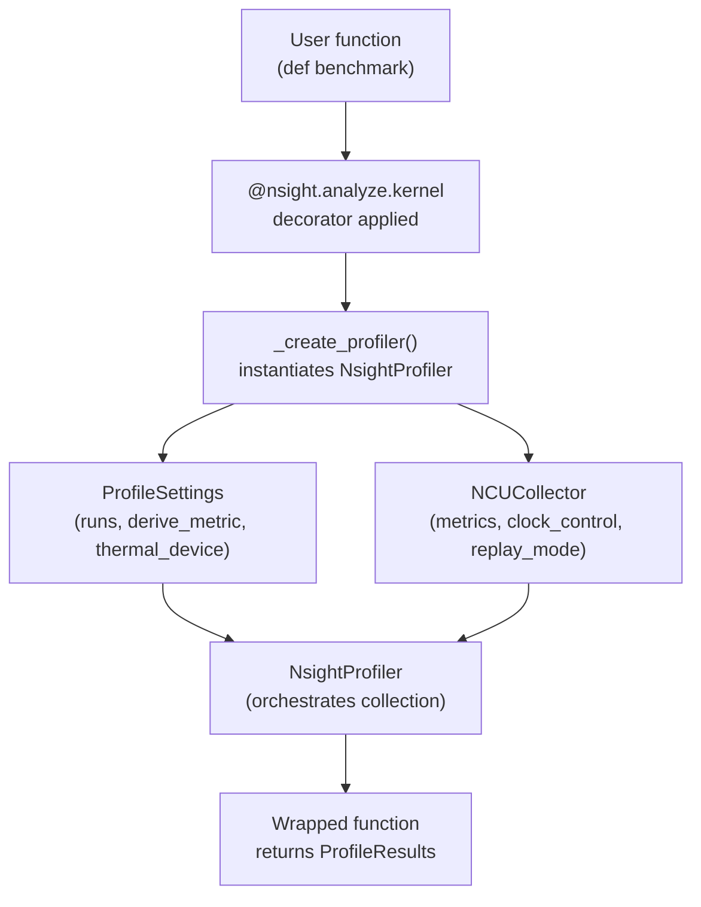
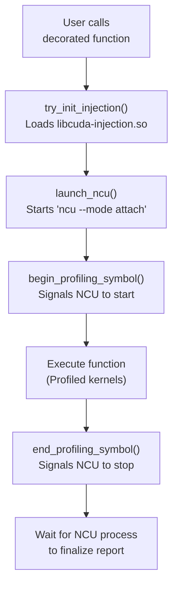
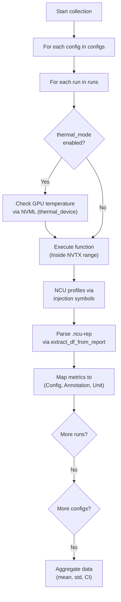

<!-- source: DeepWiki mcp.deepwiki.com · repo NVIDIA/nsight-python · page 3.3 Basic Profiling Workflow · fetched 2026-10-26 -->

# Basic Profiling Workflow

<details>
<summary>Relevant source files</summary>

The following files were used as context for generating this wiki page:

- [nsight/analyze.py](nsight/analyze.py)
- [nsight/collection/core.py](nsight/collection/core.py)
- [nsight/collection/ncu.py](nsight/collection/ncu.py)

</details>


## Purpose and Scope

This page describes the end-to-end workflow for profiling GPU kernels with `nsight-python`. As of version 1.0.0, the system uses an injection-based approach where the profiler attaches to the running process. This eliminates script relaunches and enables seamless profiling in interactive environments like Jupyter and Google Colab.

The workflow covers five main steps: decorator application, configuration definition, execution with injection-based attachment, data collection, and results access.

---

## Workflow Overview

The basic profiling workflow consists of five sequential steps:



**Sources**: [nsight/analyze.py:61-90](), [nsight/collection/ncu.py:178-210]()

---

## Step 1: Decorator Application

The `@nsight.analyze.kernel` decorator marks a function for profiling. The decorator creates a `NsightProfiler` instance [nsight/analyze.py:228-232]() which orchestrates the collection process.

### Decorator Implementation Flow



The decorator creates the profiling infrastructure by:
1. Creating `ProfileSettings` with user parameters (runs, derive_metric, thermal_device, verbosity) [nsight/analyze.py:212-227]().
2. Creating `NCUCollector` with instrumentation parameters (metrics, clock_control, cache_control, replay_mode) [nsight/analyze.py:228-235]().
3. Combining both into a `NsightProfiler` instance [nsight/analyze.py:236]().

**Sources**: [nsight/analyze.py:61-87](), [nsight/analyze.py:212-241]()

---

## Step 2: Configuration Definition

Configurations define the parameter combinations to profile. `nsight-python` v1.0.0 supports positional and keyword-only parameters, as well as automatic padding with default values [nsight/collection/core.py:49-71]().

### Configuration Specification Methods

| Method | Code Example | Description |
|--------|--------------|-------------|
| **Decorator-time** | `@nsight.analyze.kernel(configs=[(512, 64), (1024, 128)])` | Configs specified at decoration [nsight/analyze.py:118-125]() |
| **Call-time** | `benchmark(configs=[(512, 64)])` | Configs passed at call-time [nsight/analyze.py:101-105]() |
| **Automatic Padding** | `benchmark(configs=[(512,)])` | Missing values filled from function defaults [nsight/collection/core.py:49-71]() |

**Sources**: [nsight/collection/core.py:49-107](), [nsight/analyze.py:118-132]()

---

## Step 3: Execution and Injection

Unlike previous versions, v1.0.0 uses an injection-based approach. At import time, the library attempts to load the Nsight Compute injection library (`libcuda-injection.so`) via `try_init_injection()` [nsight/collection/ncu.py:127-175]().

### Injection Attachment Flow



When the decorated function is called, the `NCUCollector` launches `ncu` in attach mode [nsight/collection/ncu.py:178-210](). The library then uses `ctypes` to call `nvInjBeginProfiling` and `nvInjEndProfiling` within the current process to scope the profiling [nsight/collection/ncu.py:28-29](), [nsight/collection/ncu.py:155-156]().

**Sources**: [nsight/collection/ncu.py:127-175](), [nsight/collection/ncu.py:178-210](), [nsight/collection/ncu.py:236-258]()

---

## Step 4: Data Collection Loop

The collection phase executes the function for every configuration and run. 

### Collection Loop Structure



### New v1.0.0 Features in Collection
*   **Thermal Device**: The `thermal_device` parameter allows pinning temperature monitoring to a specific GPU index [nsight/analyze.py:83]().
*   **Unit Column**: The extraction process now captures the unit for every metric (e.g., `msec`, `Gbyte/second`), storing it in a dedicated `Unit` column [nsight/extraction.py:53-70]().

**Sources**: [nsight/collection/core.py:155-187](), [nsight/analyze.py:79-84](), [nsight/extraction.py:53-70]()

---

## Step 5: Results Access

The workflow concludes by returning a `ProfileResults` object. This object encapsulates a pandas DataFrame containing the processed data.

### DataFrame Structure (v1.0.0)

| Column | Description |
|--------|-------------|
| `Annotation` | Name from `nsight.annotate` [nsight/annotation.py:15-30]() |
| `Metric` | The NCU metric name (e.g., `gpu__time_duration.sum`) |
| `AvgValue` | Aggregated mean across runs |
| `Unit` | **New in v1.0.0**: The physical unit of the metric [nsight/extraction.py:65-70]() |
| `<param_name>` | Columns for each function parameter |

### Accessing Results

```python
@nsight.analyze.kernel(configs=[(512, 1024)], runs=5)
def my_kernel(m, n):
    with nsight.annotate("compute"):
        # GPU work here
        pass

results = my_kernel()
df = results.to_dataframe() # Returns pandas DataFrame
print(df[["Annotation", "AvgValue", "Unit"]])
```

**Sources**: [nsight/analyze.py:99-108](), [nsight/collection/core.py:236-241](), [nsight/extraction.py:53-70]()

---

