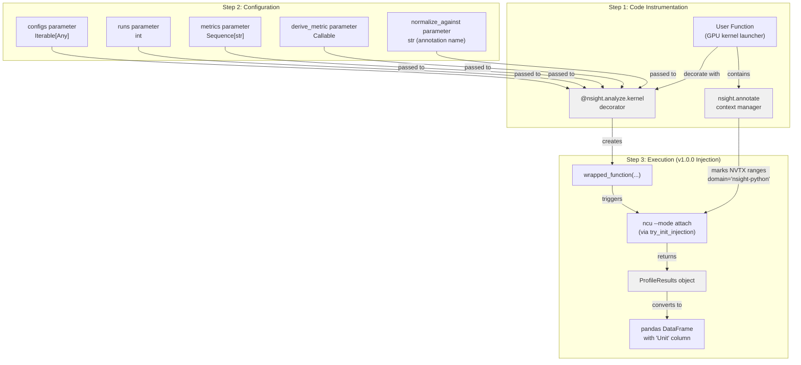
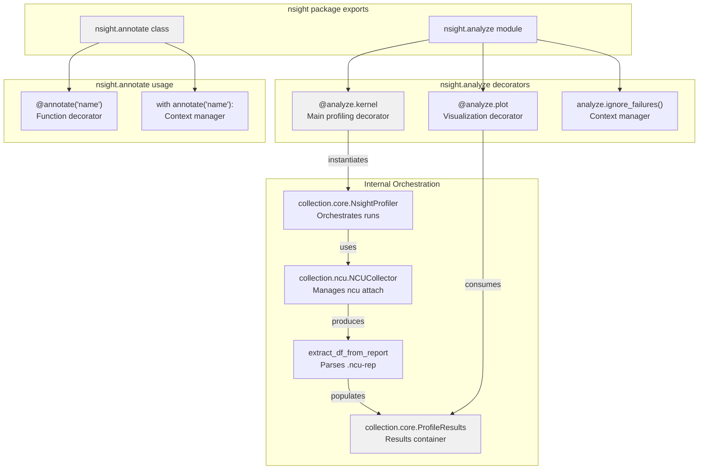

<!-- source: DeepWiki mcp.deepwiki.com · repo NVIDIA/nsight-python · page 4 User Guide · fetched 2026-10-26 -->

# User Guide

<details>
<summary>Relevant source files</summary>

The following files were used as context for generating this wiki page:

- [examples/01_compare_throughput.py](examples/01_compare_throughput.py)
- [examples/02_parameter_sweep.py](examples/02_parameter_sweep.py)
- [examples/README.md](examples/README.md)
- [examples/test_examples.py](examples/test_examples.py)
- [nsight/analyze.py](nsight/analyze.py)

</details>


This guide provides comprehensive documentation for using `nsight-python` to profile GPU kernels. It covers the two primary APIs (`nsight.analyze` and `nsight.annotate`), configuration options, metric collection, and visualization capabilities. As of version 1.0.0, `nsight-python` uses an injection-based approach where the profiler attaches to the running process, supporting environments like Jupyter and Google Colab without script relaunching.

For installation instructions, see [Installation](#2). For a quick introduction to basic concepts, see [Getting Started](#3). For detailed architectural information, see [Architecture Deep Dive](#5).

---

## Profiling Workflow Overview

The `nsight-python` profiling workflow consists of three main steps: code instrumentation, configuration, and execution. 

### End-to-End Profiling Flow



**Sources**: [nsight/analyze.py:61-116](), [nsight/analyze.py:118-191]()

---

## Core API Components

The `nsight-python` package exposes two primary modules in its public API: `nsight.analyze` and `nsight.annotate`.

### API Surface and Code Entities



**Sources**: [nsight/analyze.py:61-90](), [examples/01_compare_throughput.py:23-27](), [examples/01_compare_throughput.py:50-51]()

---

## Using the @nsight.analyze.kernel Decorator

The `@nsight.analyze.kernel` decorator is the primary interface for profiling. It executes your function multiple times across different configurations. In v1.0.0, it supports improved keyword-only parameter handling and default value padding for configurations.

### Decorator Syntax Options

| Pattern | Syntax | Use Case |
|---------|--------|----------|
| **No parentheses** | `@nsight.analyze.kernel` | Quick profiling with defaults |
| **With parameters** | `@nsight.analyze.kernel(configs=..., runs=10)` | Custom configuration |

### Key Parameters (v1.0.0)

| Parameter | Type | Default | Description |
|-----------|------|---------|-------------|
| `configs` | `Iterable[Any]` | `None` | Arguments for the decorated function. Supports scalars or sequences. |
| `runs` | `int` | `1` | Number of repetitions per configuration. |
| `metrics` | `Sequence[str]` | `["gpu__time_duration.sum"]` | NCU metrics to collect. |
| `derive_metric` | `Callable` | `None` | Function to transform metrics. Must return `(value, unit)` in v1.0.0. |
| `verbosity` | `VerbosityLevel` | `VerbosityLevel.INFO` | Replaces the old `output` parameter. |
| `thermal_device`| `int` | `None` | Pin thermal monitoring to a specific GPU device. |
| `output_csv` | `bool` | `False` | Enable CSV output of results. |

For details, see [Using nsight.analyze.kernel](#4.1).

**Sources**: [nsight/analyze.py:61-86](), [nsight/analyze.py:118-154]()

---

## Using nsight.annotate for Code Regions

The `nsight.annotate` class marks specific code regions for profiling by creating NVTX ranges. It is thread-local; kernels launched from other threads will not be associated with the annotation.

### Usage Example
```python
@nsight.annotate("torch.einsum")
def my_func(a, b):
    return torch.einsum("ij,jk->ik", a, b)

with nsight.annotate("matmul-region"):
    _ = a @ b
```

**Important**: Nested annotations are not supported. For details, see [Using nsight.annotate](#4.2).

**Sources**: [examples/01_compare_throughput.py:23-26](), [examples/01_compare_throughput.py:50-51]()

---

## Profiling Configurations

Configurations define the parameter space. Version 1.0.0 supports:
- **Scalar Configs**: `configs=[1, 2, 3]` for single-argument functions.
- **Multi-dimensional Configs**: Using `itertools.product` for parameter sweeps.
- **Default Value Padding**: If a config provides fewer values than parameters, missing values are filled from function defaults.

For details, see [Profiling Configurations](#4.3).

**Sources**: [nsight/analyze.py:118-132](), [examples/02_parameter_sweep.py:21-21]()

---

## Working with Metrics

Nsight-python v1.0.0 introduces a dedicated `Unit` column in results.
- **Default Metric**: `gpu__time_duration.sum`.
- **Custom Metrics**: Defined via `derive_metric`. To populate the `Unit` column, the function should return a tuple: `(value, "UnitName")`.
- **Multiple Metrics**: You can pass a list of metrics to the `metrics` parameter.

For details, see [Working with Metrics](#4.4).

**Sources**: [nsight/analyze.py:134-152](), [examples/03_custom_metrics.py:73-77]()

---

## Visualization and Plotting

The `@nsight.analyze.plot` decorator generates publication-quality visualizations from `ProfileResults`.

### Visualization Features
- **Plot Types**: Supports `line` and `bar` charts.
- **Subplots**: Use `row_panels` and `col_panels` to organize multi-dimensional sweeps.
- **DataFrames**: The `.to_dataframe()` method exports the full result set including statistical confidence intervals (CI95) and the `Unit` column.

For details, see [Visualization and Plotting](#4.5).

**Sources**: [nsight/analyze.py:244-255](), [examples/05_subplots.py:34-36]()

---

## Related Pages

- [Using nsight.analyze.kernel](#4.1) — Detailed documentation of the decorator and v1.0.0 parameters.
- [Using nsight.annotate](#4.2) — NVTX marking and thread-locality behavior.
- [Profiling Configurations](#4.3) — Parameter sweeps and default value support.
- [Working with Metrics](#4.4) — Collection, derivation, and the Unit column.
- [Visualization and Plotting](#4.5) — Customizing plots and DataFrames.

---

