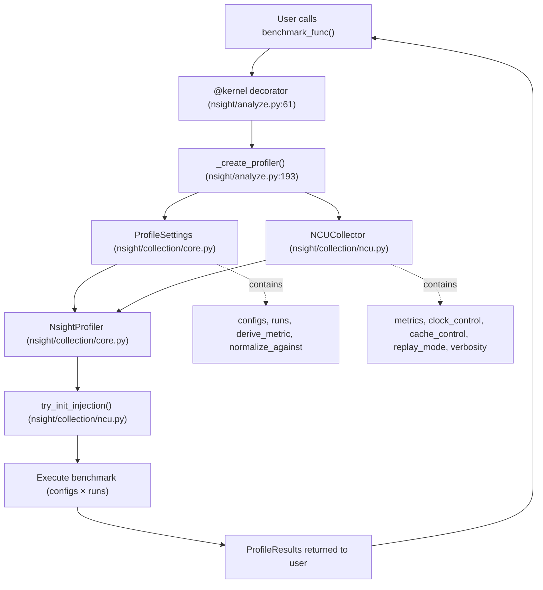

<!-- source: DeepWiki mcp.deepwiki.com · repo NVIDIA/nsight-python · page 4.1 Using nsight.analyze.kernel · fetched 2026-10-26 -->

# Using nsight.analyze.kernel

<details>
<summary>Relevant source files</summary>

The following files were used as context for generating this wiki page:

- [docs/source/analyze.rst](docs/source/analyze.rst)
- [docs/source/annotation.rst](docs/source/annotation.rst)
- [docs/source/overview/quickstart.rst](docs/source/overview/quickstart.rst)
- [nsight/analyze.py](nsight/analyze.py)
- [tests/test_profiler.py](tests/test_profiler.py)

</details>


The `@nsight.analyze.kernel` decorator is the primary interface for profiling GPU kernels in Nsight Python. It orchestrates the collection of GPU performance metrics using NVIDIA Nsight Compute, executes benchmarks across multiple configurations and repetitions, and returns structured profiling results.

As of version 1.0.0, the decorator utilizes an injection-based approach where the profiler attaches to the running process via `ncu --mode attach`. This eliminates the need for script relaunches and enables seamless profiling in interactive environments like Jupyter and Google Colab.

## Basic Usage Patterns

The `@nsight.analyze.kernel` decorator supports three invocation patterns, all defined in [nsight/analyze.py:61-241]():

**Pattern 1: Decorator without parentheses**
```python
@nsight.analyze.kernel
def benchmark_func(n: int):
    with nsight.annotate("operation"):
        # code to profile
```

**Pattern 2: Decorator with empty parentheses (default settings)**
```python
@nsight.analyze.kernel()
def benchmark_func(n: int):
    with nsight.annotate("operation"):
        # code to profile
```

**Pattern 3: Decorator with parameters**
```python
from nsight.utils import VerbosityLevel

@nsight.analyze.kernel(
    runs=10,
    metrics=["dram__throughput.avg.pct_of_peak_sustained_elapsed"],
    verbosity=VerbosityLevel.INFO
)
def benchmark_func(n: int):
    with nsight.annotate("operation"):
        # code to profile
```

### Decorated Function Signature

After decoration, the function signature changes to accept configurations and return `ProfileResults`:

```python
def wrapped_function(*args, configs=None, **kwargs) -> ProfileResults
```

- `*args`: Original positional arguments (when providing a single configuration).
- `configs`: Optional iterable of configurations that overrides decorator-time configs.
- `**kwargs`: Original keyword arguments.
- Returns: `ProfileResults` object containing profiling data.

**Note on Parameters**: As of v1.0.0, the decorator supports improved keyword-only parameter handling and default value padding. If a config provides fewer values than the function signature requires, missing values are filled from the function's defaults [nsight/analyze.py:128-130]().

**Sources:** [nsight/analyze.py:22-58](), [nsight/analyze.py:91-115](), [tests/test_profiler.py:50-101]()

## Decorator Usage Flow



**Sources:** [nsight/analyze.py:193-241](), [nsight/collection/ncu.py:214-230]()

## Parameters Reference

The decorator accepts the following parameters, grouped by functionality:

### Execution Control Parameters

| Parameter | Type | Default | Description |
|-----------|------|---------|-------------|
| `configs` | `Iterable[Any]` or `None` | `None` | Configurations to test. Can be sequences of arguments or scalar values for single-argument functions [nsight/analyze.py:118-126](). |
| `runs` | `int` | `1` | Number of times each configuration is executed [nsight/analyze.py:133](). |
| `thermal_mode` | `"auto"`, `"manual"`, or `"off"` | `"auto"` | Thermal management mode. `"auto"` (default) prevents thermal throttling [nsight/analyze.py:79](). |
| `thermal_device` | `int` or `None` | `None` | **New in v1.0.0**: Specific CUDA device index to monitor for thermal control [nsight/analyze.py:83](). |

### Metric Configuration Parameters

| Parameter | Type | Default | Description |
|-----------|------|---------|-------------|
| `metrics` | `Sequence[str]` | `["gpu__time_duration.sum"]` | List of GPU metrics to collect. Use `ncu --query-metrics` to list available metrics [nsight/analyze.py:74](). |
| `derive_metric` | `Callable` or `None` | `None` | Function to transform metrics. In v1.0.0, should return `(value, unit)` tuples for proper Unit column tracking [nsight/analyze.py:134-152](). |
| `normalize_against` | `str` or `None` | `None` | Annotation name to use as baseline for normalization [nsight/analyze.py:155-158](). |

### Hardware Control Parameters

| Parameter | Type | Default | Description |
|-----------|------|---------|-------------|
| `clock_control` | `"base"` or `"none"` | `"none"` | GPU clock frequency control. `"base"` locks clocks to base frequency [nsight/analyze.py:76](). |
| `cache_control` | `"all"` or `"none"` | `"all"` | GPU cache flush behavior. `"all"` flushes caches before each replay [nsight/analyze.py:77](). |
| `replay_mode` | `"kernel"` or `"range"` | `"kernel"` | Replay mechanism. `"kernel"` replays individual kernels; `"range"` replays annotated ranges [nsight/analyze.py:78](). |

### Output Control Parameters

| Parameter | Type | Default | Description |
|-----------|------|---------|-------------|
| `verbosity` | `VerbosityLevel` | `VerbosityLevel.INFO` | **New in v1.0.0**: Replaces `output`. Controls logging and progress bar [nsight/analyze.py:73](). |
| `output_prefix` | `str` or `None` | `None` | File path prefix for output files. If `None`, uses temporary directory [nsight/analyze.py:85](). |
| `output_csv` | `bool` | `False` | Whether to generate CSV files with raw and processed data [nsight/analyze.py:86](). |

**Sources:** [nsight/analyze.py:61-86](), [nsight/analyze.py:117-191]()

## Execution Model

The decorator implements a nested loop execution model. Unlike previous versions, v1.0.0 uses an injection library to enable/disable profiling dynamically without restarting the process.

```mermaid
graph LR
    subgraph "Execution Matrix"
        Start["Start profiling"]
        Init["try_init_injection()"]
        ConfigLoop["For each config"]
        RunLoop["For each run"]
        ThermalCheck["ThermalController.wait()"]
        ProfileStart["begin_profiling()"]
        KernelExec["Execute annotated function"]
        ProfileEnd["end_profiling()"]
        
        Start --> Init
        Init --> ConfigLoop
        ConfigLoop --> RunLoop
        RunLoop --> ThermalCheck
        ThermalCheck --> ProfileStart
        ProfileStart --> KernelExec
        KernelExec --> ProfileEnd
        ProfileEnd --> RunLoop
    end
    
    ProfileEnd --> Aggregate["Aggregate stats + Unit column"]
    Aggregate --> Return["Return ProfileResults"]
```



### Total Executions

For a decorated function with `N` configurations and `R` runs, the function body executes **N × R** times.

**Sources:** [nsight/collection/ncu.py:214-230](), [nsight/collection/core.py:108-142]()

## Working with Configurations

Configurations can be passed as a list of tuples or, for single-parameter functions, a list of scalars.

### Keyword-Only and Default Parameters

v1.0.0 introduced robust support for keyword-only parameters and default value padding:

```python
@nsight.analyze.kernel(
    configs=[
        (1024,),        # size=1024, dtype="float32" (default)
        (2048, "half"), # size=2048, dtype="half"
    ]
)
def benchmark(size: int, *, dtype: str = "float32"):
    with nsight.annotate("op"):
        # implementation
        pass
```

**Sources:** [nsight/analyze.py:109-115](), [tests/test_profiler.py:120-132]()

## ProfileResults and the Unit Column

The `ProfileResults` object returned by the decorated function includes a `Unit` column in its DataFrame, which is essential for tracking metric scales (e.g., `msecond`, `Gbyte/second`).

```python
result = benchmark_func()
df = result.to_dataframe()

# Columns include:
# - Annotation, AvgValue, Unit, StdDev, MinValue, MaxValue
# - Configuration parameters (as columns)
# - Normalized (if normalize_against was used)
```

**Sources:** [nsight/collection/core.py:41-76](), [nsight/analyze.py:152]()

## Integration with nsight.annotate

The `@nsight.analyze.kernel` decorator requires at least one `nsight.annotate` context within the decorated function to mark which code regions should be measured. Multiple annotations within one function will result in multiple rows in the output DataFrame.

```python
@nsight.analyze.kernel()
def mixed_ops(n):
    a = torch.randn(n, n, device="cuda")
    with nsight.annotate("add"):
        c = a + a
    with nsight.annotate("mul"):
        d = a * a
```

**Sources:** [docs/source/analyze.rst:7-12](), [tests/test_profiler.py:37-43]()

## Important Behavior Notes (v1.0.0+)

### Injection-Based Attach
Nsight Python no longer relaunches your script. It uses an injection library loaded at import time via `try_init_injection()`. This allows profiling in environments where subprocess management is restricted (Jupyter, Colab) [nsight/collection/ncu.py:214-230]().

### Thread Locality
Profiling is thread-local. Only kernels launched from the same thread that called the `@analyze.kernel` decorated function will be captured by the NVTX ranges [nsight/collection/ncu.py:30-40]().

### Thermal Management
The `thermal_device` parameter allows pinning thermal monitoring to a specific GPU, which is critical in multi-GPU systems to ensure the correct device is being checked for throttling [nsight/analyze.py:83]().

**Sources:** [nsight/analyze.py:73-86](), [nsight/collection/ncu.py:214-230]()

---

