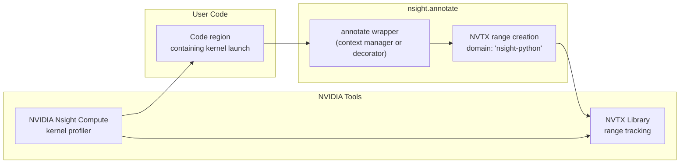
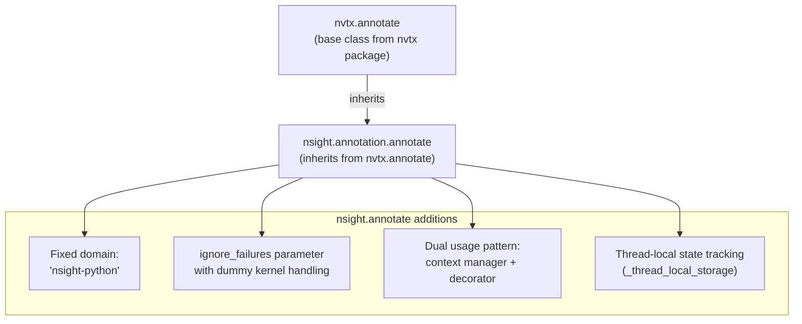
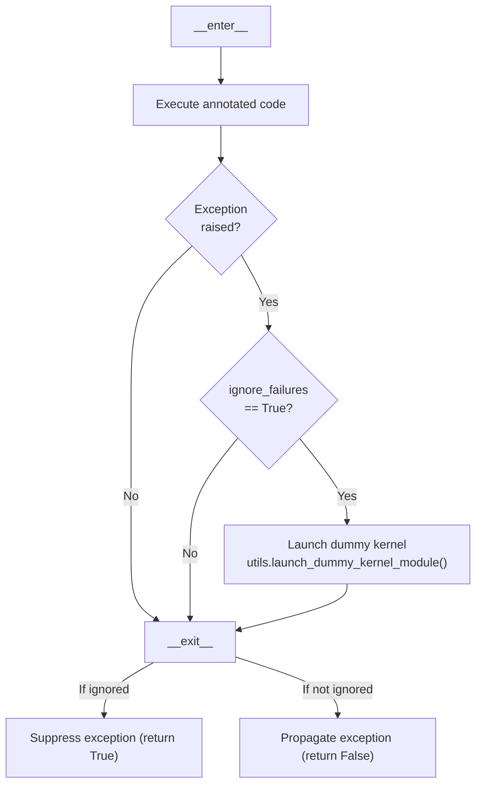
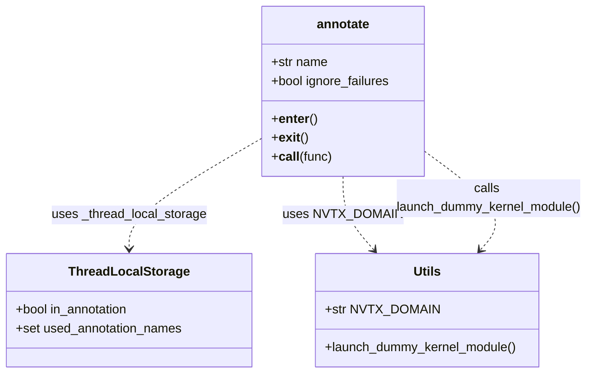

<!-- source: DeepWiki mcp.deepwiki.com · repo NVIDIA/nsight-python · page 4.2 Using nsight.annotate · fetched 2026-10-26 -->

# Using nsight.annotate

<details>
<summary>Relevant source files</summary>

The following files were used as context for generating this wiki page:

- [docs/source/release_notes/topics/updates-in-nsight-python-1.0.0.rst](docs/source/release_notes/topics/updates-in-nsight-python-1.0.0.rst)
- [nsight/annotation.py](nsight/annotation.py)
- [tests/test_annotate.py](tests/test_annotate.py)

</details>


This page documents the `nsight.annotate` class, which provides a context manager and decorator interface for marking code regions to be profiled. Annotations create NVTX ranges that are used by NVIDIA Nsight Compute to identify and isolate kernel launches during profiling.

For information about the complete profiling workflow and decorator-based orchestration, see [Using nsight.analyze.kernel](#4.1). For advanced configuration options that control how annotated regions are profiled, see [Advanced Configuration Options](#6.4).

---

## Purpose and Design

The `nsight.annotate` class serves as a lightweight marking mechanism that identifies specific code regions for GPU kernel profiling. It creates named NVTX (NVIDIA Tools Extension) ranges that enable Nsight Compute to associate performance metrics with user-defined annotations.

### Design Philosophy



**Diagram: nsight.annotate in the profiling pipeline**

The `annotate` class acts as an intermediary that bridges user code with NVIDIA's profiling infrastructure. It does not perform profiling itself—instead, it marks regions for external profiling tools.

**Sources:** [nsight/annotation.py:91-137](), [nsight/annotation.py:140-148]()

---

## Class Definition and Inheritance



**Diagram: annotate class inheritance and features**

The `annotate` class extends `nvtx.annotate` from the `nvtx` package with several key enhancements:
1. **Fixed domain**: All annotations use the `"nsight-python"` domain for consistent filtering [nsight/annotation.py:147]().
2. **Error handling**: Optional `ignore_failures` parameter for fault-tolerant profiling [nsight/annotation.py:111-115]().
3. **State Tracking**: Uses `threading.local()` to maintain thread-specific annotation state, preventing conflicts in multi-threaded scenarios [nsight/annotation.py:17-18]().

**Sources:** [nsight/annotation.py:91-148]()

---

## Constructor Parameters

| Parameter | Type | Default | Description |
|-----------|------|---------|-------------|
| `name` | `str` | (required) | Name of the annotation used to identify the profiling region in results |
| `ignore_failures` | `bool` | `False` | Whether to suppress exceptions within the annotated region and continue profiling |

### Parameter Details

#### `name`
The annotation name serves as the primary identifier in profiling results. This name appears in the output DataFrames under the `"annotation"` column. Names must be unique within a single profiling run to ensure unambiguous results [nsight/annotation.py:109-110]().

#### `ignore_failures`
When set to `True`, exceptions raised within the annotated region are caught and suppressed. The profiling workflow continues, and the measured metric for this run will be set to `NaN` [nsight/annotation.py:111-115]().

**Requirements:** The `ignore_failures=True` parameter requires the `cuda-core` package. If not installed, an `ImportError` is raised [nsight/annotation.py:144-145]().

**Sources:** [nsight/annotation.py:139-148](), [nsight/exceptions.py:12]()

---

## Usage Patterns

The `annotate` class supports two distinct usage patterns: as a context manager and as a decorator.

### Context Manager Pattern

```python
import torch
import nsight

def benchmark_function(n: int) -> None:
    data = torch.randn(n, n, device="cuda")
    
    # Context manager wraps specific code blocks
    with nsight.annotate("matrix_add"):
        result = data + data
```

This pattern is ideal for fine-grained control over annotation boundaries within a larger function [nsight/annotation.py:99-101]().

### Decorator Pattern

```python
import torch
import nsight

@nsight.annotate("einsum_op")
def annotated_op(a: torch.Tensor, b: torch.Tensor) -> torch.Tensor:
    return torch.einsum("ij,jk->ik", a, b)
```

The decorator pattern is implemented via `__call__`, which wraps the target function in a `with self:` block [nsight/annotation.py:182-188]().

**Sources:** [nsight/annotation.py:91-107](), [nsight/annotation.py:182-188](), [tests/test_annotate.py:29-30](), [tests/test_annotate.py:36-38]()

---

## State Management and Thread Locality

`nsight.annotate` uses `threading.local()` to ensure that annotation state is isolated to the current thread.

### Thread-Local Functions

| Function | Role |
|----------|------|
| `_is_in_annotation()` | Checks if the current thread is already inside an annotation context [nsight/annotation.py:20-29](). |
| `add_active_annotation(name)` | Marks a specific name as used in the current profiling run for the thread [nsight/annotation.py:42-55](). |
| `clear_active_annotations()` | Resets the thread's annotation state. Automatically called by `nsight.analyze.kernel` before each run [nsight/annotation.py:58-73](). |
| `is_active_annotation(name)` | Verifies if a name has already been used to prevent duplicates [nsight/annotation.py:75-88](). |

**Sources:** [nsight/annotation.py:17-88]()

---

## Error Handling with ignore_failures

The `ignore_failures` parameter enables fault-tolerant profiling.

### Implementation Flow



**Diagram: Error handling flow in annotate.__exit__**

When an exception occurs and `ignore_failures=True`, the system calls `utils.launch_dummy_kernel_module()` [nsight/annotation.py:171-172](). This ensures that Nsight Compute captures at least one kernel launch within the range, allowing it to generate a report even if the primary kernel failed.

**Sources:** [nsight/annotation.py:169-180](), [tests/test_annotate.py:77-84]()

---

## Limitations and Restrictions

### Nested Annotations Not Supported
Attempting to enter an annotation context while another is active on the same thread raises a `ValueError` [nsight/annotation.py:152-156]().

### Duplicate Annotation Names
Using the same annotation name twice within a single profiling run (even sequentially) raises a `ValueError` [nsight/annotation.py:159-163](). This ensures results are unambiguous.

### Thread Locality
Because NVTX ranges are thread-local, kernels launched from threads other than the one where `nsight.annotate` was called will not be associated with that annotation [nsight/annotation.py:15-18]().

**Sources:** [nsight/annotation.py:118-122](), [nsight/annotation.py:152-163](), [tests/test_annotate.py:148-151](), [tests/test_annotate.py:172-175]()

---

## Code Entity Mapping



**Diagram: Association between annotation entities and utility modules**

**Sources:** [nsight/annotation.py:17-18](), [nsight/annotation.py:147](), [nsight/annotation.py:172]()

---

