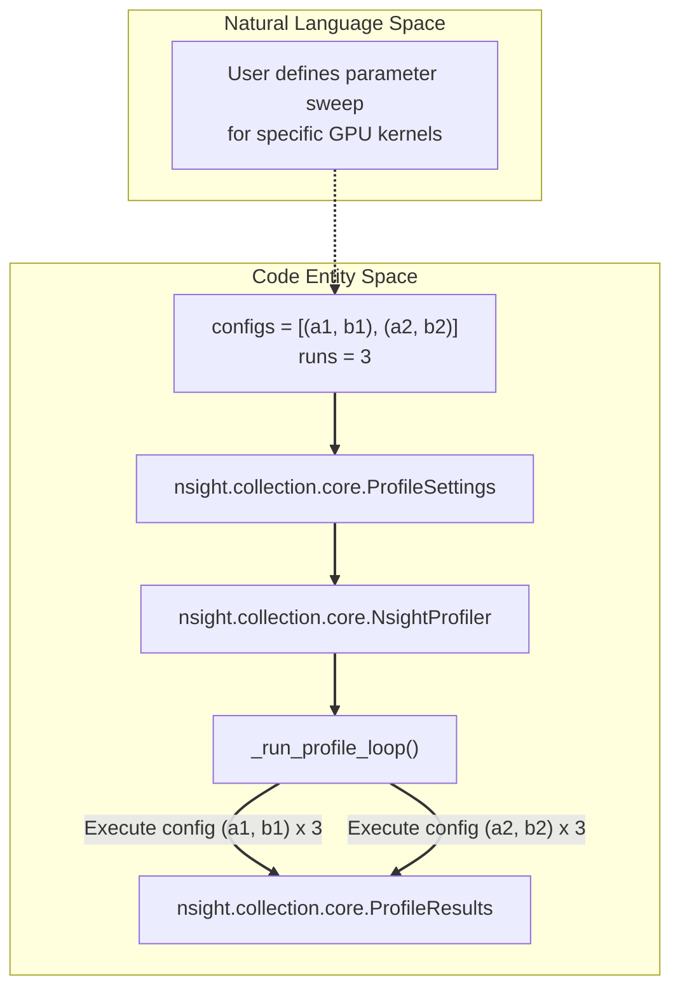
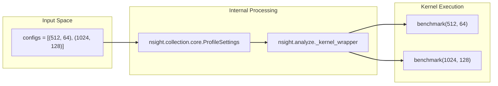

<!-- source: DeepWiki mcp.deepwiki.com · repo NVIDIA/nsight-python · page 4.3 Profiling Configurations · fetched 2026-10-26 -->

# Profiling Configurations

<details>
<summary>Relevant source files</summary>

The following files were used as context for generating this wiki page:

- [examples/04_multi_parameter.py](examples/04_multi_parameter.py)
- [examples/05_subplots.py](examples/05_subplots.py)
- [tests/test_profiler.py](tests/test_profiler.py)

</details>


## Purpose and Scope

This page explains how to define and use profiling configurations with `@nsight.analyze.kernel`. Configurations allow you to profile a kernel across multiple parameter values in a single profiling run, enabling automated parameter sweeps and comparative analysis. 

As of version **1.0.0**, the configuration system has been enhanced to support **keyword-only parameters** and **default value padding**, ensuring better compatibility with standard Python function signatures.

For information about the `@nsight.analyze.kernel` decorator itself, see [4.1 Using nsight.analyze.kernel](). For information about working with the collected metric data, see [4.4 Working with Metrics]().

---

## Configuration Basics

### What is a Configuration?

A configuration is a tuple of values that represents a specific set of input parameters for your benchmark function. The `configs` parameter of `@nsight.analyze.kernel` accepts a list of configuration tuples, and the profiler executes your kernel once for each configuration (multiplied by the number of `runs`).

```python
@nsight.analyze.kernel(configs=[(512,), (1024,), (2048,)])
def benchmark(size: int) -> None:
    # size will be 512, then 1024, then 2048
    pass
```

**Sources:** [nsight/analyze.py:280-305](), [tests/test_profiler.py:127-129]()

### Configuration Format Requirements

| Requirement | Description | Example |
|-------------|-------------|---------|
| **Type** | List of tuples | `[(512,), (1024,)]` |
| **Element Type** | Any Python object | `[(512, torch.float32), (1024, torch.float16)]` |
| **Tuple Length** | Must match benchmark function parameters | 2-parameter function needs 2-element tuples |
| **Consistency** | All tuples must have same length | All tuples must be 2-element or all 3-element |

### Configuration Execution Model



**Configuration × Runs Execution Matrix:** Each configuration is executed multiple times (determined by `runs` parameter), creating a combinatorial execution matrix. The `NsightProfiler` iterates through these in a nested loop.

**Sources:** [nsight/collection/core.py:166-180](), [nsight/collection/core.py:440-455]()

---

## Advanced Configuration Features (v1.0.0+)

### Keyword-Only Parameters
Starting in version 1.0.0, the profiler supports functions with keyword-only arguments. The configuration tuples are still provided positionally in the `configs` list, and the system maps them to the function's parameters, including those marked as keyword-only.

```python
@nsight.analyze.kernel(configs=[(1024, 0.5)])
def benchmark_kwarg(size: int, *, dropout: float) -> None:
    # size=1024, dropout=0.5
    pass
```

**Sources:** [nsight/analyze.py:355-365](), [tests/test_api_params.py:100-115]()

### Default Value Padding
If a configuration tuple is shorter than the function's signature, the profiler will attempt to "pad" the call using the function's defined default values. This allows you to sweep one parameter while keeping others at their defaults without explicitly including them in every tuple.

```python
@nsight.analyze.kernel(configs=[(512,), (1024,)])
def benchmark_defaults(size: int, dtype=torch.float32) -> None:
    # Call 1: size=512, dtype=torch.float32
    # Call 2: size=1024, dtype=torch.float32
    pass
```

**Sources:** [nsight/analyze.py:360-375](), [tests/test_api_params.py:120-135]()

---

## Multi-Parameter Configurations

### Using itertools.product for Cartesian Products

The `itertools.product` function is the recommended way to generate all combinations of parameter values, creating a Cartesian product for multi-dimensional sweeps.

```python
import itertools
import torch
import nsight

sizes = [2048, 4096, 8192]
dtypes = [torch.float32, torch.float16]

# Create all combinations: [(2048, float32), (2048, float16), ...]
configs = list(itertools.product(sizes, dtypes))

@nsight.analyze.kernel(configs=configs, runs=10)
def benchmark_multi_param(n: int, dtype: torch.dtype) -> None:
    a = torch.randn(n, n, device="cuda", dtype=dtype)
    b = torch.randn(n, n, device="cuda", dtype=dtype)
    with nsight.annotate("matmul"):
        _ = a @ b
```

**Sources:** [examples/04_multi_parameter.py:25-30](), [examples/04_multi_parameter.py:57-60]()

### Parameter Unpacking Flow



**Sources:** [nsight/analyze.py:355-380](), [nsight/collection/core.py:175-185]()

---

## Working with Custom Metrics and Configurations

When using the `derive_metric` parameter, the derived metric function receives the configuration values. This allows for calculations that depend on input sizes (e.g., TFLOPs).

### Flexible Argument Handling with `*conf`

Using `*conf` in your derivation function allows it to handle any number of configuration parameters without needing to update the signature when your benchmark parameters change.

```python
def compute_tflops(time_ns: float, *conf: Any) -> dict[str, tuple[float, str]]:
    """
    - time_ns: The measured metric (passed automatically)
    - *conf: Captures all config parameters (size, dtype, etc.)
    """
    n: int = conf[0]  # Extract size from the first position
    flops = 2 * n * n * n
    tflops: float = flops / (time_ns / 1e9) / 1e12
    return {"TFLOPS": (tflops, "TFLOPS")}
```

**Sources:** [examples/04_multi_parameter.py:32-48](), [examples/05_subplots.py:31-36]()

---

## Configuration Best Practices

### ✅ Recommended Patterns
- **Trailing Commas:** For single-parameter sweeps, ensure you use a trailing comma: `configs=[(512,), (1024,)]`. Without the comma, Python treats `(512)` as an integer.
- **Subplots for Multi-Param:** When sweeping multiple parameters, use `row_panels` and `col_panels` in `@nsight.analyze.plot` to organize results.
- **Validation:** Test your benchmark function with a single configuration manually before launching a large-scale profiling sweep.

### ❌ Anti-Patterns
- **Manual Loops:** Do not wrap the `@nsight.analyze.kernel` call in a Python `for` loop. Instead, pass the full list to the `configs` parameter so the profiler can optimize the collection process and generate a unified report.
- **Mixed Tuple Lengths:** All tuples in the `configs` list must have the same length to ensure consistent mapping to the function signature.

**Sources:** [examples/05_subplots.py:44-46](), [tests/test_profiler.py:100-101](), [nsight/analyze.py:355-360]()

---

