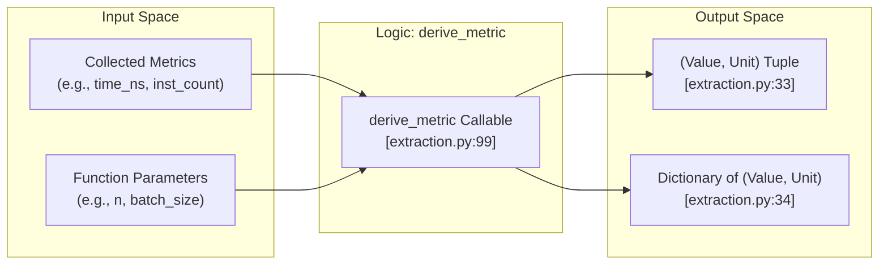
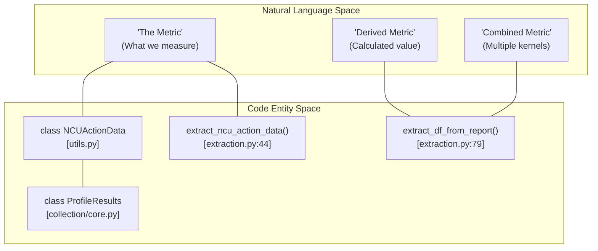

<!-- source: DeepWiki mcp.deepwiki.com · repo NVIDIA/nsight-python · page 4.4 Working with Metrics · fetched 2026-10-26 -->

# Working with Metrics

<details>
<summary>Relevant source files</summary>

The following files were used as context for generating this wiki page:

- [examples/03_custom_metrics.py](examples/03_custom_metrics.py)
- [examples/08_multiple_metrics.py](examples/08_multiple_metrics.py)
- [examples/09_advanced_metric_custom.py](examples/09_advanced_metric_custom.py)
- [examples/10_combine_kernel_metrics.py](examples/10_combine_kernel_metrics.py)
- [nsight/extraction.py](nsight/extraction.py)

</details>


This page explains how metrics are collected, transformed, and normalized in `nsight-python`. It covers default metric collection, selecting custom metrics, computing derived metrics (e.g., TFLOPs), and the new **Unit** column introduced in v1.0.0.

---

## Default Metric Collection

By default, the `@nsight.analyze.kernel` decorator collects the `gpu__time_duration.sum` metric, which reports kernel execution time in nanoseconds. This metric is automatically collected for each annotated region across all configurations and runs.

**Default Metric**: `"gpu__time_duration.sum"` (nanoseconds)

The default metric is specified in [nsight/analyze.py:35](). This value represents the total GPU time for the kernel(s) within each annotated region, as reported by NVIDIA Nsight Compute.

**Sources**: [nsight/analyze.py:35](), [nsight/analyze.py:103]()

---

## Selecting Custom Metrics

To collect different or multiple metrics, specify the `metrics` parameter (formerly `metric` in older versions, now supporting a sequence) when decorating your function:

```python
@nsight.analyze.kernel(
    metrics=[
        "smsp__sass_inst_executed_op_shared_ld.sum",
        "smsp__sass_inst_executed_op_shared_st.sum"
    ]
)
def benchmark(...):
    ...
```

### Important v1.0.0 Changes
- **Multiple Metrics**: You can pass a list/tuple of strings to `metrics`. All results are merged into one `ProfileResults` object, with a `Metric` column indicating each specific metric [examples/08_multiple_metrics.py:22-38]().
- **Visualization Limitation**: The `@nsight.analyze.plot` decorator can only visualize one metric at a time. If multiple metrics are collected without a `derive_metric` function to consolidate them, `@plot` will raise an error [examples/08_multiple_metrics.py:68-74]().

**Sources**: [nsight/analyze.py:35](), [examples/08_multiple_metrics.py:22-38](), [examples/08_multiple_metrics.py:68-74]()

---

## Derived Metrics

Derived metrics enable computation of custom values from the collected metrics and function parameters. In v1.0.0, derived metrics are expected to return both a value and a unit to populate the **Unit** column.

### Metric Transformation Patterns



### Pattern 1: Returning a Single Scalar with Unit
The function must return a `tuple[float, str]`. The `metric` parameter in `@plot` must match the **function name** of the derived metric [examples/03_custom_metrics.py:43-76]().

```python
def compute_tflops(time_ns: float, n: int) -> tuple[float, str]:
    flops = 2 * n**3
    tflops = flops / (time_ns / 1e9) / 1e12
    return (tflops, "TFLOPS") # (Value, Unit)
```

### Pattern 2: Returning a Dictionary of Metrics
Useful for computing multiple related metrics (e.g., TFLOPs and Arithmetic Intensity). The `metric` parameter in `@plot` must match a **key** in the returned dictionary [examples/03_custom_metrics.py:108-151]().

```python
def compute_stats(time_ns: float, n: int) -> dict[str, tuple[float, str]]:
    # ... logic ...
    return {
        "TFLOPS": (tflops, "TFLOPS"),
        "ArithIntensity": (intensity, "FLOP/byte")
    }
```

### Pattern 3: Advanced Multi-Metric Derivation
If `@kernel(metrics=[...])` specifies multiple raw metrics, the `derive_metric` function receives them as the first N arguments in the order they were listed [examples/09_advanced_metric_custom.py:21-64]().

**Sources**: [nsight/extraction.py:32-41](), [examples/03_custom_metrics.py:43-151](), [examples/09_advanced_metric_custom.py:21-82]()

---

## The Unit Column (New in v1.0.0)

Every `ProfileResults` object and resulting DataFrame now includes a `Unit` column. This column is populated as follows:
1. **Raw Metrics**: Units are extracted directly from the Nsight Compute report (e.g., `nsecond`, `cycle`, `byte`) [nsight/extraction.py:67-75]().
2. **Derived Metrics**: Populated from the second element of the returned `(value, unit)` tuple.
3. **Legacy/Missing Units**: If a `derive_metric` returns only a scalar, a warning is issued and `np.nan` is placed in the Unit column [nsight/extraction.py:37-41]().

**Sources**: [nsight/extraction.py:37-41](), [nsight/extraction.py:67-75](), [nsight/extraction.py:126]()

---

## Normalization and Baselines

The `normalize_against` parameter computes relative performance against a baseline annotation.

- **Speedup**: If the metric is "higher is better" (like TFLOPs), a value of 2.0 means the kernel is 2x faster than the baseline.
- **Overhead**: If the metric is "lower is better" (like time), a value of 0.5 means the kernel takes 50% of the baseline's time.

The results are stored in a `Normalized` column in the output DataFrame.

**Sources**: [nsight/analyze.py:100-102]()

---

## Combining Multiple Kernel Metrics

If an annotated region contains multiple kernel launches (e.g., a library call like `torch.matmul` that decomposes into several kernels), you must provide a `combine_kernel_metrics` function [examples/10_combine_kernel_metrics.py:28-35]().

```python
@nsight.analyze.kernel(
    combine_kernel_metrics=lambda x, y: x + y, # Sum metrics from all kernels
    metrics=["sm__cycles_elapsed.avg"]
)
def benchmark_multiple_kernels(n: int):
    with nsight.annotate("test"):
        _ = a @ b # Kernel 1
        _ = a @ b # Kernel 2
```

The aggregation is performed during the extraction phase using the provided lambda [nsight/extraction.py:88-101]().

**Sources**: [nsight/extraction.py:88-101](), [examples/10_combine_kernel_metrics.py:28-35]()

---

## Code Entity Mapping: Metric Subsystem



**Sources**: [nsight/extraction.py:44-76](), [nsight/extraction.py:79-134](), [nsight/utils.py:112-124]()

---

## CSV Output Reference

### Processed Data CSV (`processed_data-*.csv`)
This file aggregates statistics across the `runs` specified in the decorator.

| Column | Description |
|--------|-------------|
| `Annotation` | Name of the `nsight.annotate` block. |
| `AvgValue` | Arithmetic mean of the metric across runs. |
| `Unit` | The unit of measurement (e.g., `TFLOPS`, `nsecond`). |
| `Metric` | The name of the raw or derived metric. |
| `StableMeasurement`| `True` if `RelativeStdDevPct` < 2%. |
| `CI95_Lower/Upper` | 95% Confidence Interval bounds. |

**Sources**: [nsight/extraction.py:14-16](), [nsight/extraction.py:121-134]()

---

