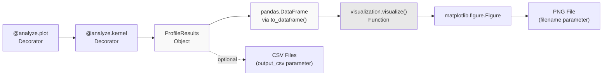
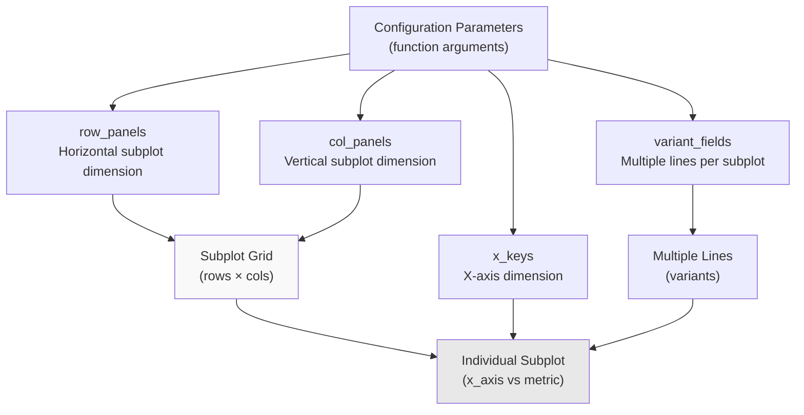

<!-- source: DeepWiki mcp.deepwiki.com · repo NVIDIA/nsight-python · page 4.5 Visualization and Plotting · fetched 2026-10-26 -->

# Visualization and Plotting

<details>
<summary>Relevant source files</summary>

The following files were used as context for generating this wiki page:

- [docs/source/overview/architecture.rst](docs/source/overview/architecture.rst)
- [examples/04_multi_parameter.py](examples/04_multi_parameter.py)
- [examples/05_subplots.py](examples/05_subplots.py)
- [examples/06_plot_customization.py](examples/06_plot_customization.py)
- [nsight/visualization.py](nsight/visualization.py)

</details>


## Purpose and Scope

This document covers the visualization and plotting capabilities of nsight-python, focusing on the `@nsight.analyze.plot` decorator and its integration with the profiling pipeline. It explains how to generate publication-quality plots from profiling results, customize visualizations, and export data in various formats including the structured DataFrame with the `Unit` column.

For information about the underlying data collection process, see [Using nsight.analyze.kernel](4.1). For details on derived metrics and normalization that affect what gets plotted, see [Working with Metrics](4.4).

## Overview of Visualization System

The visualization system operates as the final phase of the profiling pipeline, transforming `ProfileResults` objects into matplotlib figures and optionally exporting data to CSV files. The system is designed to produce publication-quality visualizations with minimal configuration while supporting extensive customization for advanced users.

**Visualization Pipeline Flow**



Sources: [nsight/analyze.py:244-346](), [examples/05_subplots.py:39-61](), [examples/06_plot_customization.py:31-84]()

## The @plot Decorator

The `@nsight.analyze.plot` decorator wraps functions already decorated with `@nsight.analyze.kernel` to automatically generate visualizations from profiling results. It intercepts the `ProfileResults` return value, generates plots as a side effect, and returns the original results unchanged.

### Basic Usage Pattern

```python
@nsight.analyze.plot(filename="performance.png", title="My Benchmark")
@nsight.analyze.kernel(configs=configs, runs=10)
def my_benchmark(size: int) -> None:
    # Benchmark implementation
    pass
```

The decorator chain must follow this order: `@plot` must be applied **before** (outside) `@kernel`. The resulting function maintains the same signature as the underlying `@kernel`-decorated function and returns `ProfileResults`.

Sources: [nsight/analyze.py:265-276]()

### Decorator Parameters

| Parameter | Type | Default | Description |
|-----------|------|---------|-------------|
| `filename` | `str` | `"plot.png"` | Output filename for the generated plot |
| `title` | `str` | `"Nsight Analyze Kernel Plot Results"` | Plot title |
| `ylabel` | `str \| None` | `None` | Y-axis label. If `None`, uses `f'{metric} (avg: {runs} runs)'` |
| `annotate_points` | `bool` | `False` | Whether to annotate data points with their numeric values |
| `show_aggregate` | `str \| None` | `None` | Show aggregate statistic: `"avg"` or `"geomean"` |
| `plot_type` | `str` | `"line"` | Plot type: `"line"` or `"bar"` |
| `plot_width` | `int` | `6` | Plot width in inches |
| `plot_height` | `int` | `4` | Plot height in inches |
| `row_panels` | `Sequence[str] \| None` | `None` | Function parameters to use for subplot rows |
| `col_panels` | `Sequence[str] \| None` | `None` | Function parameters to use for subplot columns |
| `x_keys` | `Sequence[str] \| None` | `None` | Function parameters to use for X-axis. Defaults to all parameters not in panels |
| `print_data` | `bool` | `False` | Whether to print the plotted data to stdout |
| `variant_fields` | `Sequence[str] \| None` | `None` | Config fields to use as variant dimensions (separate lines) |
| `variant_annotations` | `Sequence[str] \| None` | `None` | Annotation names to split into variants |
| `plot_callback` | `Callable[[matplotlib.figure.Figure], None] \| None` | `None` | Custom callback for advanced matplotlib customization |

Sources: [nsight/analyze.py:244-264]()

## Plot Customization

### Plot Types

The `plot_type` parameter controls the visualization style:

- **`"line"`** (default): Generates line plots with markers, suitable for continuous parameter sweeps.
- **`"bar"`**: Generates bar charts, suitable for categorical comparisons.

Example using bar chart:

```python
@nsight.analyze.plot(
    filename="bar_chart.png",
    plot_type="bar",
    annotate_points=True
)
@nsight.analyze.kernel(configs=configs, runs=10)
def benchmark(size: int) -> None:
    # Implementation
    pass
```

Sources: [examples/06_plot_customization.py:31-47](), [nsight/visualization.py:65]()

### Point Annotation and Aggregates

The `annotate_points` parameter adds numeric labels to data points, useful for reading exact values from plots.

The `show_aggregate` parameter (internally mapping to `show_avg` and `show_geomean` in the `visualize` function) displays aggregate statistics across all data series:
- `show_aggregate="avg"`: Shows average value.
- `show_aggregate="geomean"`: Shows geometric mean.

Sources: [nsight/analyze.py:288-292](), [nsight/analyze.py:313-314](), [nsight/visualization.py:32-37]()

### Titles and Labels

Plot aesthetics are controlled through dedicated parameters:

```python
@nsight.analyze.plot(
    title="Matrix Multiplication Performance",
    ylabel="TFLOPs/s",
    plot_width=10,
    plot_height=6
)
@nsight.analyze.kernel(...)
def benchmark(...) -> None:
    pass
```

If `ylabel` is not specified, the system generates a default label based on the metric name and number of runs. The visualization logic also automatically appends hardware information (GPU model and Host) to the plot subtitle.

Sources: [nsight/analyze.py:285-296](), [nsight/visualization.py:142-145]()

## Subplot Layouts

The visualization system supports creating subplot grids for multi-dimensional parameter comparisons using panel parameters.

**Panel Layout Architecture**



### Row and Column Panels

The `row_panels` and `col_panels` parameters create subplot grids by partitioning the configuration space:

- **`row_panels`**: Creates a separate row of subplots for each unique value of the specified parameters.
- **`col_panels`**: Creates a separate column of subplots for each unique value of the specified parameters.

Example with 2×2 subplot grid:

```python
@nsight.analyze.plot(
    row_panels=["dtype"],        # One row per dtype (float32, float16)
    col_panels=["transpose"]     # One column per transpose (False, True)
)
@nsight.analyze.kernel(configs=configs, runs=10)
def benchmark(n: int, dtype: torch.dtype, transpose: bool) -> None:
    # This creates 2×2 = 4 subplots
    pass
```

Sources: [examples/05_subplots.py:39-48](), [nsight/visualization.py:167-178]()

### X-Axis Selection

The `x_keys` parameter specifies which configuration parameters appear on the X-axis. By default, the system uses all function parameters **except** those specified in `row_panels` and `col_panels`.

Sources: [nsight/analyze.py:305-307](), [nsight/visualization.py:56-58]()

### Variant Fields and Annotations

The `variant_fields` parameter creates multiple lines within each subplot by splitting on specified configuration parameters. The `variant_annotations` parameter splits on annotation names (from `nsight.annotate`).

When both are provided, the visualization logic expands the data into separate lines while keeping shared x-ticks.

Sources: [nsight/analyze.py:310-311](), [nsight/visualization.py:86-140]()

## Advanced Customization

### The plot_callback Parameter

The `plot_callback` parameter accepts a function that receives the matplotlib `Figure` object after initial rendering, enabling arbitrary customization:

```python
def custom_style(fig: matplotlib.figure.Figure) -> None:
    """Callback for advanced plot customization."""
    fig.suptitle("Custom Styled Plot", fontsize=16, fontweight="bold")
    ax = fig.get_axes()[0]
    for line in ax.get_lines():
        line.set_linewidth(2)
        line.set_marker("o")

@nsight.analyze.plot(plot_callback=custom_style)
@nsight.analyze.kernel(...)
def benchmark(...) -> None:
    pass
```

Sources: [examples/06_plot_customization.py:49-74](), [nsight/visualization.py:41]()

## Data Output Formats

### DataFrame Structure and the Unit Column

The `ProfileResults.to_dataframe()` method returns a pandas DataFrame. A critical addition in v1.0.0 is the `Unit` column, which tracks the physical unit of the collected or derived metric.

| Column Category | Columns | Description |
|----------------|---------|-------------|
| **Identifiers** | `Annotation` | Name of the annotated region (`nsight.annotate` name) |
| **Config Parameters** | `<param_name>` | One column per function parameter |
| **Aggregated Metrics** | `AvgValue`, `StdDev`, `MinValue`, `MaxValue` | Statistical summary across runs |
| **Unit Info** | `Unit` | The unit of the metric (e.g., "ns", "TFLOPS", "GB/s") |
| **Stability Indicators** | `RelativeStdDevPct`, `StableMeasurement` | Measurement variance metrics |
| **Metadata** | `NumRuns`, `Metric`, `GPU`, `Host`, `ComputeClock`, `MemoryClock` | Execution context |

Sources: [nsight/analyze.py:171-191](), [nsight/visualization.py:93-107]()

### CSV Output Options

CSV output is controlled by the `output_csv` parameter in the `@kernel` decorator:

```python
@nsight.analyze.kernel(configs=configs, runs=10, output_csv=True)
def benchmark(...) -> None:
    pass
```

This generates two CSV files:
1. **Raw Data CSV** (`profiled_data-*.csv`): One row per run per configuration.
2. **Processed Data CSV** (`processed_data-*.csv`): Aggregated statistics matching the DataFrame structure, including the `Unit` column.

Sources: [nsight/analyze.py:155-191]()

### Conditional Visualization

Visualization is automatically bypassed during the internal collection phase (when `NSPY_NCU_PROFILE` is set) and only executes during the final data aggregation phase.

Sources: [nsight/analyze.py:321-340]()

---

