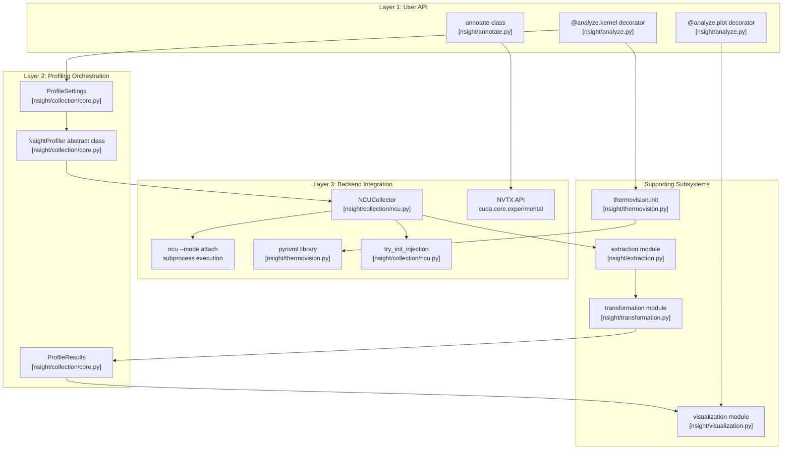
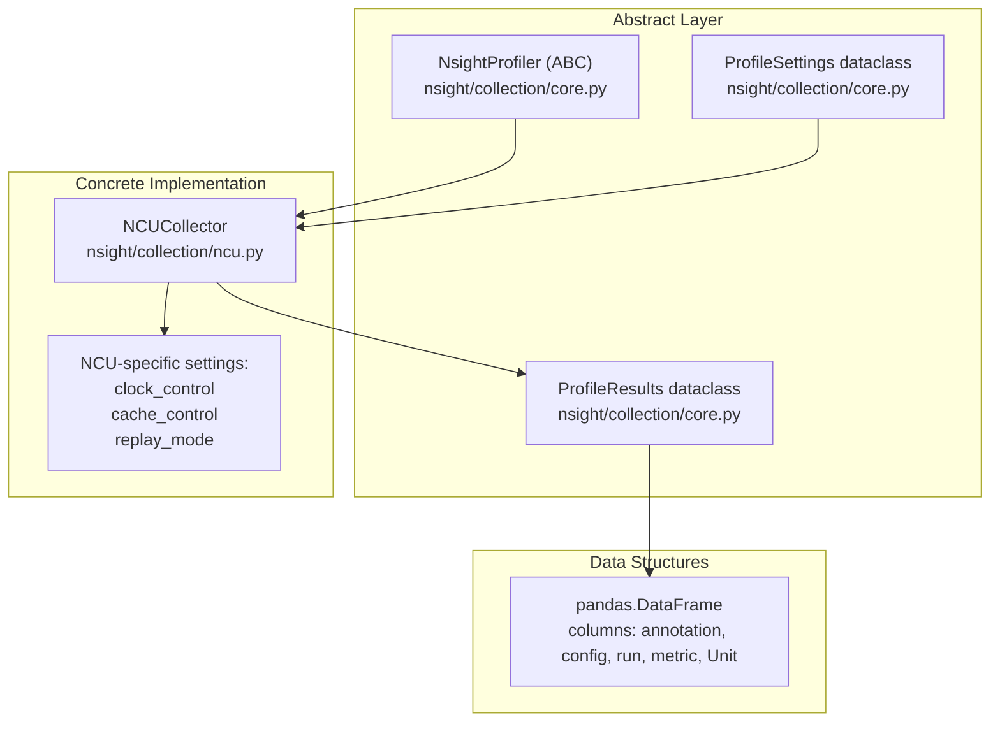
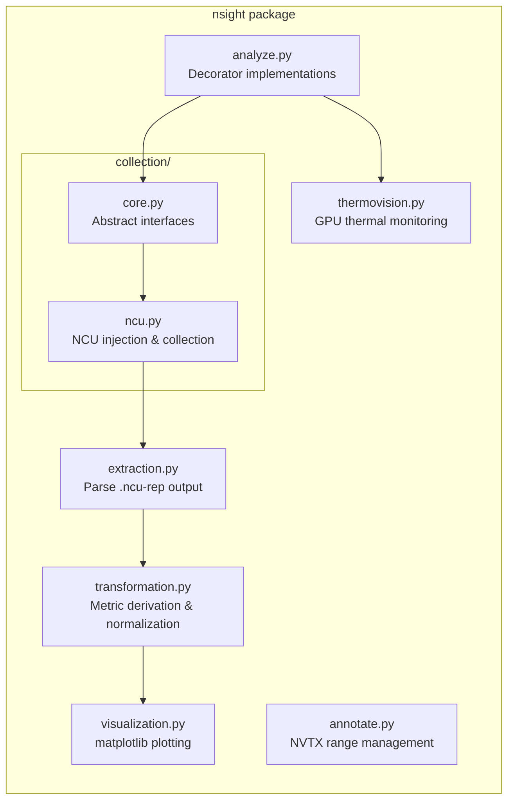
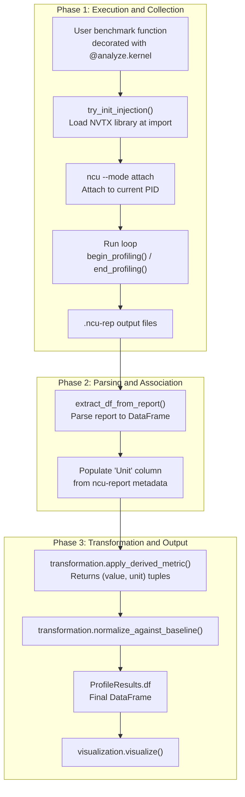
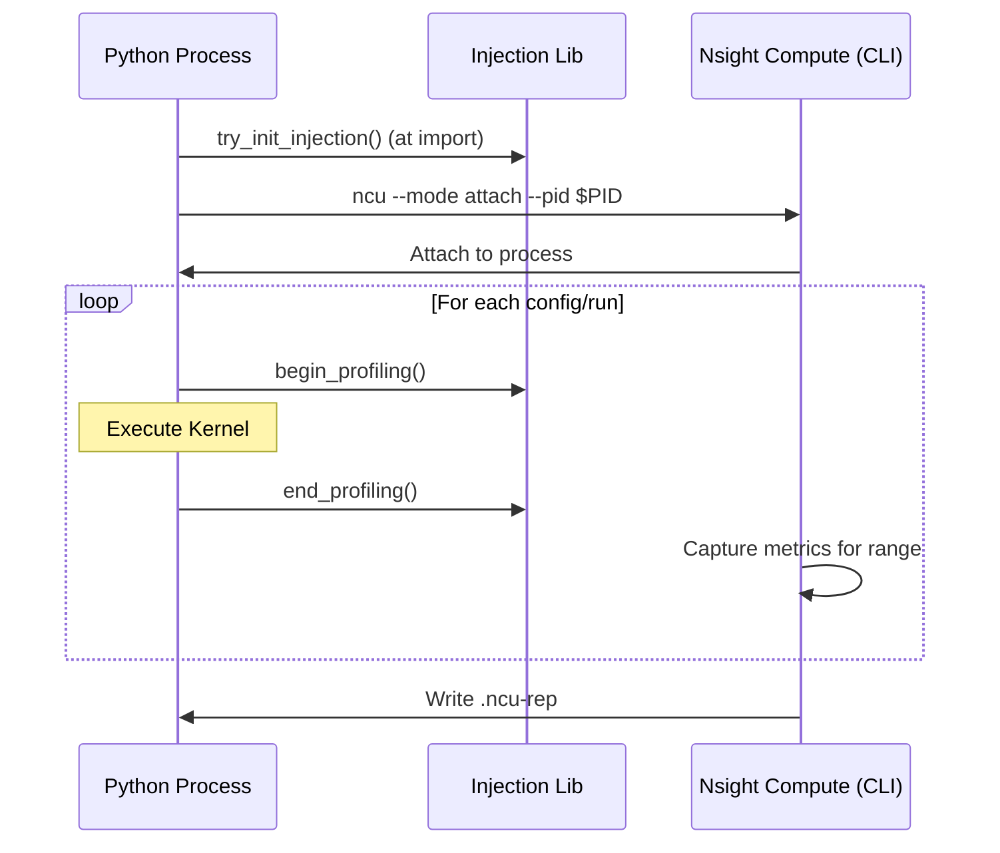
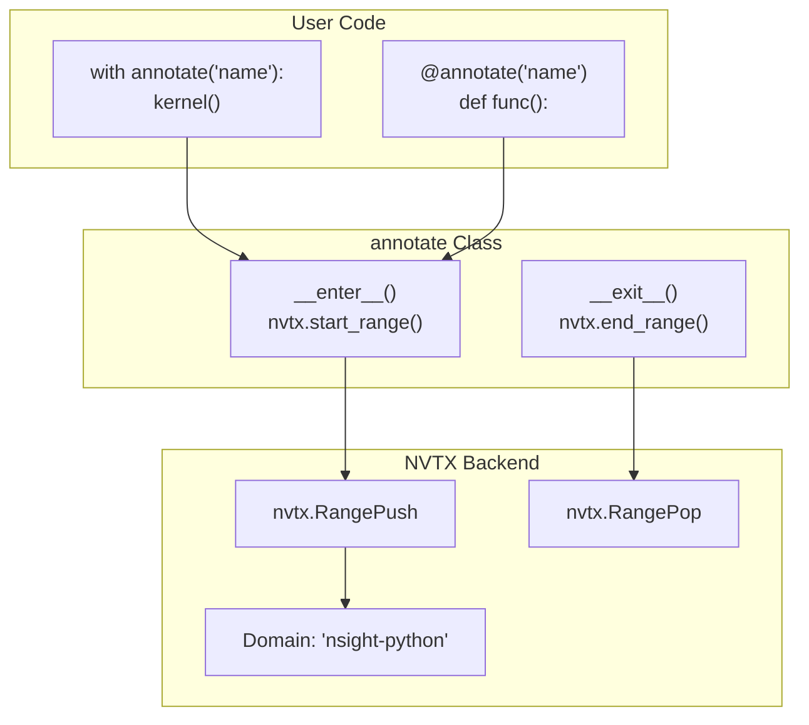

<!-- source: DeepWiki mcp.deepwiki.com · repo NVIDIA/nsight-python · page 5 Architecture Deep Dive · fetched 2026-10-26 -->

# Architecture Deep Dive

Relevant source files

The following files were used as context for generating this wiki page:

- [nsight/analyze.py](nsight/analyze.py)
- [nsight/collection/core.py](nsight/collection/core.py)

## Purpose and Scope

This page provides a detailed technical overview of nsight-python's internal architecture, explaining how components interact to orchestrate GPU profiling and data processing. It focuses on the system's core abstractions, data flow patterns, and module organization, mapping high-level concepts to specific code entities (classes, modules, functions).

As of v1.0.0, the architecture has transitioned to an **injection-based attach mode**. Instead of relaunching the entire script, the system now injects a profiling library into the running process at import time and attaches the Nsight Compute profiler dynamically.

For detailed information about specific subsystems:
- Three-phase pipeline mechanics: see [Three-Phase Pipeline](#5.1)
- Collection system implementation: see [Collection System](#5.2)
- Extraction and processing logic: see [Extraction and Processing](#5.3)
- Visualization layer details: see [Visualization Layer](#5.4)

---

## System Architecture Overview

nsight-python implements a **three-layer architecture** that separates concerns between user-facing APIs, profiling orchestration, and backend tool integration.

**Diagram 1: Three-Layer Architecture with Code Entity Mapping**

**Sources:** [nsight/analyze.py:61-90](), [nsight/collection/core.py:189-215](), [nsight/collection/ncu.py:166-180]()

---

## Core Abstractions and Class Hierarchy

The system is built on several key abstractions that define how profiling data flows through the pipeline.

### Profiling Configuration Classes

| Class | Module | Purpose |
|-------|--------|---------|
| `ProfileSettings` | `nsight/collection/core.py` | Encapsulates all profiling parameters: configs, runs, metrics, normalization, thermal control. [nsight/collection/core.py:189-215]() |
| `ProfileResults` | `nsight/collection/core.py` | Container for profiling data as pandas DataFrame with metadata and Unit tracking. [nsight/collection/core.py:228-245]() |
| `NsightProfiler` | `nsight/collection/core.py` | Abstract base class defining profiler interface. [nsight/collection/core.py:248-257]() |
| `NCUCollector` | `nsight/collection/ncu.py` | Concrete implementation using NVIDIA Nsight Compute `--mode attach`. [nsight/collection/ncu.py:166-180]() |

**Diagram 2: Class Hierarchy and Data Structures**

**Sources:** [nsight/collection/core.py:189-257](), [nsight/collection/ncu.py:166-210]()

---

## Module Organization and Responsibilities

nsight-python follows a modular design where each module has a single, well-defined responsibility.

### Package Structure

**Diagram 3: Module Dependency Graph**

| Module | Primary Classes/Functions | Responsibility |
|--------|--------------------------|----------------|
| `analyze.py` | `kernel()`, `plot()` | User-facing decorators for analysis and visualization. [nsight/analyze.py:61-90]() |
| `annotate.py` | `annotate` class | Context manager/decorator for NVTX ranges. [nsight/annotate.py:21-45]() |
| `collection/core.py` | `ProfileSettings`, `ProfileResults` | Core data structures and logic for config sanitization. [nsight/collection/core.py:109-154]() |
| `collection/ncu.py` | `try_init_injection()`, `NCUCollector` | Handles NVTX injection and `ncu` CLI interaction. [nsight/collection/ncu.py:53-85]() |
| `extraction.py` | `extract_df_from_report()` | Parses `.ncu-rep` files into structured DataFrames. |
| `transformation.py` | `aggregate_data()` | Handles derived metrics and normalization. |
| `thermovision.py` | `ThermalController` | GPU temperature monitoring via NVML. [nsight/thermovision.py:102-125]() |

**Sources:** [nsight/analyze.py:17-20](), [nsight/collection/ncu.py:1-50](), [nsight/collection/core.py:19-21]()

---

## Data Flow Through the System

The system implements a **pipeline architecture** where data undergoes multiple transformations from user code to final visualization.

**Diagram 4: End-to-End Data Flow Pipeline**

**Sources:** [nsight/collection/ncu.py:53-85](), [nsight/collection/ncu.py:114-148](), [nsight/analyze.py:134-154]()

---

## Injection-Based Profiling Pattern

Unlike previous versions that used a script relaunch, v1.0.0 uses an **injection-based attach pattern**. This allows the profiler to attach to an already running process, supporting environments like Jupyter and Colab.

### Execution Flow

1. **Import Time**: `try_init_injection()` attempts to load the NVTX injection library into the Python process. [nsight/collection/ncu.py:53-85]()
2. **Decorator Call**: `analyze.kernel()` is invoked.
3. **Profiler Attachment**: `NCUCollector` launches `ncu --mode attach` targeting the current PID. [nsight/collection/ncu.py:114-148]()
4. **Range Control**: `begin_profiling()` and `end_profiling()` markers signal to the attached `ncu` when to start and stop capturing. [nsight/collection/ncu.py:149-163]()

**Diagram 5: Injection-Based Execution Sequence**

**Sources:** [nsight/collection/ncu.py:53-163](), [nsight/collection/core.py:440-475]()

---

## NVTX Integration and Annotation System

The `annotate` class creates NVTX ranges that mark GPU execution regions, allowing the profiler to associate hardware metrics with specific code blocks.

### Annotation Mechanism

**Diagram 6: NVTX Annotation Flow**

**Sources:** [nsight/annotate.py:21-45](), [nsight/annotate.py:84-118]()

---

## Configuration Matrix Execution

The system executes a **cartesian product** of configurations and runs. It also supports padding short configs with default values from the function signature.

### Configuration Handling

- **Padding**: `_pad_config_with_defaults` ensures all config tuples match the function signature length. [nsight/collection/core.py:49-71]()
- **Binding**: `_bind_config_to_signature` splits configs into positional and keyword-only arguments for execution. [nsight/collection/core.py:74-106]()

**Sources:** [nsight/collection/core.py:49-106](), [nsight/collection/core.py:440-475]()

---

## Summary

The nsight-python architecture is structured around several key principles:

1. **Injection-Based Attach**: Uses `ncu --mode attach` and NVTX injection for zero-relaunch profiling.
2. **Unified Data Model**: `ProfileResults` tracks metrics, units, and normalization state in a single pandas-based container.
3. **Thermal Awareness**: `ThermalController` prevents hardware throttling during benchmarks.
4. **Flexible Configurations**: Supports scalar configs, tuples, and automatic default value padding.
5. **Metric Derivation**: Supports complex derived metrics that return value/unit pairs for consistent reporting.

**Sources:** [nsight/collection/ncu.py:53-85](), [nsight/collection/core.py:189-245](), [nsight/thermovision.py:102-125]()

---

