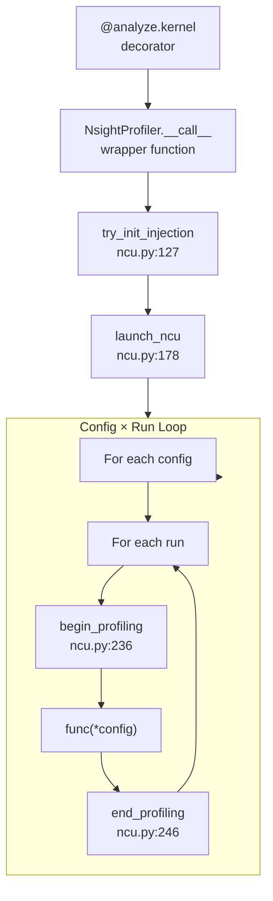
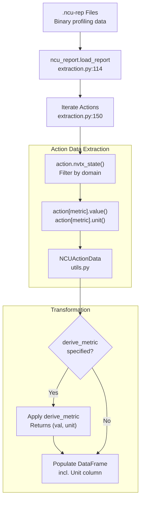
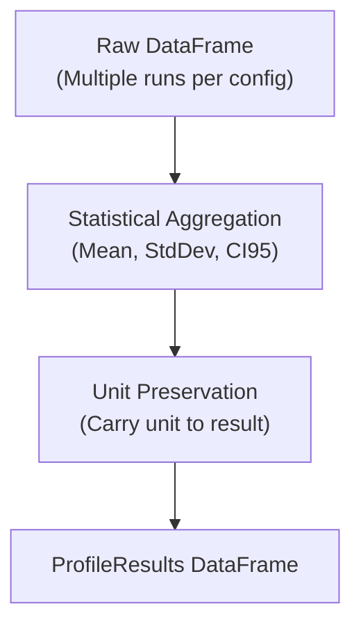
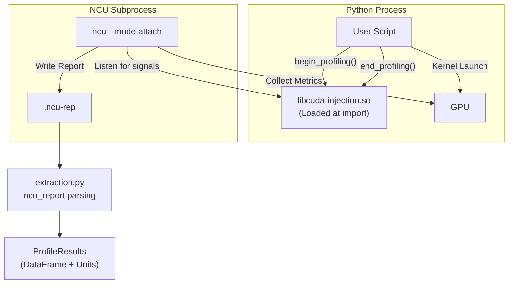

<!-- source: DeepWiki mcp.deepwiki.com · repo NVIDIA/nsight-python · page 5.1 Three-Phase Pipeline · fetched 2026-10-26 -->

# Three-Phase Pipeline

Relevant source files

The following files were used as context for generating this wiki page:

- [nsight/analyze.py](nsight/analyze.py)
- [nsight/collection/ncu.py](nsight/collection/ncu.py)
- [nsight/extraction.py](nsight/extraction.py)

## Purpose and Scope

This document explains the internal architecture of Nsight Python's data processing pipeline, which transforms user-defined benchmark functions into profiling data and visualizations. Starting with version 1.0.0, the pipeline utilizes an **injection-based attach** approach, eliminating the need for script relaunch. The pipeline consists of three sequential phases: **Collection**, **Extraction**, and **Visualization**. Each phase performs specific transformations on the profiling data as it flows through the system.

This page focuses on the overall pipeline architecture and data flow. For detailed information about specific subsystems, see:
- Collection system implementation: [5.2]()
- Extraction and processing details: [5.3]()
- Visualization layer: [5.4]()

## Pipeline Overview

The three-phase pipeline implements an ETL (Extract-Transform-Load) pattern for GPU profiling data. Each decorated function execution triggers this pipeline:

```mermaid
graph LR
    subgraph Phase1["Phase 1: Collection"]
        UserCode["User Function<br/>+ @analyze.kernel"]
        Injection["Injection Library<br/>try_init_injection()"]
        NCU["ncu --mode attach<br/>Subprocess"]
        RawData["Raw .ncu-rep<br/>Files"]
    end
    
    subgraph Phase2["Phase 2: Extraction"]
        NCUReport["ncu_report.load_report<br/>Parsing"]
        Association["Metric-Annotation<br/>Association"]
        Derivation["Derived Metric<br/>Computation"]
        RawDF["Raw DataFrame<br/>(with Unit column)"]
    end
    
    subgraph Phase3["Phase 3: Visualization"]
        Aggregation["Statistical<br/>Aggregation"]
        Normalization["Baseline<br/>Normalization"]
        ProcessedDF["Processed<br/>DataFrame"]
        Outputs["CSV Files<br/>+ Plots"]
    end
    
    UserCode --> Injection
    Injection --> NCU
    NCU --> RawData
    
    RawData --> NCUReport
    NCUReport --> Association
    Association --> Derivation
    Derivation --> RawDF
    
    RawDF --> Aggregation
    Aggregation --> Normalization
    Normalization --> ProcessedDF
    ProcessedDF --> Outputs
```

**Sources**: [nsight/analyze.py:91-108](), [nsight/collection/ncu.py:127-176](), [nsight/extraction.py:79-110]()

## Phase 1: Collection

The collection phase orchestrates the execution of user code under NVIDIA Nsight Compute profiling using a dynamic injection mechanism. This phase is responsible for:

1. **Injection Initialization**: Loading the Nsight Compute injection library via `try_init_injection()` at import time [nsight/collection/ncu.py:127-176]().
2. **NCU Attach**: Launching the `ncu` CLI in attach mode as a background process [nsight/collection/ncu.py:178-208]().
3. **Configuration Matrix Execution**: Running the benchmark function for each configuration × run combination.
4. **Profiling Control**: Triggering hardware counters via `begin_profiling_symbol()` and `end_profiling_symbol()` [nsight/collection/ncu.py:236-251]().
5. **Thermal Control**: Monitoring GPU temperature via the `thermal_device` [nsight/analyze.py:83]().

### Collection Execution Flow

The `NCUCollector` handles the specifics of invoking Nsight Compute via the `--mode attach` command [nsight/collection/ncu.py:204]().

**Key Classes and Functions**:

| Entity | Location | Role |
|--------|----------|------|
| `try_init_injection` | [nsight/collection/ncu.py:127-176]() | Loads `libcuda-injection.so` and sets environment variables |
| `launch_ncu` | [nsight/collection/ncu.py:178-226]() | Spawns `ncu --mode attach` with specified metrics and replay mode |
| `begin_profiling` | [nsight/collection/ncu.py:236-244]() | Calls `nvInjBeginProfiling` to start counter collection |
| `end_profiling` | [nsight/collection/ncu.py:246-254]() | Calls `nvInjEndProfiling` to stop counter collection |
| `NCUCollector` | [nsight/collection/ncu.py:257-306]() | Orchestrates the high-level collection process |

**Sources**: [nsight/collection/ncu.py:127-306]()

## Phase 2: Extraction

The extraction phase uses the `ncu-report` Python bindings to parse the generated `.ncu-rep` files. This phase performs:

1. **Report Loading**: Utilizing `ncu_report.load_report(report_path)` [nsight/extraction.py:114]().
2. **NVTX State Inspection**: Iterating through ranges and actions to find the `nsight-python` NVTX domain [nsight/extraction.py:152-160]().
3. **Metric Extraction**: Reading raw metric values and their associated **Units** [nsight/extraction.py:67-75]().
4. **Derived Metric Computation**: Applying `derive_metric` functions which must now return `(value, unit)` tuples [nsight/extraction.py:32-41]().

### Extraction Data Flow

The `extract_df_from_report` function is the primary entry point for this phase [nsight/extraction.py:79-110](). It handles the mapping of NVTX annotations to the specific kernel actions captured by NCU.

**Sources**: [nsight/extraction.py:44-76](), [nsight/extraction.py:79-170]()

### Unit Column and Derived Metrics

In version 1.0.0, the pipeline explicitly tracks units. If a `derive_metric` function returns only a scalar, a warning is issued and `np.nan` is placed in the `Unit` column [nsight/extraction.py:37-41]().

**Sources**: [nsight/extraction.py:32-41](), [nsight/analyze.py:141-152]()

## Phase 3: Visualization

The visualization phase aggregates the raw data and prepares it for output.

### Aggregation and Unit Handling

Aggregation computes statistics (Mean, StdDev, etc.) across the `runs` for each configuration. The `Unit` column is preserved during this process to ensure that plots and CSVs reflect the correct measurement scales.

### Visualization Outputs

The `ProfileResults` object generated at the end of the pipeline provides access to the final DataFrame and integrates with the `@nsight.analyze.plot` decorator for generating visualizations.

| Feature | Description |
|---------|-------------|
| **CSV Export** | Triggered by `output_csv=True` in `@kernel` [nsight/analyze.py:86](). |
| **Matplotlib** | The `@plot` decorator uses the aggregated DataFrame to generate figures [nsight/analyze.py:18](). |
| **Verbosity** | Controls logging detail via `VerbosityLevel` [nsight/analyze.py:73](). |

**Sources**: [nsight/analyze.py:61-86](), [nsight/collection/core.py:241-287]()

## End-to-End Data Transformation (Injection Model)

The following diagram traces the data flow specifically for the new injection-based approach:

**Sources**: [nsight/collection/ncu.py:178-226](), [nsight/collection/ncu.py:236-254]()

## Key Code Entities

| Concept | Code Entity | Location |
|---------|-------------|----------|
| Injection Loading | `try_init_injection()` | [nsight/collection/ncu.py:127]() |
| NCU Background Process | `launch_ncu()` | [nsight/collection/ncu.py:178]() |
| Profiling Trigger | `begin_profiling()` / `end_profiling()` | [nsight/collection/ncu.py:236, 246]() |
| Report Parsing | `ncu_report.load_report()` | [nsight/extraction.py:114]() |
| Action Extraction | `extract_ncu_action_data()` | [nsight/extraction.py:44]() |
| Data Aggregation | `extract_df_from_report()` | [nsight/extraction.py:79]() |
| Result Container | `ProfileResults` | [nsight/collection/core.py:241]() |

**Sources**: [nsight/collection/ncu.py:1-254](), [nsight/extraction.py:1-170]()

---

