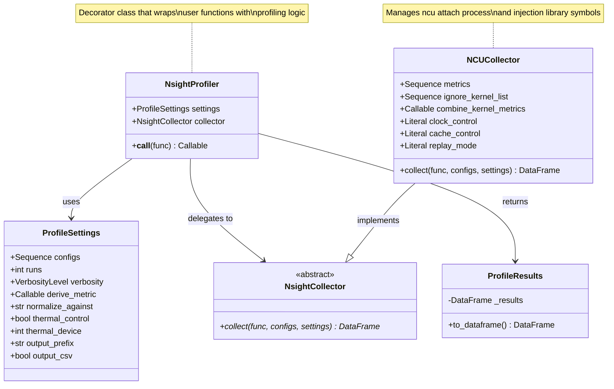
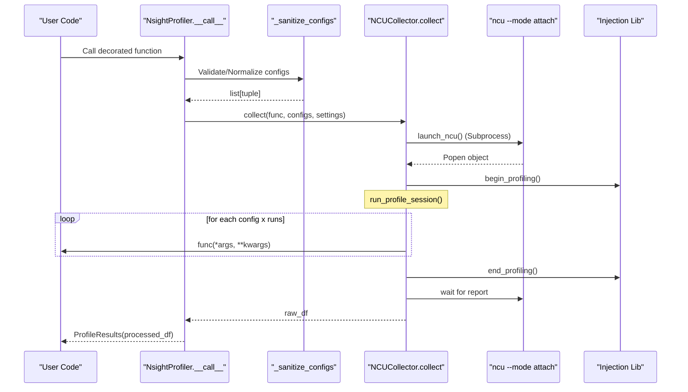

<!-- source: DeepWiki mcp.deepwiki.com · repo NVIDIA/nsight-python · page 5.2 Collection System · fetched 2026-10-26 -->

# Collection System

<details>
<summary>Relevant source files</summary>

The following files were used as context for generating this wiki page:

- [nsight/collection/core.py](nsight/collection/core.py)
- [nsight/collection/ncu.py](nsight/collection/ncu.py)
- [tests/test_collection.py](tests/test_collection.py)

</details>


The Collection System is the first phase of nsight-python's three-phase profiling pipeline. It is responsible for orchestrating the execution of user functions under the NVIDIA Nsight Compute profiler, managing hardware state (thermal control, clock control), coordinating multiple profiling runs across different configurations, and producing raw profiling data for downstream processing.

As of v1.0.0, the system uses an **injection-based attach mechanism** (`ncu --mode attach`). This allows profiling to occur within the current process (including Jupyter/Colab) without the script relaunch mechanism used in previous versions.

**Sources:** [nsight/collection/core.py:1-400](), [nsight/collection/ncu.py:1-269]()

## System Purpose and Scope

The Collection System provides:

1.  **Abstraction layer** for profiling backends (currently NVIDIA Nsight Compute).
2.  **Configuration management** for validating, padding, and binding user-provided configurations to function signatures.
3.  **Execution orchestration** for running functions multiple times across parameter spaces.
4.  **Injection management**: Loading the NCU injection library (`try_init_injection`) and controlling profiling state via `begin_profiling`/`end_profiling`.
5.  **State management** during profiling (thermal throttling prevention via `thermovision`, progress tracking).

The system is implemented in the `nsight.collection` package, with `core` handling abstractions and `ncu` handling Nsight Compute-specific implementation.

**Sources:** [nsight/collection/core.py:1-20](), [nsight/collection/ncu.py:1-10]()

## Core Abstractions

### Architecture Overview



**Diagram: Core Collection System Class Hierarchy**

The Collection System uses a **strategy pattern** to separate profiling orchestration (`NsightProfiler`) from backend-specific collection logic (`NsightCollector` implementations).

**Sources:** [nsight/collection/core.py:182-400](), [nsight/collection/ncu.py:125-269]()

### ProfileSettings Dataclass

`ProfileSettings` encapsulates configuration for a profiling session. It is defined at [nsight/collection/core.py:182-239]().

| Field | Type | Purpose |
|-------|------|---------|
| `configs` | `Sequence[Any] \| None` | List of configuration tuples/scalars |
| `runs` | `int` | Number of times each configuration is executed |
| `verbosity` | `VerbosityLevel` | Controls output detail (SILENT, INFO, DEBUG) |
| `derive_metric` | `Callable \| None` | Function to transform metrics (must return `(value, unit)`) |
| `thermal_control` | `bool` | Whether to enable thermal throttling prevention |
| `thermal_device` | `int` | CUDA device index to monitor for thermal control |

**Sources:** [nsight/collection/core.py:182-239]()

### NsightProfiler Class

`NsightProfiler` is the core orchestrator. It wraps user functions and coordinates the workflow at [nsight/collection/core.py:311-400]().



**Diagram: NsightProfiler and Injection Flow**

Key responsibilities:
1.  **Function wrapping**: Intercepts calls at [nsight/collection/core.py:337-399]().
2.  **Configuration sanitization**: Normalizes inputs via `_sanitize_configs`.
3.  **Collection delegation**: Calls the collector's `collect` method.
4.  **Run ID tracking**: Maintains `func._nspy_ncu_run_id` to allow multiple profiling sessions on one function.

**Sources:** [nsight/collection/core.py:311-400]()

## Configuration Handling

The system performs extensive signature matching to support flexible configuration inputs, including default values and keyword-only parameters.

1.  **`_sanitize_configs`**: Validates that configurations provided at decoration or runtime are consistent [nsight/collection/core.py:109-180]().
2.  **`_pad_config_with_defaults`**: If a config tuple is shorter than the function signature, it fills trailing parameters with their default values defined in the function signature [nsight/collection/core.py:49-71]().
3.  **`_bind_config_to_signature`**: Splits the final config tuple into `positional_args` and `keyword_args` based on the function's `inspect.Signature` [nsight/collection/core.py:74-106]().

**Sources:** [nsight/collection/core.py:49-180]()

## NCU Injection System

As of v1.0.0, nsight-python uses Nsight Compute's injection library to profile the current process.

### Library Loading (`try_init_injection`)

At import time, `try_init_injection()` attempts to locate and load the NCU injection library [nsight/collection/ncu.py:127-175]().
- It queries the library path using `ncu --list-injection-path-64` [nsight/collection/ncu.py:96-112]().
- It sets required environment variables: `NVTX_INJECTION64_PATH`, `NV_COMPUTE_PROFILER_PERFWORKS_DIR`, and `NV_COMPUTE_PROFILER_IN_PROCESS="1"` [nsight/collection/ncu.py:149-151]().
- It loads `libcuda-injection.so` and retrieves symbols for `nvInjBeginProfiling` and `nvInjEndProfiling` [nsight/collection/ncu.py:153-161]().

### Profiling Control

Profiling is toggled using the loaded symbols:
- **`begin_profiling()`**: Calls `nvInjBeginProfiling` with a `ProfilingParams` struct [nsight/collection/ncu.py:272-286]().
- **`end_profiling()`**: Calls `nvInjEndProfiling` [nsight/collection/ncu.py:289-301]().

**Sources:** [nsight/collection/ncu.py:127-301]()

## NCU Collector Implementation

### NCUCollector.collect

The `NCUCollector` manages the lifecycle of an `ncu` attach session [nsight/collection/ncu.py:185-269]():
1.  Checks if the injection library was successfully loaded via `injection_load_error` [nsight/collection/ncu.py:200-201]().
2.  Launches the NCU CLI in `attach` mode using `launch_ncu()` [nsight/collection/ncu.py:214-222]().
3.  Calls `begin_profiling()` to enable the injection library [nsight/collection/ncu.py:227]().
4.  Executes the workload via `run_profile_session()` [nsight/collection/ncu.py:228-235]().
5.  Calls `end_profiling()` and waits for the NCU process to finalize the report [nsight/collection/ncu.py:237-241]().

### launch_ncu Function

The `launch_ncu` function constructs the CLI command for Nsight Compute [nsight/collection/ncu.py:178-228]().

**Command Structure:**
```bash
ncu --mode attach --process-id {PID} --nvtx-include {REGEX} --metrics {METRICS} -f -o {REPORT}
```
- **`--mode attach`**: Directs NCU to attach to the running process [nsight/collection/ncu.py:214]().
- **`--process-id`**: Targets the current Python process [nsight/collection/ncu.py:216]().
- **`--nvtx-include`**: Uses a regex to capture only NVTX ranges matching the `nsight-python` domain and current function [nsight/collection/ncu.py:217-218]().

**Sources:** [nsight/collection/ncu.py:178-269]()

## Execution Session Management

### run_profile_session

The `run_profile_session` function at [nsight/collection/core.py:103-180]() orchestrates the nested loops of configurations and runs.

1.  **Thermal Control**: If enabled, it calls `thermovision.throttle_guard()` before every execution to ensure the GPU is within safe temperature limits [nsight/collection/core.py:139-141]().
2.  **Binding**: It uses `_pad_config_with_defaults` and `_bind_config_to_signature` to prepare the exact arguments for the function call [nsight/collection/core.py:144-150]().
3.  **Progress Tracking**: It updates a progress bar with ETA calculations based on the duration of previous runs [nsight/collection/core.py:152-169]().

**Sources:** [nsight/collection/core.py:103-180]()

## Integration with Nsight Compute CLI

The system relies on specific NCU versions and capabilities:
- **Minimum Version**: NCU 2026.2.1.0 (CUDA 13.3 Update 1) is required for the injection-based attach features [nsight/collection/ncu.py:30]().
- **Version Check**: `check_ncu_version` parses the output of `ncu --version` to ensure compatibility [nsight/collection/ncu.py:61-85]().
- **Error Parsing**: If NCU fails, `NCULogParser` (from `utils`) is used to extract meaningful error messages from the `.log` file generated by NCU [nsight/collection/ncu.py:254-263]().

**Sources:** [nsight/collection/ncu.py:30-85](), [nsight/collection/ncu.py:254-263]()

---

