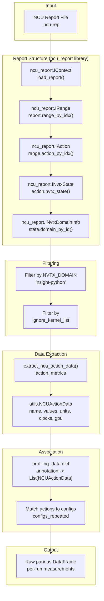
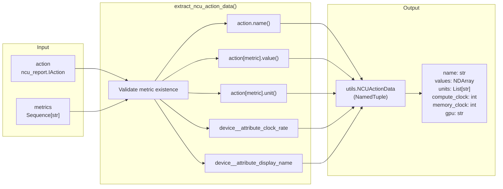

<!-- source: DeepWiki mcp.deepwiki.com · repo NVIDIA/nsight-python · page 5.3 Extraction and Processing · fetched 2026-10-26 -->

# Extraction and Processing

<details>
<summary>Relevant source files</summary>

The following files were used as context for generating this wiki page:

- [nsight/extraction.py](nsight/extraction.py)
- [nsight/transformation.py](nsight/transformation.py)
- [tests/test_transformation.py](tests/test_transformation.py)

</details>


This document describes the second phase of the nsight-python profiling pipeline: extracting raw performance data from NVIDIA Nsight Compute reports and transforming it into structured pandas DataFrames. This phase bridges the gap between binary profiling data collected by NCU and the final aggregated results ready for visualization, including the management of the `Unit` column introduced in v1.0.0.

For information about the data collection phase that precedes this, see [5.2 Collection System](). For information about how the processed data is visualized, see [5.4 Visualization Layer]().

## Overview

The extraction and processing phase consists of two major stages:

1. **Extraction**: Parsing `.ncu-rep` binary report files to extract raw metric values, associating them with user-defined annotations, and handling multiple-kernel scenarios.
2. **Transformation**: Aggregating repeated measurements, computing statistical measures, applying derived metrics, and normalizing against baselines.

The entire pipeline is implemented across two modules:
- `nsight/extraction.py`: Report parsing and initial DataFrame construction. [nsight/extraction.py:4-16]()
- `nsight/transformation.py`: Statistical aggregation and normalization. [nsight/transformation.py:4-9]()

**Sources**: [nsight/extraction.py:4-16](), [nsight/transformation.py:4-9]()

## Extraction Pipeline Architecture



**Diagram: Extraction pipeline from NCU report to initial DataFrame**

This diagram shows the complete flow through the `extract_df_from_report()` function, which processes binary NCU reports into structured pandas DataFrames.

**Sources**: [nsight/extraction.py:79-224](), [nsight/extraction.py:44-76]()

## Report Loading and Structure Navigation

The extraction process begins by loading the binary `.ncu-rep` file using the `ncu_report` Python library. If the file is missing, a `ProfilerException` is raised suggesting the use of `VerbosityLevel.DEBUG`. [nsight/extraction.py:113-119]()

NCU reports have a hierarchical structure:
- **Report**: Top-level container (`ncu_report.IContext`). [nsight/extraction.py:114-114]()
- **Ranges**: Logical groupings of profiling sessions (`ncu_report.IRange`). [nsight/extraction.py:149-149]()
- **Actions**: Individual kernel launches within a range (`ncu_report.IAction`). [nsight/extraction.py:151-151]()
- **NVTX State**: Annotation metadata attached to each action (`ncu_report.INvtxState`). [nsight/extraction.py:152-152]()

The extraction loop iterates through all ranges and actions to find kernels marked by the `nsight-python` domain. [nsight/extraction.py:148-151]()

**Sources**: [nsight/extraction.py:113-119](), [nsight/extraction.py:148-152]()

## NVTX Domain Filtering

Not all kernel launches in an NCU report are relevant. The system filters actions to only those within the `"nsight-python"` NVTX domain. [nsight/extraction.py:158-159]()

This filtering ensures that only kernels launched within `nsight.annotate` context managers or `@analyze.kernel` decorated functions are processed. The `NVTX_DOMAIN` constant is defined in `nsight/utils.py`.

Additionally, users can specify an `ignore_kernel_list` to exclude specific kernel names (e.g., initialization kernels) from analysis. [nsight/extraction.py:161-162]()

**Sources**: [nsight/extraction.py:158-162]()

## Metric Extraction from Actions

For each relevant action, the `extract_ncu_action_data()` function extracts the requested metrics along with hardware context. [nsight/extraction.py:44-76]()



**Diagram: Data extraction from NCU action objects**

The function returns a `utils.NCUActionData` namedtuple containing:
- `name`: Kernel name string. [nsight/extraction.py:70-70]()
- `values`: A numpy array of metric values. [nsight/extraction.py:71-71]()
- `units`: A list of unit strings corresponding to the metrics. [nsight/extraction.py:75-75]()
- `compute_clock`: GPU compute clock rate. [nsight/extraction.py:72-72]()
- `memory_clock`: GPU memory clock rate. [nsight/extraction.py:73-73]()
- `gpu`: GPU display name. [nsight/extraction.py:74-74]()

**Sources**: [nsight/extraction.py:44-76]()

## Annotation Association and Multiple Kernels

Extracted action data is grouped by annotation name into a dictionary. [nsight/extraction.py:167-169]()

After extraction, the system calculates how many kernels were launched per annotation run. [nsight/extraction.py:183-183]() If multiple kernels are detected (e.g., a function that launches a setup kernel and a compute kernel), a `combine_kernel_metrics` function must be provided to merge them (typically by summation). [nsight/extraction.py:190-195]()

The system uses `functools.reduce` with `NCUActionData.combine()` to merge metrics across multiple kernels in a single annotation run. [nsight/extraction.py:202-206]()

**Sources**: [nsight/extraction.py:167-169](), [nsight/extraction.py:183-206]()

## Derived Metrics and the Unit Column

In v1.0.0, derived metrics support returning units. If a `derive_metric` function is provided, it can return either a raw value or a `(value, unit)` tuple. [nsight/extraction.py:32-34]()

```python
# Extraction logic for derived metrics
if derive_metric is not None:
    # ... bind args ...
    derived_result = derive_metric(val, **bound_args.arguments)
    if isinstance(derived_result, tuple):
        derived_val, derived_unit = derived_result
    else:
        derived_val = derived_result
        derived_unit = np.nan # Warning issued if unit missing
```

If a derived metric returns only a value, a warning `DERIVED_METRIC_MISSING_UNIT_WARNING` is issued, and the `Unit` column is populated with `np.nan`. [nsight/extraction.py:37-41]()

**Sources**: [nsight/extraction.py:32-41](), [nsight/extraction.py:236-258]()

## Aggregation Pipeline

The `aggregate_data()` function in `nsight/transformation.py` performs statistical aggregation. [nsight/transformation.py:21-38]()

### Grouping with Unhashable Types
A key challenge in aggregation is that kernel configurations can include unhashable types like `dict` or `list`. To handle this, `aggregate_data` detects non-groupable columns and creates temporary stringified sort keys. [nsight/transformation.py:105-128]()

```python
def _is_groupable(series: pd.Series) -> bool:
    # Checks if values are hashable and sortable
    # ...
```

The original objects (like dicts) are recovered using a `first` aggregation to ensure the output DataFrame preserves the original Python objects rather than their string representations. [nsight/transformation.py:124-124]()

### Statistical Measures
The aggregation computes the following for each group:
- `AvgValue`: Mean of the measurements. [nsight/transformation.py:60-60]()
- `StdDev`: Standard deviation. [nsight/transformation.py:61-61]()
- `CI95_Lower/Upper`: 95% confidence intervals (1.96 * SEM). [nsight/transformation.py:138-143]()
- `StableMeasurement`: Boolean flag; `True` if `RelativeStdDevPct` < 2%. [nsight/transformation.py:151-151]()

**Sources**: [nsight/transformation.py:58-151](), [nsight/transformation.py:105-128]()

## Normalization and Geometric Mean

When `normalize_against` is specified, the `AvgValue` of each configuration is divided by the `AvgValue` of the baseline annotation for that same configuration. [nsight/transformation.py:163-189]()

```python
# Normalize the AvgValue by the values of the normalization annotation
agg_df["AvgValue"] = agg_df["AvgValue"] / agg_df["NormalizationValue"]
```

The system also calculates a **Geometric Mean** (`Geomean`) for each metric/annotation group across all configurations. [nsight/transformation.py:191-193]() This is particularly useful for summarizing speedups across a parameter sweep.

**Sources**: [nsight/transformation.py:163-193]()

## Final DataFrame Structure

The final processed DataFrame returned to the user (and the visualization layer) contains:

| Column | Description |
|--------|-------------|
| `Annotation` | The name provided in `@analyze.kernel` or `nsight.annotate`. |
| `Metric` | The NCU metric name or derived metric name. |
| `AvgValue` | The mean measurement (or normalized ratio). |
| `Unit` | The unit string (e.g., `msec`, `Gbyte/second`, `TFLOPs`). |
| `StdDev` | Standard deviation of the runs. |
| `NumRuns` | Number of iterations profiled. |
| `StableMeasurement` | Whether the variance was low enough for reliable analysis. |
| `Kernel` | The name of the CUDA kernel. |
| `GPU` | The GPU hardware model. |
| `Normalized` | Indicates if the row is normalized against a baseline. |
| `...` | One column for each parameter in the profiled function's signature. |

**Sources**: [nsight/transformation.py:58-161](), [nsight/extraction.py:269-303](), [tests/test_transformation.py:19-29]()

---

