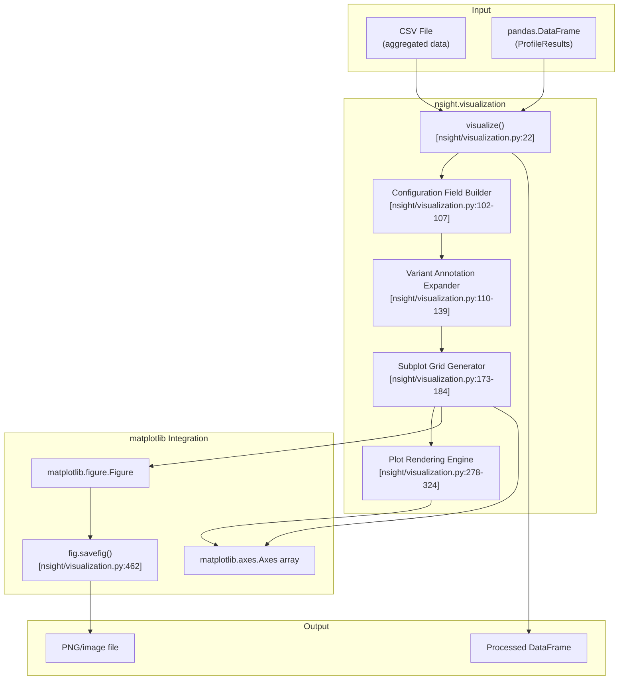
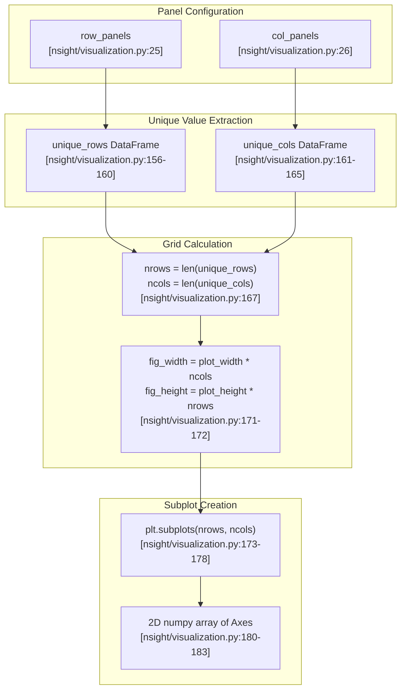
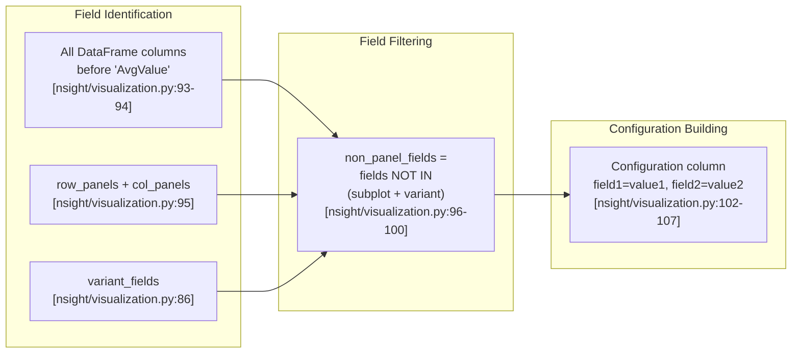
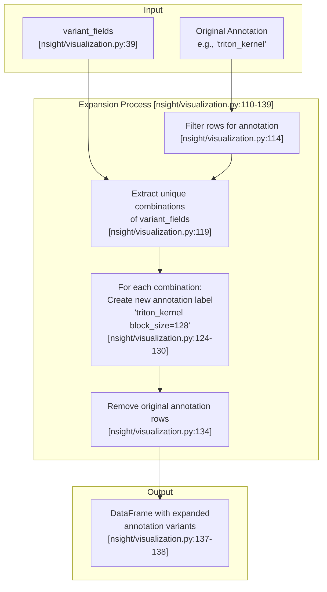
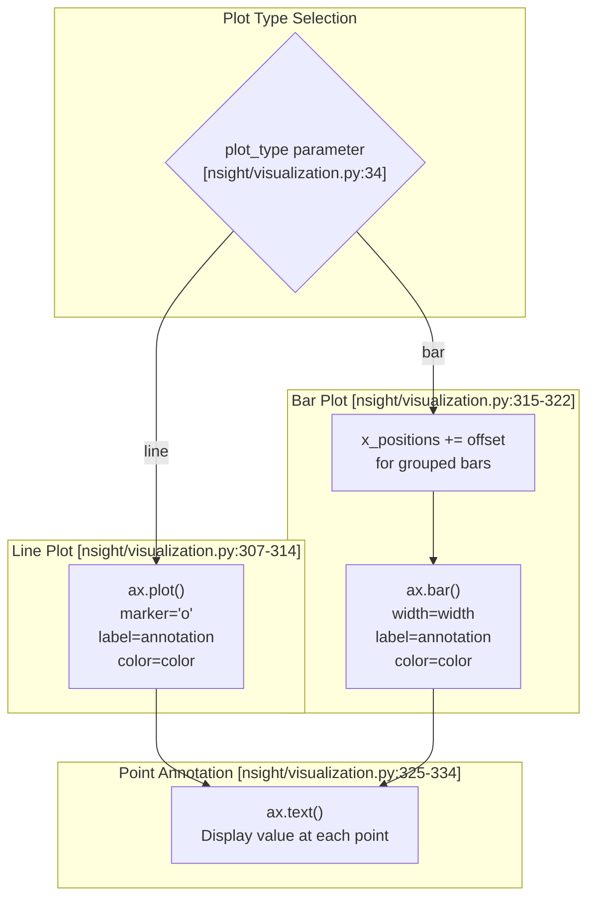

<!-- source: DeepWiki mcp.deepwiki.com · repo NVIDIA/nsight-python · page 5.4 Visualization Layer · fetched 2026-10-26 -->

# Visualization Layer

<details>
<summary>Relevant source files</summary>

The following files were used as context for generating this wiki page:

- [docs/source/overview/architecture.rst](docs/source/overview/architecture.rst)
- [docs/source/visualization.rst](docs/source/visualization.rst)
- [nsight/visualization.py](nsight/visualization.py)

</details>


## Purpose and Scope

The Visualization Layer is the final phase in nsight-python's three-phase pipeline, responsible for transforming structured profiling results into publication-quality plots and CSV files. This layer receives aggregated DataFrames from the Extraction and Processing phase (see [5.3]()) and generates matplotlib-based visualizations with configurable subplot layouts, annotation grouping, and metric displays.

This page documents the internal architecture of the visualization subsystem. For user-facing documentation on using the `@analyze.plot` decorator, see [4.5](). For the complete three-phase pipeline overview, see [5.1]().

---

## Overview

The Visualization Layer is implemented primarily in the `nsight.visualization` module and provides a single public function `visualize()` that orchestrates all plotting operations. The layer integrates tightly with pandas DataFrames, matplotlib figures, and numpy arrays to produce customizable multi-panel plots.



**Sources**: [nsight/visualization.py:1-471]()

---

## Core Function: `visualize()`

The `visualize()` function [nsight/visualization.py:22-470]() is the primary entry point for all visualization operations. It accepts either a DataFrame or CSV file path, along with configuration parameters that control subplot layout, plot appearance, and data grouping.

### Function Signature and Parameters

| Parameter | Type | Purpose |
|-----------|------|---------|
| `agg_df` | `str \| pd.DataFrame` | Aggregated profiling data or path to CSV file [nsight/visualization.py:23]() |
| `metric` | `str \| None` | Specific metric to plot (e.g., `gpu__time_duration.sum`) [nsight/visualization.py:24]() |
| `row_panels` | `Sequence[str] \| None` | Fields whose unique values create vertical subplot grid [nsight/visualization.py:25]() |
| `col_panels` | `Sequence[str] \| None` | Fields whose unique values create horizontal subplot grid [nsight/visualization.py:26]() |
| `x_keys` | `Sequence[str] \| None` | Fields to use for x-axis (defaults to non-panel config fields) [nsight/visualization.py:27]() |
| `variant_fields` | `Sequence[Any] \| None` | Config fields to split into separate lines per annotation [nsight/visualization.py:39]() |
| `variant_annotations` | `Sequence[Any] \| None` | Annotation names to apply variant splitting [nsight/visualization.py:40]() |
| `plot_type` | `str` | `"line"` or `"bar"` [nsight/visualization.py:34]() |
| `plot_width` | `int` | Width per subplot in inches [nsight/visualization.py:35]() |
| `plot_height` | `int` | Height per subplot in inches [nsight/visualization.py:36]() |
| `annotate_points` | `bool` | Whether to label data points with values [nsight/visualization.py:32]() |
| `show_avg` | `bool` | Whether to add "Avg" column with mean values [nsight/visualization.py:33]() |
| `show_geomean` | `bool` | Whether to add "Geomean" column [nsight/visualization.py:37]() |
| `show_grid` | `bool` | Whether to display grid lines [nsight/visualization.py:38]() |
| `title` | `str` | Main plot title [nsight/visualization.py:29]() |
| `ylabel` | `str` | Y-axis label (typically the metric name) [nsight/visualization.py:31]() |
| `filename` | `str` | Output filename for saved plot [nsight/visualization.py:30]() |
| `print_data` | `bool` | Whether to print aggregated data to stdout [nsight/visualization.py:28]() |
| `plot_callback` | `Callable[[Figure], None] \| None` | Custom callback for figure manipulation [nsight/visualization.py:41]() |

The function returns a `pd.DataFrame` containing the processed aggregated data [nsight/visualization.py:42]().

**Sources**: [nsight/visualization.py:22-42]()

---

## Panel-Based Subplot Layout System

The visualization layer uses a grid-based layout system where subplots are organized by `row_panels` and `col_panels` parameters. Each unique combination of row and column panel values creates a separate subplot.



### Layout Logic

1. **Extract Unique Values**: For each panel field, extract unique values from the DataFrame [nsight/visualization.py:156-165]().
2. **Calculate Grid Dimensions**: `nrows` and `ncols` are derived from the length of unique panel combinations [nsight/visualization.py:167]().
3. **Determine Figure Size**: Total figure size scales with the number of subplots using minimum per-subplot dimensions (`plot_width`, `plot_height`) [nsight/visualization.py:169-172]().
4. **Create Subplots**: Call `plt.subplots()` with `constrained_layout=True` for automatic spacing [nsight/visualization.py:173-178]().
5. **Normalize Axes Array**: Expand dimensions to ensure a 2D array even with a single row or column [nsight/visualization.py:180-183]().

### Data Filtering Per Subplot

For each subplot at position `(row_idx, col_idx)`, the data is filtered to match the row and column panel values:

```python
# [nsight/visualization.py:188-196]()
subplot_df = agg_df
if row_panels:
    subplot_df = subplot_df[(subplot_df[row_panels] == row_values).all(axis=1)]
if col_panels:
    subplot_df = subplot_df[(subplot_df[col_panels] == col_values).all(axis=1)]
```

**Sources**: [nsight/visualization.py:156-196]()

---

## Configuration Field Construction

The visualization layer constructs a `Configuration` field that represents x-axis labels by combining non-panel configuration parameters into comma-separated strings.



The construction happens in two locations:

1. **Global Configuration**: Built for the entire DataFrame at the start [nsight/visualization.py:102-107]().
2. **Per-Subplot Configuration**: Rebuilt for each subplot's filtered data, potentially with custom `x_keys` [nsight/visualization.py:200-228]().

The configuration string format is: `"field1=value1, field2=value2, ..."` where fields are joined in order [nsight/visualization.py:103-105]().

### X-Keys Validation

When `x_keys` is specified, the function validates that:
1. All `x_keys` fields exist in the `non_panel_fields` list [nsight/visualization.py:148-154]().
2. No `x_keys` overlap with `row_panels`, `col_panels`, or `variant_fields` [nsight/visualization.py:207-211]().

**Sources**: [nsight/visualization.py:86-228]()

---

## Variant Annotation Expansion

The variant system allows splitting a single annotation into multiple lines based on configuration field values. This is useful when comparing different parameter combinations within the same annotation.



### Expansion Algorithm

1. **Filter by Annotation**: Select rows matching the target annotation name [nsight/visualization.py:114]().
2. **Find Unique Combinations**: Extract unique combinations of variant field values [nsight/visualization.py:119]().
3. **Create Variant Labels**: For each combination, create a new annotation label by appending variant field values [nsight/visualization.py:124-131]().
4. **Remove Original Rows**: Delete the original annotation rows from the DataFrame [nsight/visualization.py:134]().
5. **Concatenate**: Combine remaining data with all new variant rows [nsight/visualization.py:137]().

This expansion occurs both globally (once at the start) and per-subplot (for local data filtering) [nsight/visualization.py:231-259]().

**Sources**: [nsight/visualization.py:110-139](), [nsight/visualization.py:231-259]()

---

## Plot Rendering Engine

The rendering engine iterates through each subplot and annotation, creating line or bar plots with the NVIDIA color palette.

### NVIDIA Color Scheme

The visualization layer uses a predefined NVIDIA color palette [nsight/visualization.py:262-277]().

### Plot Type Rendering



### Rendering Loop Structure

1. **Iterate Annotations**: For each unique annotation in the subplot data [nsight/visualization.py:288]().
2. **Assign Color**: Use NVIDIA color palette with wraparound [nsight/visualization.py:288]().
3. **Map X-Positions**: Map configuration labels to x-axis positions [nsight/visualization.py:298-299]().
4. **Adjust for Grouped Bars**: If multiple annotations with bar plot, offset x-positions [nsight/visualization.py:302-305]().
5. **Render Plot**: Call `ax.plot()` or `ax.bar()` [nsight/visualization.py:307-322]().
6. **Annotate Points**: If enabled (`annotate_points=True`), add text labels at each data point [nsight/visualization.py:325-334]().

**Sources**: [nsight/visualization.py:261-334]()

---

## Average and Geometric Mean Display

The visualization layer optionally displays average and geometric mean values as additional columns after the main data.

### Average Column Logic

When `show_avg=True` [nsight/visualization.py:336]():
1. Add vertical separator line at `sep_index = len(unique_configs)` [nsight/visualization.py:338-344]().
2. For each annotation, compute mean of valid (non-NaN) values [nsight/visualization.py:293-294]().
3. Plot bar at offset position [nsight/visualization.py:351]().
4. Annotate with formatted value [nsight/visualization.py:355-364]().

### Geometric Mean Column Logic

When `show_geomean=True` [nsight/visualization.py:366]():
1. Add vertical separator line [nsight/visualization.py:368]().
2. Extract precomputed `Geomean` value from DataFrame [nsight/visualization.py:379-381]().
3. Plot bar at offset position [nsight/visualization.py:386-388]().
4. Annotate with formatted value [nsight/visualization.py:389-398]().

**Sources**: [nsight/visualization.py:336-413]()

---

## Subplot Formatting and Layout

Each subplot receives consistent formatting including titles, labels, legends, and grid settings.

### Title Generation

Subplot titles combine row and column panel values [nsight/visualization.py:427-440]().

### Y-Axis Labeling

Only the leftmost subplot in each row displays the y-axis label [nsight/visualization.py:423-424]():

```python
if col_idx == 0:
    ax.set_ylabel(f"{ylabel} (avg: {agg_df['NumRuns'].max()} runs)")
```

### X-Axis Label Management

For multi-row layouts, only the bottom row displays x-axis labels [nsight/visualization.py:456-463]().

### Legend Placement

Each subplot gets an independent legend positioned automatically [nsight/visualization.py:443-449]().

**Sources**: [nsight/visualization.py:415-463]()

---

## Hardware Information and Main Title

The visualization layer automatically extracts GPU and host information from the DataFrame and incorporates it into the main title.

1. **Hardware Info Extraction**: `gpu_model` and `host` are extracted from unique values in the DataFrame [nsight/visualization.py:142-143]().
2. **Title Construction**: A hardware info subtitle is appended to the provided title [nsight/visualization.py:144-145]().
3. **Figure Title**: Set using `fig.suptitle()` with `y=1.08` to position it above the subplots [nsight/visualization.py:466]().

**Sources**: [nsight/visualization.py:142-145](), [nsight/visualization.py:466]()

---

## Output Generation and Callbacks

### File Output

The figure is saved using `fig.savefig()` with `bbox_inches="tight"` to prevent clipping [nsight/visualization.py:472]().

### Plot Callback System

Users can provide a custom `plot_callback` function that receives the matplotlib `Figure` object before saving [nsight/visualization.py:468-469]().

### Console Output

When `print_data=True`, the aggregated DataFrame is printed to stdout with formatted values [nsight/visualization.py:474-477]().

### DataFrame Return

The function returns the processed DataFrame, allowing programmatic access to the aggregated data [nsight/visualization.py:480]().

**Sources**: [nsight/visualization.py:468-480]()

---

