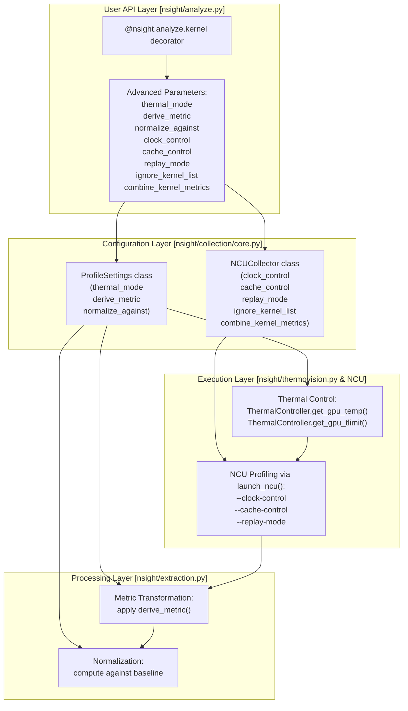
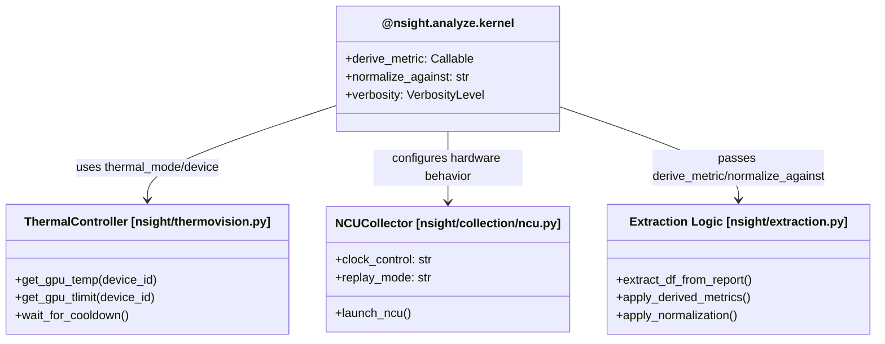

<!-- source: DeepWiki mcp.deepwiki.com · repo NVIDIA/nsight-python · page 6 Advanced Topics · fetched 2026-10-26 -->

# Advanced Topics

<details>
<summary>Relevant source files</summary>

The following files were used as context for generating this wiki page:

- [nsight/analyze.py](nsight/analyze.py)
- [tests/run_api_params.py](tests/run_api_params.py)
- [tests/test_api_params.py](tests/test_api_params.py)
- [tests/test_thermal_control.py](tests/test_thermal_control.py)

</details>


This page covers advanced features and configuration options in nsight-python for power users who need fine-grained control over GPU profiling behavior, custom metric computations, and data processing. These features extend the basic profiling workflow described in [Basic Profiling Workflow](#3.3) with capabilities for thermal management, metric transformations, performance normalization, and low-level profiling controls.

The advanced topics are organized into four subsections:
- [Thermal Management](#6.1): GPU temperature monitoring and throttling prevention, including the new `thermal_device` pinning.
- [Custom Derived Metrics](#6.2): Transforming raw metrics into domain-specific measurements with proper unit tracking.
- [Normalization and Baselines](#6.3): Computing relative performance and speedup.
- [Advanced Configuration Options](#6.4): Low-level profiling controls (clock/cache control, replay modes, kernel filtering) and the new `VerbosityLevel` system.

For information about the core profiling decorators and basic usage, see [Using nsight.analyze.kernel](#4.1) and [Using nsight.annotate](#4.2).

**Sources**: [nsight/analyze.py:1-20]()

---

## Overview of Advanced Parameters

The `@nsight.analyze.kernel` decorator exposes several configurable parameters for fine-tuning collection and extraction behavior.

### Parameter Classification

The following table categorizes the advanced parameters by their function:

| Category | Parameters | Purpose |
|----------|-----------|---------|
| **Thermal Management** | `thermal_mode`, `thermal_wait`, `thermal_cont`, `thermal_timeout`, `thermal_device` | GPU temperature monitoring, cooling wait, and device pinning |
| **Metric Transformation** | `derive_metric`, `normalize_against` | Custom metric computation and performance comparison |
| **Hardware Control** | `clock_control`, `cache_control` | GPU clock and cache state management |
| **Profiling Behavior** | `replay_mode`, `ignore_kernel_list`, `combine_kernel_metrics` | Kernel replay strategy and multi-kernel handling |
| **Output Control** | `verbosity`, `output_prefix`, `output_csv` | Logging verbosity (replaces `output`) and file generation |

**Sources**: [nsight/analyze.py:61-86]()

---

## Advanced Parameter Data Flow

The following diagram shows how advanced parameters flow through the profiling pipeline and which components consume them. It bridges the natural language configuration to the internal code entities.



**Diagram**: Advanced Parameter Flow Through Profiling Pipeline

**Sources**: [nsight/analyze.py:61-86](), [nsight/collection/ncu.py:1-50]()

---

## Thermal Management System

The thermal management system prevents GPU thermal throttling during profiling by monitoring GPU temperature via NVML and enforcing cooling periods. This ensures stable clock frequencies and reproducible measurements.

### Thermal Control Parameterization

The system has been updated in v1.0.0 to support more granular control:
- `thermal_mode`: Options include `"auto"`, `"manual"`, or `"off"`. [nsight/analyze.py:79]()
- `thermal_device`: Pins monitoring to a specific CUDA device index. [nsight/analyze.py:83]()
- `thermal_wait`/`thermal_cont`: Configures the target temperatures for waiting and continuing. [nsight/analyze.py:80-81]()

For details, see [Thermal Management](#6.1).

**Sources**: [nsight/analyze.py:79-83](), [tests/test_thermal_control.py:14-19]()

---

## Derived Metrics System

The `derive_metric` parameter enables transformation of raw profiling metrics into custom measurements like TFLOPs. 

### v1.0.0 Requirements
As of v1.0.0, the `derive_metric` function should return a tuple of `(value, unit)` to ensure the `Unit` column in the resulting DataFrame is correctly populated. [nsight/analyze.py:134-152]()

```python
def my_derive_metric(time_ns, M, N, K):
    tflops = (2 * M * N * K) / (time_ns * 1e-9) / 1e12
    return (tflops, "TFLOPS")
```

For details, see [Custom Derived Metrics](#6.2).

**Sources**: [nsight/analyze.py:134-154]()

---

## Normalization System

The `normalize_against` parameter enables computing relative performance metrics by establishing a baseline configuration. This is commonly used for speedup calculations.

### Normalization Workflow

The normalization process identifies the baseline configuration by matching annotation names (set via `nsight.annotate(name="baseline")`), extracts its metric value, and divides all other metrics by this baseline value, populating the `Normalized` column. [nsight/analyze.py:155-161]()

For details, see [Normalization and Baselines](#6.3).

**Sources**: [nsight/analyze.py:155-161]()

---

## Advanced Configuration Options

The `@nsight.analyze.kernel` decorator provides low-level controls for GPU hardware behavior and profiling strategy.

### Hardware and Replay Controls

| Parameter | Values | Purpose |
|-----------|--------|---------|
| `clock_control` | `"base"`, `"none"` | Lock GPU clocks to base frequency to reduce variance. [nsight/analyze.py:76]() |
| `cache_control` | `"all"`, `"none"` | Flush GPU caches between replays. [nsight/analyze.py:77]() |
| `replay_mode` | `"kernel"`, `"range"` | Replay individual kernels or entire NVTX ranges. [nsight/analyze.py:78]() |

### Multi-Kernel Aggregation

If an annotation contains multiple kernels, `combine_kernel_metrics` must be provided to define how to aggregate them (e.g., `lambda x, y: x + y`). [nsight/analyze.py:84]()

### Verbosity Levels

In v1.0.0, the `output` parameter is replaced by `verbosity`, which uses the `VerbosityLevel` enum:
- `VerbosityLevel.SILENT` (0)
- `VerbosityLevel.INFO` (3)
- `VerbosityLevel.DEBUG` (4)

**Sources**: [nsight/analyze.py:73-84](), [nsight/utils.py:19-23]()

---

## Code Entity Association

The following diagram associates natural language advanced concepts with their specific implementation classes and functions in the codebase.



**Diagram**: Code Entity Association for Advanced Features

For details on all advanced flags, see [Advanced Configuration Options](#6.4).

**Sources**: [nsight/analyze.py:61-86](), [tests/test_api_params.py:150-160]()

---

