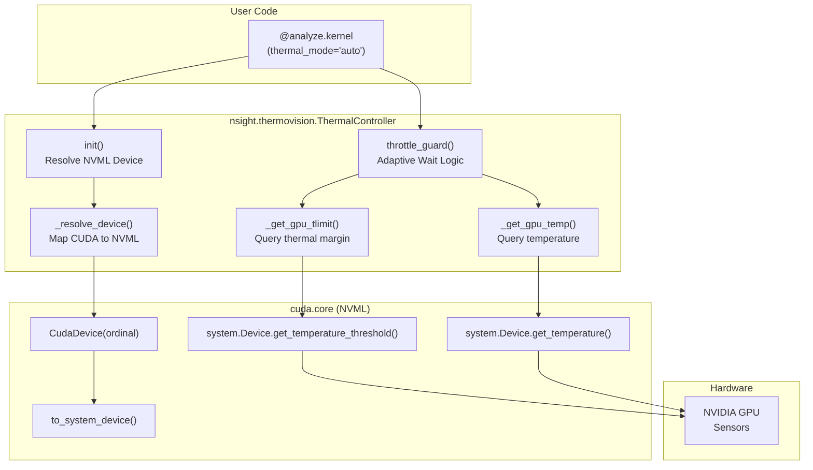
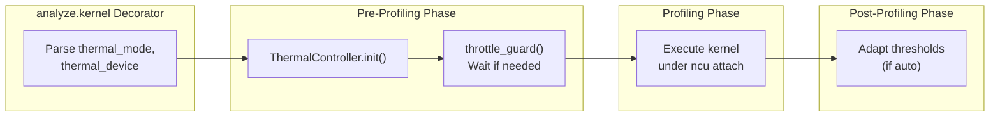
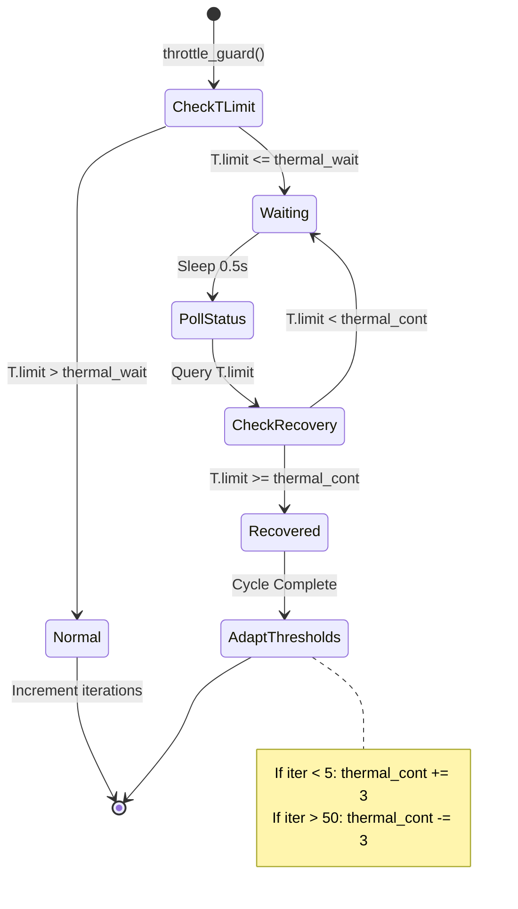

<!-- source: DeepWiki mcp.deepwiki.com · repo NVIDIA/nsight-python · page 6.1 Thermal Management · fetched 2026-10-26 -->

# Thermal Management

<details>
<summary>Relevant source files</summary>

The following files were used as context for generating this wiki page:

- [nsight/thermovision.py](nsight/thermovision.py)
- [pyproject.toml](pyproject.toml)
- [tests/run_api_params.py](tests/run_api_params.py)
- [tests/test_api_params.py](tests/test_api_params.py)
- [tests/test_thermal_control.py](tests/test_thermal_control.py)
- [tests/test_thermovision.py](tests/test_thermovision.py)

</details>


## Purpose and Scope

This document describes the thermal management subsystem (**thermovision**) in nsight-python, which prevents GPU thermal throttling from affecting profiling measurements. The system monitors GPU temperature and thermal margin via the `cuda-core` (NVML) library, automatically delaying kernel execution when the GPU is too hot.

As of version **1.0.0**, the subsystem features an **adaptive cooling algorithm** that learns optimal thresholds based on workload intensity and supports pinning monitoring to a specific CUDA device via the `thermal_device` parameter.

**Sources**: [nsight/thermovision.py:10-17](), [nsight/thermovision.py:51-84]()

---

## Overview

### Why Thermal Management is Necessary

GPU profiling workloads generate sustained compute load that can elevate GPU temperature to levels that trigger thermal throttling. When thermal throttling occurs, the GPU automatically reduces clock speeds to prevent overheating, which:

- Introduces **measurement variability** between profiling runs.
- Makes **performance comparisons invalid** across different thermal states.
- Produces **misleading benchmark results** that don't reflect true kernel performance.

The thermovision subsystem addresses this by monitoring the GPU's thermal state and enforcing cooling periods before profiling begins.

### Key Concepts

| Concept | Description |
|---------|-------------|
| **T.limit (Thermal Margin)** | Temperature headroom before throttling (°C). Lower values indicate the GPU is closer to throttling. |
| **GPU Temperature** | Current GPU core temperature (°C) measured via NVML. |
| **Adaptive Mode** | Automatically adjusts cooling thresholds based on how many iterations a kernel completes before reaching the thermal limit. |
| **Thermal Headroom** | The difference between the current temperature and the throttle point. |

**Sources**: [nsight/thermovision.py:31-41](), [nsight/thermovision.py:60-84]()

---

## Architecture

### System Components



**Diagram: Thermovision Component Architecture**

**Sources**: [nsight/thermovision.py:44-59](), [nsight/thermovision.py:111-129](), [nsight/thermovision.py:144-173]()

---

### Integration with Profiling Pipeline



**Diagram: Thermal Management in Profiling Flow**

**Sources**: [nsight/thermovision.py:111-129](), [nsight/thermovision.py:230-264]()

---

## Thermal Control Mechanism

### Adaptive Throttle Guard

The `ThermalController` implements an adaptive state machine. Unlike fixed thresholds, the **Adaptive Mode** (`thermal_mode="auto"`) monitors how many iterations the GPU performs between cooling cycles.

- **If iterations < 5**: The GPU is heating up too fast. The `thermal_cont` (continue threshold) is **increased** by 3°C to force more cooling.
- **If iterations > 50**: The GPU is running cool/slowly. The `thermal_cont` is **decreased** by 3°C to reduce unnecessary wait time.



**Diagram: Adaptive Throttle Guard State Machine**

**Sources**: [nsight/thermovision.py:37-41](), [nsight/thermovision.py:230-264](), [tests/test_thermovision.py:98-144]()

---

## Usage

### Parameters in `@analyze.kernel`

| Parameter | Default | Description |
|-----------|---------|-------------|
| `thermal_mode` | `"auto"` | `"auto"` (adaptive), `"manual"` (fixed), or `"off"`. |
| `thermal_wait` | `10` | Thermal headroom (°C) to trigger cooling. |
| `thermal_cont` | `20` | Thermal headroom (°C) to resume after cooling. |
| `thermal_timeout`| `180` | Max seconds to wait for cooling before raising `CoolingTimeoutError`. |
| `thermal_device` | `None` | CUDA device ordinal to monitor. Honors `CUDA_VISIBLE_DEVICES`. |

**Sources**: [nsight/thermovision.py:51-84](), [nsight/thermovision.py:32-34]()

### Example: Pinning to a Specific Device

In multi-GPU environments, you can ensure the controller monitors the exact device being profiled:

```python
@nsight.analyze.kernel(
    configs=[(1024, 1024)],
    thermal_mode="auto",
    thermal_device=0, # Explicitly monitor CUDA:0
    verbosity=nsight.VerbosityLevel.INFO
)
def my_kernel(n, m):
    ...
```

**Sources**: [nsight/thermovision.py:144-173](), [tests/test_thermovision.py:191-207]()

---

## Implementation Details

### Device Resolution and Mapping

The controller maps CUDA ordinals to NVML system devices using UUIDs. This ensures that even if `CUDA_VISIBLE_DEVICES` remaps `0` to a different physical GPU, the monitor follows the correct hardware.

1. **Resolution**: `_resolve_device()` is called during `init()`.
2. **Mapping**: It creates a `cuda.core.Device` object and calls `to_system_device()` to get the NVML-backed system handle.
3. **Fallback**: If the requested `thermal_device` cannot be resolved, it falls back to the first available physical GPU to maintain safety.

**Sources**: [nsight/thermovision.py:131-142](), [nsight/thermovision.py:144-173]()

### Dependency Management

The module depends on `cuda-core` (part of the `nvidia-cuda-python` bindings).

- **Availability Check**: `CUDA_CORE_AVAILABLE` flag guards all NVML operations.
- **Graceful Degradation**: If `cuda-core` is missing, a warning is issued and thermal control is disabled, but profiling proceeds.

**Sources**: [nsight/thermovision.py:20-29](), [nsight/thermovision.py:120-129]()

---

## Testing

### Mocked Thermal Scenarios

The test suite validates the adaptive logic and device resolution without requiring a physical GPU to overheat:

| Test Case | Purpose |
|-----------|---------|
| `test_thermovision_module_with_thermal_waiting` | Verifies `time.sleep` is called when T.limit is low. |
| `test_adaptive_thermal_control_increase` | Verifies `thermal_cont` increases when iterations are < 5. |
| `test_adaptive_thermal_control_decrease` | Verifies `thermal_cont` decreases when iterations are > 50. |
| `test_resolve_device_uses_current_cuda_device` | Validates that `None` maps to the current context. |

**Sources**: [tests/test_thermovision.py:34-73](), [tests/test_thermovision.py:98-144](), [tests/test_thermovision.py:147-189]()

---

## API Reference: ThermalController

### `init() -> bool`
Resolves the NVML device handle. Returns `True` if temperature retrieval is supported.
**Sources**: [nsight/thermovision.py:111-129]()

### `throttle_guard() -> None`
The main entry point called before kernel execution. Checks thermal headroom and enters a sleep loop if `T.limit < thermal_wait`.
**Sources**: [nsight/thermovision.py:230-264]()

### `_resolve_device() -> Any`
Maps the `thermal_device` ordinal to a physical NVML device.
**Sources**: [nsight/thermovision.py:144-173]()

---
**Sources**: [nsight/thermovision.py:1-264](), [tests/test_thermovision.py:1-207]()

---

