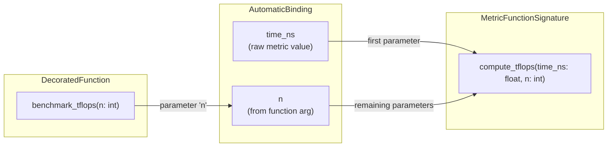
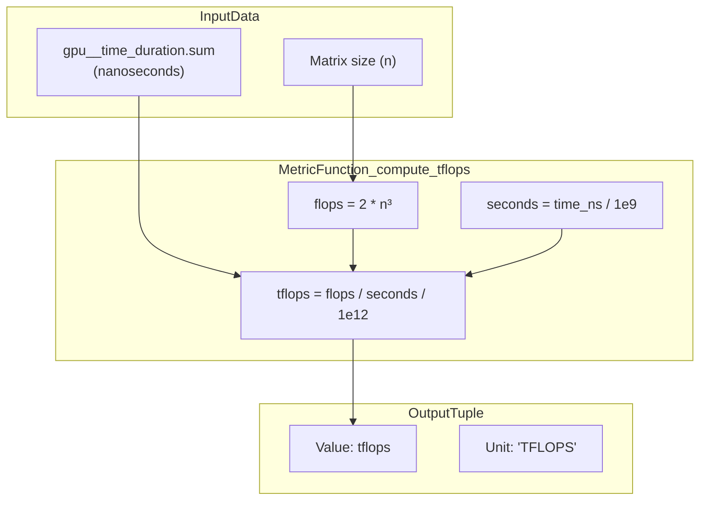
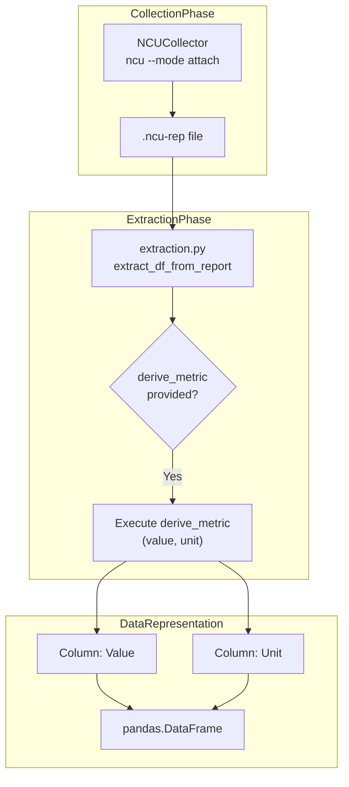

<!-- source: DeepWiki mcp.deepwiki.com · repo NVIDIA/nsight-python · page 6.2 Custom Derived Metrics · fetched 2026-10-26 -->

# Custom Derived Metrics

<details>
<summary>Relevant source files</summary>

The following files were used as context for generating this wiki page:

- [examples/03_custom_metrics.py](examples/03_custom_metrics.py)
- [examples/09_advanced_metric_custom.py](examples/09_advanced_metric_custom.py)
- [nsight/extraction.py](nsight/extraction.py)

</details>


This page documents how to define and use custom derived metrics in nsight-python. Derived metrics are user-defined transformations of raw profiling data that enable computing application-specific performance measures like TFLOPs, bandwidth utilization, or efficiency ratios that cannot be directly collected by NVIDIA Nsight Compute.

Starting with **v1.0.0**, derived metrics must return a `(value, unit)` tuple to properly populate the **Unit** column in the resulting DataFrames and plots.

---

## Purpose of Derived Metrics

The NVIDIA Nsight Compute profiler collects hardware counters and timing data from GPU kernels. However, application-level performance metrics often require additional computation. For example:

| Raw Metric | Derived Metric | Transformation Required | Unit (v1.0.0+) |
|------------|----------------|------------------------|----------------|
| `gpu__time_duration.sum` (ns) | TFLOPs/s | `(operation_count / time) / 1e12` | `"TFLOPS"` |
| `dram__bytes.sum` (bytes) | Bandwidth (GB/s) | `(bytes / time) / 1e9` | `"GB/s"` |
| `smsp__sass_inst_executed.sum` | Instructions per SM | `inst_count / sm_count` | `"inst/SM"` |

Derived metrics enable expressing profiling results in domain-specific units that are meaningful for performance analysis and optimization.

**Sources:** [nsight/extraction.py:32-41](), [examples/03_custom_metrics.py:8-28]()

---

## The `derive_metric` Parameter

The `@nsight.analyze.kernel` decorator accepts a `derive_metric` parameter that specifies a transformation function to apply to collected metrics.

### Parameter Specification

```python
@nsight.analyze.kernel(
    derive_metric: Callable[..., Any] | None = None
)
```

- **Type:** Optional callable that returns a `(value, unit)` tuple or a `dict[str, (value, unit)]`.
- **Default:** `None` (no transformation applied).
- **Behavior:** When specified, the function is called for each profiling measurement to compute the derived value. If it returns a scalar without a unit, a warning is issued and `np.nan` is stored in the Unit column [nsight/extraction.py:37-41]().

**Sources:** [nsight/analyze.py:32](), [nsight/extraction.py:85-89]()

---

## Metric Function Signature Requirements

### Standard Signature

A derived metric function must follow this signature pattern:

```python
def metric_function(raw_metric_1, raw_metric_2, ..., *function_args) -> tuple[float, str] | dict:
```

#### Diagram: Metric Function Parameter Mapping



**Key Requirements:**

1. **First N parameters** receive the raw metric values in the order they are defined in the `metrics` list of the `@kernel` decorator. If no `metrics` list is provided, the first parameter receives the default `gpu__time_duration.sum` [examples/09_advanced_metric_custom.py:27-39]().
2. **Remaining parameters** must match the decorated function's signature exactly (names and order) [examples/03_custom_metrics.py:49-52]().
3. **Return type (v1.0.0):** Should be a tuple of `(value, unit_string)` or a dictionary mapping metric names to such tuples [nsight/extraction.py:32-35]().

**Sources:** [examples/03_custom_metrics.py:43-63](), [examples/09_advanced_metric_custom.py:21-53]()

---

## Example: Computing TFLOPs

The following example demonstrates computing TFLOPs/s from matrix multiplication timing data using the v1.0.0 tuple return pattern.

#### Diagram: TFLOPs Calculation Flow



### Code Structure

1. **Metric Function Definition** [examples/03_custom_metrics.py:43-71]()
   ```python
   def compute_tflops(time_ns: float, n: int) -> tuple[float, str]:
       flops = 2 * n * n * n
       tflops = flops / (time_ns / 1e9) / 1e12
       return (tflops, "TFLOPS") # Return value and unit
   ```

2. **Decorator Configuration** [examples/03_custom_metrics.py:80-82]()
   ```python
   @nsight.analyze.kernel(
       configs=sizes, derive_metric=compute_tflops
   )
   ```

**Sources:** [examples/03_custom_metrics.py:43-82]()

---

## Metric Composition (Multiple Metrics)

Derived metrics can be composed from multiple raw Nsight Compute counters. The order of arguments in the `derive_metric` function must match the `metrics` list provided to the `@kernel` decorator.

```python
@nsight.analyze.kernel(
    metrics=["smsp__sass_inst_executed_op_shared_ld.sum", "launch__sm_count"],
    derive_metric=compute_insts_per_sm
)
def benchmark_kernel(n: int):
    ...

def compute_insts_per_sm(ld_insts: int, sm_count: int, n: int) -> tuple[float, str]:
    return (ld_insts / sm_count, "inst/SM")
```

**Sources:** [examples/09_advanced_metric_custom.py:21-82]()

---

## Data Flow and Extraction

### Diagram: Derived Metric Processing Pipeline



### Implementation Details

The transformation occurs during the extraction phase within `extract_df_from_report`:

1. **Metric Extraction:** Raw values and units are extracted from the `.ncu-rep` using `extract_ncu_action_data` [nsight/extraction.py:44-76]().
2. **Signature Inspection:** The system uses `inspect.signature(func)` to map configuration arguments to the metric function [nsight/extraction.py:136-144]().
3. **Dictionary Handling:** If `derive_metric` returns a dictionary, each key becomes a new metric row in the DataFrame [nsight/extraction.py:214-228]().
4. **Unit Population:** The second element of the returned tuple is placed in the `Unit` column. If a dictionary is returned, the unit is extracted from each dictionary value's tuple [nsight/extraction.py:214-228]().

**Sources:** [nsight/extraction.py:171-240]()

---

## Plotting with Derived Metrics

When using `derive_metric`, the `@nsight.analyze.plot` decorator requires an explicit `metric` parameter to identify which value to visualize:

- **Single Tuple Return:** Use the function name as the metric string (e.g., `metric="compute_tflops"`) [examples/03_custom_metrics.py:76]().
- **Dictionary Return:** Use the dictionary key as the metric string (e.g., `metric="ArithIntensity"`) [examples/03_custom_metrics.py:151]().

**Sources:** [examples/03_custom_metrics.py:17-28]()

---

