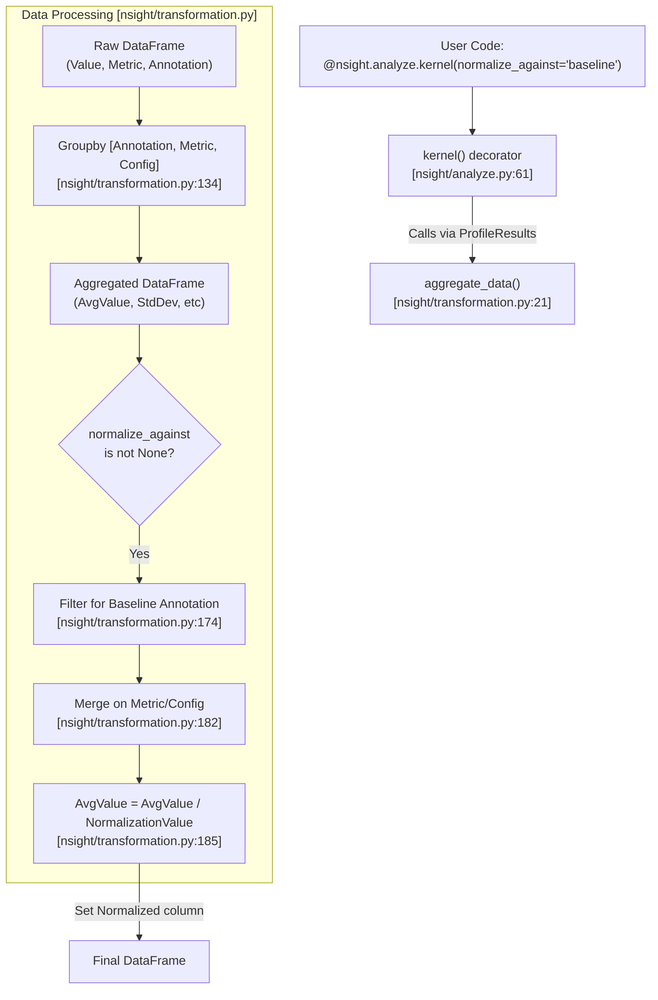
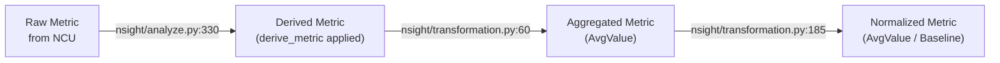

<!-- source: DeepWiki mcp.deepwiki.com · repo NVIDIA/nsight-python · page 6.3 Normalization and Baselines · fetched 2026-10-26 -->

# Normalization and Baselines

<details>
<summary>Relevant source files</summary>

The following files were used as context for generating this wiki page:

- [nsight/analyze.py](nsight/analyze.py)
- [nsight/transformation.py](nsight/transformation.py)
- [tests/test_transformation.py](tests/test_transformation.py)

</details>


This page documents the normalization feature in nsight-python, which enables computing relative performance metrics (such as speedup) by comparing profiled results against a designated baseline. For information about collecting raw metrics, see [Working with Metrics](4.4). For information about transforming metrics using custom functions, see [Custom Derived Metrics](6.2).

## Purpose and Scope

Normalization allows users to express performance metrics relative to a baseline implementation rather than as absolute values. This is particularly useful when:

- Comparing multiple implementations of the same algorithm.
- Measuring the performance impact of optimizations.
- Computing speedup factors or efficiency ratios.
- Generating performance comparison plots with normalized axes.

The normalization feature operates during the post-processing phase of the profiling pipeline, specifically within the `aggregate_data` function in [nsight/transformation.py:21-196]().

## Concept Overview

In GPU profiling workflows, raw metrics (execution time, throughput, memory bandwidth) provide absolute measurements. However, performance analysis often requires **relative comparisons**: "How much faster is implementation B compared to implementation A?"

Normalization in nsight-python works by:

1. Designating one annotated code region as the **baseline**.
2. Collecting metrics for all annotated regions (including the baseline).
3. Dividing each region's metric by the baseline's corresponding metric.
4. Producing normalized values where the baseline equals 1.0.

For example, if the baseline implementation takes 100ms and an optimized implementation takes 50ms, the normalized value would be 0.5, immediately showing a 2× speedup.

**Sources**: [nsight/transformation.py:4-9](), [nsight/analyze.py:155-156]()

## The normalize_against Parameter

The `normalize_against` parameter is specified in the `@nsight.analyze.kernel` decorator and accepts a string that must match an annotation name defined using `nsight.annotate`.

### Parameter Specification

```python
@nsight.analyze.kernel(
    normalize_against="baseline_implementation"
)
def benchmark_function(n: int):
    with nsight.annotate("baseline_implementation"):
        # Baseline code here
        baseline_algorithm(n)
    
    with nsight.annotate("optimized_implementation"):
        # Optimized code here
        optimized_result = optimized_algorithm(n)
```

### Type Signature and Location

| Component | Details |
|-----------|---------|
| Parameter Name | `normalize_against` |
| Type | `str | None` |
| Default Value | `None` (no normalization) |
| Location | [nsight/analyze.py:72]() |
| Passed To | `aggregate_data` at [nsight/analyze.py:346]() |

**Sources**: [nsight/analyze.py:42,72,155-156,346]()

## Implementation and Data Flow

The normalization logic is implemented in the `aggregate_data` function within `nsight/transformation.py`.



**Diagram: Normalization Data Flow in transformation.py**

The normalization step occurs after the data has been grouped and aggregated. This ensures that:

1. Statistics (Avg, StdDev, Min, Max) are computed for the raw runs first [nsight/transformation.py:59-69]().
2. Normalization operates on the `AvgValue` of the aggregated groups [nsight/transformation.py:185]().
3. The `Normalized` column is updated to reflect the baseline name [nsight/transformation.py:188]().

**Sources**: [nsight/transformation.py:163-189](), [nsight/analyze.py:343-348]()

## Normalization Algorithm

The normalization process follows this algorithm within `aggregate_data`:

1. **Existence Check**: It asserts that the `normalize_against` string exists in the `Annotation` column of the aggregated data [nsight/transformation.py:165-167]().
2. **Baseline Extraction**: It creates a `normalization_df` containing only rows where the annotation matches the baseline [nsight/transformation.py:174-176]().
3. **Alignment**: It merges the original aggregated DataFrame with the baseline DataFrame using the configuration fields and the metric name as keys (`merge_on = [*func_field_keys, "Metric"]`) [nsight/transformation.py:171-182]().
4. **Division**: It divides the `AvgValue` of all rows by the `NormalizationValue` (the `AvgValue` from the baseline) [nsight/transformation.py:185]().

### Configuration-Aware Normalization

When profiling with multiple configurations (via the `configs` parameter), normalization matches each configuration to its corresponding baseline value. This ensures that comparisons are made within the same parameter space (e.g., comparing Implementation A vs Baseline at size 1024, then Implementation A vs Baseline at size 2048).

**Sources**: [nsight/transformation.py:171-182]()

## The Normalized Column

Every DataFrame produced by `aggregate_data` contains a `Normalized` column for consistency [nsight/transformation.py:161]().

- If `normalize_against` is `None`, this column is set to `False` [nsight/transformation.py:161]().
- If normalization is performed, this column is set to the name of the baseline annotation (the string passed to `normalize_against`) [nsight/transformation.py:188]().

This allows downstream visualization tools (like the `@nsight.analyze.plot` decorator) to detect if the data is relative or absolute.

**Sources**: [nsight/transformation.py:160-162,187-188]()

## Interaction with derive_metric

The normalization step occurs **after** the `derive_metric` transformation.



**Diagram: Metric Processing Sequence**

This ordering allows complex workflows such as:

1. Collect raw execution time.
2. Transform to TFLOPs using `derive_metric`.
3. Normalize to compute relative TFLOPs vs. baseline.

**Sources**: [nsight/analyze.py:330-341](), [nsight/transformation.py:163-189]()

## Practical Considerations

### Stability and Statistics
Normalization is applied to the `AvgValue`. The system also calculates a `StableMeasurement` flag (boolean) based on whether the `RelativeStdDevPct` is less than 2.0% [nsight/transformation.py:151](). When analyzing normalized data, it is important to verify the stability of both the target and the baseline, as instability in the baseline will propagate to all normalized results.

### Unhashable Configs
If configurations include unhashable types like `dict` or `list`, `aggregate_data` creates temporary stringified sort keys to perform the grouping and merging required for normalization [nsight/transformation.py:105-128](). This ensures that normalization works even for complex parameter sweeps.

**Sources**: [nsight/transformation.py:105-128,151](), [tests/test_transformation.py:32-47]()

## Summary

The normalization feature in nsight-python provides:

| Feature | Implementation |
|---------|---------------|
| **Parameter** | `normalize_against` in `@nsight.analyze.kernel` [nsight/analyze.py:72]() |
| **Logic Location** | `nsight/transformation.py:aggregate_data` |
| **Input** | String matching an annotation name |
| **Alignment** | Matches by Configuration and Metric [nsight/transformation.py:171]() |
| **Output Column** | `Normalized` column in DataFrame [nsight/transformation.py:161]() |
| **Primary Use Case** | Computing speedup and relative performance metrics |

**Sources**: [nsight/transformation.py:21-196](), [nsight/analyze.py:61-156]()

---

