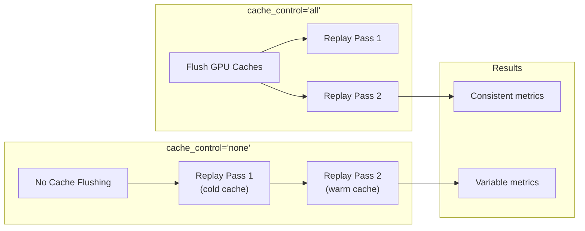

<!-- source: DeepWiki mcp.deepwiki.com · repo NVIDIA/nsight-python · page 6.4 Advanced Configuration Options · fetched 2026-10-26 -->

# Advanced Configuration Options

<details>
<summary>Relevant source files</summary>

The following files were used as context for generating this wiki page:

- [examples/11_output_csv.py](examples/11_output_csv.py)
- [nsight/collection/ncu.py](nsight/collection/ncu.py)

</details>


This page documents advanced configuration parameters for the `@nsight.analyze.kernel` decorator that provide fine-grained control over GPU profiling behavior, hardware state, and data collection strategies. These parameters enable power users to optimize profiling for specific scenarios, handle complex kernel execution patterns, and manage profiling overhead.

For basic profiling workflow, see [Getting Started](3). For thermal control configuration, see [Thermal Management](6.1). For custom metrics and normalization, see [Custom Derived Metrics](6.2) and [Normalization and Baselines](6.3).

## Parameter Categories and Configuration Flow

The `@nsight.analyze.kernel` decorator accepts configuration parameters that are distributed across internal components: `ProfileSettings` for execution control and `NCUCollector` for hardware instrumentation control via the Nsight Compute (ncu) CLI.

**Configuration Parameter Flow**

```mermaid
graph TB
    subgraph "User API: @nsight.analyze.kernel"
        Verbosity["verbosity (VerbosityLevel)"]
        OutputPrefix["output_prefix"]
        OutputCSV["output_csv"]
        Configs["configs"]
        Runs["runs"]
        
        ClockCtrl["clock_control"]
        CacheCtrl["cache_control"]
        ReplayMode["replay_mode"]
        Metric["metrics"]
        IgnoreList["ignore_kernel_list"]
        CombineMetrics["combine_kernel_metrics"]
    end
    
    subgraph "ProfileSettings (nsight/collection/core.py)"
        PSVerbosity["verbosity"]
        PSPrefix["output_prefix"]
        PSCSV["output_csv"]
        PSConfigs["configs"]
        PSRuns["runs"]
    end
    
    subgraph "NCUCollector (nsight/collection/ncu.py)"
        NCUClock["clock_control"]
        NCUCache["cache_control"]
        NCUReplay["replay_mode"]
        NCUMetric["metrics"]
        NCUIgnore["ignore_kernel_list"]
        NCUCombine["combine_kernel_metrics"]
    end
    
    Verbosity --> PSVerbosity
    OutputPrefix --> PSPrefix
    OutputCSV --> PSCSV
    Configs --> PSConfigs
    Runs --> PSRuns
    
    ClockCtrl --> NCUClock
    CacheCtrl --> NCUCache
    ReplayMode --> NCUReplay
    Metric --> NCUMetric
    IgnoreList --> NCUIgnore
    CombineMetrics --> NCUCombine
```



Sources: [nsight/analyze.py:201-240](), [nsight/collection/core.py:34-73]()

## GPU Clock and Cache Control

These parameters control GPU hardware behavior during profiling to improve measurement reproducibility and consistency.

### clock_control Parameter

The `clock_control` parameter locks GPU clock frequencies during profiling to reduce variance caused by dynamic frequency scaling (DVFS).

| Value | Behavior | Use Case |
|-------|----------|----------|
| `"none"` | No frequency changes during profiling | Default mode; reflects real application behavior |
| `"base"` | GPC and memory clocks locked to base frequency | Improves reproducibility across runs |

**Implementation Details:**
- When set to `"base"`, the `NCUCollector` passes the `--clock-control base` flag to the `ncu` process [nsight/collection/ncu.py:221-222]().
- Thermal throttling can still occur even with clock locking if the GPU hits temperature limits.
- Actual clock stability depends on driver support and GPU architecture.

Sources: [nsight/analyze.py:117-122](), [nsight/collection/ncu.py:221-222]()

### cache_control Parameter

The `cache_control` parameter determines whether GPU caches are flushed between profiling iterations.

| Value | Behavior | Use Case |
|-------|----------|----------|
| `"all"` | Flush all GPU caches before each replay iteration | Default mode; ensures most reproducible results |
| `"none"` | No cache flushing during profiling | Better reflects application behavior if data reuse is expected |

**Cache Control Trade-offs:**



Sources: [nsight/analyze.py:123-128](), [nsight/collection/ncu.py:220-221]()

## Replay Mode Configuration

The `replay_mode` parameter controls how Nsight Compute replays kernel launches to collect metrics.

### Replay Mode Comparison

| Mode | Description | Granularity | API Restrictions |
|------|-------------|-------------|------------------|
| `"kernel"` | Replay individual kernel launches | Per-kernel | None |
| `"range"` | Replay entire NVTX ranges | Per-annotated-range | Limited CUDA API support |

**Implementation Details:**
- `replay_mode="range"` uses the `--replay-mode range` flag in `ncu` [nsight/collection/ncu.py:223-224]().
- **Note:** `replay_mode="range"` is incompatible with certain CUDA features like cooperative groups or dynamic parallelism [nsight/analyze.py:133-135]().

Sources: [nsight/analyze.py:130-135](), [nsight/collection/ncu.py:223-224]()

## Multi-Kernel Handling

When profiling code that launches multiple kernels within an annotated range, these parameters control how metrics are collected and combined.

### ignore_kernel_list Parameter

The `ignore_kernel_list` parameter excludes specific kernels from profiling by name.

**Example:**
```python
@nsight.analyze.kernel(
    ignore_kernel_list=["cudaMemcpyAsync", "my_cleanup_kernel"],
    runs=10
)
```

**Implementation:**
- The list is passed to `NCUCollector` and then to `ncu` using the `--ignore-kernel-name` flag [nsight/collection/ncu.py:225-226]().

Sources: [nsight/analyze.py:107-109](), [nsight/collection/ncu.py:225-226]()

### combine_kernel_metrics Parameter

By default, Nsight Python expects exactly one kernel per annotation. If multiple kernels are detected, it raises an error unless `combine_kernel_metrics` is provided.

**Function Signature:**
`combine_kernel_metrics: Callable[[float, float], float] | None`

**Example - Summing Runtime:**
```python
@nsight.analyze.kernel(
    metric="gpu__time_duration.sum",
    combine_kernel_metrics=lambda x, y: x + y,  # Sum all kernel times
)
```

Sources: [nsight/analyze.py:110-116](), [nsight/extraction.py:110-120]()

## Output and Verbosity Control

### verbosity Parameter

The `verbosity` parameter (replacing the legacy `output` parameter) controls console output using the `VerbosityLevel` enum.

| Level | Enum | Description |
|-------|------|-------------|
| **SILENT** | `VerbosityLevel.SILENT` | No console output. `ncu` is run with `--quiet`. |
| **INFO** | `VerbosityLevel.INFO` | Shows progress bars and basic status. |
| **DEBUG** | `VerbosityLevel.DEBUG` | Maximum detail, including full `ncu` command lines and verbose `ncu` logs. |

**Implementation:**
- `VerbosityLevel.SILENT` triggers the `--quiet` flag in `ncu` [nsight/collection/ncu.py:218-219]().
- `VerbosityLevel.DEBUG` triggers the `--verbose` flag in `ncu` [nsight/collection/ncu.py:216-217]().

Sources: [nsight/utils.py:41-45](), [nsight/collection/ncu.py:215-219](), [nsight/analyze.py:138-142]()

### output_prefix and output_csv

- **`output_prefix`**: Controls the file path and naming for intermediate artifacts (`.ncu-rep`, `.log`, and `.csv` files) [nsight/analyze.py:144-156]().
- **`output_csv`**: If `True`, exports both raw (`profiled_data`) and aggregated (`processed_data`) results to CSV files [nsight/analyze.py:158-199]().

**Example - File Generation:**
```python
@nsight.analyze.kernel(output_prefix="./results/test_", output_csv=True)
def my_kernel(): ...
```
This generates:
1. `./results/test_profiled_data-my_kernel-0.csv` (Raw metrics)
2. `./results/test_processed_data-my_kernel-0.csv` (Aggregated stats)

Sources: [nsight/analyze.py:144-199](), [examples/11_output_csv.py:31-40]()

## Advanced Parameter Summary Table

| Parameter | Type | Default | Description |
|-----------|------|---------|-------------|
| `clock_control` | `Literal["none", "base"]` | `"none"` | Locks GPU clocks to base frequency. |
| `cache_control` | `Literal["none", "all"]` | `"all"` | Flushes L2/System caches between replays. |
| `replay_mode` | `Literal["kernel", "range"]` | `"kernel"` | NCU replay granularity. |
| `ignore_kernel_list` | `list[str]` | `None` | Kernel names to skip during collection. |
| `combine_kernel_metrics` | `Callable` | `None` | Reduction function for multi-kernel ranges. |
| `verbosity` | `VerbosityLevel` | `VerbosityLevel.INFO` | Console output level. |
| `output_csv` | `bool` | `False` | Enable CSV export of results. |

Sources: [nsight/analyze.py:36-199]()

---

