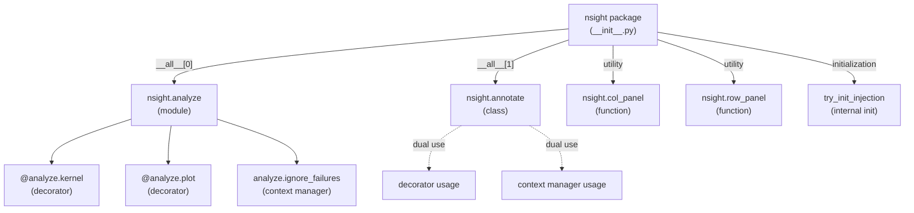
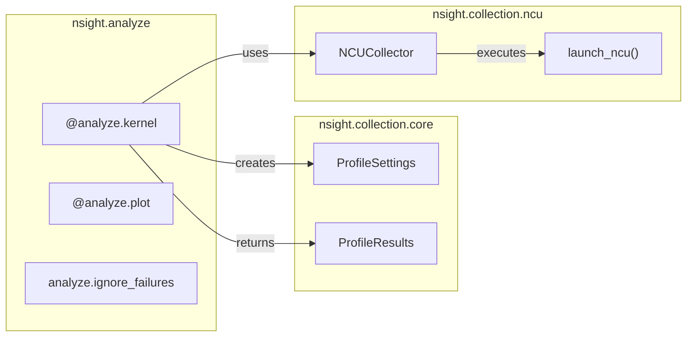
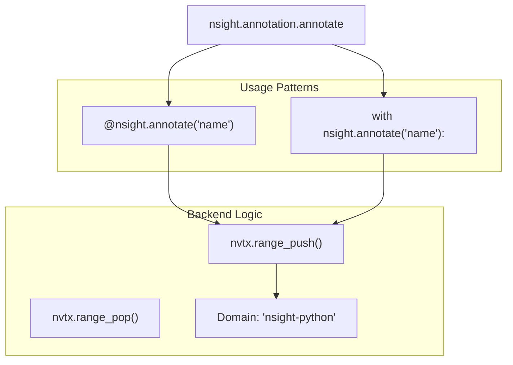

<!-- source: DeepWiki mcp.deepwiki.com · repo NVIDIA/nsight-python · page 7 API Reference · fetched 2026-10-26 -->

# API Reference

<details>
<summary>Relevant source files</summary>

The following files were used as context for generating this wiki page:

- [docs/source/analyze.rst](docs/source/analyze.rst)
- [docs/source/annotation.rst](docs/source/annotation.rst)
- [docs/source/overview/quickstart.rst](docs/source/overview/quickstart.rst)
- [nsight/__init__.py](nsight/__init__.py)

</details>


This document provides complete API documentation for all public and internal interfaces in the `nsight-python` package. The public API surface is focused on ease of use, consisting primarily of the `nsight.analyze` module and `nsight.annotate` class.

For architectural context on how these APIs fit into the overall system, see [Architecture Deep Dive](#5).

## Public API Overview

The `nsight-python` package exports a minimal public API. As of version 1.0.0, the package automatically initializes the Nsight Compute injection library upon import to support "attach" mode profiling without script relaunching.

**Diagram: Public API Exports and Module Structure**



**Sources**: [nsight/__init__.py:6-16]()

## Top-Level Package Exports

### nsight.__version__

**Type**: `str`

The semantic version string for the package. Version 1.0.0 introduces the injection-based attach mode.

### nsight.annotate

**Type**: `class`

The primary interface for marking code regions. See [nsight.annotate Class](#7.2) for details.

### nsight.analyze

**Type**: `module`

The primary interface for profiling execution. See [nsight.analyze Module](#7.1) for details.

**Sources**: [nsight/__init__.py:6-16]()

## nsight.analyze Module

The `analyze` module provides the profiling interface through decorators. In v1.0.0, it supports `VerbosityLevel` for logging control and `thermal_device` for multi-GPU systems.

**Diagram: nsight.analyze Module API Components**



**Sources**: [docs/source/analyze.rst:14-18](), [nsight/__init__.py:6]()

### @analyze.kernel

**Function Signature (v1.0.0)**:
```python
def kernel(
    func: Optional[Callable] = None,
    *,
    configs: Optional[List[Tuple]] = None,
    runs: int = 1,
    metric: Union[str, List[str]] = "gpu__time_duration.sum",
    derive_metric: Optional[Callable] = None,
    normalize_against: Optional[str] = None,
    thermal_control: bool = False,
    thermal_device: int = 0,
    clock_control: Optional[str] = None,
    cache_control: Optional[str] = None,
    replay_mode: str = "range",
    verbosity: VerbosityLevel = VerbosityLevel.INFO,
    **kwargs
) -> Union[Callable, ProfileResults]
```

#### Key Parameters (v1.0.0 Updates)

| Parameter | Type | Default | Description |
|-----------|------|---------|-------------|
| `metric` | `Union[str, List[str]]` | `"gpu__time_duration.sum"` | Supports a single string or a list of metrics. |
| `verbosity` | `VerbosityLevel` | `VerbosityLevel.INFO` | Replaces the old `output`/`verbose` parameters. |
| `thermal_device` | `int` | `0` | Specifies which CUDA device index to monitor for thermal throttling. |
| `derive_metric` | `Callable` | `None` | In v1.0.0, must return `(value, unit)` to populate the Unit column. |

For full details, see [nsight.analyze Module](#7.1).

**Sources**: [docs/source/analyze.rst:14-15](), [nsight/__init__.py:9]()

## nsight.annotate Class

Used to mark code regions for profiling. It is thread-local and creates NVTX ranges.

**Diagram: annotate Class Dual-Use Pattern**



For constraints on nested annotations and thread-locality, see [nsight.annotate Class](#7.2).

**Sources**: [docs/source/annotation.rst:12](), [nsight/__init__.py:7]()

## nsight.collection Package

The `collection` package handles the interface with the Nsight Compute (`ncu`) CLI and the injection-based attach mechanism.

### Key Components

- **`ProfileSettings`**: Dataclass containing the profiling configuration.
- **`ProfileResults`**: Dataclass containing the results, including the `Unit` column.
- **`NCUCollector`**: Manages the lifecycle of an `ncu --mode attach` session.
- **`try_init_injection()`**: Loads the NVTX injection library at import time.

For details on how the profiler attaches to the running process, see [nsight.collection Package](#7.3).

**Sources**: [nsight/__init__.py:8-12](), [docs/source/analyze.rst:11-12]()

## Internal Utilities

The `nsight-python` codebase includes several utility modules for parsing, thermal management, and visualization.

- **`nsight.utils`**: Includes `VerbosityLevel`, `NCULogParser`, and panel helpers.
- **`nsight.thermovision`**: Manages GPU temperature monitoring via NVML.
- **`nsight.extraction`**: Handles parsing `.ncu-rep` files into DataFrames.

For internal API details, see [Internal Utilities](#7.4).

**Sources**: [nsight/__init__.py:9]()

## Child Pages

- [nsight.analyze Module](#7.1) — Detailed reference for `@kernel`, `@plot`, and `ignore_failures`.
- [nsight.annotate Class](#7.2) — Reference for the `annotate` class and NVTX integration.
- [nsight.collection Package](#7.3) — Core profiling abstractions and NCU interaction.
- [Internal Utilities](#7.4) — Documentation for utility modules like `thermovision` and `utils`.

---

