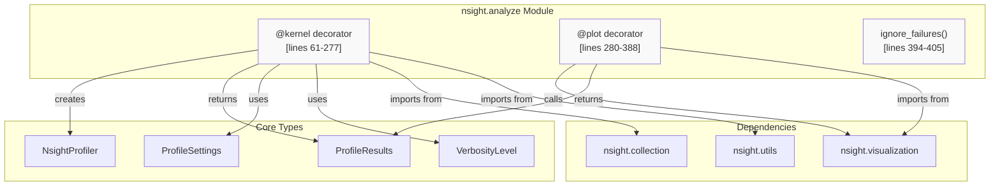
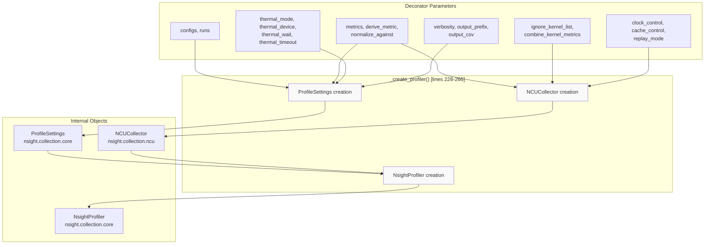
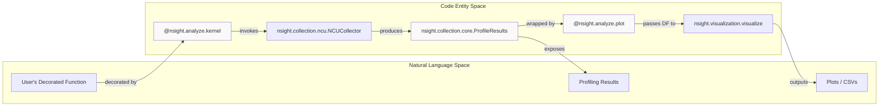

<!-- source: DeepWiki mcp.deepwiki.com · repo NVIDIA/nsight-python · page 7.1 nsight.analyze Module · fetched 2026-10-26 -->

# nsight.analyze Module

<details>
<summary>Relevant source files</summary>

The following files were used as context for generating this wiki page:

- [nsight/analyze.py](nsight/analyze.py)

</details>


This page provides complete API reference documentation for the `nsight.analyze` module, which contains the primary user-facing decorators and utilities for GPU kernel profiling. This module orchestrates profiling data collection, execution control, and result generation.

**Scope**: This page documents the public API of `nsight.analyze`: the `kernel` decorator, `plot` decorator, and `ignore_failures` context manager. It reflects updates in v1.0.0 including the injection-based attach mode, `VerbosityLevel` support, and `thermal_device` pinning.

---

## Module Structure

The `nsight.analyze` module exports three public interfaces:



**Sources**: [nsight/analyze.py:1-405]()

---

## kernel Decorator

The `kernel` decorator is the primary interface for profiling GPU kernels. In v1.0.0, it uses an injection-based approach where Nsight Compute attaches to the running process, supporting Jupyter and Colab environments without script relaunching.

### Decorator Signatures

The decorator supports two usage patterns with distinct type signatures:

**Pattern 1: Without Parentheses**
```python
@nsight.analyze.kernel
def my_function(param1, param2):
    ...
```

**Pattern 2: With Parentheses (optional parameters)**
```python
@nsight.analyze.kernel(configs=[(1, 2), (3, 4)], runs=5, verbosity=VerbosityLevel.DEBUG)
def my_function(param1, param2):
    ...
```

The implementation uses function overloads to support both patterns [nsight/analyze.py:22-57]():

| Overload | When Used | Signature |
|----------|-----------|-----------|
| Overload 1 | Without parentheses | `(_func: Callable) -> Callable[..., ProfileResults]` |
| Overload 2 | With parentheses | `(_func: None, *, **params) -> Callable[[Callable], Callable[..., ProfileResults]]` |

**Sources**: [nsight/analyze.py:22-57]()

---

### Wrapped Function Signature

After decoration, the wrapped function has the following signature:

```python
def wrapped_function(*args, configs=None, **kwargs) -> ProfileResults
```

**Note on Parameter Handling**:
- **Keyword-only Support**: The decorator now supports functions with keyword-only parameters [nsight/analyze.py:111-112]().
- **Default Value Padding**: If `configs` provide fewer values than the function has parameters, missing values are automatically filled from the function's default values [nsight/analyze.py:113-115]().
- **Variadic Arguments**: `*args` and `**kwargs` are tolerated in the signature but will remain empty during profiling [nsight/analyze.py:112-113]().

**Sources**: [nsight/analyze.py:99-115]()

---

### Parameters Reference

The `kernel` decorator accepts the following parameters (mostly keyword-only):

#### Execution Configuration

| Parameter | Type | Default | Description |
|-----------|------|---------|-------------|
| `configs` | `Iterable[Any] \| None` | `None` | List of configurations. Can be sequences of arguments or scalars if the function takes one argument [nsight/analyze.py:118-132](). |
| `runs` | `int` | `1` | Number of executions per configuration for statistical aggregation. |

#### Metric Configuration

| Parameter | Type | Default | Description |
|-----------|------|---------|-------------|
| `metrics` | `Sequence[str]` | `["gpu__time_duration.sum"]` | List of Nsight Compute metrics to collect. |
| `derive_metric` | `Callable[...] \| None` | `None` | Function to transform metrics. Must return `(value, unit)` tuples for proper `Unit` column population [nsight/analyze.py:142-145](). |
| `normalize_against` | `str \| None` | `None` | Annotation name to use as baseline for normalization. |

#### Hardware & Thermal Control

| Parameter | Type | Default | Description |
|-----------|------|---------|-------------|
| `clock_control` | `Literal["base", "none"]` | `"none"` | Locks clocks to base frequency if set to `"base"`. |
| `cache_control` | `Literal["all", "none"]` | `"all"` | Flushes caches before replay if set to `"all"`. |
| `replay_mode` | `Literal["kernel", "range"]` | `"kernel"` | Replay mechanism for metric collection. |
| `thermal_mode` | `Literal["auto", "manual", "off"]` | `"auto"` | Thermal throttling prevention mode [nsight/analyze.py:177](). |
| `thermal_device` | `int \| None` | `None` | **New in v1.0.0**: Specific CUDA device ID to monitor for thermal status [nsight/analyze.py:182](). |

#### Output & Verbosity

| Parameter | Type | Default | Description |
|-----------|------|---------|-------------|
| `verbosity` | `VerbosityLevel` | `VerbosityLevel.INFO` | **New in v1.0.0**: Replaces `output`. Controls logging detail (`SILENT`, `INFO`, `DEBUG`) [nsight/analyze.py:166](). |
| `output_prefix` | `str \| None` | `None` | Path prefix for generated report and CSV files. |
| `output_csv` | `bool` | `False` | If `True`, exports raw and processed data to CSV. |

**Sources**: [nsight/analyze.py:61-191]()

---

### Parameter Flow and Profiler Creation

The following diagram shows how decorator parameters flow into the internal profiling system via the `_create_profiler` helper:



**Implementation Details**:
The `_create_profiler()` helper function [nsight/analyze.py:228-266]():
- Sets up output paths (temporary directory or user-specified prefix).
- Instantiates `ProfileSettings` with execution, thermal, and verbosity parameters [nsight/analyze.py:247-257]().
- Instantiates `NCUCollector` with metric and hardware control settings [nsight/analyze.py:258-265]().
- Returns an `NsightProfiler` which orchestrates the injection and collection [nsight/analyze.py:266]().

**Sources**: [nsight/analyze.py:228-266]()

---

## plot Decorator

The `plot` decorator generates visualizations from the `ProfileResults` returned by a `@kernel` function.

### Usage Pattern

The decorator is stacked above `@kernel`:

```python
@nsight.analyze.plot(filename="throughput.png", plot_type="bar", row_panels=["batch_size"])
@nsight.analyze.kernel(configs=itertools.product([128, 256], [1024]))
def my_kernel(batch_size, feature_dim):
    ...
```

### Parameters Reference

| Parameter | Type | Default | Description |
|-----------|------|---------|-------------|
| `filename` | `str` | `"plot.png"` | Output file path. |
| `row_panels` | `Sequence[str] \| None` | `None` | Parameters to split into horizontal subplot rows [nsight/analyze.py:333](). |
| `col_panels` | `Sequence[str] \| None` | `None` | Parameters to split into vertical subplot columns [nsight/analyze.py:334](). |
| `x_keys` | `Sequence[str] \| None` | `None` | Parameters to use for the X-axis [nsight/analyze.py:335](). |
| `variant_fields` | `Sequence[str] \| None` | `None` | Parameters to use as legend variants (different lines/bars) [nsight/analyze.py:338](). |
| `plot_type` | `str` | `"line"` | Supports `"line"` or `"bar"` [nsight/analyze.py:328](). |

**Sources**: [nsight/analyze.py:280-353]()

---

## ignore_failures Context Manager

A utility context manager used to suppress exceptions. It is commonly used for warmup runs where hardware initialization or kernel compilation might throw transient errors that should not halt the profiling pipeline.

### Implementation

```python
@contextlib.contextmanager
def ignore_failures() -> Iterable[None]:
    try:
        yield
    except Exception:
        pass
```

**Sources**: [nsight/analyze.py:394-405]()

---

## Data Flow: From Collection to Visualization

The following diagram bridges the high-level API calls to the internal entity space:



**Key Data Transitions**:
1. **`@kernel` execution**: Triggers `NsightProfiler.profile()`, which executes the function across `configs` and `runs` [nsight/analyze.py:269-277]().
2. **Result Generation**: Returns a `ProfileResults` object. This object contains the raw and aggregated data, including the v1.0.0 `Unit` column [nsight/analyze.py:107-108]().
3. **`@plot` execution**: The wrapper checks if the environment is in profiling mode (via `NSPY_NCU_PROFILE`). If not, it calls `nsight.visualization.visualize()` using the DataFrame from `ProfileResults` [nsight/analyze.py:363-382]().

**Sources**: [nsight/analyze.py:269-382]()

---

## Sources
- [nsight/analyze.py:1-405]()
- [nsight/utils.py:1-32]() (for `VerbosityLevel`)
- [nsight/collection/core.py:1-100]() (for `ProfileResults` and `ProfileSettings`)

---

