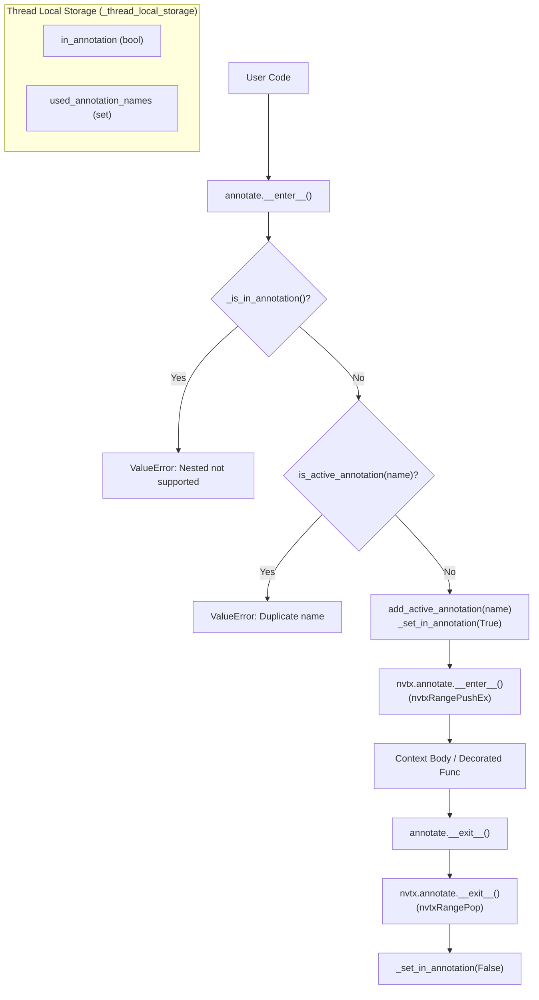
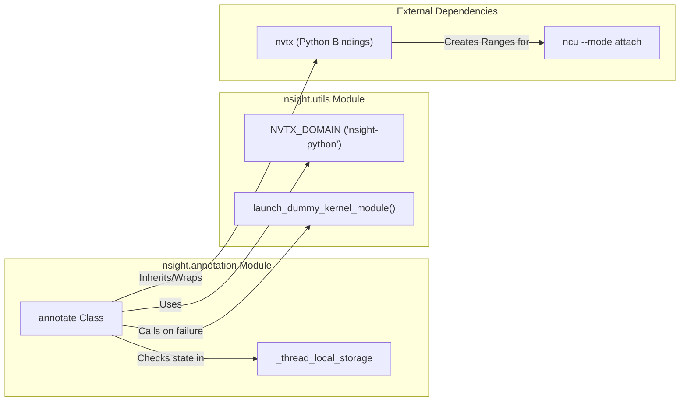

<!-- source: DeepWiki mcp.deepwiki.com · repo NVIDIA/nsight-python · page 7.2 nsight.annotate Class · fetched 2026-10-26 -->

# nsight.annotate Class

<details>
<summary>Relevant source files</summary>

The following files were used as context for generating this wiki page:

- [docs/source/release_notes/topics/updates-in-nsight-python-1.0.0.rst](docs/source/release_notes/topics/updates-in-nsight-python-1.0.0.rst)
- [nsight/annotation.py](nsight/annotation.py)

</details>


This document provides the API reference for the `nsight.annotate` class, which is used to mark code regions for GPU profiling. It details the class implementation, its interaction with NVTX, and specific constraints like thread-locality and nesting restrictions.

## Overview

The `nsight.annotate` class is a hybrid decorator/context-manager used to mark specific code regions for profiling. It inherits from `nvtx.annotate` and extends it to integrate with the Nsight Python collection pipeline [nsight/annotation.py:91-95](). All annotations created by this class are automatically associated with the NVTX domain `"nsight-python"` [nsight/annotation.py:124-126](), which allows the `NCUCollector` to filter and identify relevant profiling ranges.

**Key Features:**
*   **Dual Usage**: Supports both `@nsight.annotate` decorator and `with nsight.annotate` context manager syntax [nsight/annotation.py:97-106]().
*   **Unique Identification**: Requires unique names within a profiling run to ensure unambiguous metric association [nsight/annotation.py:109-110]().
*   **Failure Resilience**: Optional suppression of exceptions to prevent profiling failures from crashing the main application [nsight/annotation.py:111-115]().
*   **Thread Isolation**: Uses thread-local storage to track active annotations, preventing conflicts in multi-threaded environments [nsight/annotation.py:14-17]().

---

## Class Definition

```python
class nsight.annotate(name: str, ignore_failures: bool = False)
```
[nsight/annotation.py:91-137]()

### Parameters

| Parameter | Type | Default | Description |
|-----------|------|---------|-------------|
| `name` | `str` | *required* | The label for the annotated region. Must be unique within a single profiling run [nsight/annotation.py:109-110](). |
| `ignore_failures` | `bool` | `False` | If `True`, exceptions raised within the context are suppressed. The measured metric for failed runs is set to `NaN` [nsight/annotation.py:111-115](). |

### Implementation Details
*   **Domain**: Automatically sets `domain=utils.NVTX_DOMAIN` (which is `"nsight-python"`) during initialization [nsight/annotation.py:147]().
*   **Dependency**: If `ignore_failures` is `True`, the class verifies that `cuda-core` is available, as it is required for dummy kernel launches during error recovery [nsight/annotation.py:143-145]().

**Sources**: [nsight/annotation.py:91-148]()

---

## Data Flow and Code Entities

The following diagrams illustrate how the `annotate` class bridges the gap between Python user code and the NVTX/NCU profiling subsystems.

### Diagram: Annotation Lifecycle and State Management
This diagram shows how `nsight.annotate` manages thread-local state to enforce uniqueness and prevent nesting.


**Sources**: [nsight/annotation.py:17-88](), [nsight/annotation.py:149-181]()

### Diagram: System Component Interaction
This diagram maps natural language concepts to the specific code entities responsible for them.


**Sources**: [nsight/annotation.py:9-11](), [nsight/annotation.py:91](), [nsight/annotation.py:147](), [nsight/annotation.py:172]()

---

## Detailed Behavior

### Thread-Locality Constraints
Annotations are strictly thread-local [nsight/annotation.py:14-17]().
1.  **Isolation**: An annotation started in Thread A is not visible to Thread B.
2.  **NCU Limitation**: Because NVTX ranges are thread-local, NVIDIA Nsight Compute will only capture kernels launched from the *same thread* that entered the `nsight.annotate` context. Kernels launched from background threads or subprocesses will not be associated with the annotation.

### Nesting and Uniqueness
*   **No Nesting**: The `__enter__` method calls `_is_in_annotation()` and raises a `ValueError` if a range is already active [nsight/annotation.py:152-157](). This is because the collection system expects a 1:1 mapping between an NVTX range and a set of metrics.
*   **Name Uniqueness**: The class tracks `used_annotation_names` in thread-local storage [nsight/annotation.py:53-55](). Reusing a name within the same profiling run (before `clear_active_annotations()` is called) results in a `ValueError` [nsight/annotation.py:159-164]().

### Failure Handling (`ignore_failures`)
If an exception occurs within an `annotate` block and `ignore_failures=True`:
1.  The exception is caught in `__exit__` [nsight/annotation.py:171]().
2.  `utils.launch_dummy_kernel_module()` is called [nsight/annotation.py:172](). This ensures the profiler still sees a kernel launch within the NVTX range, allowing it to complete the report without crashing the NCU collection logic.
3.  The `__exit__` method returns `True`, suppressing the exception from propagating to the user's script [nsight/annotation.py:180]().

**Sources**: [nsight/annotation.py:14-88](), [nsight/annotation.py:149-181]()

---

## Usage Examples

### Context Manager
```python
import nsight
import torch

with nsight.annotate("linear_layer", ignore_failures=True):
    x = torch.randn(1024, 1024, device="cuda")
    w = torch.randn(1024, 1024, device="cuda")
    y = torch.matmul(x, w)
```
[nsight/annotation.py:99-101]()

### Decorator
```python
@nsight.annotate("custom_kernel")
def run_my_kernel(data):
    # Kernel logic here
    pass
```
[nsight/annotation.py:104-106]()

### Multi-Implementation Comparison
```python
@nsight.analyze.kernel(configs=[("fast",), ("slow",)])
def compare(mode):
    if mode == "fast":
        with nsight.annotate("impl_fast"):
            # call fast kernel
            pass
    else:
        with nsight.annotate("impl_slow"):
            # call slow kernel
            pass
```
*Note: `nsight.analyze.kernel` automatically calls `clear_active_annotations()` before each configuration run to allow reuse of names across different config iterations [nsight/annotation.py:66-68]().*

**Sources**: [nsight/annotation.py:97-106](), [nsight/annotation.py:66-72]()

---

