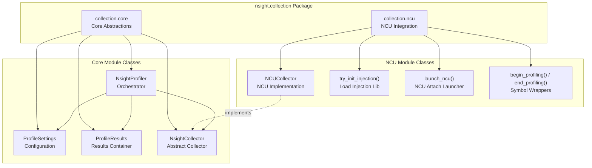
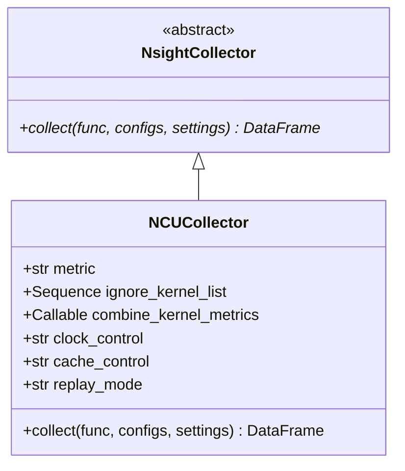
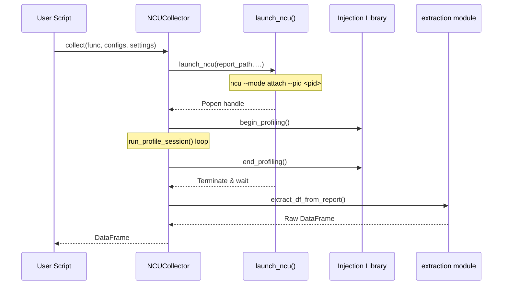
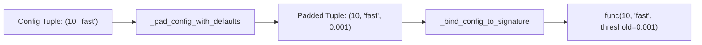

<!-- source: DeepWiki mcp.deepwiki.com · repo NVIDIA/nsight-python · page 7.3 nsight.collection Package · fetched 2026-10-26 -->

# nsight.collection Package

<details>
<summary>Relevant source files</summary>

The following files were used as context for generating this wiki page:

- [docs/source/collection/core.rst](docs/source/collection/core.rst)
- [nsight/collection/core.py](nsight/collection/core.py)
- [nsight/collection/ncu.py](nsight/collection/ncu.py)

</details>


## Purpose and Scope

The `nsight.collection` package provides the internal collection infrastructure for nsight-python's profiling system. It defines core abstractions for profiling settings, results, and collectors, along with a concrete implementation that integrates with NVIDIA Nsight Compute (NCU) using a non-relaunching injection-based approach.

As of version 1.0.0, the collection system no longer relaunches the user's script. Instead, it uses `ncu --mode attach` and an injection library to profile the current process in-place. This enables profiling in interactive environments like Jupyter and Colab.

**Sources:** [nsight/collection/core.py:1-400](), [nsight/collection/ncu.py:1-269]()

---

## Package Structure

The `nsight.collection` package consists of two modules:

| Module | Purpose | Key Classes/Functions |
|--------|---------|----------------------|
| `collection.core` | Core abstractions and orchestration logic | `ProfileSettings`, `ProfileResults`, `NsightCollector`, `NsightProfiler` |
| `collection.ncu` | NVIDIA Nsight Compute integration via injection | `NCUCollector`, `try_init_injection()`, `launch_ncu()`, `begin_profiling()`, `end_profiling()` |



**Sources:** [nsight/collection/core.py:1-400](), [nsight/collection/ncu.py:1-269]()

---

## Core Abstractions

### ProfileSettings

`ProfileSettings` is a dataclass that encapsulates all configuration parameters for a profiling session. It is defined at [nsight/collection/core.py:224-290]().

**Key Attributes:**

| Attribute | Type | Description |
|-----------|------|-------------|
| `configs` | `Sequence[tuple[Any, ...]]` | List of configuration tuples to profile. |
| `runs` | `int` | Number of times to execute each configuration. |
| `verbosity` | `VerbosityLevel` | Controls log detail (SILENT, INFO, DEBUG). |
| `derive_metric` | `Callable` | Function returning `(value, unit)` tuples for custom metrics. |
| `normalize_against` | `str` | Annotation name to normalize metrics against. |
| `thermal_control` | `bool` | Enable thermal throttling prevention. |
| `thermal_device` | `int` | CUDA device index to monitor for thermal status. |
| `output_prefix` | `str` | Prefix for intermediate profiler files. |
| `output_csv` | `bool` | Export raw and processed data to CSV files. |

**Sources:** [nsight/collection/core.py:224-290]()

---

### ProfileResults

`ProfileResults` is a wrapper class around a pandas DataFrame containing processed profiling results, including the `Unit` column introduced in v1.0.0. It is defined at [nsight/collection/core.py:293-338]().

**Key Method:**

- **`to_dataframe() -> pd.DataFrame`** - Returns the processed profiling data as a pandas DataFrame.

**Sources:** [nsight/collection/core.py:293-338]()

---

### NsightCollector

`NsightCollector` is an abstract base class defining the interface for profiling data collectors. It is defined at [nsight/collection/core.py:341-360]().



**Sources:** [nsight/collection/core.py:341-360]()

---

### NsightProfiler

`NsightProfiler` coordinates the profiling workflow. It validates configurations, invokes the collector, and processes the results. Defined at [nsight/collection/core.py:363-468]().

**Decorator Workflow:**

1. **Configuration Sanitization** - Validates and normalizes inputs via `_sanitize_configs()` [nsight/collection/core.py:109-154](). It handles padding configs with default values using `_pad_config_with_defaults()` [nsight/collection/core.py:49-71]().
2. **Data Collection** - Delegates to `collector.collect()`.
3. **Data Processing** - Transforms raw data using `transformation.aggregate_data()`.
4. **CSV Export** - Optionally saves data to CSV files [nsight/collection/core.py:437-460]().

**Sources:** [nsight/collection/core.py:363-468]()

---

## NCU Collector Implementation

### Injection System

Version 1.0.0 uses an injection-based approach to attach Nsight Compute to the running process.

- **`try_init_injection()`**: Called at import time. It finds the NCU injection library (`libcuda-injection.so`), sets environment variables like `NV_COMPUTE_PROFILER_IN_PROCESS=1`, and loads symbols for starting/stopping the profiler [nsight/collection/ncu.py:127-176]().
- **`begin_profiling()` / `end_profiling()`**: Wrappers for the `nvInjBeginProfiling` and `nvInjEndProfiling` symbols that signal NCU to start/stop the profiling session [nsight/collection/ncu.py:255-276]().

**Sources:** [nsight/collection/ncu.py:127-176](), [nsight/collection/ncu.py:255-276]()

---

### NCU Execution Flow

The `NCUCollector.collect()` method coordinates the attachment of the NCU CLI to the current process. Defined at [nsight/collection/ncu.py:279-373]().



**Key Steps:**
1. **Launch NCU**: `launch_ncu()` starts `ncu` in `--mode attach` targeting the current PID [nsight/collection/ncu.py:178-252]().
2. **Signal Profiling**: `begin_profiling()` is called to notify the attached NCU to begin data collection [nsight/collection/ncu.py:339]().
3. **Execute Session**: `run_profile_session()` iterates through all configurations and runs [nsight/collection/core.py:157-221]().
4. **Stop Profiling**: `end_profiling()` is called, and the NCU process is terminated to flush the report [nsight/collection/ncu.py:348-356]().

**Sources:** [nsight/collection/ncu.py:279-373](), [nsight/collection/core.py:157-221]()

---

### launch_ncu() Function

The `launch_ncu()` function constructs the command to attach NCU to the current process. Defined at [nsight/collection/ncu.py:178-252]().

**Command Structure:**
```bash
ncu --mode attach --pid <current_pid>
    --cache-control <cache_control>
    --clock-control <clock_control>
    --replay-mode <replay_mode>
    --metrics <metric>
    --nvtx --nvtx-include "regex:nsight-python@.+/"
    -f -o <report_path>
```

**Sources:** [nsight/collection/ncu.py:214-228]()

---

## Configuration Mapping

The system supports mapping configuration tuples to complex function signatures, including keyword-only arguments and default values.

| Function | Purpose |
|----------|---------|
| `_pad_config_with_defaults` | Fills in missing trailing arguments in a config tuple using function defaults [nsight/collection/core.py:49-71](). |
| `_bind_config_to_signature` | Splits a config tuple into `*args` and `**kwargs` based on `inspect.Parameter.kind` [nsight/collection/core.py:74-106](). |



**Sources:** [nsight/collection/core.py:49-106]()

---

