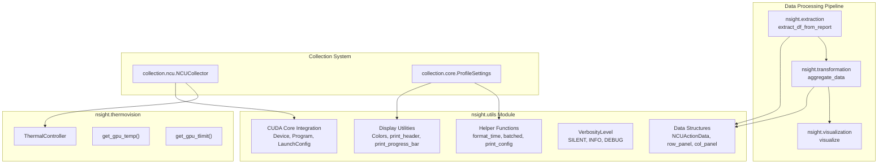
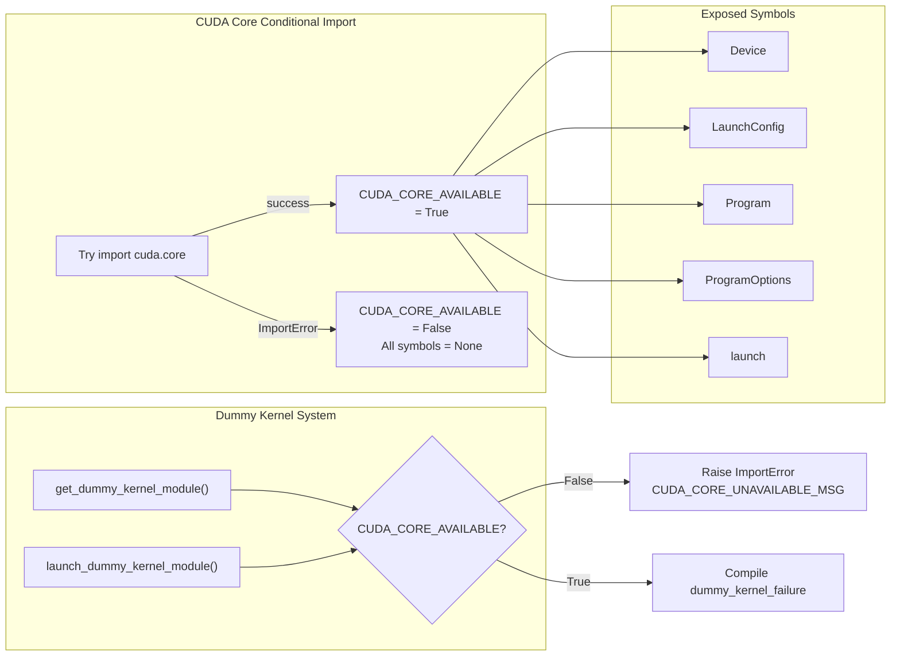
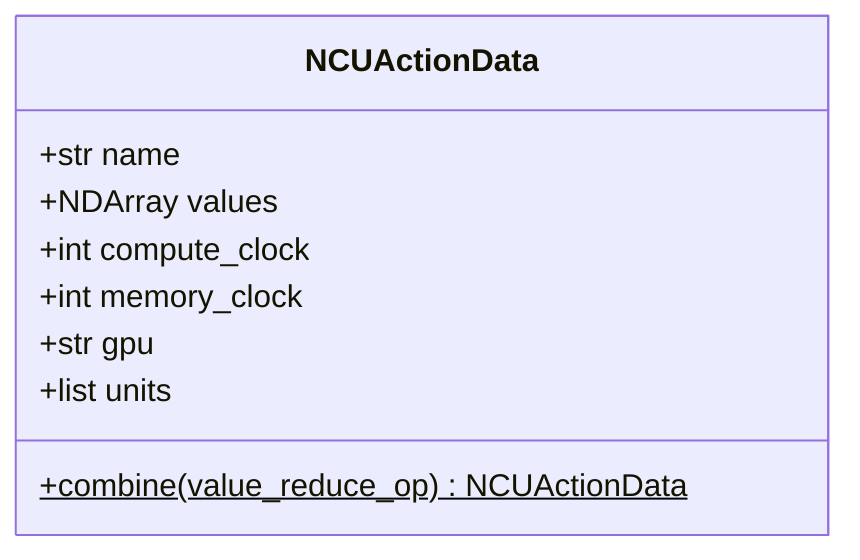

<!-- source: DeepWiki mcp.deepwiki.com · repo NVIDIA/nsight-python · page 7.4 Internal Utilities · fetched 2026-10-26 -->

# Internal Utilities

Relevant source files

The following files were used as context for generating this wiki page:

- [docs/source/utils.rst](docs/source/utils.rst)
- [nsight/extraction.py](nsight/extraction.py)
- [nsight/transformation.py](nsight/transformation.py)
- [nsight/utils.py](nsight/utils.py)
- [tests/test_transformation.py](tests/test_transformation.py)

This page documents the internal utility modules that support the nsight-python profiling infrastructure. These utilities are not part of the public API but provide essential functionality for display formatting, error handling, data processing, and system integration.

For documentation of the public-facing APIs, see [nsight.analyze Module]() and [nsight.annotate Class](). For the core profiling abstractions, see [nsight.collection Package]().

---

## Overview of Utility Systems

The nsight-python package includes several internal utility systems that support the profiling workflow:

| Utility System | Module | Primary Purpose |
|----------------|--------|-----------------|
| Core Utilities | `nsight.utils` | CUDA integration, formatting, progress display, error handling |
| Thermal Management | `nsight.thermovision` | GPU temperature monitoring via NVML |
| Extraction | `nsight.extraction` | Parsing and extracting data from Nsight Compute reports |
| Transformation | `nsight.transformation` | Data normalization, metric derivation, association |
| Visualization | `nsight.visualization` | Plot generation and DataFrame formatting |

**Sources:** [nsight/utils.py:1-321](), [nsight/extraction.py:1-110](), [nsight/transformation.py:1-191]()

---

## Utility System Architecture

**Sources:** [nsight/utils.py:42-51](), [nsight/extraction.py:79-110](), [nsight/transformation.py:21-38]()

---

## Core Utilities (nsight.utils)

The `nsight.utils` module provides foundational utilities used throughout the profiling system.

### CUDA Core Integration

**Key Components:**

| Component | Type | Purpose |
|-----------|------|---------|
| `CUDA_CORE_AVAILABLE` | bool | Flag indicating if cuda-core package is installed [nsight/utils.py:30]() |
| `get_dummy_kernel_module()` | Function | Returns compiled dummy kernel for error handling scenarios [nsight/utils.py:86-103]() |
| `launch_dummy_kernel_module()` | Function | Launches dummy kernel when provider fails [nsight/utils.py:106-123]() |
| `NVTX_DOMAIN` | str constant | Domain name `"nsight-python"` for NVTX ranges [nsight/utils.py:39]() |

The CUDA core integration is optional but required for robust profiling. When available, it enables launching dummy kernels during profiling failures to maintain consistent kernel counts in reports [nsight/utils.py:88-93]().

**Sources:** [nsight/utils.py:27-40](), [nsight/utils.py:86-123]()

---

### Display and Formatting Utilities

**Verbosity Control:**
The `VerbosityLevel` IntEnum defines three levels: `SILENT` (0), `INFO` (3), and `DEBUG` (4) [nsight/utils.py:42-51]().

**Display Functions:**

| Function | Signature | Purpose |
|----------|-----------|---------|
| `purple(msg: str) -> str` | [nsight/utils.py:77-79]() | Wraps message in purple ANSI codes |
| `format_time(seconds: float) -> str` | [nsight/utils.py:125-129]() | Converts seconds to `HH:MM:SS` format |
| `print_header(*lines: str) -> None` | [nsight/utils.py:133-139]() | Prints boxed header with purple borders |
| `print_progress_bar(...)` | [nsight/utils.py:174-212]() | Dynamic progress bar with time estimate |
| `print_config(...)` | [nsight/utils.py:214-233]() | Prints current configuration being profiled |

**Progress Display Behavior:**
The `overwrite_output` parameter controls display mode. When `True`, it uses ANSI escape codes (`\033[1A`, `\033[2K\r`) to update the terminal line in-place [nsight/utils.py:200-206]().

**Sources:** [nsight/utils.py:42-79](), [nsight/utils.py:125-233]()

---

### Data Structures

#### Panel Classes
Panel classes are empty marker types used by the visualization system to distinguish between row-wise and column-wise plot layouts.
- `row_panel`: [nsight/utils.py:54-55]()
- `col_panel`: [nsight/utils.py:58-59]()

#### NCUActionData

**NCUActionData Dataclass:** [nsight/utils.py:141-149]()
Stores profiling data from Nsight Compute actions. It includes a `combine` static method that creates a closure to merge two `NCUActionData` objects using a reduction operator, provided the GPU and clock context match [nsight/utils.py:150-171]().

**Sources:** [nsight/utils.py:54-59](), [nsight/utils.py:141-171]()

---

## Extraction Utilities (nsight.extraction)

The `nsight.extraction` module handles parsing `.ncu-rep` files and converting them into structured DataFrames.

**Key Function: `extract_df_from_report`** [nsight/extraction.py:79-110]()
This function orchestrates the extraction process:
1. Loads the report using `ncu_report.load_report(report_path)` [nsight/extraction.py:114]().
2. Iterates through ranges and actions, filtering for the `nsight-python` NVTX domain [nsight/extraction.py:148-159]().
3. Associates kernel actions with user-defined annotations [nsight/extraction.py:164-169]().
4. Extracts raw metric values and units using `extract_ncu_action_data` [nsight/extraction.py:44-76]().
5. Applies the `derive_metric` function if provided to create calculated metrics [nsight/extraction.py:99]().

**Sources:** [nsight/extraction.py:44-110](), [nsight/extraction.py:114-176]()

---

## Transformation Utilities (nsight.transformation)

The `nsight.transformation` module performs data aggregation and normalization.

**Key Function: `aggregate_data`** [nsight/transformation.py:21-38]()
Processes raw DataFrames into aggregated results:
1. **Grouping:** Groups by "Annotation", "Metric", and function configuration parameters [nsight/transformation.py:72-128]().
2. **Aggregation:** Computes mean, std, min, max, and count (`NumRuns`) for each group [nsight/transformation.py:59-69]().
3. **Statistical Analysis:** Calculates 95% Confidence Intervals (`CI95_Lower`, `CI95_Upper`) and relative standard deviation [nsight/transformation.py:137-148]().
4. **Stability Check:** Flags measurements as stable if relative standard deviation is < 2% [nsight/transformation.py:151]().
5. **Normalization:** If `normalize_against` is specified, it divides values by the baseline annotation's average [nsight/transformation.py:163-189]().
6. **Geometric Mean:** Calculates the geometric mean of values for each annotation/metric group [nsight/transformation.py:191]().

**Handling Unhashable Configs:**
The utility handles dict- or list-valued config parameters by creating a temporary stringified sort key, grouping on it, and then recovering the original objects using a "first" aggregation [nsight/transformation.py:100-128]().

**Sources:** [nsight/transformation.py:21-191](), [tests/test_transformation.py:32-47]()

---

## Thermal Management (nsight.thermovision)

The `nsight.thermovision` module provides the `ThermalController` (managed via `init()`) to prevent thermal throttling.

**Functionality:**
- **Initialization:** Sets up NVML to monitor GPU state.
- **Monitoring:** Queries current temperature (`get_gpu_temp`) and the thermal limit (`get_gpu_tlimit`).
- **Control:** Used by the profiler to pause execution until the GPU cools down if it exceeds the `thermal_limit` or a calculated threshold.

**Sources:** [nsight/utils.py:Diagram 3 (Architecture Reference)]()

---

