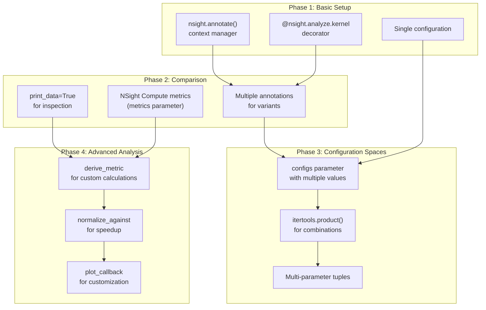
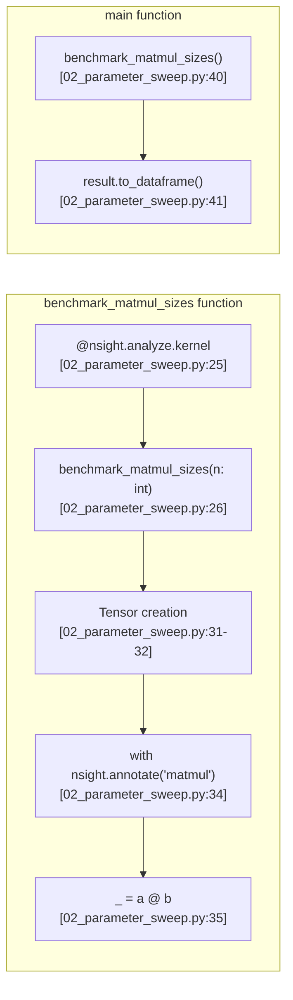
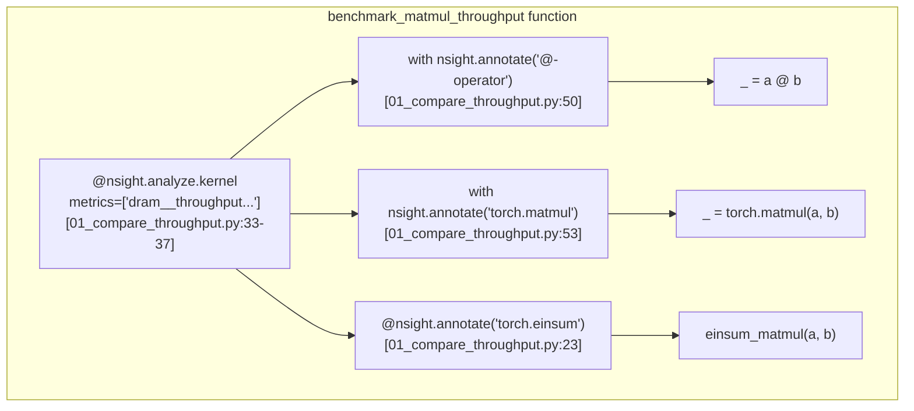
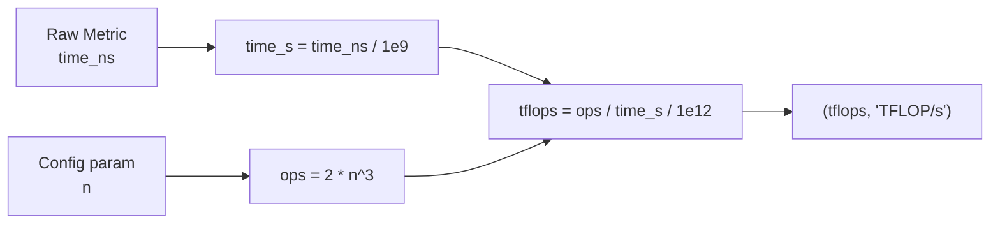
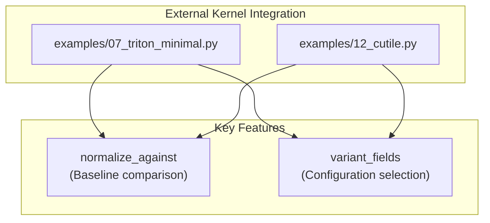

<!-- source: DeepWiki mcp.deepwiki.com · repo NVIDIA/nsight-python · page 8 Examples · fetched 2026-10-26 -->

# Examples

<details>
<summary>Relevant source files</summary>

The following files were used as context for generating this wiki page:

- [examples/01_compare_throughput.py](examples/01_compare_throughput.py)
- [examples/02_parameter_sweep.py](examples/02_parameter_sweep.py)
- [examples/README.md](examples/README.md)
- [examples/test_examples.py](examples/test_examples.py)

</details>


This page provides an overview of the practical examples available in the `examples/` directory and walks through key patterns demonstrated across different use cases. Each example builds on concepts from the previous ones, progressing from minimal setup to advanced features like custom metrics, multi-parameter sweeps, and framework integration.

For detailed API documentation of the decorators and functions used in these examples, see [API Reference](#7). For conceptual background on the profiling workflow, see [Basic Profiling Workflow](#3.3).

## Example Directory Organization

The examples are numbered sequentially by complexity, with each file demonstrating specific features of `nsight-python`. All examples require PyTorch installed with CUDA support, except `07_triton_minimal.py` (requires Triton) and `12_cutile.py` (requires cuTile).

**Example Progression:**

| Example File | Focus Area | Key Features Demonstrated |
|--------------|-----------|--------------------------|
| `00_minimal.py` | Basic profiling | `@nsight.analyze.kernel`, `nsight.annotate` context manager |
| `01_compare_throughput.py` | Multiple implementations | Multiple annotations, NSight Compute metrics, `@nsight.annotate` as decorator |
| `02_parameter_sweep.py` | Configuration spaces | Multiple config values, visualization across problem sizes |
| `03_custom_metrics.py` | Derived metrics | `derive_metric` parameter, computing TFLOPs from time |
| `04_multi_parameter.py` | Multi-dimensional configs | `itertools.product()`, flexible metric functions |
| `05_subplots.py` | Subplot organization | `row_panels`, `col_panels` for multi-dimensional visualization |
| `06_plot_customization.py` | Advanced plotting | `plot_callback`, custom styling, annotations |
| `07_triton_minimal.py` | Framework integration | Triton kernels, `variant_fields`, `normalize_against` |
| `08_multiple_metrics.py` | Metric Collection | Sequence of metric names, "Metric" column in DataFrame |
| `09_advanced_metric_custom.py` | Advanced Derivation | Computing custom metrics from multiple raw metrics |
| `10_multiple_kernels_combine.py` | Kernel Aggregation | `combine_kernel_metrics` to sum consecutive kernel executions |
| `11_output_csv.py` | Data Export | `output_csv` and `output_prefix` parameters |
| `12_cutile.py` | cuTile Integration | Profiling cuTile kernels against PyTorch baselines |

**Sources:** [examples/README.md:1-119](), [examples/test_examples.py:9-72]()

## Example Workflow Patterns

The examples demonstrate a common profiling workflow that progresses through increasing levels of sophistication. In v1.0.0, this workflow uses the **Injection-based Attach** mode, meaning the profiler attaches to the existing process without a script relaunch.



**Sources:** [examples/README.md:44-119]()

## Minimal Example Pattern

The minimal example demonstrates the core profiling workflow using the simplest possible setup.

### Code Structure



### Key Components

The minimal pattern uses two primary constructs:

1. **`@nsight.analyze.kernel` decorator**: Applied to the benchmark function to enable profiling. As of v1.0.0, this decorator initiates profiling via `ncu --mode attach` injection.
2. **`nsight.annotate()` context manager**: Marks specific code regions for profiling. Creates an NVTX range that Nsight Compute uses to identify which kernels to profile.

**Sources:** [examples/00_minimal.py:1-47](), [examples/02_parameter_sweep.py:20-46](), [examples/README.md:47-51]()

## Comparing Multiple Implementations

Example `01_compare_throughput.py` demonstrates profiling multiple code variants within a single benchmark function.

### Multi-Annotation Pattern



### Custom Metrics and Results

The decorator specifies a custom Nsight Compute metric:

```python
@nsight.analyze.kernel(
    runs=10,
    metrics=["dram__throughput.avg.pct_of_peak_sustained_elapsed"],
)
```

The resulting DataFrame contains a **Unit** column (new in v1.0.0) alongside the metric values. For details on comparing implementations, see [Comparing Implementations](#8.2).

**Sources:** [examples/01_compare_throughput.py:22-65](), [examples/README.md:63-68]()

## Parameter Sweep Patterns

Example `02_parameter_sweep.py` demonstrates sweeping across multiple configuration values.

### Configuration Specification

The `configs` parameter accepts a list of tuples. Each tuple element maps positionally to the benchmark function parameters.

```python
sizes = [(2**i,) for i in range(11, 14)] # [(2048,), (4096,), (8192,)]

@nsight.analyze.kernel(configs=sizes, runs=10)
def benchmark_matmul_sizes(n: int) -> None:
    ...
```

For more complex sweeps involving multiple parameters (e.g., `m, n, k`), `itertools.product()` is commonly used. For details, see [Parameter Sweeps](#8.3).

**Sources:** [examples/02_parameter_sweep.py:20-37](), [examples/README.md:69-72]()

## Custom Metric Derivation

Example `03_custom_metrics.py` demonstrates computing derived metrics like TFLOPs from raw profiling data.

### Derive Metric Function Signature

The `derive_metric` parameter accepts a callable. In v1.0.0, it is recommended that this function returns a `(value, unit)` tuple to populate the **Unit** column in results.



For details, see [Custom Metrics and Visualization](#8.4).

**Sources:** [examples/README.md:73-77](), [examples/03_custom_metrics.py:1-20]()

## Triton and cuTile Integration

The framework supports profiling kernels from other libraries like Triton and cuTile.

### Integration Pattern



For details, see [Triton and cuTile Integration](#8.5).

**Sources:** [examples/07_triton_minimal.py:1-20](), [examples/12_cutile.py:1-20](), [examples/README.md:94-99,117-119]()

## Running Examples

All examples require a CUDA-capable GPU and Nsight Compute.

### Python Package Dependencies

| Package | Required For | Installation |
|---------|--------------|--------------|
| `nsight` | All examples | `pip install nsight-python` |
| `torch` | Most examples | `pip install torch --index-url https://download.pytorch.org/whl/cuXXX` |
| `triton` | `07_triton_minimal.py` | `pip install triton` |
| `cutile` | `12_cutile.py` | See [cuTile Docs](https://docs.nvidia.com/cuda/cutile-python/quickstart.html) |

**Sources:** [examples/README.md:1-42]()

---

