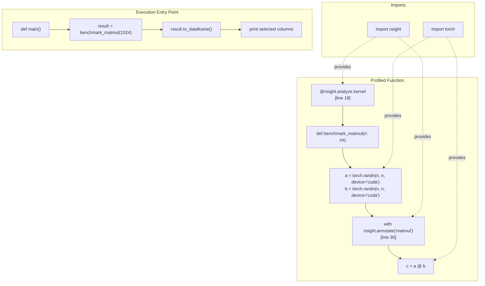
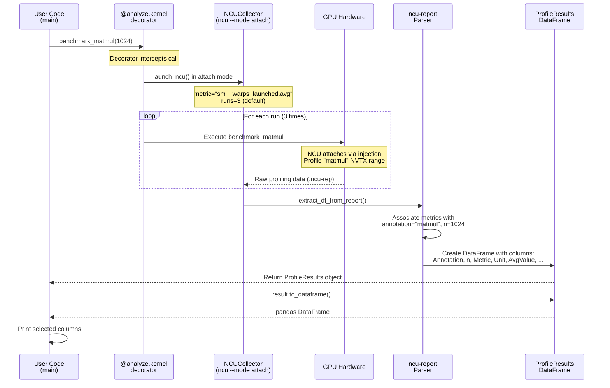
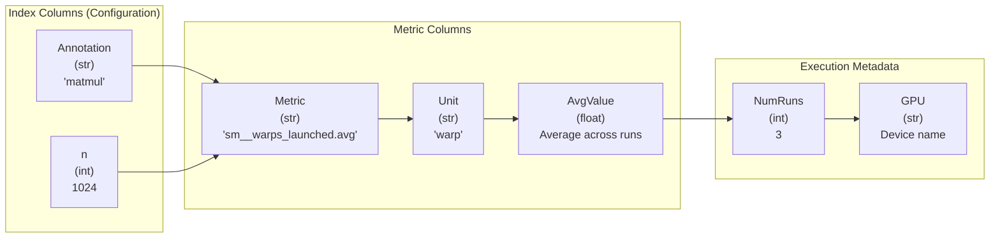

<!-- source: DeepWiki mcp.deepwiki.com · repo NVIDIA/nsight-python · page 8.1 Minimal Example · fetched 2026-10-26 -->

# Minimal Example

<details>
<summary>Relevant source files</summary>

The following files were used as context for generating this wiki page:

- [examples/00_minimal.py](examples/00_minimal.py)
- [examples/07_triton_minimal.py](examples/07_triton_minimal.py)

</details>


## Purpose and Scope

This page walks through the simplest possible example of using `nsight-python` to profile a GPU kernel. The minimal example demonstrates the two core components required for profiling: the `@nsight.analyze.kernel` decorator and the `nsight.annotate` context manager. 

As of version 1.0.0, this example also demonstrates the new **injection-based profiling** approach. Unlike previous versions, the script no longer relaunches itself. Instead, the profiler attaches to the running process via injection, enabling seamless profiling in environments like Jupyter and Colab.

**Sources:** [examples/00_minimal.py:4-12]()

---

## Complete Example Overview

The minimal example is implemented in [examples/00_minimal.py](). The example profiles a simple matrix multiplication operation using PyTorch on GPU. The complete workflow consists of three parts:

1. A benchmark function decorated with `@nsight.analyze.kernel`.
2. A kernel region marked with `nsight.annotate()` context manager.
3. A main function that executes the benchmark and prints results.

**Sources:** [examples/00_minimal.py:1-47]()

---

## Code Structure and Component Mapping

The following diagram maps the conceptual components to their actual implementations in the minimal example:

**Diagram: Minimal Example Code Entity Mapping**



**Sources:** [examples/00_minimal.py:14-47]()

---

## Anatomy of the Example

### The Decorator: `@nsight.analyze.kernel`

The `@nsight.analyze.kernel` decorator at [examples/00_minimal.py:19]() transforms `benchmark_matmul` into a profiling function. In version 1.0.0, this decorator orchestrates the following:

- Invokes the `NCUCollector` to prepare for profiling.
- Triggers `ncu --mode attach` via an injection mechanism to capture kernels.
- Collects GPU performance metrics for regions wrapped in `nsight.annotate`.
- Returns a `ProfileResults` object containing the collected data.

The decorator in this example uses default settings:
- **Default metric**: `"sm__warps_launched.avg"`.
- **Unit**: Version 1.0.0 introduces a dedicated `Unit` column in the output.
- **Verbosity**: Uses the new `verbosity` parameter (replacing the old `output` parameter) set to default info levels.

**Sources:** [examples/00_minimal.py:19](), [examples/00_minimal.py:38-40]()

### The Annotation: `nsight.annotate()`

The `nsight.annotate("matmul")` context manager at [examples/00_minimal.py:30]() marks the specific code region to profile. This creates an NVTX (NVIDIA Tools Extension) range with the label `"matmul"` under the `"nsight-python"` domain. 

The annotated region contains only the matrix multiplication operation `c = a @ b` at [examples/00_minimal.py:31](). The setup code that creates the input matrices executes outside the annotation and is not profiled, ensuring that metrics reflect only the computation of interest.

**Sources:** [examples/00_minimal.py:26-31]()

### The Main Function and Output

The `main()` function at [examples/00_minimal.py:34-42]() demonstrates the basic execution pattern:

```python
result = benchmark_matmul(1024)
```

The `result` is a `ProfileResults` object containing profiling data. The example prints a subset of columns, including the new `Unit` column:

| Column | Description |
|--------|-------------|
| `Annotation` | The NVTX range name (`"matmul"`) |
| `n` | The function parameter captured as configuration |
| `Metric` | The collected metric name |
| `Unit` | The measurement unit (e.g., `warp`, `cycle`, `second`) |
| `AvgValue` | The average metric value across runs |
| `NumRuns` | Number of profiling repetitions (default: 3) |
| `GPU` | The GPU device name |

**Sources:** [examples/00_minimal.py:34-42]()

---

## Execution Flow

The following diagram illustrates the version 1.0.0 injection-based execution flow:

**Diagram: Minimal Example Execution Flow (Injection Mode)**



**Sources:** [examples/00_minimal.py:36](), [examples/00_minimal.py:38-41]()

---

## Understanding the Output Structure

The `ProfileResults` object returned by `benchmark_matmul(1024)` contains a pandas DataFrame with the following structure:

**Diagram: ProfileResults DataFrame Schema**



Each row in the DataFrame represents one metric for one configuration (annotation + parameters). 

**Sources:** [examples/00_minimal.py:38-40]()

---

## Key Concepts Demonstrated

| Concept | Implementation | Purpose |
|---------|---------------|---------|
| **Profiling Scope** | `@nsight.analyze.kernel` | Defines which function to profile. |
| **Measurement Region** | `nsight.annotate("matmul")` | Marks specific code region for metric collection. |
| **Parameter Capture** | Function argument `n: int` | Automatically captured as configuration dimension. |
| **Injection Mode** | `ncu --mode attach` | Profiles without script relaunch (supports Jupyter). |
| **Metric Units** | `Unit` column | Provides context for the numerical values (new in v1.0.0). |

**Sources:** [examples/00_minimal.py:19-31](), [examples/00_minimal.py:38-40]()

---

## Running the Example

To execute the minimal example:

```bash
python examples/00_minimal.py
```

The script will:
1. Initialize the Nsight injection library.
2. Launch `ncu` in attach mode.
3. Execute the benchmark 3 times.
4. Print a summary table.

**Expected output format:**
```
  Annotation     n                   Metric  Unit  AvgValue  NumRuns         GPU
0     matmul  1024  sm__warps_launched.avg  warp  524288.0        3  NVIDIA ...
Benchmark complete!
```

**Sources:** [examples/00_minimal.py:34-46]()

---

## What Happens Behind the Scenes

1. **Collection Phase**: The `@nsight.analyze.kernel` decorator uses `try_init_injection()` to load the NVTX injection library. It then calls `begin_profiling()` to signal `ncu` to start capturing.
2. **Extraction Phase**: `NCUCollector` parses the resulting `.ncu-rep` files using `extract_df_from_report`.
3. **Visualization Phase**: The extraction phase produces a `ProfileResults` object. The `to_dataframe()` method provides structured data access.

**Sources:** [examples/00_minimal.py:1-47]()

---

## Next Steps

- [Comparing Implementations](#8.2) - Profile multiple implementations and compare performance.
- [Parameter Sweeps](#8.3) - Profile across parameter spaces using the `configs` parameter.
- [Triton and cuTile Integration](#8.5) - See [examples/07_triton_minimal.py]() for profiling Triton kernels with variants and `normalize_against`.

**Sources:** [examples/07_triton_minimal.py:101-108]()

---

