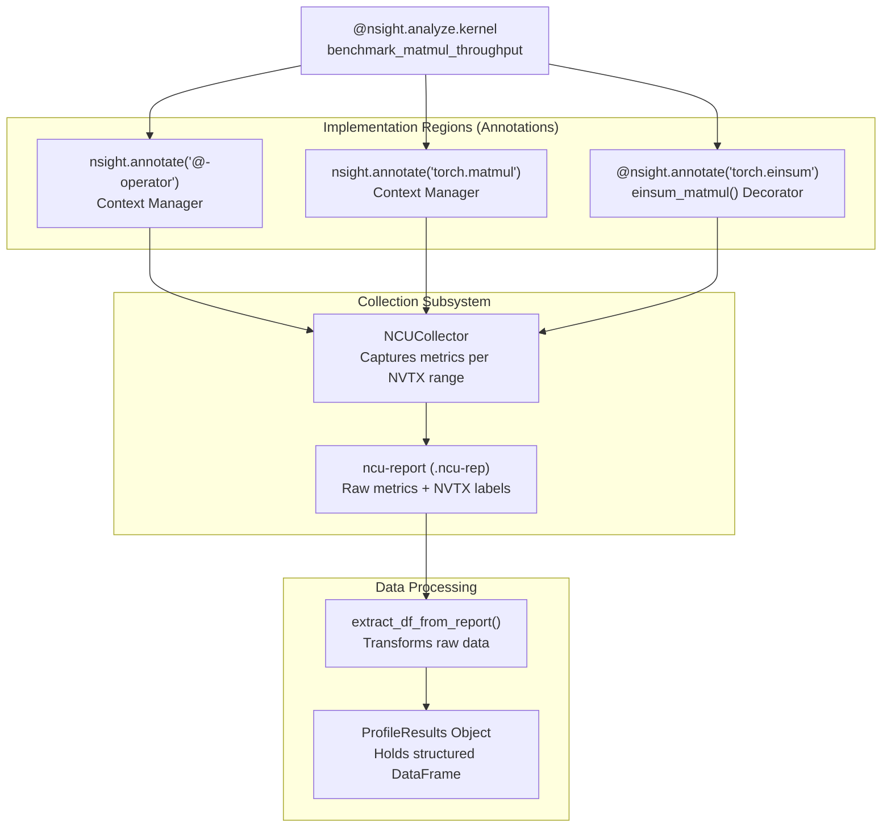
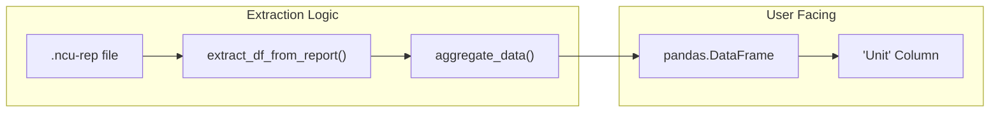

<!-- source: DeepWiki mcp.deepwiki.com · repo NVIDIA/nsight-python · page 8.2 Comparing Implementations · fetched 2026-10-26 -->

# Comparing Implementations

<details>
<summary>Relevant source files</summary>

The following files were used as context for generating this wiki page:

- [examples/01_compare_throughput.py](examples/01_compare_throughput.py)
- [examples/02_parameter_sweep.py](examples/02_parameter_sweep.py)
- [examples/README.md](examples/README.md)
- [examples/test_examples.py](examples/test_examples.py)

</details>


## Purpose and Scope

This page demonstrates how to compare different implementations of the same operation using nsight-python's annotation and profiling capabilities. It covers techniques for marking multiple code regions, selecting appropriate metrics, and analyzing the resulting structured data.

For information about basic profiling setup, see [Quick Start Tutorial](3.1). For details on visualization options, see [Visualization and Plotting](4.5). For advanced normalization features, see [Normalization and Baselines](6.3).

---

## Comparison Pattern Overview

The core pattern for comparing implementations involves:
1. Defining a benchmark function decorated with `@nsight.analyze.kernel`.
2. Using multiple `nsight.annotate()` blocks or decorators to mark different implementation regions.
3. Each annotation creates a distinct measurement region (NVTX range) in the profiling data.
4. Results are automatically collected by the `NCUCollector` and associated with annotation labels.

### Code to Entity Mapping: Comparison Workflow



**Sources:** [examples/01_compare_throughput.py:23-58](), [nsight/collection/ncu.py:25-30]()

---

## Annotation Methods

Nsight-python provides two syntactic patterns for creating annotations, both producing identical profiling behavior by creating NVTX ranges.

### Context Manager Pattern

The context manager syntax wraps code blocks with profiling markers. This is useful for profiling specific lines within a larger function.

```python
with nsight.annotate("implementation-name"):
    # Code to profile
    result = operation()
```

This pattern is demonstrated in [examples/01_compare_throughput.py:50-55](), where two implementations are marked:
- **Line 50-51:** `"@-operator"` annotation wrapping `a @ b`.
- **Line 54-55:** `"torch.matmul"` annotation wrapping `torch.matmul(a, b)`.

### Decorator Pattern

The decorator syntax applies annotations to entire functions. This is ideal for modular code where different implementations are defined in separate functions.

```python
@nsight.annotate("implementation-name")
def implementation_function(args):
    # Entire function body is profiled
    return result
```

This pattern is demonstrated in [examples/01_compare_throughput.py:23-26](), where the `einsum_matmul` function is decorated with `@nsight.annotate("torch.einsum")`.

### Comparison of Patterns

| Pattern | Code Entity | Use Case | Example Location |
|---------|-------------|----------|------------------|
| **Context Manager** | `nsight.annotate.__enter__` | Profile specific code blocks | [01_compare_throughput.py:50-55]() |
| **Decorator** | `nsight.annotate.__call__` | Profile entire function | [01_compare_throughput.py:23-26]() |

**Sources:** [examples/01_compare_throughput.py:23-58](), [nsight/annotate.py:10-25]()

---

## Selecting Comparison Metrics

### Default Metric: Execution Time

By default, `@nsight.analyze.kernel` measures kernel execution time. In version 1.0.0, this is reported with a dedicated `Unit` column in the output DataFrame.

### Custom Metrics via `metrics` Parameter

The `metrics` parameter allows selection of specific Nsight Compute (NCU) metrics. While the default is time, comparing implementations often requires looking at hardware utilization or throughput.

| Metric Name | Description | Use Case |
|--------|-------------|----------|
| `sm__cycles_elapsed.avg` | Execution time (cycles) | General speed comparison |
| `dram__throughput.avg.pct_of_peak_sustained_elapsed` | DRAM bandwidth utilization | Memory-bound analysis |
| `sm__inst_executed.avg` | Instruction count | Algorithmic efficiency |
| `gpu__time_duration.sum` | Wall clock time | Total latency |

### Example: Comparing DRAM Throughput

The example in [examples/01_compare_throughput.py:33-37]() demonstrates custom metric selection:

```python
@nsight.analyze.kernel(
    runs=10,
    # Collect DRAM throughput as percentage of peak instead of time
    metrics=["dram__throughput.avg.pct_of_peak_sustained_elapsed"],
)
def benchmark_matmul_throughput(n: int) -> None:
    ...
```

This configuration:
- Measures DRAM throughput instead of execution time [examples/01_compare_throughput.py:36]().
- Performs 10 runs to ensure statistical stability [examples/01_compare_throughput.py:34]().

**Sources:** [examples/01_compare_throughput.py:33-37](), [nsight/analyze.py:45-55]()

---

## Data Flow and Result Structure

### ProfileResults DataFrame

After profiling, the `ProfileResults.to_dataframe()` method returns a pandas DataFrame. In v1.0.0, this DataFrame includes a `Unit` column to clarify the scale of the collected metrics.

| Column | Description |
|--------|-------------|
| `Annotation` | The label provided to `nsight.annotate` (e.g., `"torch.matmul"`) |
| `Metric` | The value of the collected NCU metric |
| `Unit` | The unit of measurement (e.g., `msec`, `pct`, `cycle`) |
| `Run` | The iteration index (0 to `runs-1`) |

### Code Entity Space: Result Extraction



**Sources:** [nsight/extraction.py:15-40](), [nsight/transformation.py:20-35](), [examples/01_compare_throughput.py:62-63]()

---

## Complete Example Walkthrough

The following walkthrough analyzes [examples/01_compare_throughput.py]().

### 1. Function Decorator with Annotation
[Lines 23-26]() define a function with an annotation decorator. This creates a reusable implementation labeled `"torch.einsum"` that can be called from the benchmark.

### 2. Benchmark Function Setup
[Lines 29-37]() configure the profiling parameters. The `@nsight.analyze.plot` decorator is used to generate a bar chart (`plot_type="bar"`) comparing the different annotations.

### 3. Implementation Regions
[Lines 50-58]() define three implementations to compare:
1. **Context Manager: `@-operator`** (lines 50-51).
2. **Context Manager: `torch.matmul`** (lines 54-55).
3. **Decorated Function: `torch.einsum`** (line 58).

### 4. Result Access
[Lines 62-63]() demonstrate accessing the comparison results:
```python
result = benchmark_matmul_throughput(2048)
print(result.to_dataframe())
```
The `ProfileResults` object returned by the decorated function provides the `to_dataframe()` method for programmatic analysis.

**Sources:** [examples/01_compare_throughput.py:1-70]()

---

## Best Practices for Comparisons

1. **Statistical Significance:** Always use the `runs` parameter (e.g., `runs=10`) to account for GPU performance variability [examples/01_compare_throughput.py:34]().
2. **Warmup:** Nsight Python handles internal warmups, but ensure your benchmark function initializes data (like `torch.randn`) outside the annotated regions to avoid profiling allocation overhead [examples/01_compare_throughput.py:46-47]().
3. **Metric Relevance:** Use `ncu --query-metrics` to find metrics relevant to your bottleneck (e.g., compute-bound vs. memory-bound) [examples/01_compare_throughput.py:65]().
4. **Naming:** Use unique and descriptive strings for `nsight.annotate` as these become the primary keys in your resulting plots and DataFrames.

**Sources:** [examples/01_compare_throughput.py:1-70](), [nsight/analyze.py:30-50]()

---

