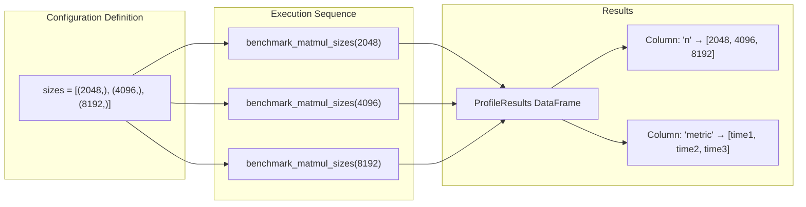
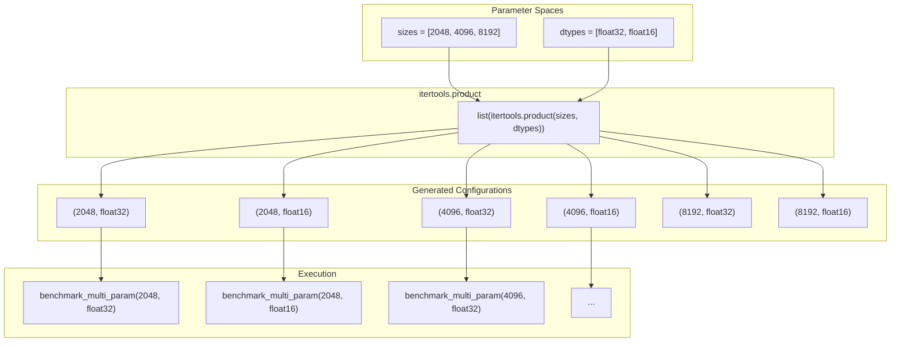
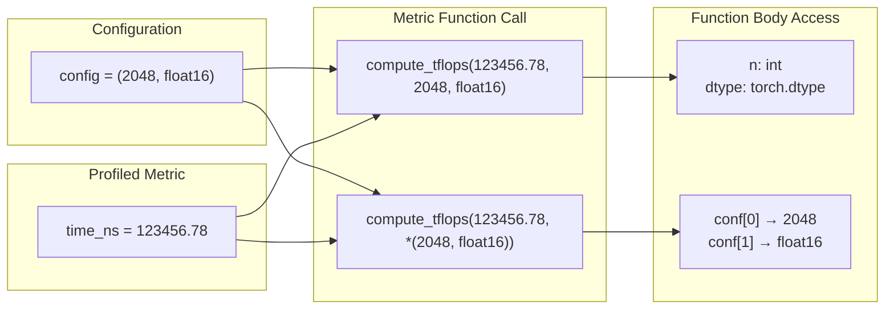

<!-- source: DeepWiki mcp.deepwiki.com · repo NVIDIA/nsight-python · page 8.3 Parameter Sweeps · fetched 2026-10-26 -->

# Parameter Sweeps

<details>
<summary>Relevant source files</summary>

The following files were used as context for generating this wiki page:

- [examples/01_compare_throughput.py](examples/01_compare_throughput.py)
- [examples/02_parameter_sweep.py](examples/02_parameter_sweep.py)
- [examples/04_multi_parameter.py](examples/04_multi_parameter.py)
- [examples/05_subplots.py](examples/05_subplots.py)
- [examples/README.md](examples/README.md)
- [examples/test_examples.py](examples/test_examples.py)

</details>


## Purpose and Scope

This page demonstrates how to profile GPU kernels across multiple configurations using parameter sweeps. Parameter sweeps enable systematic exploration of how performance varies with different input parameters, such as problem sizes, data types, and algorithm variants. 

For basic profiling setup, see [Quick Start Tutorial](3.1). For comparing different implementations, see [Comparing Implementations](8.2). For custom metric computation, see [Custom Metrics and Visualization](8.4).

**Sources**: [examples/02_parameter_sweep.py:1-47](), [examples/04_multi_parameter.py:1-77]()

---

## Overview

Parameter sweeps are configured through the `configs` parameter of the `@nsight.analyze.kernel` decorator. Each configuration is a tuple of parameters that will be passed to the benchmark function. The profiler executes the benchmark function once for each configuration (repeated `runs` times), collecting metrics for every combination.

### Configuration Data Flow

```mermaid
graph TB
    ConfigDef["configs parameter<br/>List[Tuple[...]]"]
    Decorator["@nsight.analyze.kernel"]
    Matrix["Config × Runs Matrix"]
    Execution["Benchmark Function<br/>Receives config parameters"]
    Annotation["nsight.annotate context"]
    NCU["NCU Profiling<br/>Collects metrics"]
    Results["ProfileResults<br/>DataFrame with config columns"]
    
    ConfigDef --> Decorator
    Decorator --> Matrix
    Matrix --> Execution
    Execution --> Annotation
    Annotation --> NCU
    NCU --> Results
    
    Matrix -.."For each config".-> Execution
    Execution -.."runs times".-> NCU
```

**Diagram**: Configuration parameter flow from decorator to profiling results.

**Sources**: [examples/02_parameter_sweep.py:21-26](), [examples/04_multi_parameter.py:28-56]()

---

## Single-Parameter Sweeps

Single-parameter sweeps test performance across one dimension (e.g., problem size). Each configuration is a **single-element tuple**.

### Example: Matrix Size Sweep

The example at [examples/02_parameter_sweep.py:1-44]() demonstrates sweeping over matrix sizes:

```python
# Define configurations as single-element tuples
sizes = [(2**i,) for i in range(11, 14)]  # [(2048,), (4096,), (8192,)]

@nsight.analyze.plot("02_parameter_sweep.png")
@nsight.analyze.kernel(configs=sizes, runs=10)
def benchmark_matmul_sizes(n: int) -> None:
    """Benchmark receives n from each config tuple."""
    a = torch.randn(n, n, device="cuda")
    b = torch.randn(n, n, device="cuda")
    
    with nsight.annotate("matmul"):
        _ = a @ b
```

**Key details**:
- Configurations must be tuples: `[(2048,)]`, not `[2048]` [examples/02_parameter_sweep.py:21]().
- Benchmark function signature matches config tuple: `def benchmark(n: int)` [examples/02_parameter_sweep.py:26]().
- Function is called without arguments: `benchmark_matmul_sizes()` [examples/02_parameter_sweep.py:40]().
- Parameters are automatically unpacked from configs during execution.

### Single-Parameter Configuration Structure



**Diagram**: Single-parameter sweep execution and result structure.

**Sources**: [examples/02_parameter_sweep.py:21-26]()

---

## Multi-Parameter Sweeps

Multi-parameter sweeps test performance across multiple dimensions simultaneously. Use `itertools.product` to generate all combinations.

### Example: Size and Data Type Sweep

The example at [examples/04_multi_parameter.py:1-77]() demonstrates sweeping over matrix size and data type:

```python
import itertools

# Define parameter ranges
sizes = [2048, 4096, 8192]
dtypes = [torch.float32, torch.float16]

# Generate all combinations
configs = list(itertools.product(sizes, dtypes))
# Result: [(2048, float32), (2048, float16), (4096, float32), ...]

@nsight.analyze.kernel(configs=configs, runs=10, derive_metric=compute_tflops)
def benchmark_multi_param(n: int, dtype: torch.dtype) -> None:
    """Benchmark receives both n and dtype from config tuples."""
    a = torch.randn(n, n, device="cuda", dtype=dtype)
    b = torch.randn(n, n, device="cuda", dtype=dtype)
    
    with nsight.annotate("matmul"):
        _ = a @ b
```

**Key details**:
- `itertools.product(sizes, dtypes)` creates Cartesian product [examples/04_multi_parameter.py:29]().
- Benchmark function signature matches config tuple structure: `def benchmark(n: int, dtype: torch.dtype)` [examples/04_multi_parameter.py:58-59]().
- Function is called without arguments: `benchmark_multi_param()` [examples/04_multi_parameter.py:72]().

### Multi-Parameter Execution Matrix



**Diagram**: Multi-parameter sweep using `itertools.product` to generate configuration matrix.

**Sources**: [examples/04_multi_parameter.py:24-29](), [examples/04_multi_parameter.py:56-68]()

---

## Configuration Patterns

The following table summarizes common configuration patterns:

| Pattern | Configuration Definition | Benchmark Signature | Use Case |
|---------|-------------------------|---------------------|----------|
| Single parameter | `[(256,), (512,), (1024,)]` | `def bench(n: int)` | Problem size sweep |
| Two parameters | `list(itertools.product(sizes, dtypes))` | `def bench(n: int, dtype: torch.dtype)` | Size × type sweep |
| Three parameters | `list(itertools.product(m, n, k))` | `def bench(m: int, n: int, k: int)` | 3D parameter space |
| Named tuples | `[("small", 256), ("medium", 512)]` | `def bench(name: str, size: int)` | Named configurations |
| Derived configs | `[(2**i, 2**(i+1)) for i in range(8, 12)]` | `def bench(m: int, n: int)` | Related parameters |

**Sources**: [examples/02_parameter_sweep.py:21](), [examples/04_multi_parameter.py:24-29]()

---

## Accessing Configuration in Metric Functions

Custom metric functions need access to configuration parameters to compute derived metrics. Two approaches are available:

### Explicit Parameters

Match the benchmark function signature:

```python
def compute_tflops(time_ns: float, n: int, dtype: torch.dtype) -> dict[str, tuple[float, str]]:
    """Explicitly list all config parameters."""
    flops = 2 * n * n * n
    tflops = flops / (time_ns / 1e9) / 1e12
    return {"TFLOPS": (tflops, "TFLOPS")}
```

### Variadic Parameters with `*conf`

Use `*conf` to capture all configuration parameters as a tuple [examples/04_multi_parameter.py:32-48]():

```python
def compute_tflops(time_ns: float, *conf: Any) -> dict[str, tuple[float, str]]:
    """
    More flexible signature:
    - time_ns: The measured metric (first argument)
    - *conf: All config parameters as tuple
    """
    n: int = conf[0]  # First config parameter (size)
    # dtype = conf[1]  # Second parameter (if needed)
    
    flops = 2 * n * n * n
    tflops: float = flops / (time_ns / 1e9) / 1e12
    return {"TFLOPS": (tflops, "TFLOPS")}
```

**Advantages of `*conf` approach**:
- Function works with varying numbers of configuration parameters [examples/04_multi_parameter.py:40]().
- Can extract only needed parameters [examples/04_multi_parameter.py:43]().
- More maintainable when adding/removing config parameters.

### Metric Function Parameter Mapping



**Diagram**: Two approaches for accessing configuration parameters in metric functions.

**Sources**: [examples/04_multi_parameter.py:32-48]()

---

## Faceting with Subplots

When sweeping over three or more parameters, visualizing the data in a single plot becomes difficult. Nsight Python supports faceting through `row_panels` and `col_panels` [examples/05_subplots.py:44-45]().

```python
@nsight.analyze.plot(
    filename="05_subplots.png",
    metric="TFLOPS",
    row_panels=["dtype"],      # Create row for each dtype
    col_panels=["transpose"],  # Create column for each transpose setting
)
@nsight.analyze.kernel(configs=configs, runs=10, derive_metric=compute_tflops)
def benchmark_with_subplots(n: int, dtype: torch.dtype, transpose: bool) -> None:
    ...
```

**Sources**: [examples/05_subplots.py:24-49]()

---

## Best Practices

### Configuration Organization

1. **Use descriptive parameter names**: Function signatures should clearly indicate what each parameter represents [examples/04_multi_parameter.py:58-59]().
2. **Single-element tuples**: Always use tuples for configs, even with one parameter: `[(256,)]` not `[256]` [examples/02_parameter_sweep.py:21]().
3. **Cartesian products**: Use `itertools.product` for multi-parameter sweeps rather than manual nested loops [examples/04_multi_parameter.py:29]().
4. **Powers of 2**: For size sweeps, use powers of 2 for consistent GPU occupancy patterns [examples/02_parameter_sweep.py:21]().

### Performance Considerations

| Configuration Size | Execution Time Estimate | Recommendation |
|-------------------|------------------------|----------------|
| 10 configs × 10 runs | ~100 kernel executions | Suitable for development |
| 50 configs × 10 runs | ~500 kernel executions | Production benchmarks |
| 100 configs × 50 runs | ~5000 kernel executions | Comprehensive analysis, use thermal control |

**Sources**: [examples/02_parameter_sweep.py:21-25](), [examples/04_multi_parameter.py:25-29](), [examples/05_subplots.py:24-28]()

---

