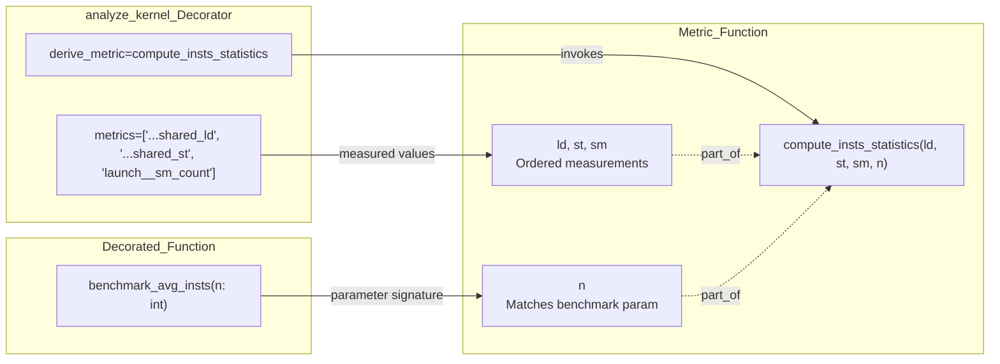
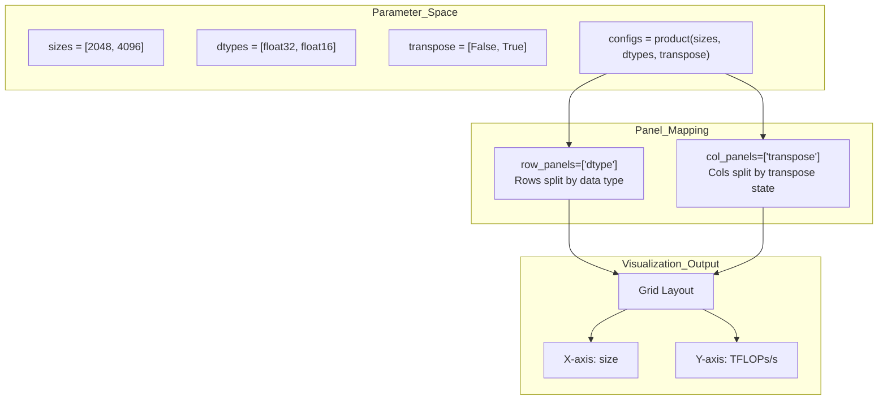

<!-- source: DeepWiki mcp.deepwiki.com · repo NVIDIA/nsight-python · page 8.4 Custom Metrics and Visualization · fetched 2026-10-26 -->

# Custom Metrics and Visualization

<details>
<summary>Relevant source files</summary>

The following files were used as context for generating this wiki page:

- [examples/03_custom_metrics.py](examples/03_custom_metrics.py)
- [examples/06_plot_customization.py](examples/06_plot_customization.py)
- [examples/08_multiple_metrics.py](examples/08_multiple_metrics.py)
- [examples/09_advanced_metric_custom.py](examples/09_advanced_metric_custom.py)
- [examples/10_combine_kernel_metrics.py](examples/10_combine_kernel_metrics.py)

</details>


## Purpose and Scope

This page provides practical examples demonstrating how to compute custom derived metrics and customize plot output in nsight-python. It covers the `derive_metric` parameter for computing custom performance indicators (like TFLOPs/s or arithmetic intensity), subplot organization with `row_panels` and `col_panels`, plot type selection, and advanced customization using `plot_callback`.

For conceptual information about metrics and normalization, see [Working with Metrics](#4.4). For API reference documentation, see [nsight.analyze Module](#7.1) and [nsight.analyze Module](#7.1). For advanced metric composition techniques, see [Custom Derived Metrics](#6.2).

## Custom Metric Functions

### Metric Function Signature

Custom metric functions transform raw profiling measurements into domain-specific performance indicators. The function signature must follow a specific pattern to ensure correct data flow from the profiler and the decorated benchmark function.

**Return Type Patterns:**
1.  **Single Tuple:** Returns `(value, unit)` (e.g., `(12.5, "TFLOPS")`). [examples/03_custom_metrics.py:18-18]()
2.  **Dictionary:** Returns a mapping of metric names to `(value, unit)` tuples. [examples/03_custom_metrics.py:19-20]()
3.  **Warning Note:** Returning scalars without units will issue warnings and store `np.nan` in the `Unit` column. [examples/03_custom_metrics.py:21-21]()

**Signature Matching Diagram**



**Sources:** [examples/03_custom_metrics.py:17-21](), [examples/09_advanced_metric_custom.py:21-45]()

### TFLOPs and Arithmetic Intensity Example

Derived metrics can be used to calculate hardware-specific performance. When `derive_metric` returns a dictionary, the `@plot` decorator's `metric` parameter must match one of the dictionary keys. [examples/03_custom_metrics.py:117-118]()

| Component | Example Value | Description |
|-----------|-------|-------------|
| **Input Metric** | `time_ns` | Kernel execution time in nanoseconds |
| **FLOP Count** | `2 * n³` | Total operations for matrix multiplication |
| **Arithmetic Intensity** | `FLOPs / Bytes` | Ratio of compute to memory access |
| **Unit Tracking** | `"FLOP/byte"` | Stored in DataFrame "Unit" column |

**Implementation (Dictionary Pattern):**

```python
def compute_tflops_and_arithmetic_intensity(time_ns: float, n: int) -> dict[str, tuple[float, str]]:
    flops = 2 * n * n * n
    tflops = flops / (time_ns / 1e9) / 1e12
    memory_bytes = (n * n + n * n + n * n) * 4 # Float32
    arithmetic_intensity = flops / memory_bytes

    return {
        "TFLOPS": (tflops, "TFLOPS"),
        "ArithIntensity": (arithmetic_intensity, "FLOP/byte"),
    }
```

**Sources:** [examples/03_custom_metrics.py:108-146]()

### Advanced Multi-Metric Composition

You can collect multiple raw hardware metrics and combine them in a single derived function. The order of arguments in the `derive_metric` function must match the order in the `metrics` list provided to the `@kernel` decorator. [examples/09_advanced_metric_custom.py:28-29]()

```python
@nsight.analyze.kernel(
    configs=sizes,
    derive_metric=compute_insts_statistics,
    metrics=[
        "smsp__sass_inst_executed_op_shared_ld.sum", # ld_insts
        "smsp__sass_inst_executed_op_shared_st.sum", # st_insts
        "launch__sm_count",                          # launch_sm_count
    ],
)
def benchmark_avg_insts(n: int):
    ...
```

**Sources:** [examples/09_advanced_metric_custom.py:73-82]()

## Plot Customization Options

### Basic Plot Parameters

The `@analyze.plot` decorator provides several parameters for customizing output. Note that when multiple metrics exist (either via `metrics` list or `derive_metric` dictionary), the `metric` parameter **must** be explicitly specified. [examples/03_custom_metrics.py:24-24]()

| Parameter | Type | Default | Description |
|-----------|------|---------|-------------|
| `filename` | `str` | `"profile_results.png"` | Output file path |
| `metric` | `str` | `None` | Key from derived dict or function name for tuple returns |
| `ylabel` | `str` | `"Metric Value"` | Y-axis label |
| `annotate_points` | `bool` | `False` | Display values on data points |
| `plot_type` | `str` | `"line"` | Visualization style: `"line"` or `"bar"` |

**Sources:** [examples/03_custom_metrics.py:74-82](), [examples/06_plot_customization.py:32-39]()

### Plot Type Selection

The `plot_type` parameter controls the visualization style:

*   **Line plot (default):** Best for showing trends across continuous parameters.
*   **Bar chart:** Best for comparing discrete configurations. [examples/06_plot_customization.py:37-37]()

```python
@nsight.analyze.plot(
    filename="06_bar_chart.png",
    metric="TFLOPS",
    plot_type="bar",  # Use bar chart instead of line plot
    annotate_points=True,
)
```

**Sources:** [examples/06_plot_customization.py:32-39]()

## Subplot Organization

### Row and Column Panels

For multi-dimensional parameter sweeps, use `row_panels` and `col_panels` to create subplot grids. Each unique combination of panel values creates a separate subplot.

**Panel Configuration Logic:**



**Sources:** [examples/05_subplots.py:23-46]()

## Advanced Customization with Plot Callback

### Callback Function Signature

For fine-grained control over plot appearance, use `plot_callback` to receive the matplotlib figure object after initial rendering. [examples/06_plot_customization.py:49-50]()

```python
def custom_style(fig: Any) -> None:
    # Modify the figure
    fig.suptitle("Custom Styled Plot", fontsize=16, fontweight="bold")
    fig.set_figwidth(10)
    
    # Modify the axes
    ax = fig.get_axes()[0]
    ax.set_ylabel("Performance (TFLOPs/s)", fontsize=12)
    ax.grid(True, alpha=0.3)
    
    # Customize line appearance
    for line in ax.get_lines():
        line.set_linewidth(2)
        line.set_marker("o")
```

**Sources:** [examples/06_plot_customization.py:50-68]()

## Metric Aggregation and Limitations

### Multiple Metrics Limitation
The `@nsight.analyze.plot` decorator cannot visualize multiple metrics simultaneously. If a `@kernel` function collects a list of metrics, `@plot` will raise an error unless a single `metric` is specified. [examples/08_multiple_metrics.py:68-76]()

### Combining Kernel Metrics
When multiple kernels are launched within a single annotation, `combine_kernel_metrics` can be used to aggregate their results (e.g., summing total cycles). [examples/10_combine_kernel_metrics.py:11-12]()

```python
@nsight.analyze.kernel(
    configs=sizes,
    combine_kernel_metrics=lambda x, y: x + y,  # Sum metrics from multiple kernels
    metrics=["sm__cycles_elapsed.avg"],
)
def benchmark_multiple_kernels(n: int):
    with nsight.annotate("test"):
        _ = a @ b  # Kernel 1
        _ = a @ b  # Kernel 2
```

**Sources:** [examples/08_multiple_metrics.py:68-76](), [examples/10_combine_kernel_metrics.py:28-35]()

## Summary of Visualization Parameters

| Parameter | Type | Default | Purpose |
|-----------|------|---------|---------|
| `derive_metric` | `Callable` | `None` | Transform raw metrics to custom values (returns tuple or dict) |
| `filename` | `str` | `"profile_results.png"` | Output file path |
| `metric` | `str` | `None` | Required if >1 metric exists; matches function name or dict key |
| `plot_type` | `str` | `"line"` | `"line"` or `"bar"` |
| `row_panels` | `List[str]` | `None` | Parameter names to split into subplot rows |
| `col_panels` | `List[str]` | `None` | Parameter names to split into subplot columns |
| `plot_callback` | `Callable` | `None` | Matplotlib function for advanced styling |

**Sources:** [examples/03_custom_metrics.py:17-27](), [examples/05_subplots.py:39-46](), [examples/06_plot_customization.py:71-75]()

---

