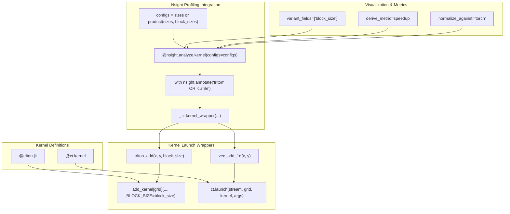
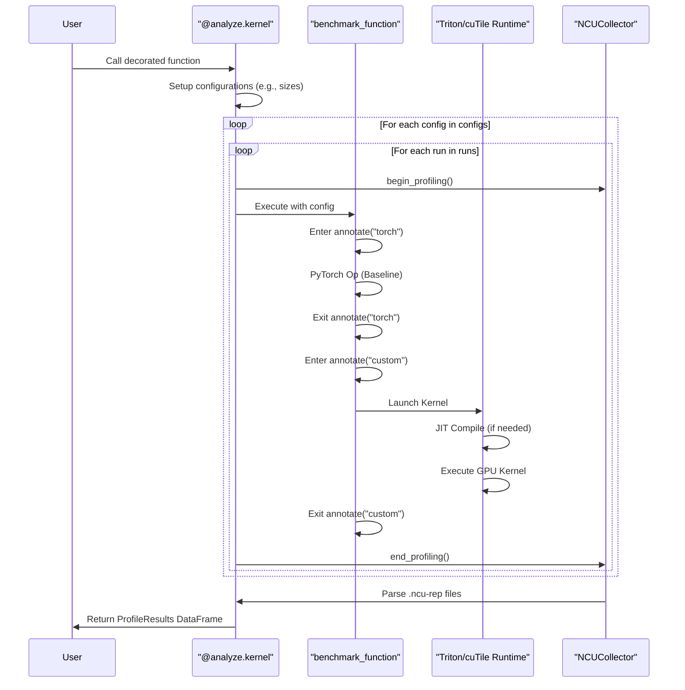

<!-- source: DeepWiki mcp.deepwiki.com · repo NVIDIA/nsight-python · page 8.5 Triton and cuTile Integration · fetched 2026-10-26 -->

# Triton and cuTile Integration

<details>
<summary>Relevant source files</summary>

The following files were used as context for generating this wiki page:

- [examples/00_minimal.py](examples/00_minimal.py)
- [examples/07_triton_minimal.py](examples/07_triton_minimal.py)
- [examples/12_cutile.py](examples/12_cutile.py)

</details>


## Purpose and Scope

This document explains how to use `nsight-python` to profile Triton and cuTile GPU kernels. Both frameworks allow for writing custom GPU kernels in Python, and `nsight-python` provides specialized support for profiling these implementations alongside standard frameworks like PyTorch. This page covers Triton-specific profiling patterns, cuTile integration (new in v1.0.0), parameter sweeps across kernel configurations (such as block sizes), and comparison workflows for evaluating custom kernels against baseline implementations.

For general profiling setup and configuration concepts, see [Core Concepts](#3.2) and [Profiling Configurations](#4.3). For information on visualization features, see [Visualization and Plotting](#4.5).

---

## Triton and cuTile Kernel Profiling Workflow

Profiling Triton and cuTile kernels follows the same decorator-based pattern as other GPU operations. The workflow consists of defining a kernel using the respective framework's JIT or kernel decorator, wrapping kernel launches in `nsight.annotate` contexts, and using the `@nsight.analyze.kernel` decorator to orchestrate profiling runs.



**Sources:** [examples/07_triton_minimal.py:1-132](), [examples/12_cutile.py:1-121]()

---

## Triton Integration

Triton kernels utilize `triton.language` (typically imported as `tl`) for low-level GPU operations. A key feature is the use of `tl.constexpr` for compile-time constants like block sizes, which can be swept using `nsight-python` configurations.

### Triton Kernel Definition and Launch

[examples/07_triton_minimal.py:27-58]() demonstrates the standard pattern:

```python
@triton.jit
def add_kernel(..., BLOCK_SIZE: tl.constexpr):
    # Kernel logic using BLOCK_SIZE
    ...

def triton_add(x, y, block_size):
    grid = lambda meta: (triton.cdiv(n_elements, meta["BLOCK_SIZE"]),)
    add_kernel[grid](x, y, output, n_elements, BLOCK_SIZE=block_size)
```

### Profiling with Variants

When comparing multiple Triton configurations (e.g., different block sizes) against a single baseline (e.g., PyTorch), use `variant_fields` and `variant_annotations`.

*   **`variant_fields`**: Creates separate visualization lines for each unique value of specified configuration fields (e.g., `["block_size"]`). [examples/07_triton_minimal.py:95]()
*   **`variant_annotations`**: Restricts the variant behavior to specific annotations. This prevents the profiler from trying to find a "block_size" variant for the PyTorch baseline. [examples/07_triton_minimal.py:99]()

**Sources:** [examples/07_triton_minimal.py:87-100]()

---

## cuTile Integration

New in v1.0.0, `nsight-python` supports profiling kernels written with `cuda.tile` (cuTile). cuTile provides a tiled programming model that maps well to GPU hardware structures.

### cuTile Kernel Definition

[examples/12_cutile.py:23-61]() shows a 1D vector addition kernel:

```python
@ct.kernel
def vec_add_kernel_1d(a, b, c, TILE: ct.Constant[int]):
    bid = ct.bid(0)
    a_tile = ct.load(a, index=(bid,), shape=(TILE,))
    b_tile = ct.load(b, index=(bid,), shape=(TILE,))
    sum_tile = a_tile + b_tile
    ct.store(c, index=(bid,), tile=sum_tile)
```

The kernel uses `ct.load` and `ct.store` to move data between global memory and registers/shared memory based on the `TILE` constant.

### cuTile Launch and Profiling

Launching cuTile kernels requires an explicit `ct.launch` call. In a profiling context, this launch is wrapped in an annotation:

[examples/12_cutile.py:80-83]()
```python
ct.launch(
    torch.cuda.current_stream(), grid, vec_add_kernel_1d, (x, y, output, TILE)
)
```

[examples/12_cutile.py:116-117]()
```python
with nsight.annotate("cuTile"):
    _ = vec_add_1d(x, y)
```

**Sources:** [examples/12_cutile.py:23-117]()

---

## Comparing Custom Kernels Against Baselines

A primary use case for custom kernels is achieving higher performance than standard library operators. `nsight-python` facilitates this through normalization and derived metrics.

### Speedup Calculation

To visualize speedup (where higher is better) instead of normalized time (where lower is better), use a custom `derive_metric` function to take the reciprocal of the normalized value.

[examples/07_triton_minimal.py:69-84]()
```python
def speedup(metric: float, n: int, block_size: int) -> tuple[float, str]:
    # With normalize_against, metric = current / baseline
    # Speedup = 1 / (current / baseline) = baseline / current
    return (1.0 / metric, "x")

@nsight.analyze.kernel(
    ...,
    normalize_against="torch",
    derive_metric=speedup,
)
```

### Component Mapping for Custom Kernels

| Component | Code Entity (Triton) | Code Entity (cuTile) | Purpose |
|-----------|----------------------|----------------------|---------|
| Kernel Def | `@triton.jit` [07:29]() | `@ct.kernel` [12:23]() | Define GPU execution logic |
| Constants | `tl.constexpr` [07:35]() | `ct.Constant[int]` [12:25]() | Compile-time parameters |
| Launch | `kernel[grid](...)` [07:56]() | `ct.launch(...)` [12:80]() | Invoke kernel on GPU |
| Annotation | `nsight.annotate("triton")` [07:127]() | `nsight.annotate("cuTile")` [12:116]() | Mark region for NCU collection |

**Sources:** [examples/07_triton_minimal.py:29-127](), [examples/12_cutile.py:23-116]()

---

## Execution Flow for Custom Kernels

The following diagram illustrates how `nsight-python` manages the profiling of custom kernels across multiple configurations.



**Sources:** [examples/07_triton_minimal.py:101-132](), [examples/12_cutile.py:96-121]()

---

## Best Practices

1.  **Warm-up and JIT**: Triton and cuTile both involve JIT compilation. `nsight-python` handles multiple runs (`runs=10`), but ensure the number of runs is sufficient to amortize the initial compilation cost in the average values. [examples/07_triton_minimal.py:103]()
2.  **Precise Annotation**: Wrap only the helper function or the specific kernel launch in `nsight.annotate`. Avoid including large tensor allocations or CPU-side preprocessing inside the annotation to ensure the collected metrics reflect kernel execution. [examples/12_cutile.py:112-117]()
3.  **Variant Filtering**: When using `variant_fields` for a custom kernel parameter (like `block_size`), always use `variant_annotations` to exclude the baseline annotation if that baseline does not support the same parameter. [examples/07_triton_minimal.py:95-99]()
4.  **Unit Consistency**: When using `derive_metric`, return a tuple `(value, unit)` to ensure the `Unit` column in the resulting DataFrame is correctly populated (e.g., returning `"x"` for speedup). [examples/07_triton_minimal.py:84]()

**Sources:** [examples/07_triton_minimal.py:69-109](), [examples/12_cutile.py:100-118]()

---

