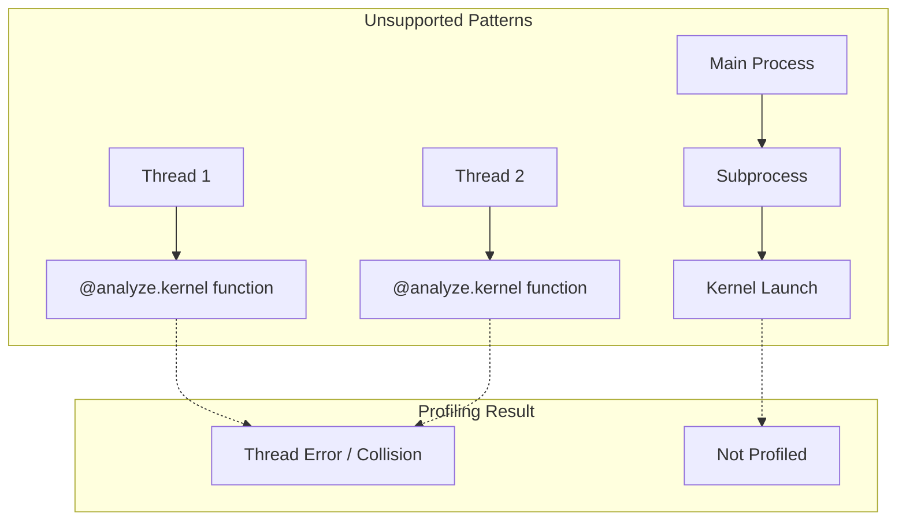
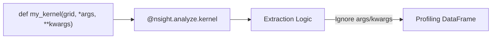

<!-- source: DeepWiki mcp.deepwiki.com · repo NVIDIA/nsight-python · page 9 Known Issues and Limitations · fetched 2026-10-26 -->

# Known Issues and Limitations

Relevant source files

The following files were used as context for generating this wiki page:

- [docs/source/release_notes/known_issues.rst](docs/source/release_notes/known_issues.rst)

This page documents known issues, limitations, and API restrictions in `nsight-python`. Understanding these constraints is essential for designing effective profiling workflows and avoiding common pitfalls. As of version 1.0.0, the system has moved to an injection-based attach mode, which resolves previous script relaunch issues but introduces specific multi-threading and API considerations.

## Scope and Purpose

This document covers:
- **Annotation restrictions** for NVTX range usage and thread-locality.
- **Process and thread limitations** affecting kernel profiling coverage.
- **API restrictions** imposed by NVIDIA Nsight Compute replay modes.
- **Argument handling** in decorated function signatures.

---

## Annotation Restrictions

The `nsight.annotate` context manager and decorator are the primary tools for marking code regions for profiling. However, they have specific structural and thread-based limitations.

### Nested Annotations
Nested annotations (using `nsight.annotate` within another `nsight.annotate` context) are **not supported**. The profiling pipeline's extraction logic expects flat, non-overlapping ranges to accurately associate metrics with specific configurations. Using nested contexts will cause `nsight-python` to error out. [docs/source/release_notes/known_issues.rst:10-10]()

### Thread-Locality of Ranges
`nsight.annotate` marks a region with a **thread-local NVTX push/pop range**. Because NVTX ranges are tied to the thread that created them, kernels launched from any other thread fall outside the range that `ncu` targets. Consequently, those kernels will not be profiled. [docs/source/release_notes/known_issues.rst:8-8]()

For more details on these restrictions, see [Annotation Restrictions](#9.1).

**Sources:** [docs/source/release_notes/known_issues.rst:8-10](), [nsight/annotation.py:46-48]()

---

## Subprocess and Thread Limitations

The architectural design of the `NCUCollector` and the underlying Nsight Compute attach mechanism impose restrictions on how processes and threads are handled.

### Subprocess Isolation
Kernels launched from a **subprocess** created within an annotated region will not be profiled. NVIDIA Nsight Compute instruments the process it attaches to; it does not automatically follow forks or child processes created via `subprocess.Popen` or `multiprocessing`. [docs/source/release_notes/known_issues.rst:7-7]()

### Multi-Thread Calling Restriction
Calling functions decorated with `@nsight.analyze.kernel` from **multiple threads is not supported**. This restriction applies whether the threads run sequentially or concurrently. The profiling orchestration assumes a single-threaded execution flow for the coordination of the `ncu` attach process. [docs/source/release_notes/known_issues.rst:12-12]()

**Diagram: Process and Thread Limitations**

For details on process isolation and thread constraints, see [Subprocess and Thread Limitations](#9.2).

**Sources:** [docs/source/release_notes/known_issues.rst:7-12]()

---

## API Compatibility Issues

### `replay_mode="range"` Restrictions
When using the `replay_mode="range"` option in the `@nsight.analyze.kernel` decorator, only a **subset of CUDA APIs** are supported within the annotated range. If an unsupported API call (such as certain graph APIs or specific memory management calls) is detected, an error will be reported. [docs/source/release_notes/known_issues.rst:9-9]()

| Replay Mode | Scope | API Support |
| :--- | :--- | :--- |
| `kernel` | Individual kernel launches | Full CUDA API support |
| `range` | Entire NVTX range | Restricted (see Nsight Compute Profiling Guide) |

### Argument Handling (`*args` and `**kwargs`)
In decorated function signatures, `*args` and `**kwargs` are **tolerated but ignored**. They will always appear as empty collections within the profiling logic and will not be included in the profiling output or configuration matrices. [docs/source/release_notes/known_issues.rst:11-11]()

**Diagram: Argument Handling Flow**

For details on API compatibility and parameter behavior, see [API Compatibility Issues](#9.3).

**Sources:** [docs/source/release_notes/known_issues.rst:9-11](), [nsight/analyze.py:27-50]()

---

## Summary Table of Limitations

| Feature | Limitation | Workaround |
| :--- | :--- | :--- |
| **Annotations** | No nesting allowed | Use sequential annotations |
| **Multi-threading** | No multi-thread calls to decorated functions | Call from main thread only |
| **Subprocesses** | Child process kernels not captured | Launch kernels in the main process |
| **Replay Mode** | `range` mode restricts CUDA APIs | Switch to `replay_mode="kernel"` |
| **Function Signatures** | `*args` and `**kwargs` are ignored | Use explicit named parameters |

**Sources:** [docs/source/release_notes/known_issues.rst:7-13]()

---

