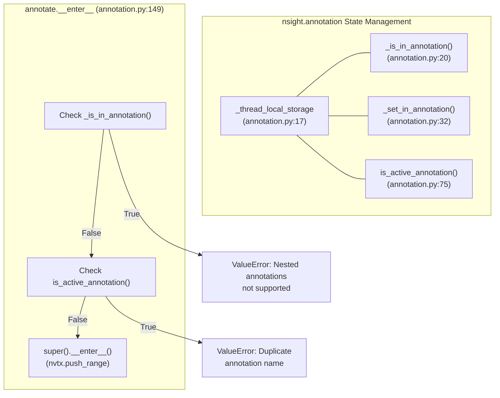
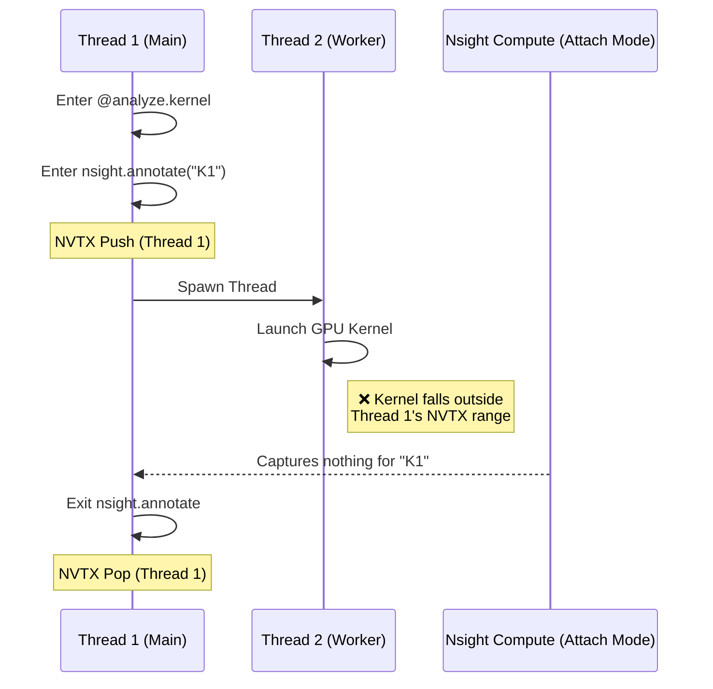

<!-- source: DeepWiki mcp.deepwiki.com · repo NVIDIA/nsight-python · page 9.1 Annotation Restrictions · fetched 2026-10-26 -->

# Annotation Restrictions

<details>
<summary>Relevant source files</summary>

The following files were used as context for generating this wiki page:

- [docs/source/release_notes/known_issues.rst](docs/source/release_notes/known_issues.rst)
- [docs/source/release_notes/topics/updates-in-nsight-python-1.0.0.rst](docs/source/release_notes/topics/updates-in-nsight-python-1.0.0.rst)
- [nsight/annotation.py](nsight/annotation.py)

</details>


## Purpose and Scope

This document describes important limitations and behavioral constraints of the `nsight.annotate` context manager and the `@nsight.analyze.kernel` decorator. As of version 1.0.0, nsight-python has moved to an injection-based attach model, which eliminates script relaunching but introduces specific thread-locality and nesting restrictions that are critical for correct profiling results.

---

## Nested Annotation Limitation

### Overview

The `nsight.annotate` context manager **does not support nesting**. Attempting to enter an `nsight.annotate` context while another is already active will raise a `ValueError` [nsight/annotation.py:152-156](). This restriction exists because the underlying NVTX range mechanism used by nsight-python expects a flat annotation hierarchy to properly associate metrics with specific code regions.

### Unsupported Pattern

The following code pattern is **not supported**:

```python
import nsight

@nsight.analyze.kernel(configs=configs)
def my_benchmark():
    with nsight.annotate("outer"):
        # Some setup code
        
        with nsight.annotate("inner"):  # ❌ Raises ValueError
            # Kernel launch
            result = model(input)
```

**Sources:** [docs/source/release_notes/known_issues.rst:10](), [nsight/annotation.py:152-156]()

### Technical Implementation

The `annotate` class [nsight/annotation.py:91-137]() inherits from `nvtx.annotate` and uses thread-local storage to track state.



**Title:** Annotation Entry Logic and State Validation

The `annotate` class creates NVTX ranges under a dedicated domain `"nsight-python"` [nsight/annotation.py:147](). Nested annotations are discouraged because each annotation is expected to contain a single kernel launch [nsight/annotation.py:129-131](). Calling `nvtx.pop_range()` (implicitly or explicitly) inside a nested context could pop the wrong range, corrupting the profiling report.

**Sources:** [nsight/annotation.py:17-40](), [nsight/annotation.py:149-167](), [docs/source/release_notes/known_issues.rst:10]()

---

## Duplicate Annotation Names

### Restriction

Annotation names must be **unique within a single profiling run** [nsight/annotation.py:109-110](). If a name is reused within the same iteration, a `ValueError` is raised [nsight/annotation.py:159-163]().

### State Management

The profiler tracks used names in `_thread_local_storage.used_annotation_names` [nsight/annotation.py:53-55](). This state is cleared at the start of each profiling iteration by `clear_active_annotations()` [nsight/annotation.py:58-72](), allowing names to be reused across different configurations or runs, but not within the same execution of the decorated function.

**Sources:** [nsight/annotation.py:42-55](), [nsight/annotation.py:159-163]()

---

## Thread-Locality and Multi-Threading Restrictions

### Thread-Local NVTX Ranges

`nsight.annotate` marks regions using thread-local NVTX push/pop ranges [docs/source/release_notes/known_issues.rst:8](). Because Nsight Compute (`ncu`) targets ranges on the thread that created them, **kernels launched from a different thread than the one entering the annotation context will not be profiled** [docs/source/release_notes/known_issues.rst:8]().

### Multi-Threaded Call Restriction

Calling a function decorated with `@nsight.analyze.kernel` from multiple threads is **not supported**, whether those calls occur sequentially or concurrently [docs/source/release_notes/known_issues.rst:12]().



**Title:** Thread-Locality Limitation in NVTX Range Targeting

**Sources:** [docs/source/release_notes/known_issues.rst:8-12](), [nsight/annotation.py:15-17]()

---

## Subprocess Limitations

Kernels launched from a **subprocess** created within an annotated region will not be profiled [docs/source/release_notes/known_issues.rst:7](). Since the Nsight Compute profiler attaches to the specific PID of the Python process via injection [docs/source/release_notes/topics/updates-in-nsight-python-1.0.0.rst:10-14](), it does not automatically follow forks or child processes for kernel capture.

**Sources:** [docs/source/release_notes/known_issues.rst:7](), [docs/source/release_notes/topics/updates-in-nsight-python-1.0.0.rst:10-16]()

---

## Argument Handling Restrictions

### `*args` and `**kwargs`

While the `@nsight.analyze.kernel` decorator tolerates `*args` and `**kwargs` in the signature of the decorated function, they are **ignored during profiling** [docs/source/release_notes/known_issues.rst:11](). They will always appear as empty in the profiling logic and will not be included as columns in the resulting output DataFrame [docs/source/release_notes/topics/updates-in-nsight-python-1.0.0.rst:36-37]().

### Supported Parameter Types

As of version 1.0.0, the system supports:
*   **Keyword-only parameters**: Parameters defined after `*` in a signature are correctly mapped from configurations [docs/source/release_notes/topics/updates-in-nsight-python-1.0.0.rst:31-33]().
*   **Default values**: Configs can omit trailing parameters if the function signature provides defaults [docs/source/release_notes/topics/updates-in-nsight-python-1.0.0.rst:34-35]().

**Sources:** [docs/source/release_notes/known_issues.rst:11](), [docs/source/release_notes/topics/updates-in-nsight-python-1.0.0.rst:28-37]()

---

