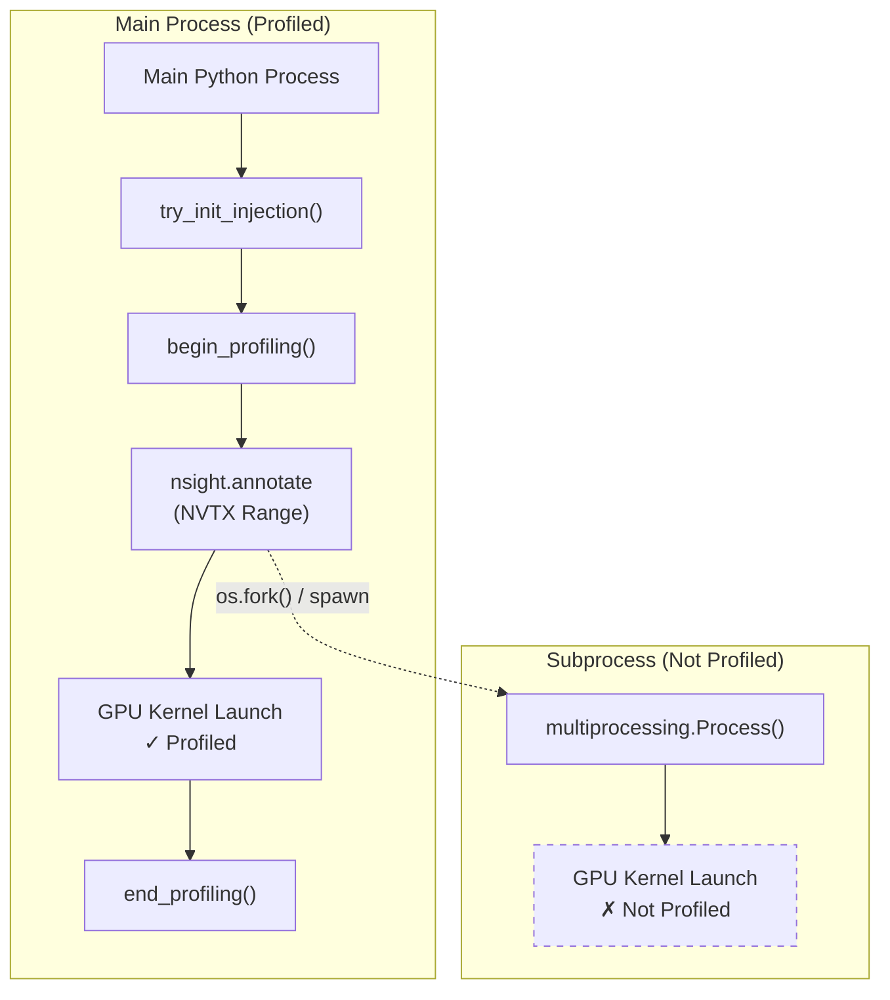
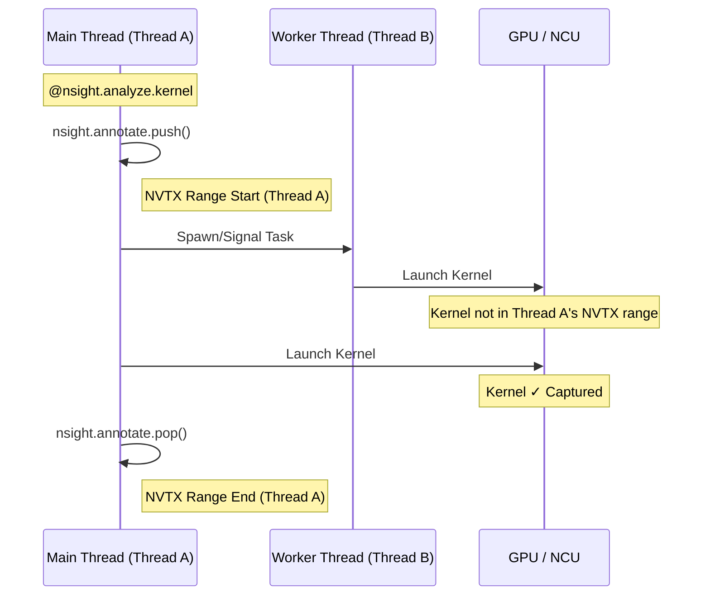

<!-- source: DeepWiki mcp.deepwiki.com · repo NVIDIA/nsight-python · page 9.2 Subprocess and Thread Limitations · fetched 2026-10-26 -->

# Subprocess and Thread Limitations

Relevant source files

The following files were used as context for generating this wiki page:

- [docs/source/release_notes/known_issues.rst](docs/source/release_notes/known_issues.rst)

## Purpose and Scope

This page documents the architectural limitations of nsight-python regarding process and thread boundaries. Specifically, it explains why GPU kernels launched from subprocesses or different threads than the annotation context cannot be profiled. It also documents the restriction against calling `@nsight.analyze.kernel`-decorated functions from multiple threads.

For information about other annotation restrictions such as nested annotations, see [Annotation Restrictions](9.1). For general API compatibility issues with different replay modes, see [API Compatibility Issues](9.3).

## The Core Limitations

There are three primary limitations regarding execution context in nsight-python:

1.  **Subprocess Isolation**: GPU kernels launched from a subprocess created within an `nsight.annotate` context or `@nsight.analyze.kernel` decorated function will not be profiled [docs/source/release_notes/known_issues.rst:7-7]().
2.  **Thread Locality**: Kernels launched from a different thread than the one that created the `nsight.annotate` region will not be profiled [docs/source/release_notes/known_issues.rst:8-8]().
3.  **Multi-Threaded Decorator Calls**: Calling a function decorated with `@nsight.analyze.kernel` from multiple threads (sequentially or concurrently) is not supported [docs/source/release_notes/known_issues.rst:12-12]().

## Subprocess Limitations

### Why Subprocesses Are Not Profiled
The limitation stems from how NVIDIA Nsight Compute (`ncu`) instruments processes. As of version 1.0.0, nsight-python uses an injection-based attach mode where the profiler attaches to the running process [docs/source/release_notes/known_issues.rst:9-9](). 

*   **Process Isolation**: Operating system process isolation means child processes (created via `multiprocessing` or `subprocess`) run in separate memory spaces with their own CUDA contexts.
*   **Injection Scope**: The injection library initialized via `try_init_injection` [nsight/collection/ncu.py:34-60]() is active within the current process. It does not automatically propagate to child processes.
*   **CUDA Context Separation**: `ncu` captures kernel launches from the specific CUDA context it is monitoring. Subprocesses initialize their own independent CUDA runtimes and contexts which fall outside the monitored scope.

### Process Hierarchy Diagram

**Sources:** [docs/source/release_notes/known_issues.rst:7-8](), [nsight/collection/ncu.py:34-118]()

## Thread Limitations

### NVTX Thread-Locality
The `nsight.annotate` class marks regions using NVTX (NVIDIA Tools Extension) push/pop ranges [nsight/annotation.py:15-81](). NVTX ranges are inherently **thread-local**.

*   **Range Targeting**: When `ncu` profiles in `replay_mode="range"`, it targets specific NVTX ranges.
*   **The Mismatch**: If Thread A creates the NVTX range via `nsight.annotate`, but Thread B launches the GPU kernel, the kernel launch occurs outside the NVTX range defined on Thread A's stack. Consequently, `ncu` ignores these kernels.

### Multi-Threaded Call Restriction
Calling an `@nsight.analyze.kernel` decorated function from multiple threads is explicitly unsupported [docs/source/release_notes/known_issues.rst:12-12](). This is because the internal state of the `NsightProfiler` [nsight/collection/core.py:155-223]() and the underlying `NCUCollector` [nsight/collection/ncu.py:121-224]() are designed for a single control flow per profiling session.

### Thread Interaction Diagram

**Sources:** [docs/source/release_notes/known_issues.rst:8-8](), [nsight/annotation.py:63-78]()

## Symptoms and Identification

These limitations often result in **silent data absence** rather than explicit crashes.

| Symptom | Cause |
| :--- | :--- |
| **Empty Results** | Kernels were launched in a subprocess or a different thread; the profiler saw the NVTX range but no kernels inside it. |
| **Missing Configurations** | If using `itertools.product` for configs in a multi-threaded way, the profiler may fail to associate results with the correct metadata. |
| **`ncu` Error: "No kernels profiled"** | The targeted NVTX range was found, but it contained zero intercepted CUDA kernel launches. |

**Sources:** [docs/source/release_notes/known_issues.rst:7-12](), [nsight/collection/ncu.py:195-210]()

## Workarounds

### For Subprocesses
*   **Refactor to Synchronous Calls**: Move logic from subprocesses into the main process during profiling.
*   **Independent Profiling**: Apply the decorator inside the target function that the subprocess executes, so the subprocess becomes the "Main Process" for its own profiling session.

### For Threads
*   **Single-Threaded Benchmarking**: Ensure the thread that enters the `nsight.annotate` context is the same thread that invokes the GPU kernels (e.g., the thread running PyTorch or Triton commands).
*   **Avoid Concurrent Decorator Calls**: Ensure only one thread at a time interacts with functions decorated with `@nsight.analyze.kernel`.

**Sources:** [docs/source/release_notes/known_issues.rst:8-12]()

---

