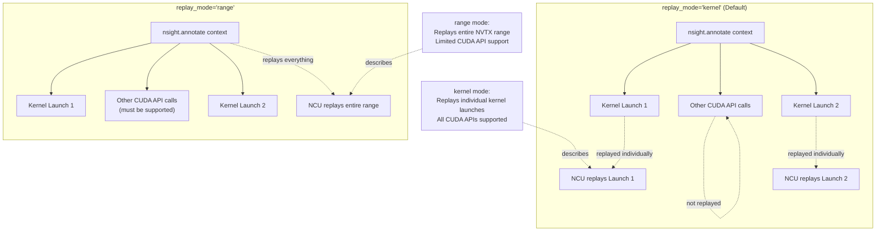
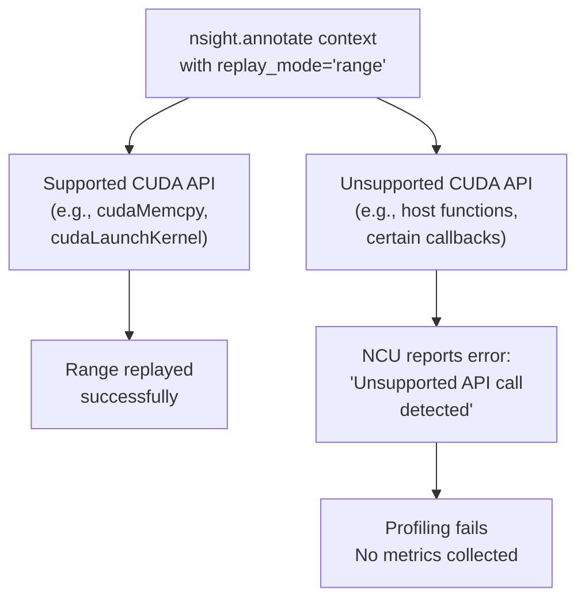
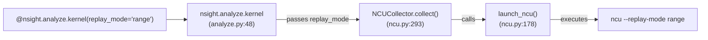

<!-- source: DeepWiki mcp.deepwiki.com · repo NVIDIA/nsight-python · page 9.3 API Compatibility Issues · fetched 2026-10-26 -->

# API Compatibility Issues

Relevant source files

The following files were used as context for generating this wiki page:

- [docs/source/release_notes/known_issues.rst](docs/source/release_notes/known_issues.rst)
- [nsight/collection/ncu.py](nsight/collection/ncu.py)

This page documents API compatibility limitations when using `replay_mode='range'` with the `@nsight.analyze.kernel` decorator, as well as behavior regarding function signatures and multi-threaded calls.

## Overview

When profiling GPU kernels with Nsight Python, the choice of `replay_mode` significantly impacts API compatibility. While kernel replay mode supports all CUDA APIs, range replay mode has strict restrictions that can cause profiling failures if unsupported APIs are used within annotated regions. Additionally, certain Python-level calling patterns and argument types have specific behaviors or limitations.

**Sources**: [docs/source/release_notes/known_issues.rst:9-12]()

---

## Replay Mode Fundamentals

### Kernel Replay Mode vs Range Replay Mode

**Kernel Replay Mode** (`replay_mode="kernel"`):
- Replays each kernel launch individually within the annotated range.
- All CUDA API calls between kernels execute normally without replay.
- No restrictions on which CUDA APIs can be used.
- This is the default mode for the `@nsight.analyze.kernel` decorator.

**Range Replay Mode** (`replay_mode="range"`):
- Replays the entire NVTX-annotated range multiple times to collect metrics.
- All CUDA API calls within the range are replayed.
- Only a subset of CUDA APIs are supported within replayed ranges.

**Sources**: [nsight/analyze.py:39](), [docs/source/release_notes/known_issues.rst:9]()

---

## API Restrictions in Range Replay Mode

### Supported and Unsupported APIs

When using `replay_mode="range"`, NVIDIA Nsight Compute can only replay CUDA API calls that it explicitly supports. The following diagram illustrates the data flow and error path:

Common unsupported API categories in range mode include:

| API Category | Support Status | Notes |
|-------------|---------------|-------|
| Basic kernel launches | ✓ Supported | `cudaLaunchKernel`, cooperative launches |
| Memory operations | ✓ Supported | `cudaMemcpy`, `cudaMemset`, async variants |
| Host callbacks | ✗ Unsupported | `cudaLaunchHostFunc`, `cudaStreamAddCallback` |
| Advanced Graph APIs | ⚠ Partial | Limited support for specific CUDA graph operations |

If an unsupported API is detected, the profiler will report an error. In such cases, the user must either switch to `replay_mode="kernel"` or modify the code to exclude the unsupported API from the annotated range.

**Sources**: [docs/source/release_notes/known_issues.rst:9]()

---

## Argument and Threading Restrictions

### Variadic Arguments (*args and **kwargs)

In the `@nsight.analyze.kernel` decorator, `*args` and `**kwargs` in decorated function signatures are tolerated but ignored. They will always be empty and will not appear in the profiling output or configuration space.

**Sources**: [docs/source/release_notes/known_issues.rst:11]()

### Multi-threaded Calling Restrictions

Calling `@nsight.analyze.kernel`-decorated functions from multiple threads is not supported. This restriction applies regardless of whether the threads run sequentially or concurrently. Profiling state is managed globally per process, and multi-threaded entry into decorated functions can lead to undefined behavior or corrupted profiling reports.

**Sources**: [docs/source/release_notes/known_issues.rst:12]()

---

## Code Entity Reference

The following code entities implement and enforce these compatibility rules:

| Entity | Type | Role | Location |
|--------|------|------|----------|
| `kernel` | decorator | Entry point; defines `replay_mode` parameter. | [nsight/analyze.py:48]() |
| `launch_ncu` | function | Constructs the `ncu` command with `--replay-mode`. | [nsight/collection/ncu.py:178]() |
| `NCUCollector` | class | High-level interface for NCU collection. | [nsight/collection/ncu.py:293]() |
| `NCUErrorContext` | context manager | Handles and reports NCU-specific errors, including API issues. | [nsight/exceptions.py:126]() |

### System Integration Diagram

This diagram shows how the `replay_mode` selected in the `nsight.analyze` module is passed down to the `NCUCollector` and finally to the `ncu` CLI.

**Sources**: [nsight/analyze.py:48](), [nsight/collection/ncu.py:178](), [nsight/collection/ncu.py:293]()

---

## Summary of Workarounds

1.  **API Compatibility**: If range mode fails, switch to `replay_mode='kernel'` in the decorator parameters [nsight/analyze.py:39]().
2.  **Signature Compatibility**: Use explicit named parameters in decorated functions instead of `*args` or `**kwargs` to ensure they are captured in profiling results [docs/source/release_notes/known_issues.rst:11]().
3.  **Thread Safety**: Ensure all calls to decorated profiling functions occur on the main thread [docs/source/release_notes/known_issues.rst:12]().

**Sources**: [docs/source/release_notes/known_issues.rst:9-12](), [nsight/analyze.py:39]()

---

