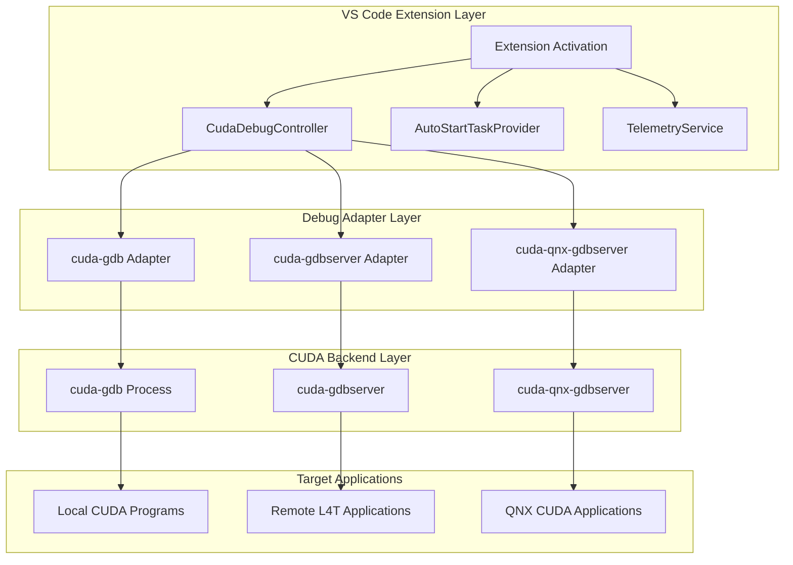
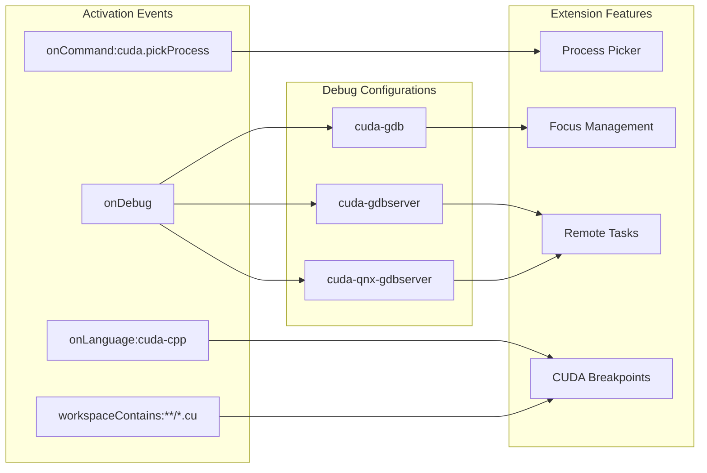
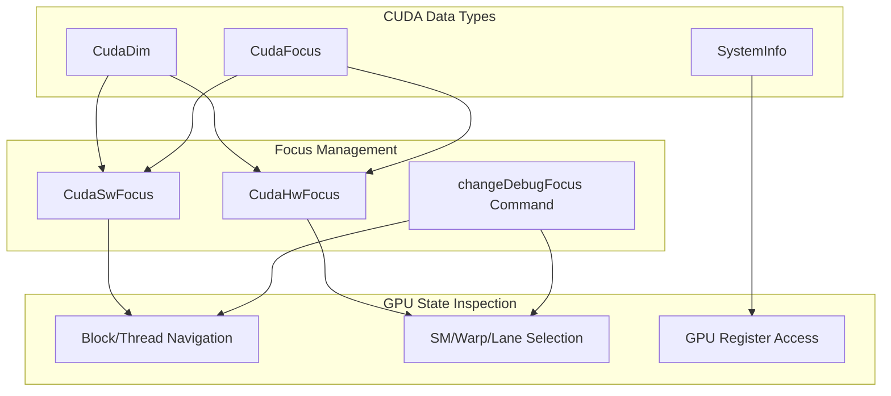
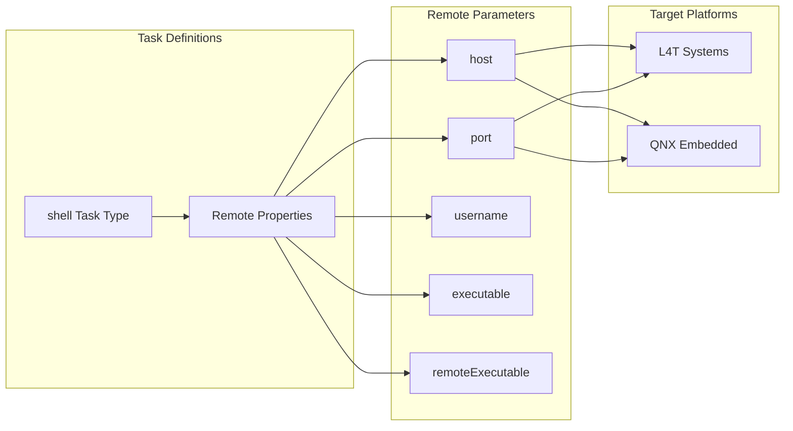

<!-- source: DeepWiki mcp.deepwiki.com · repo NVIDIA/nsight-vscode-edition · page 1 Overview · fetched 2026-10-26 -->

# Overview

Relevant source files

The following files were used as context for generating this wiki page:

- [CHANGELOG.md](CHANGELOG.md)
- [README.md](README.md)
- [nsight-128.png](nsight-128.png)
- [package.json](package.json)
- [src/debugger/types.ts](src/debugger/types.ts)

## Purpose and Scope

This document provides an overview of the Nsight Visual Studio Code Edition, a comprehensive VS Code extension for CUDA development and debugging. The extension enables developers to debug CUDA applications with full GPU state inspection, kernel execution control, and support for multiple deployment platforms including local systems, remote L4T devices, and QNX embedded systems.

For detailed information about the extension's internal architecture, see [Architecture](#2). For CUDA-specific debugging features, see [CUDA Features](#4). For development and testing guidance, see [Development](#5).

## System Architecture

The Nsight Visual Studio Code Edition follows a layered architecture that extends the VS Code Debug Adapter Protocol with CUDA-specific capabilities:

**Sources:** [package.json:1-1061](), [README.md:1-112]()

## Core Extension Components

The extension integrates with VS Code through several key mechanisms defined in the package manifest:

**Sources:** [package.json:38-44](), [package.json:124-691](), [package.json:100-109]()

## Debugging Configurations

The extension provides three distinct debugging configurations, each targeting different deployment scenarios:

| Debug Type | Target Platform | Backend | Configuration |
|------------|----------------|---------|---------------|
| `cuda-gdb` | Local Development | cuda-gdb binary | Launch/Attach |
| `cuda-gdbserver` | Remote L4T Systems | cuda-gdbserver | Remote Launch |
| `cuda-qnx-gdbserver` | QNX Embedded | cuda-qnx-gdbserver | Remote Launch |

### Launch Configuration Properties

Each debugger type supports extensive configuration through `launch.json`:

- **Program Execution**: `program`, `args`, `cwd`, `environment`
- **Debugger Control**: `debuggerPath`, `miDebuggerPath`, `miDebuggerArgs`
- **CUDA Features**: `breakOnLaunch`, `onAPIError`
- **Logging**: `verboseLogging`, `logFile`
- **Remote Settings**: `target`, `sysroot`, `additionalSOLibSearchPath`

**Sources:** [package.json:135-276](), [package.json:468-655](), [package.json:703-833]()

## CUDA-Specific Features

The extension extends standard debugging capabilities with CUDA-specific functionality:

**Sources:** [src/debugger/types.ts:12-58](), [package.json:102-105]()

### CUDA Focus System

The extension implements a dual coordinate system for GPU debugging through the `CudaFocus` type:

- **Software Focus (`CudaSwFocus`)**: Uses `blockIdx` and `threadIdx` coordinates matching CUDA programming model
- **Hardware Focus (`CudaHwFocus`)**: Uses `sm`, `warp`, and `lane` for low-level hardware inspection

**Sources:** [src/debugger/types.ts:18-31]()

## Remote Debugging Capabilities

The extension provides comprehensive remote debugging support with automated setup tasks:

**Sources:** [package.json:64-98](), [package.json:593-622]()

## System Information Collection

The extension collects comprehensive system and GPU information for debugging sessions through the `SystemInfo` interface:

- **OS Information**: Platform, architecture, distribution details
- **GPU Information**: Device enumeration, current active device, SM type
- **Telemetry**: Usage data collection with privacy controls

**Sources:** [src/debugger/types.ts:33-58](), [README.md:108-112]()

## Extension Dependencies

The extension integrates with several external components:

- **Required Extension**: `ms-vscode.cpptools` for C++ IntelliSense support
- **CUDA Toolkit**: Provides `cuda-gdb` and related debugging tools
- **Workspace Integration**: `cdt-gdb-adapter` for GDB protocol support

**Sources:** [package.json:16-18](), [package.json:57-59](), [README.md:83-91]()

---

