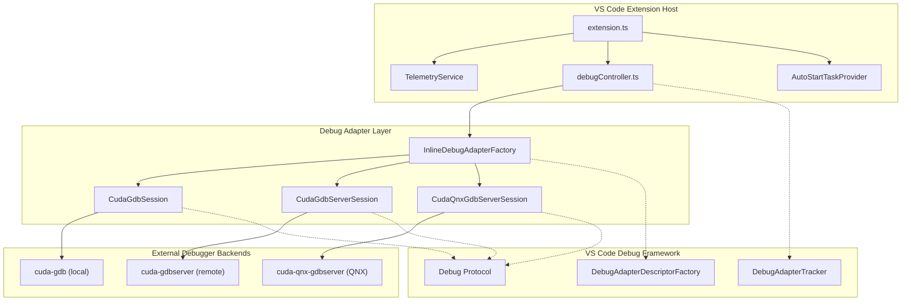
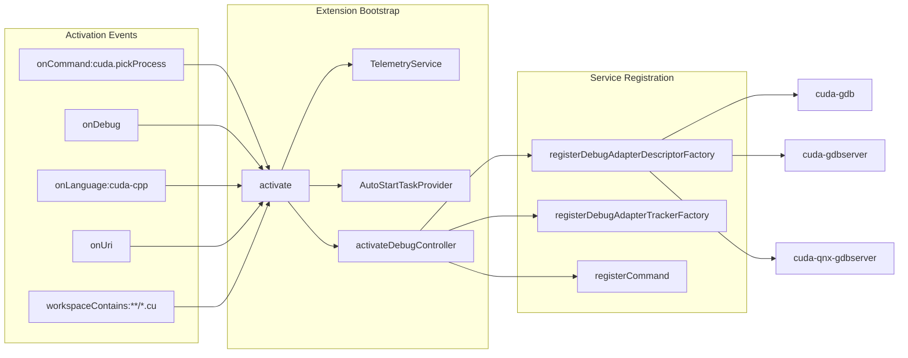
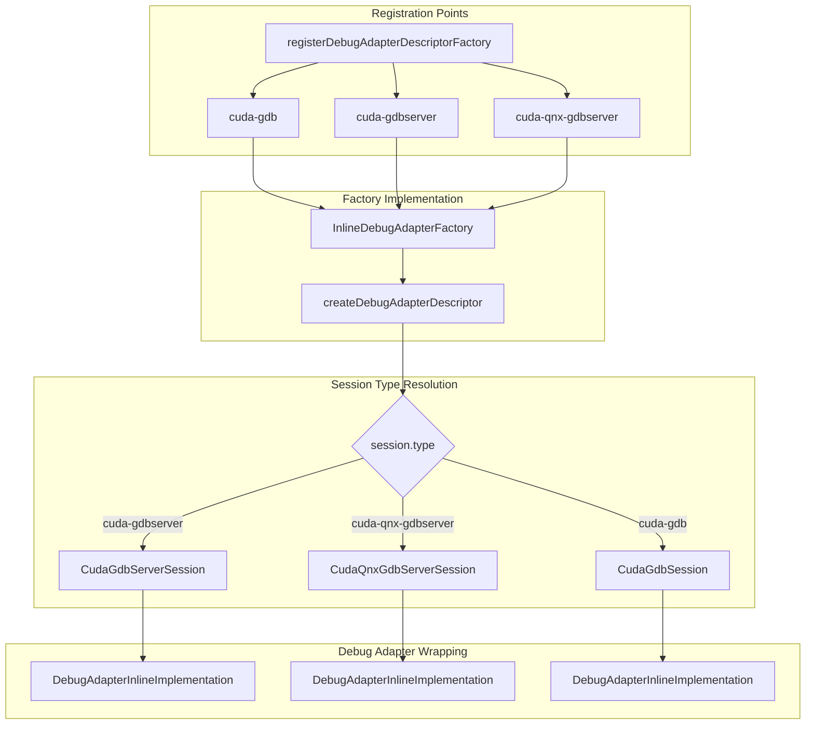
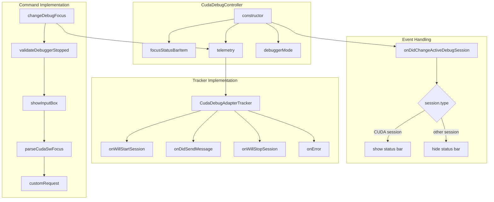
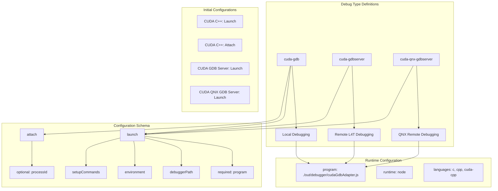

<!-- source: DeepWiki mcp.deepwiki.com · repo NVIDIA/nsight-vscode-edition · page 2 Architecture · fetched 2026-10-26 -->

# Architecture

Relevant source files

The following files were used as context for generating this wiki page:

- [package.json](package.json)
- [src/debugController.ts](src/debugController.ts)
- [src/extension.ts](src/extension.ts)

This document explains the overall system architecture of the Nsight Visual Studio Code Edition and how its components interact within the VS Code extension framework. It covers the layered architecture, extension lifecycle, debug adapter patterns, and integration points that enable CUDA debugging capabilities.

For details about the individual debug session implementations, see [Core Components](#3). For CUDA-specific protocol extensions and telemetry, see [CUDA Protocol Extensions](#2.3).

## System Overview

The Nsight Visual Studio Code Edition follows a layered architecture that integrates with VS Code's extension and debug adapter framework. The system provides CUDA debugging capabilities through three distinct debug session types, each targeting different deployment scenarios.

**System Architecture Overview**

Sources: [src/extension.ts:25-39](), [src/debugController.ts:33-47](), [package.json:124-931]()

The architecture consists of four primary layers:

| Layer | Components | Purpose |
|-------|------------|---------|
| **Extension Host** | `extension.ts`, `debugController.ts`, `TelemetryService` | VS Code integration, command registration, lifecycle management |
| **Debug Adapter** | `InlineDebugAdapterFactory`, session classes | Debug protocol implementation, session management |
| **Backend Integration** | Session-specific backends | Communication with CUDA debugger tools |
| **Framework Integration** | VS Code debug APIs, protocol handlers | Standard VS Code debug framework compliance |

## Extension Activation and Lifecycle

The extension follows VS Code's standard activation pattern with specific triggers for CUDA development scenarios.

**Extension Activation Flow**

Sources: [package.json:38-44](), [src/extension.ts:25-39](), [src/debugController.ts:223-238]()

### Activation Triggers

The extension activates on multiple triggers defined in `package.json`:

- **Command Activation**: `onCommand:cuda.pickProcess` - When process picker is invoked
- **Debug Activation**: `onDebug` - When any debug session starts
- **Language Activation**: `onLanguage:cuda-cpp` - When CUDA C++ files are opened
- **URI Activation**: `onUri` - For protocol handler scenarios
- **Workspace Activation**: `workspaceContains:**/*.cu` - When CUDA source files are present

### Bootstrap Sequence

The `activate` function in [src/extension.ts:25-39]() orchestrates the initialization:

1. **Package Metadata Loading**: Reads version information from `package.json`
2. **Telemetry Initialization**: Creates `TelemetryService` with Google Analytics 4 integration
3. **System Information Collection**: Gathers host OS information for telemetry
4. **Task Provider Registration**: Registers `AutoStartTaskProvider` for remote debugging setup
5. **Debug Controller Activation**: Calls `activateDebugController` for debug framework integration

## Debug Adapter Factory Pattern

The extension implements VS Code's debug adapter factory pattern to support multiple CUDA debugging scenarios through a unified interface.

**Debug Adapter Factory Pattern**

Sources: [src/debugController.ts:33-47](), [src/debugController.ts:227-230]()

### Factory Implementation

The `InlineDebugAdapterFactory` class implements `vscode.DebugAdapterDescriptorFactory` and handles session type resolution:

- **Session Type Inspection**: Uses `session.type` to determine the appropriate session class
- **Inline Implementation**: Returns `vscode.DebugAdapterInlineImplementation` for in-process debugging
- **Session Instantiation**: Creates specific session instances based on debug configuration

### Debug Session Types

| Session Type | Class | Target Platform | Backend Tool |
|--------------|-------|----------------|--------------|
| `cuda-gdb` | `CudaGdbSession` | Local development | `cuda-gdb` |
| `cuda-gdbserver` | `CudaGdbServerSession` | Remote Linux/L4T | `cuda-gdbserver` |
| `cuda-qnx-gdbserver` | `CudaQnxGdbServerSession` | QNX embedded | `cuda-qnx-gdbserver` |

Each session type is registered with VS Code through `registerDebugAdapterDescriptorFactory` in [src/debugController.ts:227-230]().

## Debug Controller Integration

The `CudaDebugController` class serves as the primary integration point with VS Code's debug framework, managing UI state, command handling, and telemetry collection.

**Debug Controller Architecture**

Sources: [src/debugController.ts:135-221](), [src/debugController.ts:55-133]()

### State Management

The controller maintains several key state elements:

- **Focus Status Bar**: Displays current CUDA thread/block focus with command integration
- **Debugger Mode**: Tracks debug session state (`design`, `stopped`, `running`)
- **Session Tracking**: Monitors active debug sessions for CUDA-specific UI updates

### Tracker Integration

The `CudaDebugAdapterTracker` implements `vscode.DebugAdapterTracker` to intercept debug protocol messages:

- **Session Lifecycle**: Tracks session start/stop for telemetry collection
- **Protocol Message Interception**: Processes CUDA-specific events like focus changes
- **Error Handling**: Captures and reports debug adapter errors
- **State Synchronization**: Updates controller state based on debug events

### Command Registration

The controller registers several VS Code commands:

| Command | Function | Purpose |
|---------|----------|---------|
| `cuda.changeDebugFocus` | `changeDebugFocus()` | Interactive CUDA focus switching |
| `cuda.pickProcess` | `pickProcess()` | Process selection for attach scenarios |

Sources: [src/debugController.ts:235-236]()

## Protocol and Configuration Integration

The extension integrates deeply with VS Code's debug configuration system through comprehensive `package.json` contributions that define debug types, configuration schemas, and initial configurations.

**Debug Configuration Architecture**

Sources: [package.json:124-931]()

### Debug Type Registration

Each debug type is comprehensively defined with:

- **Runtime Configuration**: Node.js runtime with specific adapter entry point
- **Language Support**: C, C++, and CUDA C++ language bindings
- **Configuration Attributes**: Separate schemas for `launch` and `attach` modes
- **Initial Configurations**: Ready-to-use templates for common scenarios

### Configuration Schema Structure

The configuration schemas provide extensive customization options:

| Category | Properties | Purpose |
|----------|------------|---------|
| **Core** | `program`, `debuggerPath`, `args` | Basic execution parameters |
| **Environment** | `environment`, `envFile`, `cwd` | Runtime environment setup |
| **Debug Control** | `stopAtEntry`, `breakOnLaunch`, `onAPIError` | Debug behavior configuration |
| **Remote** | `target`, `sysroot`, `additionalSOLibSearchPath` | Remote debugging setup |
| **Advanced** | `setupCommands`, `initCommands`, `preRunCommands` | GDB command customization |

### Task Provider Integration

The extension includes task definition support for automated remote debugging setup through `AutoStartTaskProvider`, enabling shell command execution with remote connection parameters.

Sources: [package.json:64-98](), [src/extension.ts:36]()

---

