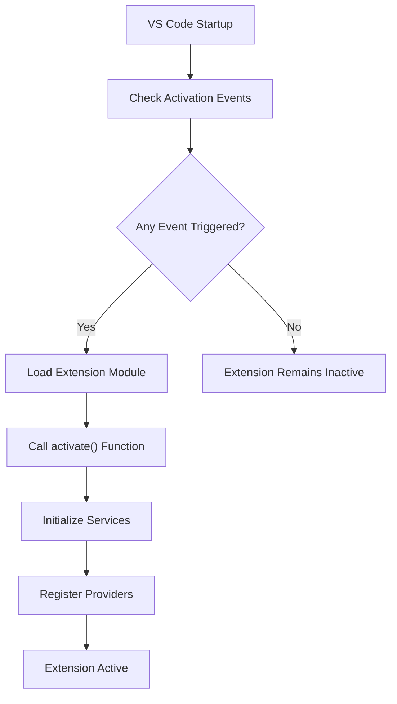
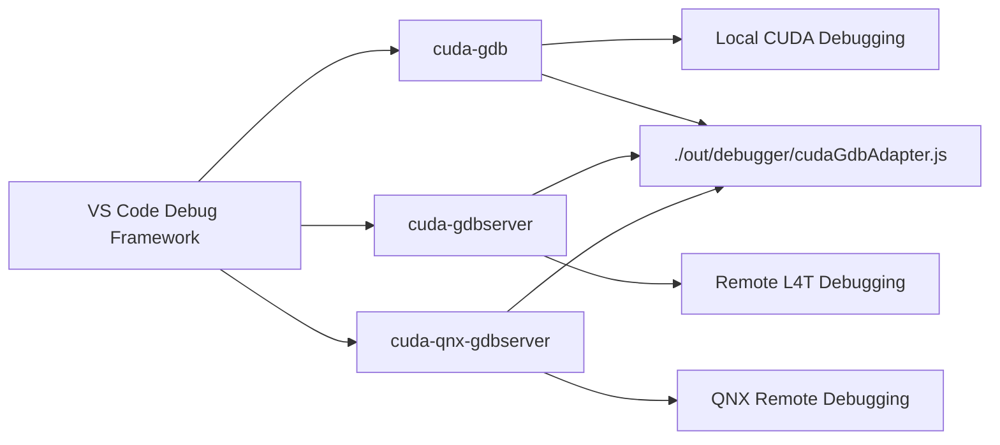
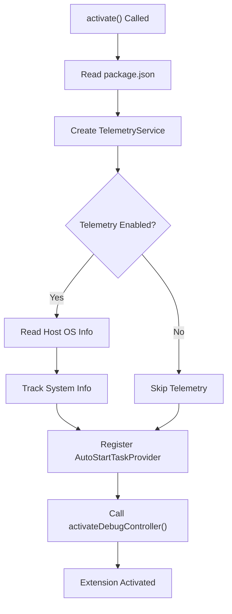
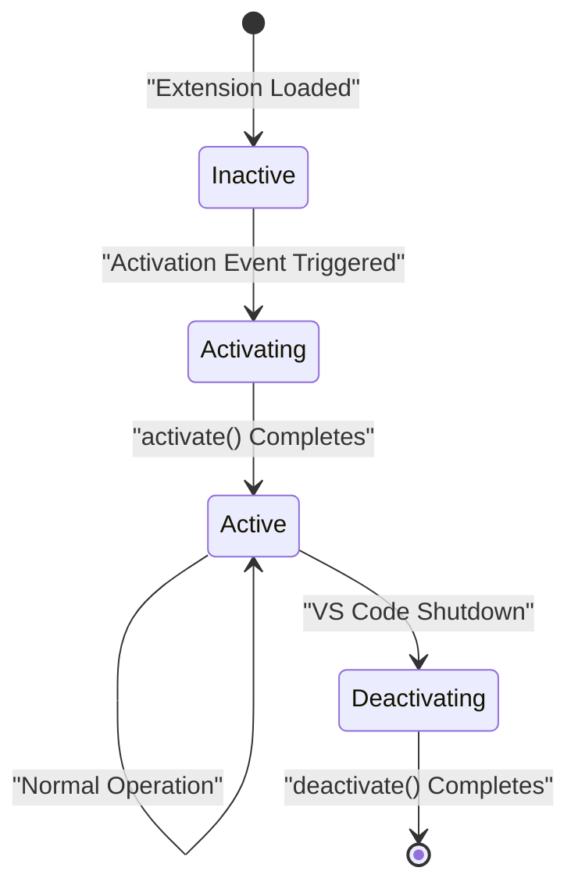

<!-- source: DeepWiki mcp.deepwiki.com · repo NVIDIA/nsight-vscode-edition · page 2.1 Extension Structure · fetched 2026-10-26 -->

# Extension Structure

<details>
<summary>Relevant source files</summary>

The following files were used as context for generating this wiki page:

- [package.json](package.json)
- [src/extension.ts](src/extension.ts)

</details>


This document details the VS Code extension structure for Nsight Visual Studio Code Edition, covering extension activation, registration, and core service initialization. It explains how the extension integrates with the VS Code framework through activation events, contribution points, and service setup.

For information about the debug adapter protocol implementation, see [Debug Adapter Protocol](#2.2). For details about the debug controller that manages VS Code integration, see [Debug Controller](#3.2). For task provider implementations, see [Task Providers](#3.3).

## Extension Metadata and Configuration

The extension is configured through [package.json:1-1019]() which defines the complete VS Code extension manifest. The extension identifies itself as `nsight-vscode-edition` with the display name "Nsight Visual Studio Code Edition" and is published by NVIDIA.

| Property | Value | Purpose |
|----------|-------|---------|
| `name` | `nsight-vscode-edition` | Extension identifier |
| `displayName` | `Nsight Visual Studio Code Edition` | User-visible name |
| `publisher` | `nvidia` | Publisher organization |
| `main` | `./dist/extension` | Entry point module |
| `engines.vscode` | `^1.91.0` | Minimum VS Code version |

The extension includes the `ms-vscode.cpptools` extension pack [package.json:16-18]() to provide C++ language support alongside CUDA debugging capabilities.

**Extension Activation Flow**


Sources: [package.json:1-1019](), [src/extension.ts:25-39]()

## Activation Events and Entry Points

The extension activates on multiple trigger conditions defined in [package.json:38-44]():

```typescript
"activationEvents": [
    "onCommand:cuda.pickProcess",
    "onDebug", 
    "onLanguage:cuda-cpp",
    "onUri",
    "workspaceContains:**/*.cu"
]
```

The main entry point is the `activate()` function in [src/extension.ts:25-39]() which performs initialization in this sequence:

1. Reads extension metadata from `package.json`
2. Creates `TelemetryService` instance  
3. Collects and tracks system information
4. Registers `AutoStartTaskProvider`
5. Activates debug controller

The extension also exports a `deactivate()` function [src/extension.ts:41]() for cleanup, though it currently contains no implementation.

Sources: [package.json:38-44](), [src/extension.ts:25-41]()

## Contribution Points

The extension contributes multiple capabilities to VS Code through the `contributes` section [package.json:63-932]():

**Debug Configuration Types**


| Contribution Type | Configuration | Purpose |
|------------------|---------------|---------|
| Debuggers | `cuda-gdb` | Local CUDA debugging with cuda-gdb |
| Debuggers | `cuda-gdbserver` | Remote debugging via cuda-gdbserver |
| Debuggers | `cuda-qnx-gdbserver` | QNX embedded system debugging |
| Commands | `cuda.changeDebugFocus` | CUDA focus management |
| Variables | `cuda.pickProcess` | Process picker for attach scenarios |
| Breakpoints | `c`, `cpp`, `cuda`, `cuda-cpp` | Language breakpoint support |
| Task Definitions | `shell` with CUDA properties | Remote debugging task automation |

All three debugger types use the same adapter program `./out/debugger/cudaGdbAdapter.js` [package.json:133, 465, 700]() but with different configuration schemas for their specific use cases.

Sources: [package.json:63-932]()

## Service Initialization

The `activate()` function initializes core services in a specific order:

**Service Initialization Sequence**


The `TelemetryService` is instantiated with Google Analytics 4 configuration using predefined API secrets and measurement IDs [src/extension.ts:22-23, 29](). If telemetry is enabled, the extension collects host operating system information using `readOsInfo()` and tracks it.

The `AutoStartTaskProvider` is registered with VS Code's task system [src/extension.ts:36]() to handle automated remote debugging setup tasks.

Finally, `activateDebugController()` is called [src/extension.ts:38]() to initialize the debug integration layer, passing both the extension context and telemetry service.

Sources: [src/extension.ts:25-39]()

## Extension Lifecycle

The extension follows VS Code's standard lifecycle pattern:

**Extension Lifecycle States**


During the active state, the extension maintains:
- Debug adapter factories for all three debug types
- Command handlers for CUDA-specific operations  
- Task providers for remote debugging automation
- Telemetry collection for usage analytics
- Debug controller for VS Code integration

The extension remains active until VS Code shuts down, at which point the `deactivate()` function is called for cleanup, though no specific cleanup operations are currently implemented [src/extension.ts:41]().

Sources: [src/extension.ts:25-41](), [package.json:38-44]()

---

