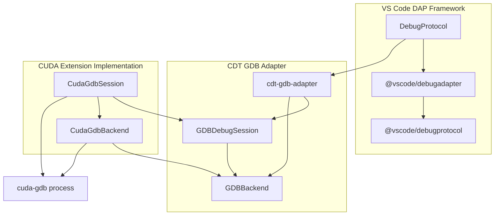
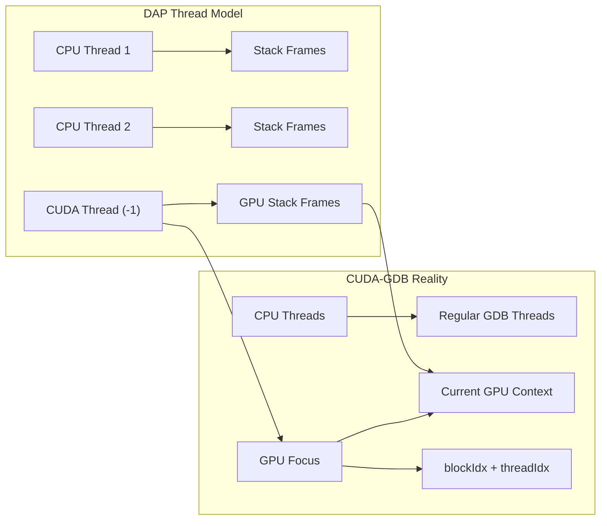
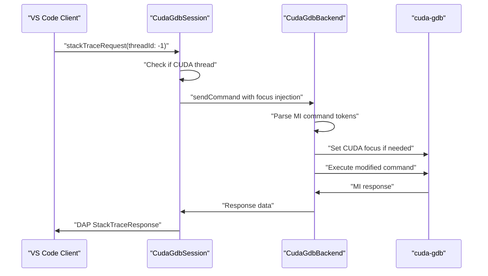
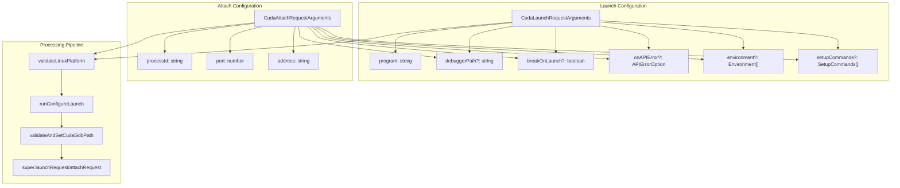
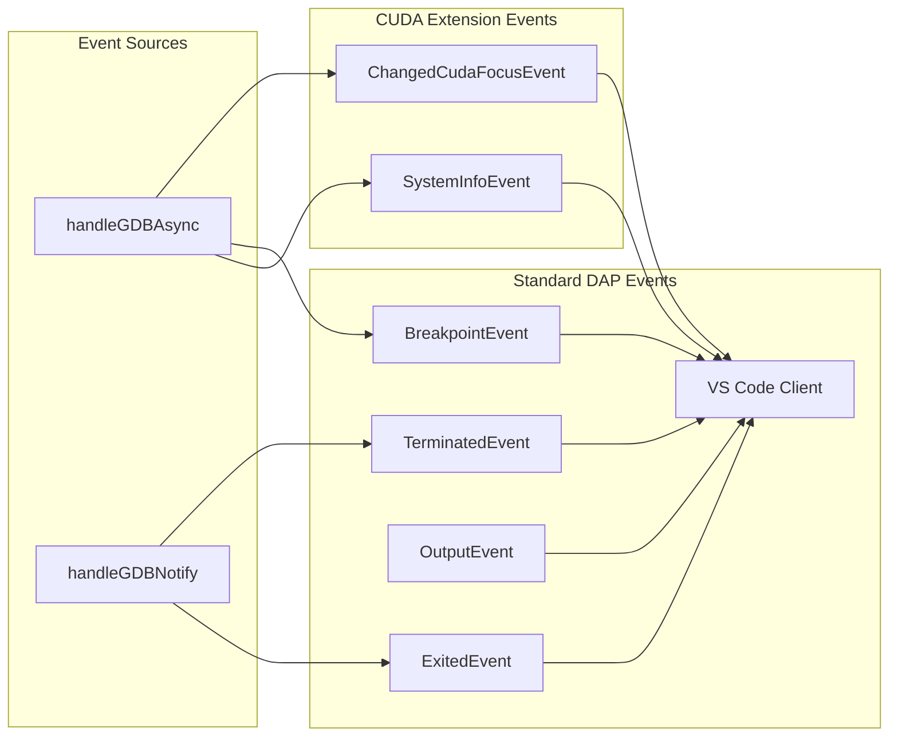
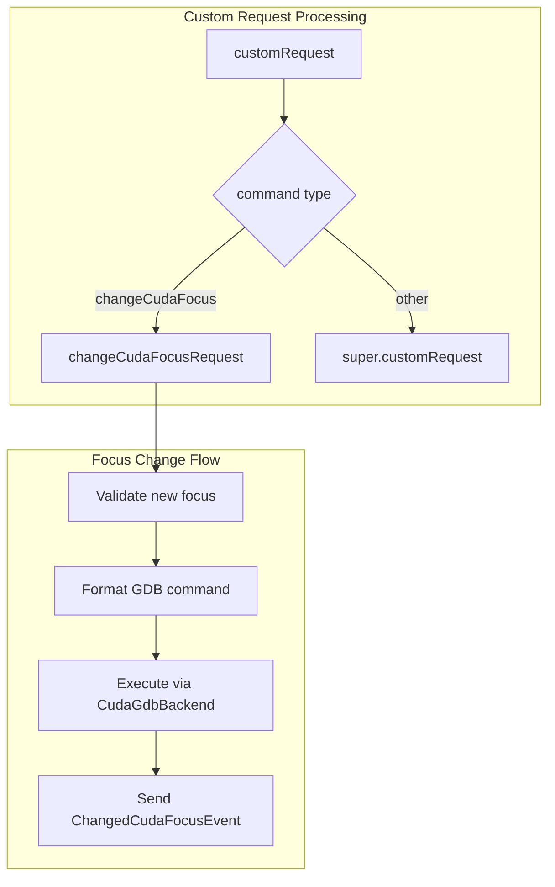

<!-- source: DeepWiki mcp.deepwiki.com · repo NVIDIA/nsight-vscode-edition · page 2.2 Debug Adapter Protocol · fetched 2026-10-26 -->

# Debug Adapter Protocol

<details>
<summary>Relevant source files</summary>

The following files were used as context for generating this wiki page:

- [src/debugger/cudaGdbSession.ts](src/debugger/cudaGdbSession.ts)
- [src/test/testPrograms/variables/.vscode/launch.json](src/test/testPrograms/variables/.vscode/launch.json)
- [third-party-notices.txt](third-party-notices.txt)

</details>


This document explains how the Nsight Visual Studio Code Extension implements and extends the VS Code Debug Adapter Protocol (DAP) to provide CUDA debugging capabilities. The implementation builds upon the standard DAP foundation while adding CUDA-specific protocol extensions for GPU thread management and debugging.

For information about the CUDA-specific protocol extensions and their data structures, see [CUDA Protocol Extensions](#2.3). For details about debug session types and backends, see [Debug Sessions](#3.1).

## Standard DAP Foundation

The extension implements the Debug Adapter Protocol by extending the `GDBDebugSession` class from the `cdt-gdb-adapter` library. The primary implementation is in the `CudaGdbSession` class, which serves as the main debug adapter for CUDA applications.



**DAP Implementation Architecture**

Sources: [src/debugger/cudaGdbSession.ts:15-28](), [third-party-notices.txt:5-8](), [third-party-notices.txt:59-62](), [third-party-notices.txt:125-128]()

The `CudaGdbSession` class implements the core DAP request handlers by overriding methods from the base `GDBDebugSession`:

| DAP Request | Method | Purpose |
|-------------|--------|---------|
| `launch` | `launchRequest` | Start debugging a CUDA application |
| `attach` | `attachRequest` | Attach to running CUDA process |
| `threads` | `threadsRequest` | List CPU threads and virtual CUDA thread |
| `stackTrace` | `stackTraceRequest` | Get stack frames for selected thread |
| `scopes` | `scopesRequest` | Get variable scopes for a frame |
| `variables` | `variablesRequest` | Get variables and CUDA registers |
| `evaluate` | `evaluateRequest` | Evaluate expressions and GDB commands |

Sources: [src/debugger/cudaGdbSession.ts:374-875]()

## CUDA Thread Virtualization

Since `cuda-gdb` does not treat GPU threads as first-class objects like CPU threads, the extension creates a virtual CUDA thread to satisfy DAP requirements that all frames must belong to a thread.



**CUDA Thread Virtualization Model**

The virtual CUDA thread uses a constant ID of `-1` and is dynamically mapped to the GPU thread currently in focus:

```typescript
const CUDA_THREAD = {
    ID: -1,
    NAME: '(CUDA)'
};
```

Sources: [src/debugger/cudaGdbSession.ts:43-46](), [src/debugger/cudaGdbSession.ts:380-381](), [src/debugger/cudaGdbSession.ts:795-810]()

## Request Processing Flow

The extension implements a sophisticated request processing flow that handles both standard DAP requests and CUDA-specific focus management.



**DAP Request Processing with CUDA Focus Management**

The `CudaGdbBackend.sendCommand` method automatically injects CUDA focus commands when DAP requests target the virtual CUDA thread:

Sources: [src/debugger/cudaGdbSession.ts:205-232](), [src/debugger/cudaGdbSession.ts:234-308](), [src/debugger/cudaGdbSession.ts:276-304]()

## Launch and Attach Configuration

The extension supports both launch and attach scenarios with CUDA-specific configuration options that extend the standard DAP launch/attach arguments.



**Launch and Attach Configuration Flow**

The configuration process validates the platform, sets up CUDA-specific parameters, and locates the appropriate `cuda-gdb` binary:

Sources: [src/debugger/cudaGdbSession.ts:131-157](), [src/debugger/cudaGdbSession.ts:470-503](), [src/debugger/cudaGdbSession.ts:505-653](), [src/debugger/cudaGdbSession.ts:655-693]()

## Event System and Notifications

The extension extends the standard DAP event system with CUDA-specific events that notify clients about GPU state changes and system information.



**DAP Event System with CUDA Extensions**

Custom event classes implement the CUDA Debug Protocol event interfaces:

- `ChangedCudaFocusEvent`: Notifies when GPU thread focus changes
- `SystemInfoEvent`: Provides GPU and system information for telemetry

Sources: [src/debugger/cudaGdbSession.ts:50-76](), [src/debugger/cudaGdbSession.ts:708-750](), [src/debugger/cudaGdbSession.ts:752-770]()

## Custom Request Handling

The extension handles CUDA-specific requests that are not part of the standard DAP specification through the `customRequest` method.



**Custom Request Handling for CUDA Operations**

The `changeCudaFocus` request allows clients to switch between different GPU threads programmatically:

Sources: [src/debugger/cudaGdbSession.ts:457-468](), [src/debugger/cudaGdbSession.ts:1435-1472]()

## Register and Variable Handling

The extension provides specialized handling for CUDA GPU registers and variables, extending the standard DAP variables interface.

Sources: [src/debugger/cudaGdbSession.ts:104-130](), [src/debugger/cudaGdbSession.ts:905-1071](), [src/debugger/cudaGdbSession.ts:942-1070]()

---

