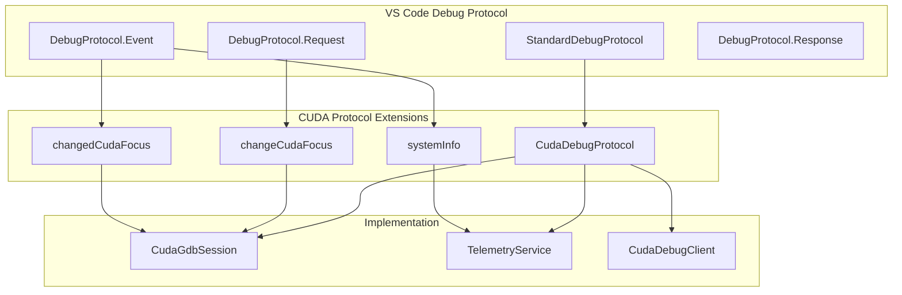
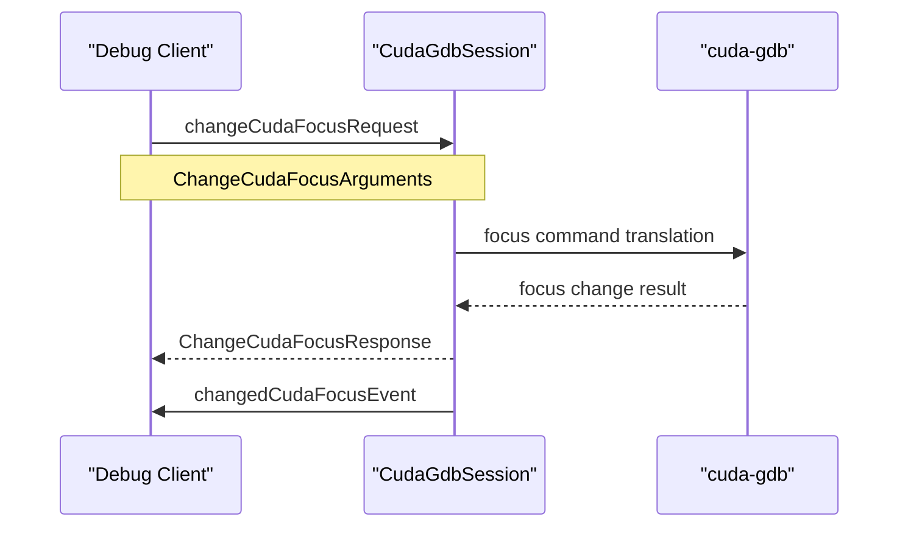
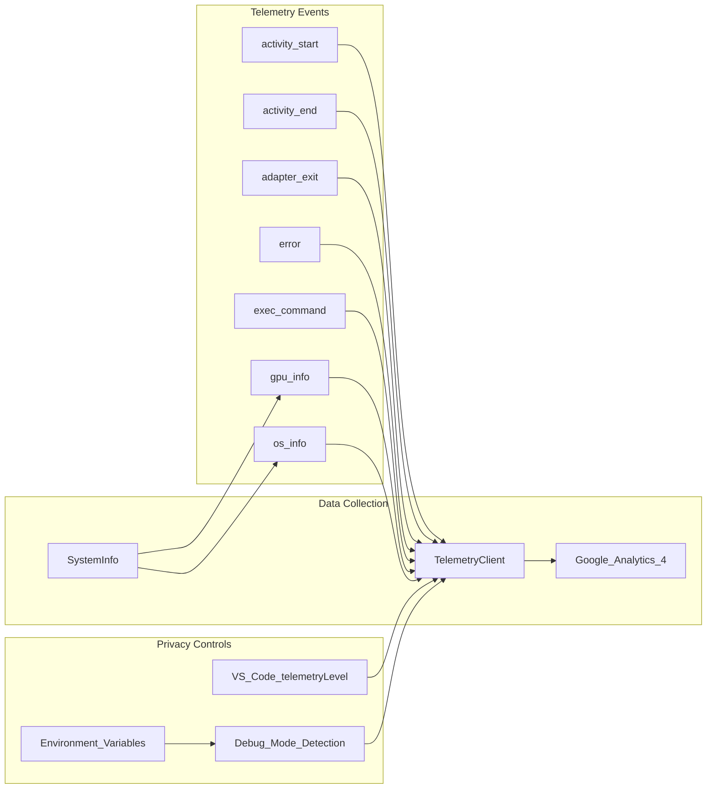
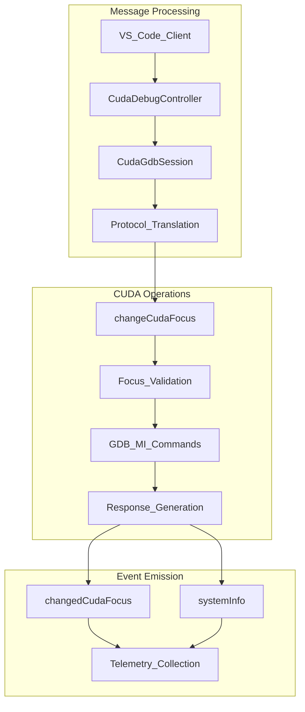

<!-- source: DeepWiki mcp.deepwiki.com · repo NVIDIA/nsight-vscode-edition · page 2.3 CUDA Protocol Extensions · fetched 2026-10-26 -->

# CUDA Protocol Extensions

<details>
<summary>Relevant source files</summary>

The following files were used as context for generating this wiki page:

- [src/debugger/cudaDebugProtocol.ts](src/debugger/cudaDebugProtocol.ts)
- [src/telemetryService.ts](src/telemetryService.ts)
- [src/test/breakpoints.test.ts](src/test/breakpoints.test.ts)
- [src/test/localsAndWatches.test.ts](src/test/localsAndWatches.test.ts)

</details>


This document covers the CUDA-specific extensions to the Visual Studio Code Debug Adapter Protocol implemented by the Nsight Visual Studio Code Extension. These extensions enable CUDA debugging capabilities such as focus management and system information collection that are not available in the standard debug protocol.

For information about the overall debug adapter architecture, see [Debug Adapter Protocol](#2.2). For details about CUDA focus management specifically, see [Focus Management](#4.1).

## Protocol Extension Overview

The CUDA protocol extensions add specialized requests and events to the standard VS Code Debug Adapter Protocol to support GPU debugging workflows. The extensions are implemented through the `CudaDebugProtocol` namespace which defines custom message types for CUDA-specific operations.



**CUDA Protocol Extension Architecture**

Sources: [src/debugger/cudaDebugProtocol.ts:16-55](), [src/telemetryService.ts:19-82]()

## Custom Requests

### changeCudaFocus Request

The `changeCudaFocus` request allows clients to change the current CUDA debugging focus to a specific thread, block, or coordinate system. This is essential for GPU debugging where thousands of threads may be executing simultaneously.

| Property | Type | Description |
|----------|------|-------------|
| `command` | `'changeCudaFocus'` | Request identifier |
| `arguments` | `ChangeCudaFocusArguments` | Focus change parameters |
| `arguments.focus` | `types.CudaFocus` | Target focus coordinates |

The request follows the standard debug protocol pattern but extends it with CUDA-specific focus management:



**CUDA Focus Change Flow**

Sources: [src/debugger/cudaDebugProtocol.ts:27-40](), [src/test/localsAndWatches.test.ts:403]()

## Custom Events

### changedCudaFocus Event

The `changedCudaFocus` event is emitted when the CUDA focus changes, either due to a client request or internal debugger state changes. This allows the UI to update thread/block displays accordingly.

```typescript
interface ChangedCudaFocusEvent extends DebugProtocol.Event {
    body: {
        focus?: types.CudaFocus;
    };
}
```

### systemInfo Event

The `systemInfo` event provides detailed information about the debugging target's hardware and software environment. This information is crucial for understanding GPU capabilities and is also used for telemetry collection.

```typescript
interface SystemInfoEvent extends DebugProtocol.Event {
    body: {
        systemInfo?: types.SystemInfo;
    };
}
```

Sources: [src/debugger/cudaDebugProtocol.ts:42-54](), [src/telemetryService.ts:307-340]()

## Telemetry Integration

The protocol extensions integrate with the `TelemetryService` to collect usage analytics and system information. The telemetry system operates in two locations: 'host' (VS Code extension) and 'debug-adapter' (debug session).



**Telemetry System Architecture**

The telemetry service tracks various debug session activities:

| Event Type | Purpose | Location |
|------------|---------|----------|
| `activity_start/end` | Session lifecycle tracking | Both |
| `adapter_exit` | Debug adapter termination | Debug-adapter |
| `error` | Error condition reporting | Both |
| `exec_command` | Command execution tracking | Debug-adapter |
| `gpu_info` | GPU hardware information | Both |
| `os_info` | Operating system details | Both |

Sources: [src/telemetryService.ts:21-82](), [src/telemetryService.ts:105-196](), [src/telemetryService.ts:307-340]()

## Implementation Details

### Protocol Message Flow

The CUDA protocol extensions follow the standard debug adapter message flow but add specialized handlers for CUDA-specific operations:



**Protocol Message Processing Flow**

### Type Definitions

The protocol extensions rely on custom types defined in the types module:

- `CudaFocus`: Represents thread/block coordinates for GPU debugging
- `SystemInfo`: Contains hardware and OS information for the target system
- `CudaDim`: Provides coordinate system utilities for CUDA dimensions

Sources: [src/debugger/cudaDebugProtocol.ts:13-14](), [src/debugger/cudaDebugProtocol.ts:32-54]()

## Usage in Testing

The test suite demonstrates how the protocol extensions are used in practice:

```typescript
// Example from test code showing changeCudaFocusRequest usage
await dc.changeCudaFocusRequest({ 
    focus: { 
        type: 'software', 
        blockIdx: { x: 0, y: 0, z: 0 }, 
        threadIdx: { x: 0, y: 0, z: 0 } 
    } 
});
```

This allows tests to verify that CUDA-specific debugging features work correctly across different thread and block configurations.

Sources: [src/test/localsAndWatches.test.ts:403](), [src/test/breakpoints.test.ts:44-60]()

## Configuration and Privacy

The telemetry component of the protocol extensions respects VS Code's telemetry settings and provides additional privacy controls:

| Setting | Purpose | Default |
|---------|---------|---------|
| `telemetry.telemetryLevel` | VS Code telemetry preference | Follows VS Code |
| `NV_DEVTOOLS_UXT_DEBUG` | Enable debug mode telemetry | Disabled |
| `NV_DEVTOOLS_UXT_ROLE` | Internal vs external usage | External |

The system automatically detects internal NVIDIA usage and tags telemetry data accordingly to separate development from customer usage patterns.

Sources: [src/telemetryService.ts:118-141](), [src/telemetryService.ts:342-345]()

---

