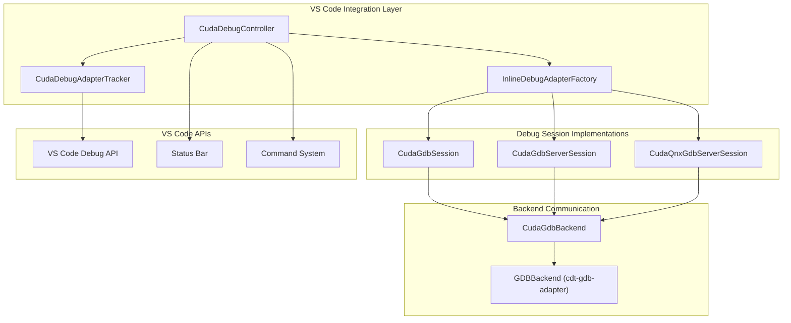
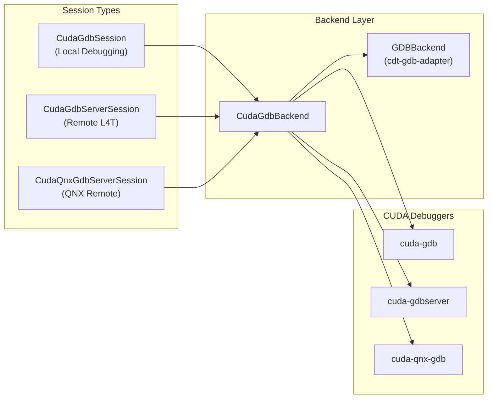
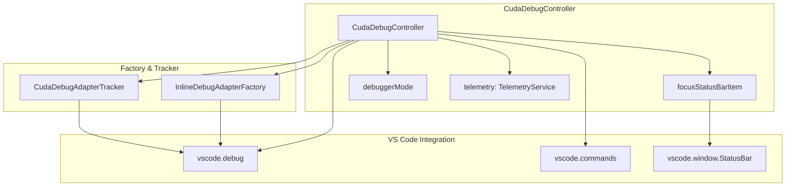
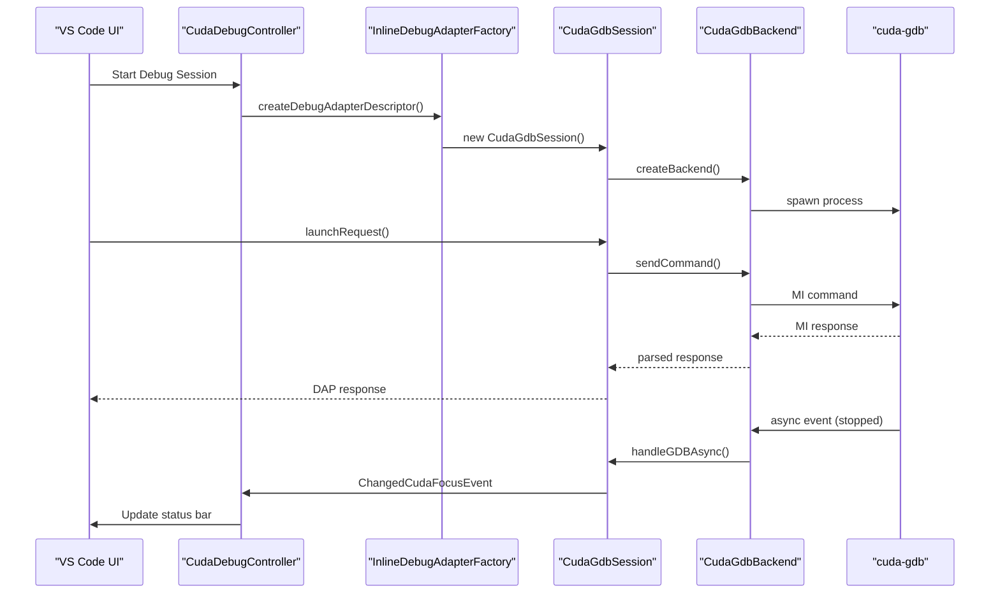
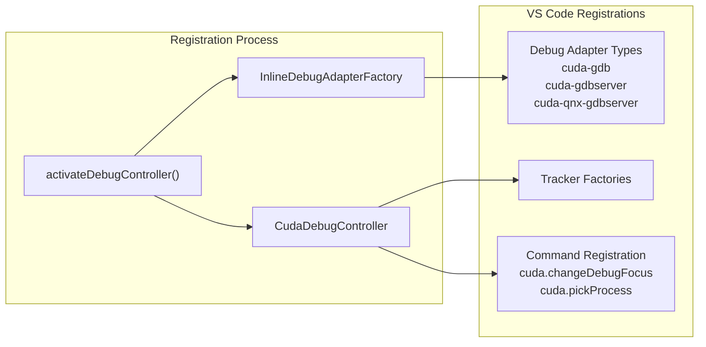

<!-- source: DeepWiki mcp.deepwiki.com · repo NVIDIA/nsight-vscode-edition · page 3 Core Components · fetched 2026-10-26 -->

# Core Components

Relevant source files

The following files were used as context for generating this wiki page:

- [src/debugController.ts](src/debugController.ts)
- [src/debugger/cudaGdbSession.ts](src/debugger/cudaGdbSession.ts)

This document describes the main functional components that provide debugging capabilities in the Nsight Visual Studio Code Edition. These components form the core debugging infrastructure that enables CUDA debugging through VS Code's Debug Adapter Protocol.

For information about the overall system architecture, see [Architecture](#2). For details about CUDA-specific debugging features, see [CUDA Features](#4).

## Component Overview

The extension is built around several key functional components that work together to provide CUDA debugging capabilities:

**Sources:** [src/debugController.ts:1-243](), [src/debugger/cudaGdbSession.ts:1-1708]()

## Debug Session Components

The debug session components handle the actual debugging protocol implementation and communication with CUDA debuggers:

### CudaGdbSession

The `CudaGdbSession` class is the primary debug session implementation that extends the CDT GDB adapter's `GDBDebugSession`. It provides CUDA-specific debugging capabilities including focus management and GPU thread handling.

| Component | Purpose | Key Methods |
|-----------|---------|-------------|
| `CudaGdbSession` | Main debug session for local debugging | `launchRequest()`, `attachRequest()`, `threadsRequest()` |
| `CudaGdbBackend` | CUDA-specific GDB backend communication | `sendCommand()`, `sendMICommand()` |
| Request Handlers | Protocol request processing | `changeCudaFocusRequest()`, `disassembleRequest()` |

**Sources:** [src/debugger/cudaGdbSession.ts:374-1558](), [src/debugController.ts:35-46]()

### Key Session Features

The `CudaGdbSession` implements several CUDA-specific features:

- **CUDA Thread Management**: Creates a virtual CUDA thread (`CUDA_THREAD.ID = -1`) to represent GPU execution context [src/debugger/cudaGdbSession.ts:43-46]()
- **Focus Management**: Tracks current CUDA focus (block/thread coordinates) and synchronizes with cuda-gdb [src/debugger/cudaGdbSession.ts:391-402]()
- **Register Handling**: Provides specialized GPU register inspection through `RegisterData` and `RegisterGroup` classes [src/debugger/cudaGdbSession.ts:104-372]()
- **Command Processing**: Intercepts and modifies GDB MI commands to inject CUDA focus changes [src/debugger/cudaGdbSession.ts:234-308]()

**Sources:** [src/debugger/cudaGdbSession.ts:374-1558]()

## VS Code Integration Components

### CudaDebugController

The `CudaDebugController` serves as the main integration point between the extension and VS Code's debugging infrastructure:

**Sources:** [src/debugController.ts:135-221]()

### Debug Adapter Factory

The `InlineDebugAdapterFactory` creates appropriate debug session instances based on the debug configuration type:

| Debug Type | Session Class | Purpose |
|------------|---------------|---------|
| `cuda-gdb` | `CudaGdbSession` | Local CUDA debugging |
| `cuda-gdbserver` | `CudaGdbServerSession` | Remote L4T debugging |
| `cuda-qnx-gdbserver` | `CudaQnxGdbServerSession` | QNX remote debugging |

**Sources:** [src/debugController.ts:33-47]()

### Debug Adapter Tracker

The `CudaDebugAdapterTracker` monitors debug session events and updates the extension state accordingly:

- **Mode Tracking**: Updates debugger mode (`design`, `stopped`, `running`) based on protocol events [src/debugController.ts:49-53]()
- **Focus Updates**: Handles `changedCudaFocus` events to update the status bar [src/debugController.ts:115-119]()
- **Telemetry**: Tracks session lifecycle and system information [src/debugController.ts:74-81]()

**Sources:** [src/debugController.ts:55-133]()

## Component Communication Flow

The following diagram shows how components communicate during a typical debugging operation:

**Sources:** [src/debugController.ts:33-47](), [src/debugger/cudaGdbSession.ts:408-421](), [src/debugger/cudaGdbSession.ts:205-232]()

## Activation and Registration

The components are activated and registered through the `activateDebugController` function:

**Sources:** [src/debugController.ts:223-238]()

---

