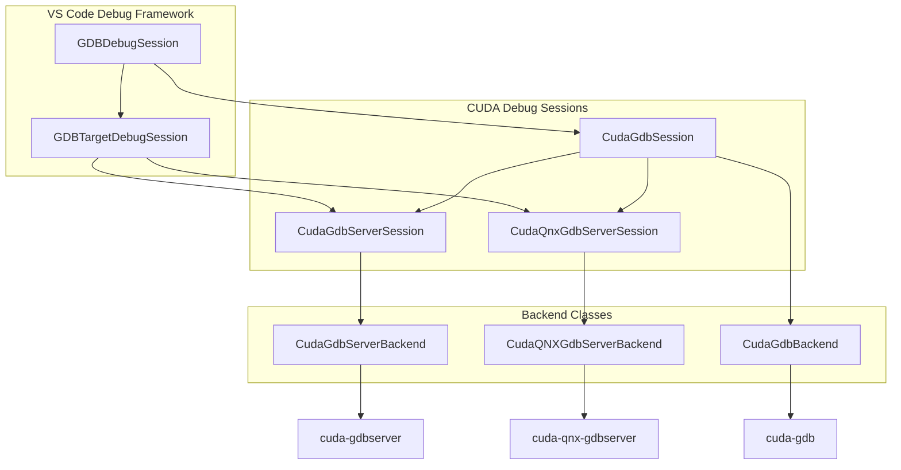
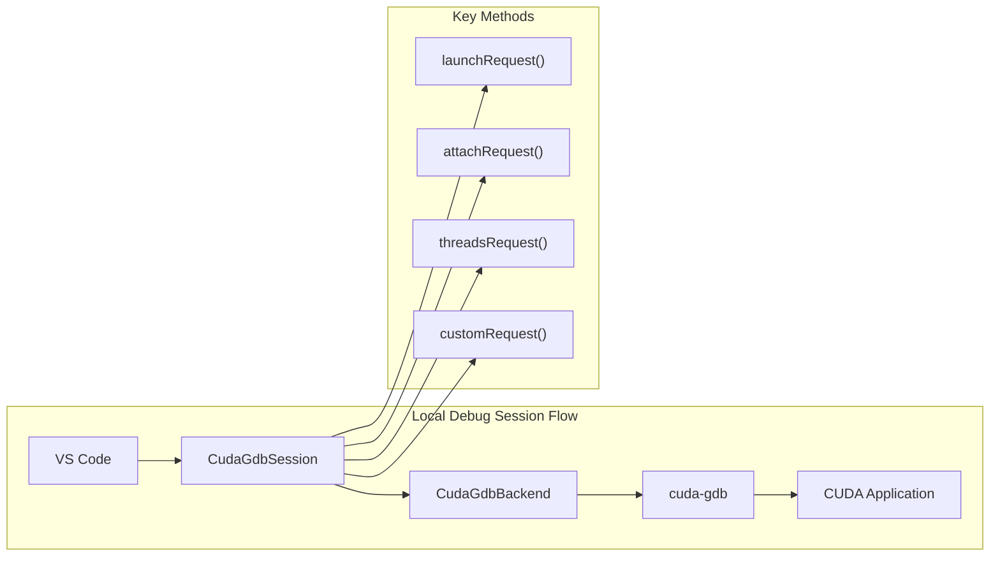
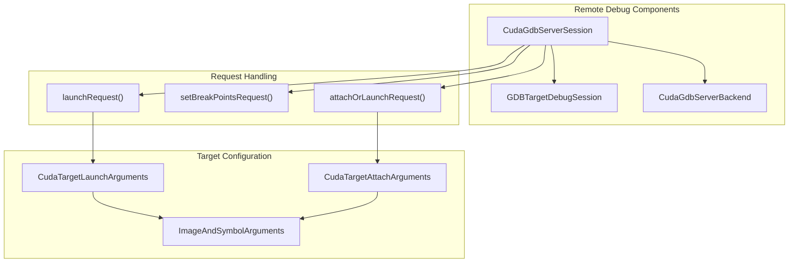
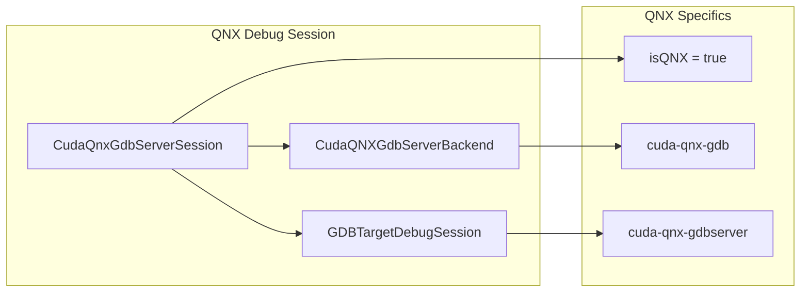
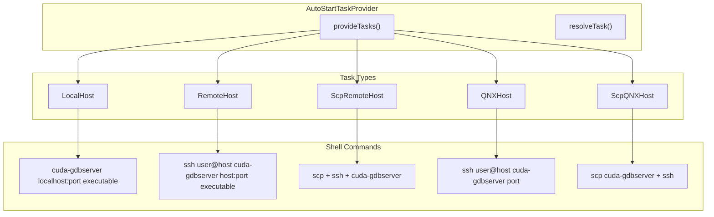
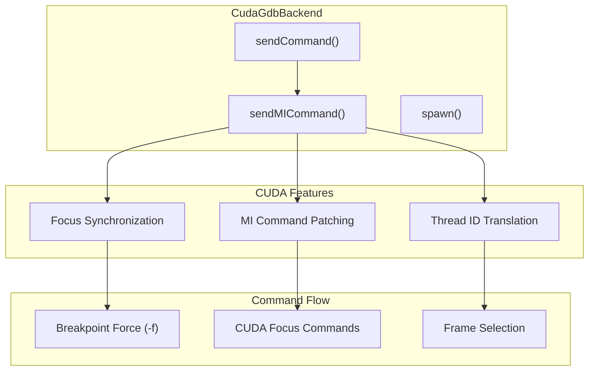

<!-- source: DeepWiki mcp.deepwiki.com · repo NVIDIA/nsight-vscode-edition · page 3.1 Debug Sessions · fetched 2026-10-26 -->

# Debug Sessions

Relevant source files

The following files were used as context for generating this wiki page:

- [src/autoStartTaskProvider.ts](src/autoStartTaskProvider.ts)
- [src/debugger/cudaGdbServerSession.ts](src/debugger/cudaGdbServerSession.ts)
- [src/debugger/cudaGdbSession.ts](src/debugger/cudaGdbSession.ts)
- [src/debugger/cudaQnxGdbServerSession.ts](src/debugger/cudaQnxGdbServerSession.ts)

This document explains the debug session implementations in the Nsight Visual Studio Code Extension. Debug sessions are the core components that manage the debugging lifecycle for CUDA applications, handling communication between VS Code's Debug Adapter Protocol and the underlying `cuda-gdb` debugger. The extension supports three types of debug sessions: local debugging, remote debugging with `cuda-gdbserver`, and QNX remote debugging.

For information about the Debug Adapter Protocol implementation details, see [Debug Adapter Protocol](#2.2). For CUDA-specific protocol extensions, see [CUDA Protocol Extensions](#2.3).

## Session Types Overview

The extension implements three debug session classes that inherit from each other to provide specialized debugging capabilities:

**Debug Session Class Hierarchy**

Sources: [src/debugger/cudaGdbSession.ts:374-1781](), [src/debugger/cudaGdbServerSession.ts:67-152](), [src/debugger/cudaQnxGdbServerSession.ts:27-113]()

## Local Debug Sessions

The `CudaGdbSession` class provides local CUDA debugging capabilities by directly launching `cuda-gdb` processes.

### CudaGdbSession Implementation

The base session class extends `GDBDebugSession` from the `cdt-gdb-adapter` and adds CUDA-specific functionality:

| Feature | Implementation | Purpose |
|---------|----------------|---------|
| CUDA Thread Management | `CUDA_THREAD` constant, `cudaThread` property | Creates virtual DAP thread for GPU threads |
| Focus Management | `_cudaFocus` property, `ChangedCudaFocusEvent` | Tracks current GPU thread/block coordinates |
| Backend Creation | `createBackend()` returns `CudaGdbBackend` | Provides CUDA-enhanced GDB communication |
| Register Handling | `cudaRegistersRequest()` method | Displays GPU register groups and values |

**Local Debug Session Architecture**

Sources: [src/debugger/cudaGdbSession.ts:374-503](), [src/debugger/cudaGdbSession.ts:188-332]()

### Launch vs Attach Modes

Local sessions support both launch and attach request types:

**Launch Requests (`CudaLaunchRequestArguments`)**:
- Start new CUDA application process
- Controlled by `program`, `args`, `stopAtEntry` parameters
- Environment variable configuration via `environment` and `envFile`
- Setup commands executed via `setupCommands` array

**Attach Requests (`CudaAttachRequestArguments`)**:
- Connect to existing CUDA process
- Requires `processId` parameter (string or number)
- Validates ptrace permissions via `/proc/sys/kernel/yama/ptrace_scope`
- Resolves program path using `/proc/{pid}/exe`

Sources: [src/debugger/cudaGdbSession.ts:470-503](), [src/debugger/cudaGdbSession.ts:505-653]()

## Remote Debug Sessions

Remote debugging enables debugging CUDA applications running on separate hosts using `cuda-gdbserver`.

### CudaGdbServerSession Implementation

The `CudaGdbServerSession` extends `CudaGdbSession` and delegates remote-specific functionality to `GDBTargetDebugSession`:

**Remote Debug Session Structure**

The key difference from local sessions is the target configuration structure:

| Configuration | Purpose | Example |
|---------------|---------|---------|
| `target.host` | Remote host address | `"192.168.1.100"` |
| `target.port` | Remote port number | `"2345"` |
| `target.parameters` | Additional target parameters | `["--other-option"]` |
| `imageAndSymbols.symbolFileName` | Local symbol file path | `"/path/to/symbols"` |
| `server` | Server executable path | `"cuda-gdbserver"` |

Sources: [src/debugger/cudaGdbServerSession.ts:103-135](), [src/debugger/cudaGdbServerSession.ts:20-59]()

## QNX Debug Sessions

QNX debugging provides specialized support for CUDA applications on QNX embedded systems.

### CudaQnxGdbServerSession Implementation

The QNX session extends the base `CudaGdbSession` with QNX-specific configuration:

**QNX Debug Session Flow**

Key differences from generic remote sessions:
- Uses `cuda-qnx-gdb` instead of `cuda-gdb`
- Sets `isQNX = true` during validation
- Specialized backend class `CudaQNXGdbServerBackend`
- QNX-specific target debugging behavior

Sources: [src/debugger/cudaQnxGdbServerSession.ts:65-96](), [src/debugger/cudaQnxGdbServerSession.ts:21-25]()

## Auto-Start Task Provider

The `AutoStartTaskProvider` creates VS Code tasks for launching remote debugging servers automatically.

### Task Definitions

**Auto-Start Task Types and Commands**

### Task Command Templates

Each task type uses variable substitution from VS Code configuration:

| Task Type | Command Template | Use Case |
|-----------|-----------------|----------|
| `LocalHost` | `cuda-gdbserver ${config:host}:${config:port} ${config:executable}` | Local server launch |
| `RemoteHost` | `ssh ${config:username}@${config:host} "cuda-gdbserver ${config:host}:${config:port} ${config:remoteExecutable}"` | Remote server with existing executable |
| `ScpRemoteHost` | `scp ${config:executable} ${config:username}@${config:host}:/tmp && ssh ...` | Copy executable then launch server |
| `QNXHost` | `ssh ${config:username}@${config:host} ${config:cudaGdbServerPath} ${config:port}` | QNX server launch |
| `ScpQNXHost` | `scp ${config:cudaGdbServerPath} ${config:username}@${config:host}:/tmp && ssh ...` | Copy QNX server then launch |

Sources: [src/autoStartTaskProvider.ts:42-52](), [src/autoStartTaskProvider.ts:3-9]()

## Backend Implementations

Each debug session type uses a specialized backend class that extends `GDBBackend` from `cdt-gdb-adapter`.

### CudaGdbBackend Features

The base backend class provides CUDA-specific GDB command handling:

**CUDA Backend Command Processing**

Key backend responsibilities:
- **Command Serialization**: Ensures GDB commands execute sequentially via `lastSendCommandPromise`
- **CUDA Focus Management**: Injects `cuda-focus` commands before thread-specific operations
- **MI Command Patching**: Adds `-f` flag to breakpoint commands, handles `--thread` parameter translation
- **Process Management**: Monitors `cuda-gdb` process exit and emits `cudaGdbExit` events

Sources: [src/debugger/cudaGdbSession.ts:205-232](), [src/debugger/cudaGdbSession.ts:234-308](), [src/debugger/cudaGdbSession.ts:310-331]()

---

