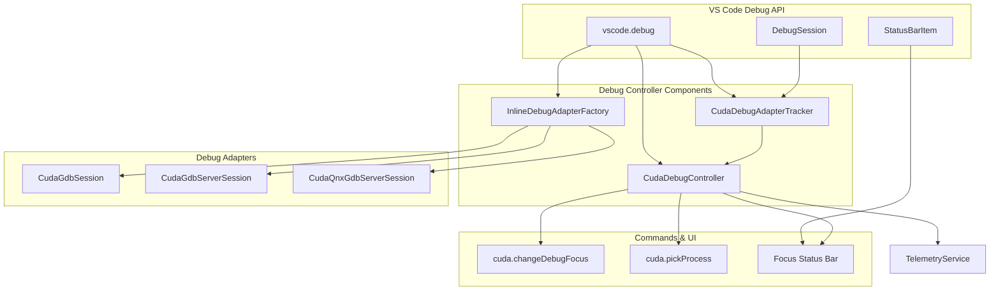
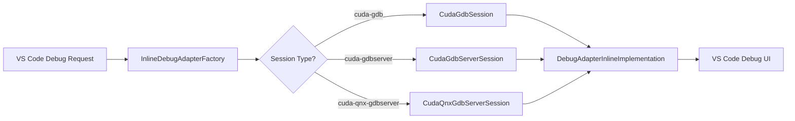
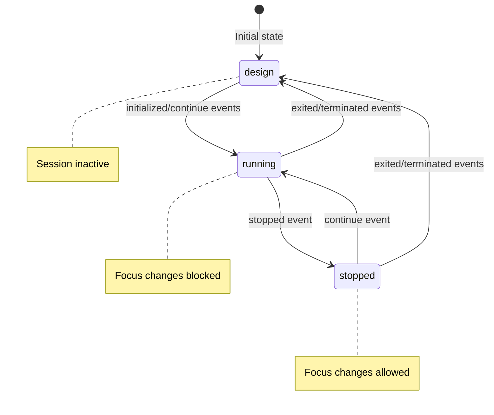
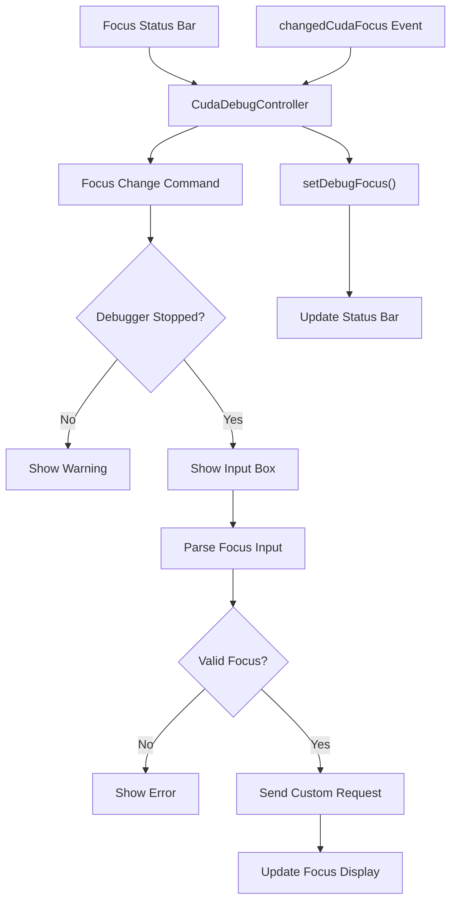
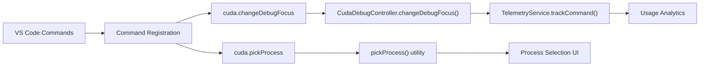
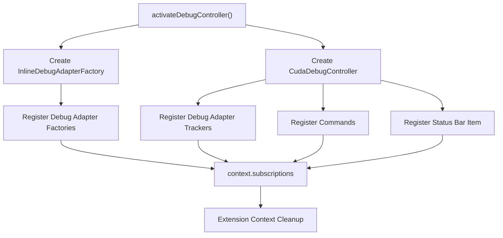

<!-- source: DeepWiki mcp.deepwiki.com · repo NVIDIA/nsight-vscode-edition · page 3.2 Debug Controller · fetched 2026-10-26 -->

# Debug Controller

Relevant source files

The following files were used as context for generating this wiki page:

- [src/debugController.ts](src/debugController.ts)

The Debug Controller serves as the primary VS Code integration layer that manages debug session lifecycle, CUDA focus visualization, and command orchestration for the Nsight extension. It coordinates between VS Code's debug API and the CUDA debug adapters, providing UI feedback and handling CUDA-specific debugging commands.

For information about the underlying debug sessions and adapters, see [Debug Sessions](#3.1). For details about the CUDA protocol extensions, see [CUDA Protocol Extensions](#2.3).

## Overview

The Debug Controller consists of three main components that work together to provide a seamless CUDA debugging experience within VS Code:

**Debug Controller Component Architecture**

Sources: [src/debugController.ts:1-242]()

## Debug Adapter Factory

The `InlineDebugAdapterFactory` class implements VS Code's `DebugAdapterDescriptorFactory` interface to create appropriate debug adapters based on session type:

| Debug Type | Session Class | Purpose |
|------------|---------------|---------|
| `cuda-gdb` | `CudaGdbSession` | Local CUDA debugging |
| `cuda-gdbserver` | `CudaGdbServerSession` | Remote L4T debugging |
| `cuda-qnx-gdbserver` | `CudaQnxGdbServerSession` | QNX remote debugging |

The factory uses inline debug adapter implementation, meaning the debug adapters run within the extension host process rather than as separate executables.

**Debug Adapter Factory Flow**

Sources: [src/debugController.ts:33-47]()

## Debug Session Tracking

The `CudaDebugAdapterTracker` monitors debug adapter protocol messages and manages debugger state transitions:

**Debugger Mode State Machine**

The tracker handles several types of events:

- **Lifecycle Events**: `initialized`, `stopped`, `continue`, `exited`, `terminated`
- **CUDA Events**: `changedCudaFocus`, `systemInfo`
- **Error Handling**: Telemetry tracking for errors and exits

Sources: [src/debugController.ts:55-133](), [src/debugController.ts:49-53]()

## CUDA Focus Management

The Debug Controller provides visual feedback for CUDA thread/block focus through a status bar item and handles focus change commands:

**CUDA Focus Management Flow**

The focus management includes:

- **Status Bar Integration**: Shows current CUDA focus with command `cuda.changeDebugFocus`
- **Input Validation**: Parses user input using `utils.parseCudaSwFocus()`
- **Protocol Communication**: Sends `CudaDebugProtocol.Request.changeCudaFocus` to debug adapter
- **State Enforcement**: Only allows focus changes when debugger is stopped

Sources: [src/debugController.ts:167-221](), [src/debugController.ts:136-157]()

## Command Integration

The Debug Controller registers two primary commands with VS Code:

| Command | Function | Purpose |
|---------|----------|---------|
| `cuda.changeDebugFocus` | `changeDebugFocus()` | Interactive CUDA focus switching |
| `cuda.pickProcess` | `pickProcess()` | Process attachment for debugging |

The commands integrate with VS Code's command palette and provide telemetry tracking for usage analytics.

**Command Registration and Telemetry Flow**

Sources: [src/debugController.ts:235-236](), [src/debugController.ts:172-207]()

## Lifecycle Management

The activation function `activateDebugController()` orchestrates the registration of all debug controller components with VS Code:

**Registration Sequence:**
1. Debug adapter descriptor factories for all three debug types
2. Debug adapter tracker factories for session monitoring  
3. The debug controller itself as a disposable resource
4. Command handlers for CUDA-specific operations

The debug controller implements proper cleanup through the `vscode.Disposable` interface, ensuring resources are released when the extension deactivates.

**Debug Controller Activation and Registration**

Sources: [src/debugController.ts:223-238](), [src/debugController.ts:159-161]()

---

