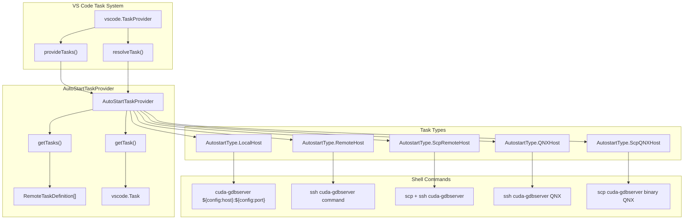
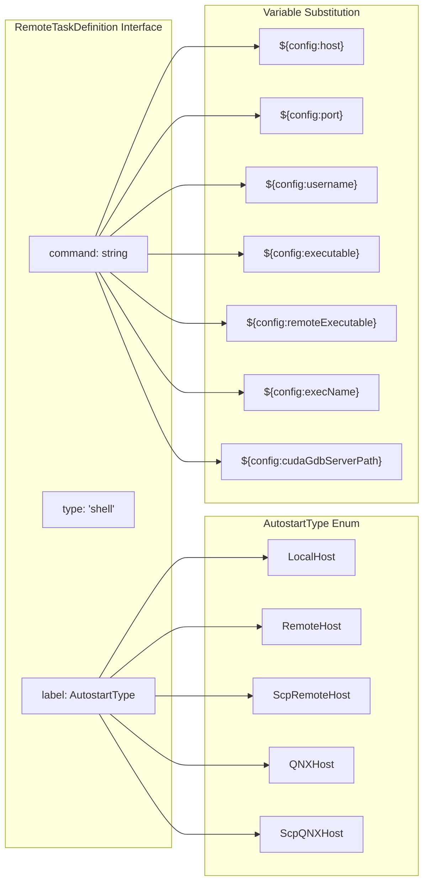
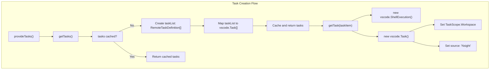
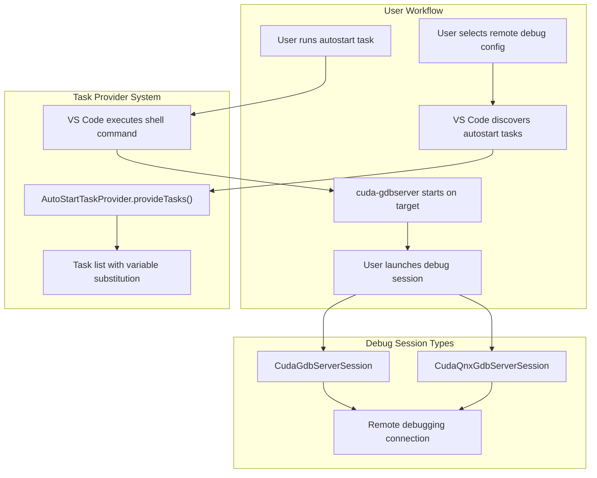

<!-- source: DeepWiki mcp.deepwiki.com · repo NVIDIA/nsight-vscode-edition · page 3.3 Task Providers · fetched 2026-10-26 -->

# Task Providers

Relevant source files

The following files were used as context for generating this wiki page:

- [src/autoStartTaskProvider.ts](src/autoStartTaskProvider.ts)
- [src/debugger/cudaGdbServerSession.ts](src/debugger/cudaGdbServerSession.ts)
- [src/debugger/cudaQnxGdbServerSession.ts](src/debugger/cudaQnxGdbServerSession.ts)
- [src/debugger/processList.ts](src/debugger/processList.ts)
- [src/test/launchArguments.test.ts](src/test/launchArguments.test.ts)
- [src/test/testPrograms/launchEnvVars/launchEnvVars.cpp](src/test/testPrograms/launchEnvVars/launchEnvVars.cpp)
- [src/test/testPrograms/launchEnvVars/launchEnvVars.txt](src/test/testPrograms/launchEnvVars/launchEnvVars.txt)

This document covers the task provider system in Nsight Visual Studio Code Edition, specifically the `AutoStartTaskProvider` class that manages automated startup tasks for remote CUDA debugging scenarios. Task providers enable users to automatically start cuda-gdbserver processes on local and remote hosts before beginning debug sessions.

For information about the core debug session management, see [Debug Sessions](#3.1). For details about the debug controller that orchestrates VS Code integration, see [Debug Controller](#3.2).

## Overview

The task provider system implements VS Code's `TaskProvider` interface to offer pre-configured shell commands that prepare remote debugging environments. The primary implementation is the `AutoStartTaskProvider` class, which provides shell tasks for starting cuda-gdbserver on various target platforms including localhost, remote Linux hosts, and QNX systems.

**Task Provider Architecture**

Sources: [src/autoStartTaskProvider.ts:1-70]()

## Task Types and Definitions

The `AutoStartTaskProvider` supports five distinct autostart scenarios, each defined by the `AutostartType` enum and corresponding `RemoteTaskDefinition` objects.

| Task Type | Purpose | Command Pattern |
|-----------|---------|-----------------|
| `LocalHost` | Start cuda-gdbserver locally | `cuda-gdbserver ${config:host}:${config:port} ${config:executable}` |
| `RemoteHost` | Start cuda-gdbserver on remote host | `ssh ${config:username}@${config:host} "cuda-gdbserver ..."` |
| `ScpRemoteHost` | Copy executable and start cuda-gdbserver remotely | `scp ... && ssh ... cuda-gdbserver` |
| `QNXHost` | Start cuda-gdbserver on QNX system | `ssh ${config:username}@${config:host} ${config:cudaGdbServerPath}` |
| `ScpQNXHost` | Copy cuda-gdbserver binary to QNX and start | `scp cuda-gdbserver ... && ssh ... /tmp/cuda-gdbserver` |

**Task Definition Structure**

Sources: [src/autoStartTaskProvider.ts:3-9](), [src/autoStartTaskProvider.ts:11-15](), [src/autoStartTaskProvider.ts:42-52]()

## Task Provider Implementation

The `AutoStartTaskProvider` class implements the VS Code `TaskProvider` interface with two main methods: `provideTasks()` and `resolveTask()`.

### Task Provision

The `provideTasks()` method returns all available autostart tasks by calling the internal `getTasks()` method. Tasks are created once and cached in the `tasks` member variable for subsequent calls.

Sources: [src/autoStartTaskProvider.ts:22-24](), [src/autoStartTaskProvider.ts:36-58](), [src/autoStartTaskProvider.ts:61-68]()

### Task Resolution

The `resolveTask()` method handles task resolution for tasks that may be stored in VS Code's task configurations. It extracts the label from the task definition and calls `getTask()` to create a properly configured task instance.

### Shell Execution Configuration

Each task is configured as a `vscode.ShellExecution` with variable substitution support. The task definition's command property is preserved on the task object to ensure proper execution by VS Code's task system.

Sources: [src/autoStartTaskProvider.ts:26-34](), [src/autoStartTaskProvider.ts:62-66]()

## Integration with Debug Sessions

The task provider system integrates with the broader debugging architecture by providing automated setup for remote debugging scenarios. The tasks created by `AutoStartTaskProvider` are designed to work with the debug session types implemented in the codebase.

**Debug Session Integration Flow**

Sources: [src/autoStartTaskProvider.ts:1-70](), [src/debugger/cudaGdbServerSession.ts:67-152](), [src/debugger/cudaQnxGdbServerSession.ts:27-113]()

## Variable Substitution and Configuration

The task commands rely heavily on VS Code's variable substitution system, using placeholders like `${config:host}`, `${config:port}`, and `${config:username}` that are resolved from the debug configuration at execution time. This allows the same task definitions to work across different debugging scenarios by dynamically substituting the appropriate values.

The `execName` variable is used specifically for scenarios where the executable basename is needed separately from the full executable path, particularly useful in SCP-based remote execution tasks.

Sources: [src/autoStartTaskProvider.ts:41-53]()

---

