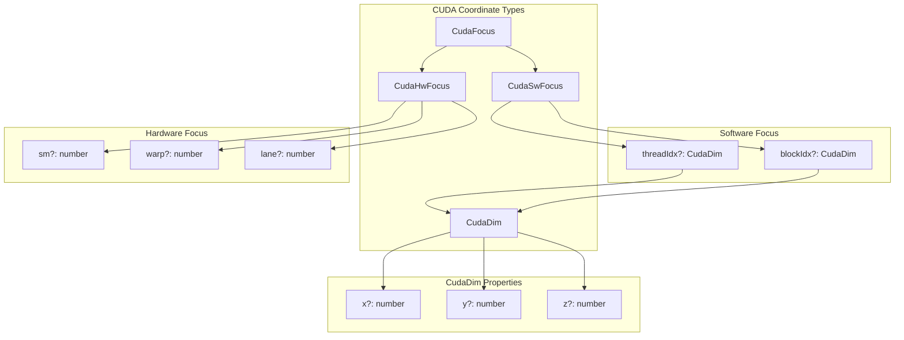
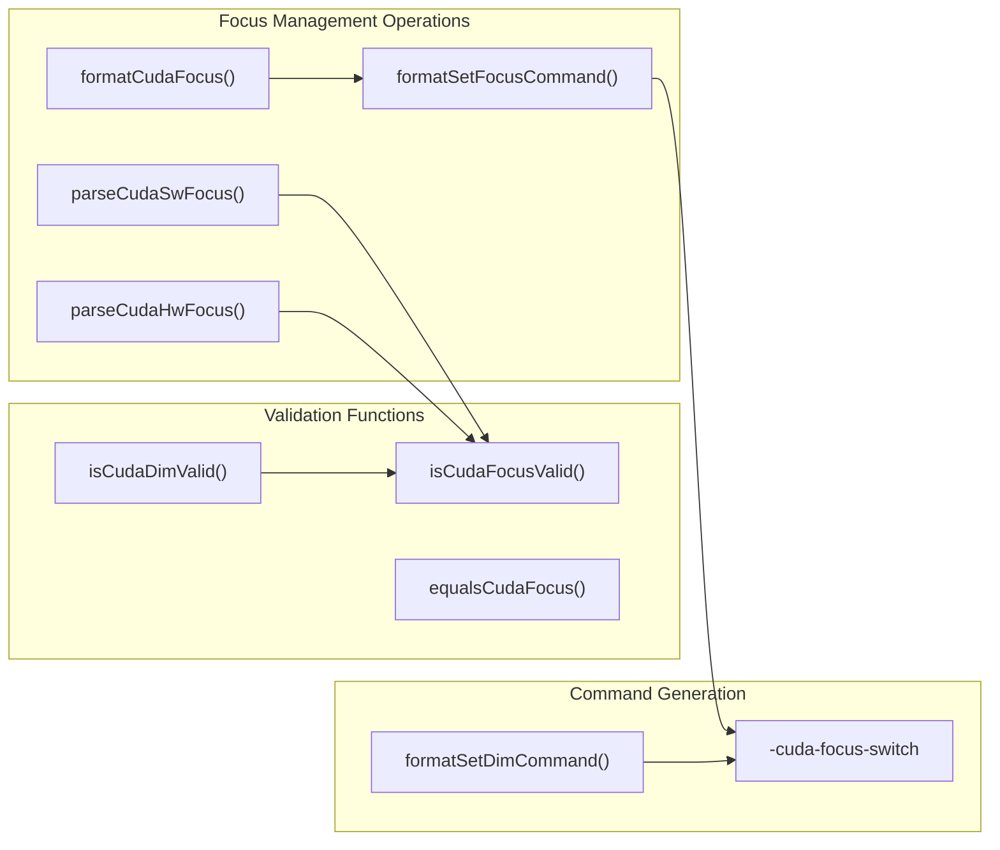
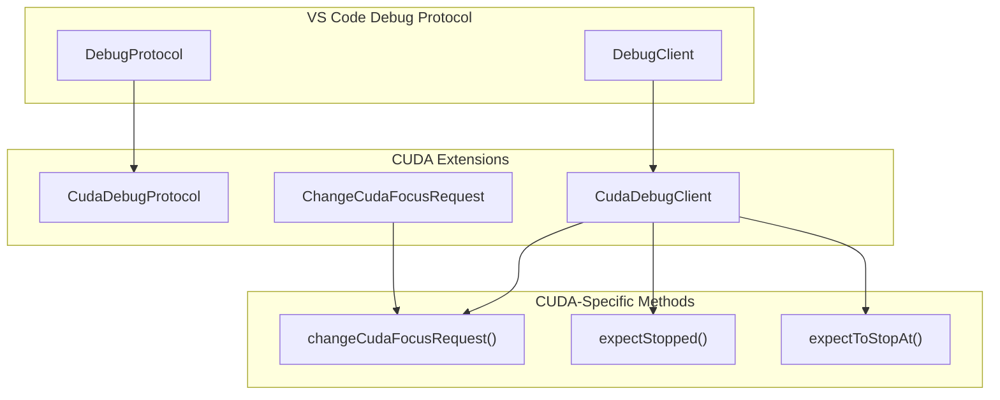
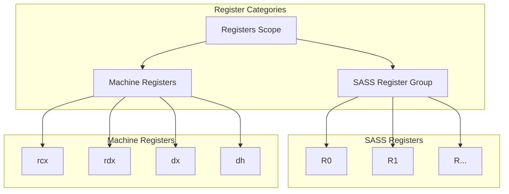
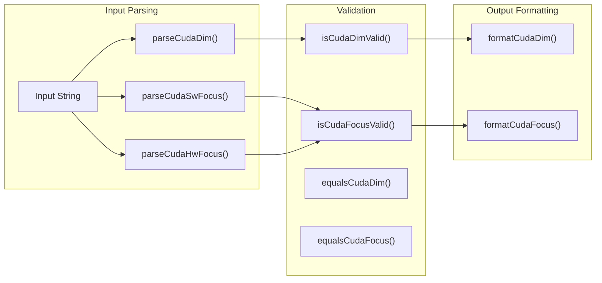
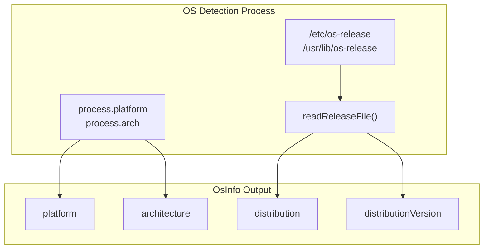

<!-- source: DeepWiki mcp.deepwiki.com · repo NVIDIA/nsight-vscode-edition · page 4 CUDA Features · fetched 2026-10-26 -->

# CUDA Features

Relevant source files

The following files were used as context for generating this wiki page:

- [README.md](README.md)
- [nsight-128.png](nsight-128.png)
- [src/debugger/types.ts](src/debugger/types.ts)
- [src/debugger/utils.ts](src/debugger/utils.ts)
- [src/test/cudaDebugClient.ts](src/test/cudaDebugClient.ts)
- [src/test/registers.test.ts](src/test/registers.test.ts)

This document covers the CUDA-specific debugging capabilities and data structures implemented in the Nsight Visual Studio Code Extension. These features extend the standard VS Code debugging experience to support GPU kernel debugging, thread/block navigation, and CUDA-specific state inspection.

For general debug session management, see [Debug Sessions](#3.1). For overall architecture details, see [Architecture](#2).

## CUDA Data Types and Coordinate Systems

The extension defines several core data types to represent CUDA execution contexts and coordinate systems. These types enable precise navigation and identification of GPU threads, blocks, and hardware units.

### Core Data Structures

The `CudaDim` interface represents three-dimensional CUDA coordinates used throughout the GPU execution model:

Sources: [src/debugger/types.ts:12-31]()

### System Information Collection

The extension collects comprehensive system information to support debugging across different platforms and GPU configurations:

| Data Type | Properties | Purpose |
|-----------|------------|---------|
| `OsInfo` | platform, architecture, distribution, distributionVersion | Host system identification |
| `GpuInfo` | current, name, description, smType | GPU hardware details |
| `SystemInfo` | os, gpus[] | Complete system configuration |

Sources: [src/debugger/types.ts:33-58]()

## Focus Management System

The CUDA focus management system allows debuggers to switch between different execution contexts within GPU kernels. This system supports both software-level (block/thread) and hardware-level (SM/warp/lane) coordinate systems.

### Focus Types and Operations

Sources: [src/debugger/utils.ts:28-290]()

### Focus Command Generation

The extension generates GDB commands to switch CUDA focus using the `formatSetFocusCommand()` function. Software focus commands target specific block and thread coordinates:

- Block coordinates: `block (x, y, z)`
- Thread coordinates: `thread (x, y, z)`
- Hardware coordinates: `sm N warp N lane N`

The complete command format is `-cuda-focus-switch [block (x,y,z)] [thread (x,y,z)]` for software focus or `-cuda-focus-switch [sm N] [warp N] [lane N]` for hardware focus.

Sources: [src/debugger/utils.ts:262-290]()

## Debug Protocol Extensions

The extension extends the VS Code Debug Adapter Protocol with CUDA-specific capabilities through the `CudaDebugProtocol` namespace and specialized debug client implementations.

### Protocol Extension Architecture

Sources: [src/test/cudaDebugClient.ts:25-90](), [src/debugger/cudaDebugProtocol.ts]()

The `CudaDebugClient` class extends the standard `DebugClient` with CUDA-specific capabilities, including focus change requests and enhanced stopping location verification for GPU kernel breakpoints.

## GPU State Inspection

The extension provides comprehensive GPU state inspection capabilities, including register access, variable viewing, and execution context analysis.

### Register Access and Inspection

The extension supports inspection of both GPU-specific SASS registers and standard machine registers during debugging sessions:

Sources: [src/test/registers.test.ts:15-121]()

### Breakpoint and Execution Control

The extension supports CUDA kernel breakpoint management with thread-specific stopping behavior. When a breakpoint is hit in GPU code, the debugger can stop on any thread that encounters the breakpoint condition.

Key capabilities include:
- Setting breakpoints in `.cu` kernel files
- Conditional breakpoint support with expression evaluation
- Thread-specific execution control (step over, step into, step out)
- Stack frame inspection for GPU threads

Sources: [src/test/registers.test.ts:19-32](), [src/test/cudaDebugClient.ts:40-89]()

## Coordinate Parsing and Validation

The extension includes comprehensive parsing and validation utilities for CUDA coordinates and focus specifications.

### Parsing Capabilities

Sources: [src/debugger/utils.ts:72-241]()

The parsing system supports flexible coordinate input formats:
- Parenthetical notation: `(x, y, z)`
- Named coordinates: `block (x, y, z) thread (x, y, z)`
- Hardware specifications: `sm 0 warp 1 lane 15`
- Partial coordinate specifications with undefined values

## System Information Collection

The extension automatically collects system information for telemetry and debugging context, including operating system details and GPU hardware configuration.

### OS Information Detection

The `readOsInfo()` function reads Linux distribution information from standard release files and combines it with Node.js platform detection:

Sources: [src/debugger/utils.ts:322-349]()

The system information is used for:
- Platform-specific debugging behavior
- Telemetry and analytics collection
- Remote debugging compatibility checks
- GPU driver and toolkit version validation

---

