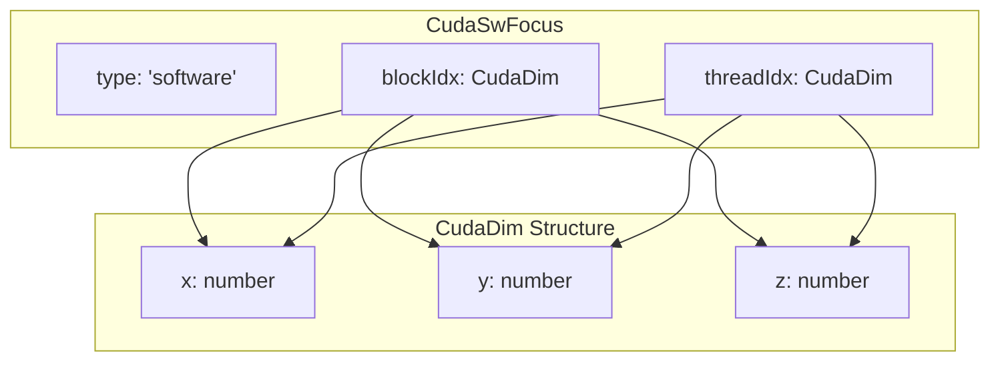
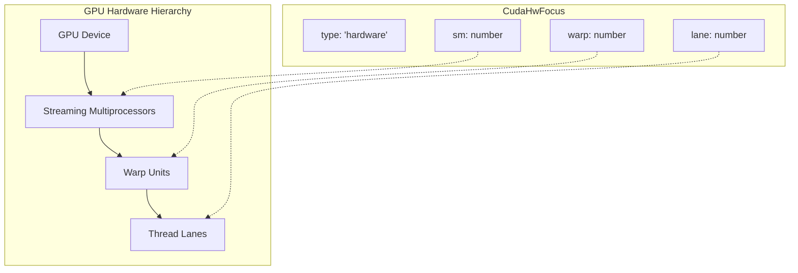
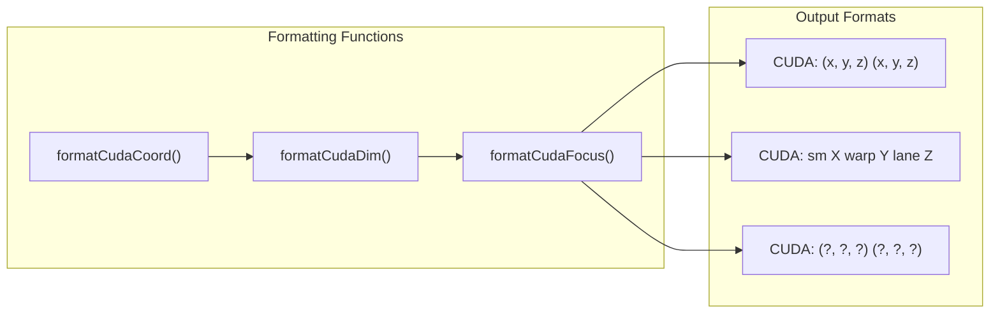
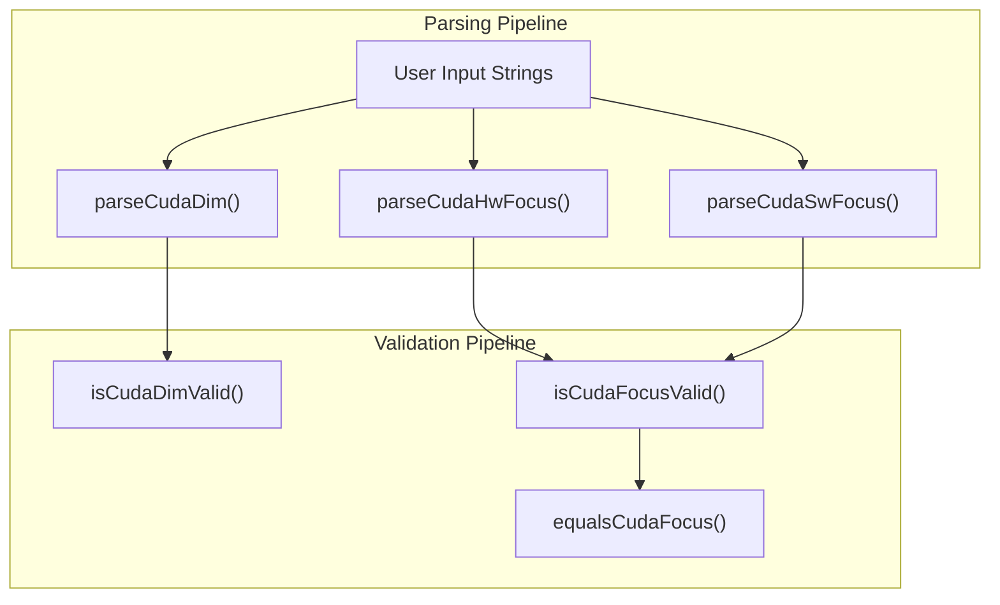
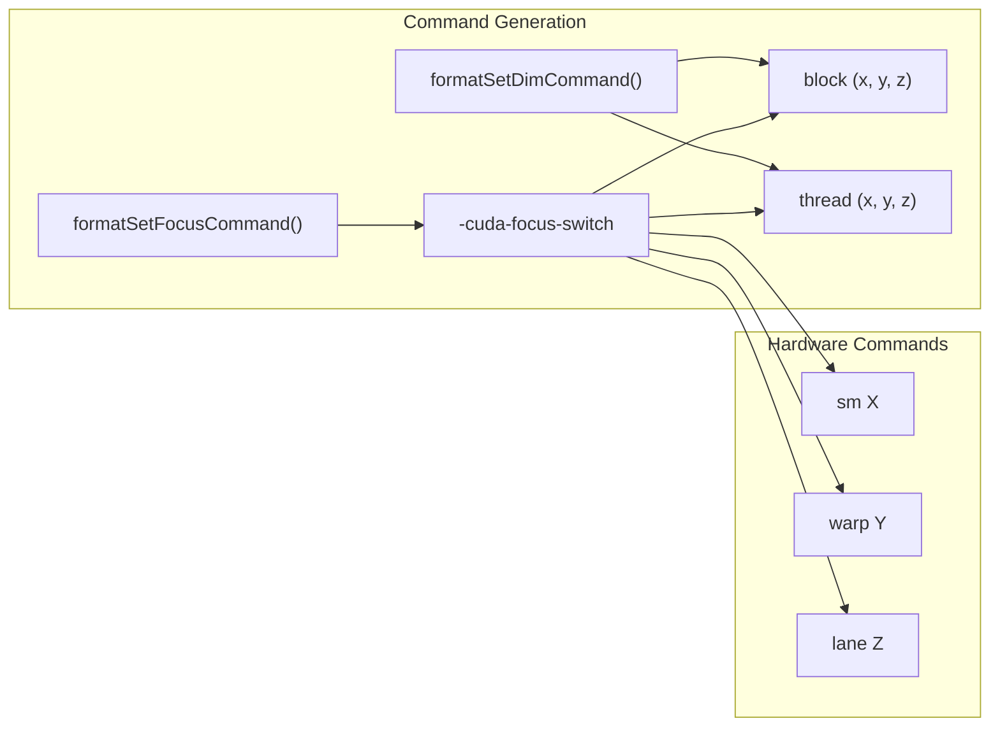
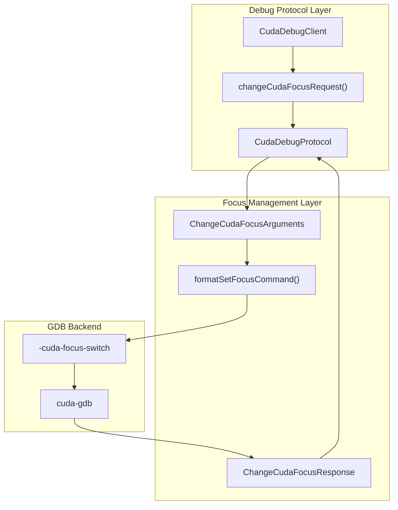

<!-- source: DeepWiki mcp.deepwiki.com · repo NVIDIA/nsight-vscode-edition · page 4.1 Focus Management · fetched 2026-10-26 -->

# Focus Management

Relevant source files

The following files were used as context for generating this wiki page:

- [README.md](README.md)
- [nsight-128.png](nsight-128.png)
- [src/debugger/types.ts](src/debugger/types.ts)
- [src/debugger/utils.ts](src/debugger/utils.ts)
- [src/test/cudaDebugClient.ts](src/test/cudaDebugClient.ts)
- [src/test/registers.test.ts](src/test/registers.test.ts)

This document describes the CUDA focus management system in Nsight Visual Studio Code Edition, which allows developers to switch the debugger's focus between different GPU execution contexts during debugging. The system provides both software-level (block/thread) and hardware-level (SM/warp/lane) coordinate systems for navigating GPU execution hierarchies.

For information about the broader debug protocol integration, see [CUDA Protocol Extensions](#2.3). For details about CUDA-specific data types, see [Data Types](#4.2).

## Overview

CUDA focus management enables developers to inspect different GPU execution contexts while debugging kernel code. The system supports two coordinate systems:

- **Software Focus**: Uses CUDA's logical grid organization (block and thread indices)
- **Hardware Focus**: Uses physical GPU hardware organization (streaming multiprocessor, warp, and lane)

This functionality is essential for debugging parallel GPU code where thousands of threads may be executing simultaneously, allowing developers to examine specific execution contexts and their associated variables, registers, and call stacks.

## Focus Coordinate Systems

### Software Focus Coordinates

Software focus uses CUDA's logical execution model with 3D block and thread coordinates:

**Sources:** [src/debugger/types.ts:18-22](), [src/debugger/types.ts:12-16]()

### Hardware Focus Coordinates

Hardware focus maps to the physical GPU architecture:

**Sources:** [src/debugger/types.ts:24-29]()

## Core Implementation

### Focus Data Types

The focus management system uses a union type to represent both coordinate systems:

| Type | Purpose | Key Fields |
|------|---------|------------|
| `CudaDim` | 3D coordinates | `x`, `y`, `z` (optional numbers) |
| `CudaSwFocus` | Software focus | `type: 'software'`, `blockIdx`, `threadIdx` |
| `CudaHwFocus` | Hardware focus | `type: 'hardware'`, `sm`, `warp`, `lane` |
| `CudaFocus` | Union type | `CudaSwFocus \| CudaHwFocus` |

**Sources:** [src/debugger/types.ts:12-31]()

### Focus Formatting and Display

The system provides comprehensive formatting capabilities for displaying focus information in the UI:

The `formatCudaFocus()` function generates user-friendly display strings with prefixes like "CUDA:" and handles undefined coordinates with "?" placeholders.

**Sources:** [src/debugger/utils.ts:23-70]()

### Focus Parsing and Validation

The system includes robust parsing capabilities to convert user input into focus objects:

Key validation rules:
- At least one coordinate must be defined for valid dimensions
- Software focus requires valid block and thread dimensions
- Hardware focus requires at least one of SM, warp, or lane to be defined

**Sources:** [src/debugger/utils.ts:72-241]()

## GDB Command Generation

The focus management system generates appropriate GDB commands to switch debugging context:

The `formatSetFocusCommand()` function generates GDB Machine Interface commands that instruct `cuda-gdb` to switch the debugging context to the specified coordinates.

**Sources:** [src/debugger/utils.ts:243-290]()

## Debug Protocol Integration

Focus management integrates with the VS Code Debug Adapter Protocol through specialized request handlers:

The `changeCudaFocusRequest()` method in `CudaDebugClient` provides the interface for programmatically changing focus during debug sessions.

**Sources:** [src/test/cudaDebugClient.ts:36-38]()

## Usage in Debugging Workflow

Focus management enables several key debugging scenarios:

1. **Thread-specific Variable Inspection**: Switch focus to examine variables in specific GPU threads
2. **Breakpoint Context Switching**: Navigate between different execution contexts when breakpoints are hit
3. **Hardware-level Debugging**: Inspect low-level GPU execution state using SM/warp/lane coordinates
4. **Parallel Execution Analysis**: Compare state across multiple threads or blocks

The system automatically formats focus information for display in the VS Code status bar and debug views, providing developers with clear visibility into their current debugging context within the GPU execution hierarchy.

**Sources:** [README.md:53-55]()

---

