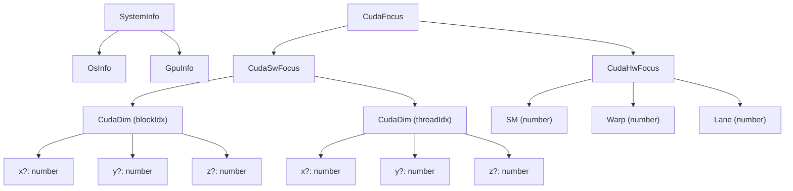
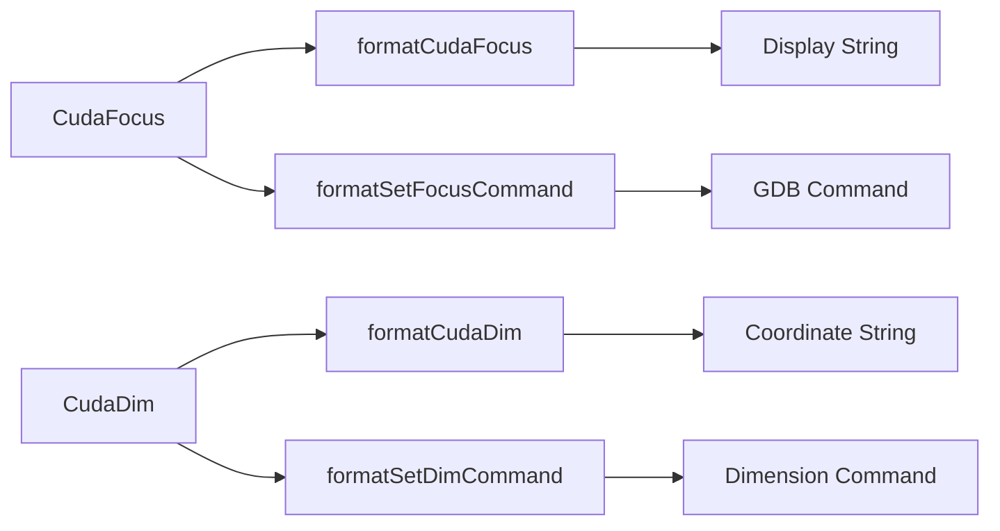
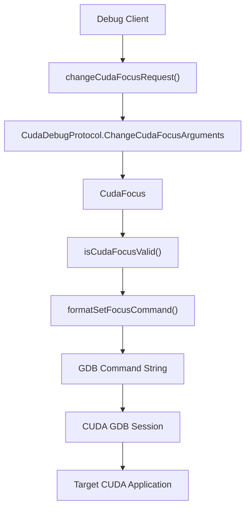
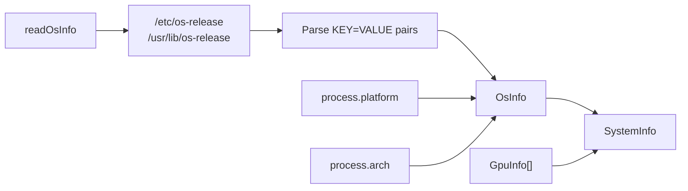
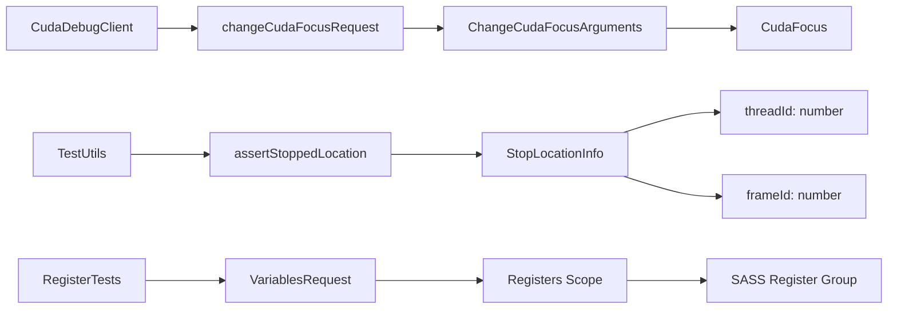

<!-- source: DeepWiki mcp.deepwiki.com · repo NVIDIA/nsight-vscode-edition · page 4.2 Data Types · fetched 2026-10-26 -->

# Data Types

<details>
<summary>Relevant source files</summary>

The following files were used as context for generating this wiki page:

- [README.md](README.md)
- [nsight-128.png](nsight-128.png)
- [src/debugger/types.ts](src/debugger/types.ts)
- [src/debugger/utils.ts](src/debugger/utils.ts)
- [src/test/cudaDebugClient.ts](src/test/cudaDebugClient.ts)
- [src/test/registers.test.ts](src/test/registers.test.ts)

</details>


This document covers the CUDA-specific data types and utility functions used throughout the Nsight Visual Studio Code Extension for representing GPU debugging state, coordinate systems, and system information. These types form the foundation for CUDA focus management, thread/block navigation, and hardware abstraction.

For information about how these data types are used in debugging sessions, see [Focus Management](#4.1). For details about remote debugging protocols that utilize these types, see [Remote Debugging](#4.3).

## Core CUDA Types

### CudaDim

The `CudaDim` interface represents 3-dimensional coordinates used throughout CUDA programming for indexing blocks, threads, and grid dimensions.

```typescript
interface CudaDim {
    x?: number;
    y?: number;
    z?: number;
}
```

This type supports optional coordinates, allowing partial specification of dimensions. The `CudaDim` is used extensively for representing:
- Block indices (`blockIdx`)
- Thread indices (`threadIdx`) 
- Grid and block dimensions

**Sources:** [src/debugger/types.ts:12-16]()

### CUDA Focus Types

The extension supports two distinct coordinate systems for focusing on specific CUDA execution contexts:

#### CudaSwFocus (Software Focus)

```typescript
interface CudaSwFocus {
    type: 'software';
    blockIdx?: CudaDim;
    threadIdx?: CudaDim;
}
```

Software focus uses the logical CUDA programming model coordinates that developers write in their kernels.

**Sources:** [src/debugger/types.ts:18-22]()

#### CudaHwFocus (Hardware Focus) 

```typescript
interface CudaHwFocus {
    type: 'hardware';
    sm?: number;
    warp?: number;
    lane?: number;
}
```

Hardware focus uses the physical GPU execution model with streaming multiprocessors (SM), warps, and lanes.

**Sources:** [src/debugger/types.ts:24-29]()

#### CudaFocus Union Type

```typescript
type CudaFocus = CudaSwFocus | CudaHwFocus;
```

The `CudaFocus` type provides a discriminated union allowing the debugger to work with either coordinate system seamlessly.

**Sources:** [src/debugger/types.ts:31]()

## System Information Types

### OsInfo

```typescript
interface OsInfo {
    platform?: string;
    architecture?: string;
    distribution?: string;
    distributionVersion?: string;
}
```

Contains operating system metadata collected during debugging sessions, particularly important for remote debugging scenarios.

**Sources:** [src/debugger/types.ts:33-41]()

### GpuInfo

```typescript
interface GpuInfo {
    current?: string;
    name?: string;
    description?: string;
    smType?: string;
}
```

Represents GPU device information, where the `current` field contains a "*" character for the currently active device.

**Sources:** [src/debugger/types.ts:43-52]()

### SystemInfo

```typescript
interface SystemInfo {
    os?: OsInfo;
    gpus?: GpuInfo[];
}
```

Aggregates system information combining OS and GPU details for telemetry and debugging context.

**Sources:** [src/debugger/types.ts:54-58]()

## Type Relationships



**Sources:** [src/debugger/types.ts:12-58]()

## Utility Functions

### Formatting Functions

The extension provides comprehensive formatting utilities for converting CUDA data types to human-readable strings:

| Function | Purpose | Return Format |
|----------|---------|---------------|
| `formatCudaDim()` | Format 3D coordinates | `"(x, y, z)"` |
| `formatCudaFocus()` | Format focus information | `"CUDA: (block) (thread)"` or `"CUDA: sm X warp Y lane Z"` |
| `formatSetFocusCommand()` | Generate GDB focus command | `"-cuda-focus-switch block (x,y,z) thread (x,y,z)"` |



**Sources:** [src/debugger/utils.ts:28-35](), [src/debugger/utils.ts:38-70](), [src/debugger/utils.ts:262-290]()

### Parsing Functions

The extension includes parsers for converting string representations back to typed objects:

| Function | Input Format | Purpose |
|----------|--------------|---------|
| `parseCudaDim()` | `"(x,y,z)"` or `"name (x,y,z)"` | Parse coordinate strings |
| `parseCudaSwFocus()` | `"block (x,y,z) thread (x,y,z)"` | Parse software focus |
| `parseCudaHwFocus()` | `"sm X warp Y lane Z"` | Parse hardware focus |

**Sources:** [src/debugger/utils.ts:72-105](), [src/debugger/utils.ts:141-156](), [src/debugger/utils.ts:123-139]()

### Validation Functions

Type validation ensures data integrity throughout the debugging workflow:

| Function | Purpose | Validation Logic |
|----------|---------|------------------|
| `isCudaDimValid()` | Check if dimension has valid coordinates | At least one coordinate defined |
| `isCudaFocusValid()` | Check if focus is properly formed | Valid block/thread or SM/warp/lane |
| `equalsCudaDim()` | Compare two dimensions | All coordinates match |
| `equalsCudaFocus()` | Compare two focus objects | Type and coordinates match |

**Sources:** [src/debugger/utils.ts:198-241](), [src/debugger/utils.ts:158-196]()

## Usage in Debug Protocol



**Sources:** [src/test/cudaDebugClient.ts:36-38](), [src/debugger/utils.ts:262-290]()

## System Information Collection

The extension dynamically collects system information for telemetry and debugging context:



The `readOsInfo()` function reads Linux distribution information from standard release files and combines it with Node.js process information.

**Sources:** [src/debugger/utils.ts:322-349]()

## Testing Integration

The data types are extensively tested through the debugging framework:



**Sources:** [src/test/cudaDebugClient.ts:20-38](), [src/test/registers.test.ts:15-121]()

---

