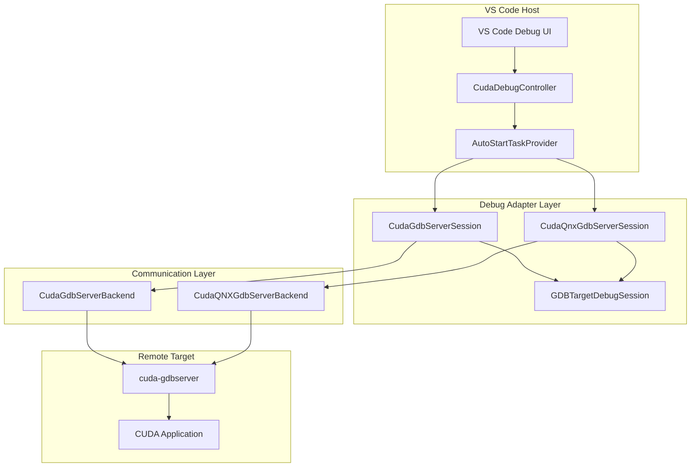
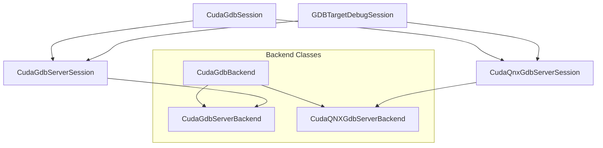
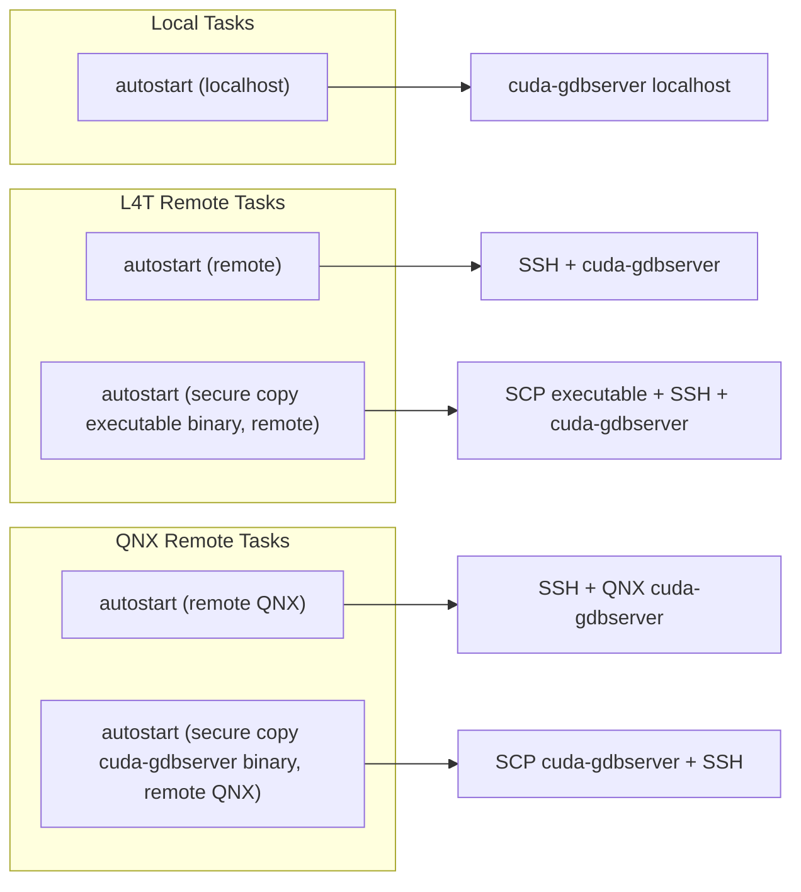
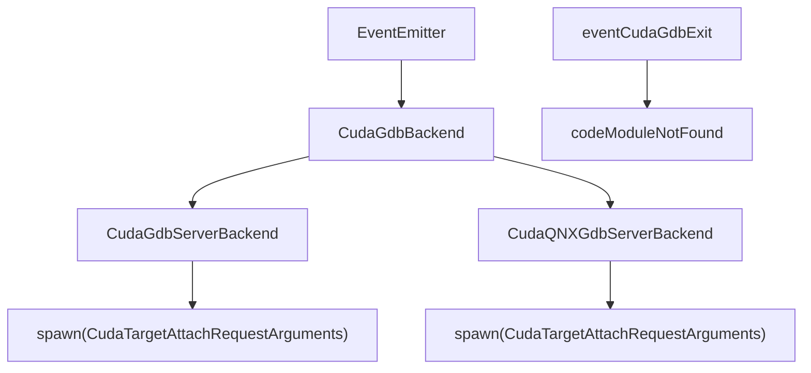

<!-- source: DeepWiki mcp.deepwiki.com · repo NVIDIA/nsight-vscode-edition · page 4.3 Remote Debugging · fetched 2026-10-26 -->

# Remote Debugging

<details>
<summary>Relevant source files</summary>

The following files were used as context for generating this wiki page:

- [CHANGELOG.md](CHANGELOG.md)
- [src/autoStartTaskProvider.ts](src/autoStartTaskProvider.ts)
- [src/debugger/cudaGdbServerSession.ts](src/debugger/cudaGdbServerSession.ts)
- [src/debugger/cudaQnxGdbServerSession.ts](src/debugger/cudaQnxGdbServerSession.ts)

</details>


This document covers the remote debugging capabilities of Nsight Visual Studio Code Edition, which enable debugging CUDA applications running on remote systems via `cuda-gdbserver`. This includes support for L4T (Linux for Tegra) and QNX platforms, autostart task automation, and the underlying session management architecture.

For information about local debugging sessions, see [Debug Sessions](#3.1). For focus management within remote debugging sessions, see [Focus Management](#4.1).

## Overview

Remote debugging allows developers to debug CUDA applications running on target devices from a host development machine. The extension supports two primary remote platforms:

- **L4T (Linux for Tegra)**: NVIDIA's Linux distribution for Tegra SoCs
- **QNX**: Real-time operating system for embedded applications

The remote debugging system uses `cuda-gdbserver` on the target device to communicate with `cuda-gdb` running on the host machine through the VS Code debug adapter protocol.

## Remote Debugging Architecture

The remote debugging system consists of several interconnected components that manage the communication between the VS Code interface, debug adapters, and remote target systems.

### Component Architecture



Sources: [src/debugger/cudaGdbServerSession.ts:67-152](), [src/debugger/cudaQnxGdbServerSession.ts:27-113](), [src/autoStartTaskProvider.ts:17-69]()

### Session Type Hierarchy



Sources: [src/debugger/cudaGdbServerSession.ts:61-89](), [src/debugger/cudaQnxGdbServerSession.ts:21-51]()

## Supported Remote Platforms

### L4T (Linux for Tegra) Remote Debugging

L4T remote debugging uses the `CudaGdbServerSession` class to establish connections with `cuda-gdbserver` running on Tegra-based devices. This session type provides standard remote debugging capabilities for NVIDIA's ARM-based platforms.

| Feature | Implementation |
|---------|----------------|
| Session Class | `CudaGdbServerSession` |
| Backend Class | `CudaGdbServerBackend` |
| Target Platform | Linux for Tegra (L4T) |
| Connection Method | SSH + cuda-gdbserver |

### QNX Remote Debugging

QNX remote debugging uses the specialized `CudaQnxGdbServerSession` class designed for real-time embedded systems. This session type includes QNX-specific optimizations and handling.

| Feature | Implementation |
|---------|----------------|
| Session Class | `CudaQnxGdbServerSession` |
| Backend Class | `CudaQNXGdbServerBackend` |
| Target Platform | QNX RTOS |
| Connection Method | SSH + cuda-gdbserver |
| QNX Flag | `isQNX = true` |

Sources: [src/debugger/cudaGdbServerSession.ts:103-135](), [src/debugger/cudaQnxGdbServerSession.ts:65-96]()

## Autostart Task System

The `AutoStartTaskProvider` class provides automated task execution for setting up remote debugging sessions. It defines five distinct autostart task types to handle different remote debugging scenarios.

### Task Types



### Task Command Templates

The autostart tasks use VS Code configuration variables to construct shell commands:

| Task Type | Command Template |
|-----------|------------------|
| `LocalHost` | `cuda-gdbserver ${config:host}:${config:port} ${config:executable}` |
| `RemoteHost` | `ssh ${config:username}@${config:host} "cuda-gdbserver ${config:host}:${config:port} ${config:remoteExecutable}"` |
| `ScpRemoteHost` | `scp ${config:executable} ${config:username}@${config:host}:/tmp && ssh ${config:username}@${config:host} "cuda-gdbserver ${config:host}:${config:port} /tmp/${config:execName}"` |
| `QNXHost` | `ssh ${config:username}@${config:host} ${config:cudaGdbServerPath} ${config:port}` |
| `ScpQNXHost` | `scp ${config:cudaGdbServerPath} ${config:username}@${config:host}:/tmp && ssh ${config:username}@${config:host} /tmp/cuda-gdbserver ${config:port}` |

Sources: [src/autoStartTaskProvider.ts:3-53]()

## Session Implementation Details

### CudaGdbServerSession

The `CudaGdbServerSession` class extends `CudaGdbSession` and integrates with `GDBTargetDebugSession` to provide remote debugging capabilities for L4T platforms.

**Key Methods:**
- `launchRequest()`: Handles launch configuration and validates CUDA GDB path with `isQNX = false`
- `createBackend()`: Creates `CudaGdbServerBackend` instance
- `startGDBServer()`: Placeholder for autostart functionality
- `setBreakPointsRequest()`: Delegates to `GDBTargetDebugSession`

### CudaQnxGdbServerSession

The `CudaQnxGdbServerSession` class provides QNX-specific remote debugging with specialized backend handling.

**Key Differences from Generic Server Session:**
- Sets `isQNX = true` during launch request validation
- Uses `CudaQNXGdbServerBackend` instead of `CudaGdbServerBackend`
- Includes QNX-specific path validation and configuration

### Backend Architecture

Both session types use specialized backend classes that extend `CudaGdbBackend`:



Sources: [src/debugger/cudaGdbServerSession.ts:61-89](), [src/debugger/cudaQnxGdbServerSession.ts:21-51]()

## Configuration Interfaces

### CudaTargetAttachArguments

```typescript
interface CudaTargetAttachArguments {
    type?: string;
    parameters?: string[];
    host?: string;
    port?: string;
    connectCommands?: string[];
}
```

### CudaTargetLaunchArguments

```typescript
interface CudaTargetLaunchArguments extends CudaTargetAttachArguments {
    serverParameters?: string[];
    server?: string;
    serverPortRegExp?: string;
    cwd?: string;
    serverStartupDelay?: number;
}
```

### ImageAndSymbolArguments

```typescript
interface ImageAndSymbolArguments {
    symbolFileName?: string;
    symbolOffset?: string;
    imageFileName?: string;
    imageOffset?: string;
}
```

Sources: [src/debugger/cudaGdbServerSession.ts:20-59]()

## Error Handling and Diagnostics

The remote debugging system includes comprehensive error handling through event emitters and validation:

- **Module Not Found**: Both session types listen for `eventCudaGdbExit` events with `codeModuleNotFound` to handle missing CUDA GDB dependencies
- **Platform Validation**: `validateLinuxPlatform()` ensures compatibility before session initialization  
- **Path Validation**: `validateAndSetCudaGdbPath()` verifies CUDA GDB availability with platform-specific logic

The system sends `OutputEvent` and `TerminatedEvent` messages to inform users of connection failures or missing dependencies.

Sources: [src/debugger/cudaGdbServerSession.ts:80-86](), [src/debugger/cudaQnxGdbServerSession.ts:42-48]()

---

